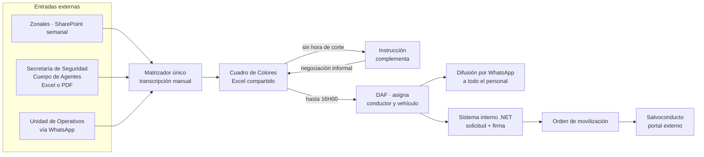

# INFORME EJECUTIVO DE ANÁLISIS FUNCIONAL
## Proyecto: Automatización y Sistematización de los Procesos de la Agencia Metropolitana de Control
### Módulo Transportes / Cuadro de Colores Operativo — Fase 1: Análisis

|                        |                                                                                                      |
| ---------------------- | ---------------------------------------------------------------------------------------------------- |
| **Documento**          | Informe ejecutivo de análisis funcional                                                              |
| **Fase**               | 1 de N — Análisis (sin implementación)                                                               |
| **Estado**             | Emitido para revisión y aprobación del Product Owner                                                 |
| **Fuentes analizadas** | 8 transcripciones, 1 libro Excel, 2 PDF operativos, 1 imagen de propuesta, 2 proyectos de referencia |
| **Naturaleza**         | Análisis de hallazgos. **No constituye especificación técnica ni documento de requerimientos.**      |

---

## 1. RESUMEN EJECUTIVO

El análisis de las fuentes disponibles confirma que la Agencia Metropolitana de Control opera hoy su planificación diaria sobre un artefacto ofimático —el llamado *cuadro de colores*— que concentra simultáneamente cuatro funciones incompatibles entre sí: es borrador de trabajo, es canal de coordinación entre direcciones, es respaldo documental y es la fuente de la que se derivan las órdenes de servicio del personal en territorio. Ninguna de esas cuatro funciones cuenta hoy con control de acceso, trazabilidad ni horario de corte. El resultado es un proceso que depende críticamente de una persona, que produce errores de asignación con consecuencias físicas sobre los funcionarios y que expone información sensible por un canal informal.

El hallazgo de mayor peso funcional es que **el cuadro de colores no es una herramienta de planificación, sino un compilado diario**. La planificación real vive en otros artefactos —el SharePoint semanal de las administraciones zonales, los Excel y PDF que remiten Secretaría de Seguridad y Cuerpo de Agentes, y el sistema interno de trámites— y el cuadro únicamente responde a la pregunta de dónde estará movilizado cada funcionario al día siguiente. Esta distinción, expresada literalmente por la Product Owner (*"este cuadro solo me sirve para el 30 de julio... estos son cuadros diarios"*), reordena por completo el modelo de datos y debe quedar validada antes de avanzar, porque condiciona todo lo demás.

El segundo hallazgo estructural es que el cuadro se comporta como **nueve unidades autónomas** y no como una tabla única. Cada bloque tiene departamento dueño, personal propio, catálogos propios de puntos de encuentro, tipos de control e instituciones participantes, y política propia respecto al uso de vehículo. La Product Owner fue explícita: *"cada bloque corresponde a un personal asignado, un conductor asignado, un vehículo asignado, diferente"*. Esto convierte al control de acceso en una regla de negocio de primer orden, no en un detalle de presentación.

Finalmente, el análisis identificó **once inconsistencias entre fuentes** —de las cuales cuatro son bloqueantes— y **veintitrés vacíos de información** que requieren validación explícita. Se recomienda no iniciar la Fase 2 hasta resolver los cuatro puntos bloqueantes de la sección 11.

---

## 2. INVENTARIO Y VALORACIÓN DE FUENTES

| # | Fuente | Tipo | Interlocutor | Aporte principal | Confiabilidad |
|---|---|---|---|---|---|
| F-01 | `AudioProductOwner.txt` | Transcripción | Product Owner (DNP) | Alcance inicial, órdenes de servicio, roles, bloqueos de personal | Alta |
| F-02 | `AudioProductOwner2.txt` | Transcripción | Product Owner (DNP) | Lógica de IDs, bloques, unidad de operativos, hora de corte | Alta |
| F-03 | `AudioDesarrolladorTecnico.txt` | Transcripción | Desarrollador único | **Flujo AS-IS completo de transporte**, sistema interno, órdenes de movilización | Muy alta |
| F-04 | `AudioUsuarioFuncional.txt` | Transcripción | Matrizador (César) | **Operación real del llenado**, puntos fijos, planificación semanal | Muy alta |
| F-05 | `ProductOwner_1.txt` | Transcripción | Product Owner | Ingesta de entidades externas, reglas de descanso, dotación | Muy alta |
| F-06 | `ProductOwner_2.txt` | Transcripción | Product Owner | Catálogos por bloque, horas, zonales múltiples, política de vehículo | Muy alta |
| F-07 | `ProductOwner_3.txt` | Transcripción | Product Owner | **Naturaleza diaria del cuadro**, cierres, órdenes de servicio | Muy alta |
| F-08 | `ProductOwner_4.txt` | Transcripción | Product Owner | Adopción, evidencia de no ingreso, compromisos y fechas | Muy alta |
| F-09 | `CUADRO_DE_COLORES.xlsx` | Libro Excel | — | **Estructura de los 9 bloques con sus colores HEX reales** | Muy alta |
| F-10 | `JULIO_2026_-_SABADO_25.pdf` | Cuadro real | — | Caso real completo: 50+ operativos, personal, conductores, placas | Muy alta |
| F-11 | `Fuentes_de_que_alimentan_Colores.pdf` | Documento | — | Estructura de los 3 Excel de origen | Alta |
| F-12 | `PROPUESTA_FINAL_PO.png` | Imagen | Product Owner | Cabecera unificada de 9 columnas | Alta |
| F-13 | `instruccion-frontend.zip` | Proyecto | — | Arquitectura, convenciones, UI institucional | Referencia |
| F-14 | `instruccion-backend.zip` | Proyecto | — | Arquitectura backend, convenciones | Referencia |

> **Observación sobre F-13 y F-14.** Los proyectos entregados son `instruccion-frontend` e `instruccion-backend`. El enunciado del proyecto se refiere a `transporte-frontend` y `transporte-backend` como estándar oficial. **Se ha trabajado el análisis arquitectónico sobre `instruccion-*` por ser lo efectivamente disponible.** Ver punto bloqueante B-01.

---

## 3. PROCESOS DETECTADOS

Se identificaron **seis procesos** encadenados. Solo el P-03 corresponde al alcance nominal del módulo; los demás lo condicionan.

### P-01 · Planificación semanal de administraciones zonales
Diez líderes zonales cargan su planificación en un libro Excel compartido en SharePoint corporativo. El acceso se bloquea el fin de semana y el martes, de modo que lo cargado queda congelado para la semana siguiente (F-04). El matrizador extrae de ese libro únicamente los campos que el cuadro necesita, descartando el resto: *"el César pobre tiene que estar viendo qué le sirve y qué no le sirve"* (F-08).

### P-02 · Recepción de planificación de entidades externas
Secretaría de Seguridad y Cuerpo de Agentes remiten su programación en Excel o PDF, sin formato normalizado. El matrizador la transcribe manualmente a una hoja intermedia y de ahí al cuadro (F-01, F-04). Es el punto de mayor generación de error por digitación.

### P-03 · Consolidación del cuadro de colores *(alcance nominal del módulo)*
Proceso diario. La secuencia observada es: Inspección inicia el llenado por ser quien más operativos genera → pasa a Instrucción → ambas negocian horarios y vehículos por vía informal → el archivo pasa a la DAF → la DAF asigna conductor y vehículo → se difunde el archivo definitivo por WhatsApp (F-03). No existe hora de corte en ninguna transición.

### P-04 · Asignación de recursos de transporte
La DAF cruza las solicitudes contra sus propios archivos Excel de conductores, vacaciones y permisos. Cuando no hay disponibilidad, se recurre a llamadas telefónicas al personal de descanso (F-03). Es un proceso reactivo: los recursos se asignan después de planificar, no antes.

### P-05 · Formalización documental
Una vez cerrado el cuadro, las áreas requirentes registran la solicitud en el sistema interno (.NET), descargan el PDF, lo firman con firma electrónica y lo vuelven a cargar. Con ese respaldo la DAF genera la orden de movilización; para horarios nocturnos se requiere además un salvoconducto tramitado en un portal externo (F-03). El sistema interno no tiene URL pública: exige presencia física o VPN.

### P-06 · Emisión de órdenes de servicio *(propuesto, no existe hoy)*
Producto esperado del nuevo sistema. Cada funcionario recibiría exclusivamente su asignación, sin visibilidad del resto del cuadro (F-01, F-03).

---

## 4. ACTORES DETECTADOS

| ID | Actor | Unidad | Función en el proceso | Fuente |
|---|---|---|---|---|
| A-01 | Directora DMIP | DMIP | Aprueba el cuadro; por ordenanza la DNP consolida y da el último visto bueno | F-01, F-07 |
| A-02 | Supervisor | AMC | Destinatario de la vista consolidada | F-01 |
| A-03 | Product Owner / Administradora | DNP | Define reglas, administra el sistema interno | F-01 a F-08 |
| A-04 | Matrizador de Operativos (César) | DMIP | Consolidaba el cuadro completo. **Cesó funciones** | F-04, F-05 |
| A-05 | Matrizador de Inspecciones (Bryan) | DMIP | Carga inspecciones técnicas y generales | F-04 |
| A-06 | Gestor de Calidad (Líder) | DMIP | Respaldo del matrizador, mismos accesos | F-01 |
| A-07 | Coordinador Unidad de Operativos (Pablo Osorio) | DMIP | Dirige operativos fijos, PMO y limpiaparabrisas | F-02, F-05 |
| A-08 | Asistente de Operativos (Víctor) | DMIP | Matrizador de la Unidad de Operativos; canal de contacto | F-02, F-08 |
| A-09 | Coordinadora de Inspección | DMIP | Recibe y difunde el cuadro cerrado | F-07 |
| A-10 | Líder Zonal (×10) | DMIT | Planifica su zonal en el SharePoint semanal | F-04, F-08 |
| A-11 | Analista de Transporte | DAF | Asigna conductor y vehículo | F-03, F-06 |
| A-12 | Conductor | DAF | Ejecuta la movilización | F-03, F-06 |
| A-13 | Inspector General (×10) | DMIP | Personal de campo | F-05 |
| A-14 | Inspector Técnico (×10) | DMIP | Personal de campo | F-05 |
| A-15 | Personal CCF/TCC (×5) | DMIP | Personal de campo para trámites específicos | F-05 |
| A-16 | Inspector Notificador | DMIP–Operativos | Personal de campo de la Unidad de Operativos | F-07, F-10 |
| A-17 | Personal de Instrucción | DMIT | Cupo en patrulla nocturna y operativos propios | F-01, F-05 |
| A-18 | Desarrollador único | USIT | Implementa; sostiene el ecosistema completo | F-03 |
| A-19 | Secretaría de Seguridad | Externo | Órgano requirente | F-04 |
| A-20 | Cuerpo de Agentes de Control (CACMQ) | Externo | Órgano requirente | F-04 |
| A-21 | ECU 911 | Externo | Genera alertas que derivan en operativos | F-03, F-10 |

**Dotación declarada:** 10 inspectores generales, 10 inspectores técnicos, 5 CCF (25 rotativos), y aproximadamente 25–26 personas en la Unidad de Operativos, con solo 3 conductores propios para 2 unidades (F-05, F-01).

---

## 5. ROLES Y PERMISOS DETECTADOS

Los permisos se derivan de la propiedad de bloques declarada por la Product Owner en F-02 y F-05, y de la restricción explícita a la DAF en F-06.

| Rol | Escritura | Lectura | Restricciones explícitas | Fuente |
|---|---|---|---|---|
| **DMIP – Operativos** | Bloques 1, 2, 3 | Sus bloques | Personal exclusivo de la Unidad de Operativos | F-02 |
| **DMIP – Inspecciones** | Bloques 4, 5, 6, 8 | Sus bloques | Inspectores generales y técnicos | F-02, F-05 |
| **DMIT – Instrucción** | Bloque 7; cupo en 6 | Sus bloques | *"Solo pueden tener acceso a asignar un personal aquí. Nada más"* | F-01 |
| **DAF – Transportes** | **Únicamente conductor y placa** | Los 9 bloques | *"Ellos no pueden toparme en nada"* | F-06 |
| **Dirección / Supervisor** | Visto bueno final | Matriz completa | Única con vista global | F-01, F-07 |
| **Funcionario de campo** | — | Solo su orden de servicio | *"No sabe con quién va a ir ni qué va a hacer el resto"* | F-01 |
| **Gestor de Calidad** | Igual que matrizador | — | Backup operativo | F-01 |

> **Nota sobre la propiedad del bloque 4 (Patrulla ECU Diurna).** La fuente F-02 lo atribuye a Inspecciones: *"ECU diurna, eso sí va general y técnico, eso sí va llenado por nosotros"*. La directiva de reingeniería recibida posteriormente lo asigna a la rama Operativos. **Contradicción bloqueante B-02.**

---

## 6. ENTRADAS DETECTADAS

| ID | Entrada | Origen | Formato | Periodicidad | Normalizada |
|---|---|---|---|---|---|
| E-01 | Planificación zonal | 10 líderes zonales | Excel en SharePoint, 17 columnas | Semanal, cierre martes | Sí |
| E-02 | Programación de Secretaría de Seguridad | Externo | Excel o PDF, formato libre | Variable | **No** |
| E-03 | Programación de Cuerpo de Agentes | Externo | Excel o PDF, formato libre | Variable | **No** |
| E-04 | Directrices de la Unidad de Operativos | Pablo Osorio | **WhatsApp** | Diaria | **No** |
| E-05 | Planificación de PMO y puntos fijos | Matrizador | Excel, 17 columnas | Semanal | Sí |
| E-06 | Alertas ECU 911 | Externo | Sistema externo | Continua | No |
| E-07 | Base de personal | DMIP | Excel compartido | Mensual (alta rotación) | Parcial |
| E-08 | Base de conductores, vacaciones y permisos | DAF | Excel propio de la DAF | — | **No accesible** |
| E-09 | Trámites y asignaciones | Sistema interno .NET | Base de datos | Continua | Sí |

**Estructura de los tres Excel de origen (F-11):**

| Origen | Columnas | Particularidad |
|---|---|---|
| Secretaría de Seguridad | 15 | Incluye `PROPIEDAD DEL VEHÍCULO`, `MATERIA`, `NOMBRE EVENTO` |
| Zonales | 17 | Incluye `AM/PM`, `SOLICITUD APOYO`, `CHECK`, `SECTOR DE INTERVENCIÓN` |
| PMO y Puntos Fijos | 17 | Incluye `UNIDAD QUE PLANIFICA`, `UNIDADES PARTICIPANTES`, `CATEGORÍA DE CONTROL` |

Las tres estructuras difieren entre sí y ninguna coincide con la cabecera unificada de 9 columnas de la propuesta final (F-12). La normalización es, por tanto, un requisito funcional y no una tarea de migración.

---

## 7. SALIDAS Y DOCUMENTOS DETECTADOS

| ID | Documento | Emisor | Formato | Estado actual | Destinatario |
|---|---|---|---|---|---|
| S-01 | Cuadro de Colores del día | DMIP | Excel → PDF | Existe | Hoy: todo el personal por WhatsApp. Debe pasar a: directores y supervisor |
| S-02 | **Orden de Servicio individual** | Dirección | PDF vertical | **No existe** | Funcionario asignado, aislado |
| S-03 | Solicitud de transporte | Área requirente | PDF firmado electrónicamente | Existe, en sistema .NET | DAF |
| S-04 | **Orden de movilización** | DAF | PDF | Existe, en sistema .NET | Conductor |
| S-05 | **Salvoconducto** | Portal externo | PDF | Existe, sin repositorio | Conductor, horario nocturno |
| S-06 | Acta de advertencia | Unidad de Operativos | Libretín físico (hoja roja) | Existe, en papel | Instrucción |
| S-07 | Estadísticas por unidad | Sistema | — | **No existe** | Coordinadores |

> **Delimitación crítica de alcance.** S-02 (orden de servicio) y S-04 (orden de movilización) son documentos **distintos**, con emisores, destinatarios y fundamentos legales distintos. La orden de servicio indica al funcionario dónde presentarse; la orden de movilización habilita legalmente al conductor a circular y su ausencia acarrea multa de aproximadamente USD 3.000 (F-03). El nombre del proyecto —*Módulo Transportes*— sugiere S-04, mientras que las transcripciones del PO se concentran en S-01 y S-02. **Punto bloqueante B-03.**

---

## 8. REGLAS DE NEGOCIO EXPLÍCITAS

Se documentan únicamente las reglas con respaldo textual verificable.

### 8.1 Temporalidad y ciclo

| ID | Regla | Fuente |
|---|---|---|
| RN-01 | El cuadro de colores es **diario**. Se elabora el día anterior para el día siguiente | F-03, F-07 |
| RN-02 | La operación cubre lunes a domingo, de 08H00 a 24H00 | F-01 |
| RN-03 | No se opera entre las 00H00 y las 08H00, salvo operativo especial | F-01 |
| RN-04 | La planificación zonal se carga en el SharePoint y se bloquea el martes | F-04, F-08 |
| RN-05 | El cuadro debe quedar cerrado y difundido a las 16H30 | F-07 |
| RN-06 | El número de semana se calcula automáticamente y es de solo lectura | F-07 |
| RN-07 | Los horarios se registran únicamente en horas completas y medias horas | F-06 |
| RN-08 | No se registra horario de almuerzo | F-06 |

### 8.2 Identificación

| ID | Regla | Fuente |
|---|---|---|
| RN-09 | El ID de operativo se genera automáticamente; no se digita | F-02 |
| RN-10 | Formato: `SIGLAS + secuencial + día + mes + año` | F-02 |
| RN-11 | Las siglas dependen del bloque y de la dirección o unidad | F-02 |
| RN-12 | El secuencial **se reinicia cada día**, para poder contar operativos por jornada | F-06 |
| RN-13 | Un operativo puede agrupar a varios funcionarios bajo un mismo ID | F-07 |

### 8.3 Estructura por bloques

| ID | Regla | Fuente |
|---|---|---|
| RN-14 | El cuadro se organiza en bloques independientes; cada bloque es un formulario | F-02, F-06 |
| RN-15 | Cada bloque tiene personal, conductor y vehículo propios, sin relación con otros bloques | F-01 |
| RN-16 | Cada bloque despliega sus propios puntos de encuentro, tipos de control e instituciones | F-06 |
| RN-17 | El punto de encuentro depende de la zonal seleccionada | F-06 |
| RN-18 | Las 10 zonales aparecen siempre, sin filtrar por operativo | F-06 |
| RN-19 | Un operativo puede abarcar dos o más zonales si se parte la jornada | F-06 |
| RN-20 | Debe existir la opción `ADICIONALES` con texto libre en los catálogos | F-06 |
| RN-21 | Deben poder crearse bloques temporales con vigencia (AMC-CBQ, fiestas de Quito) | F-01, F-02 |
| RN-22 | El formato del cuadro pertenece a la DMIP por ordenanza; ninguna dirección puede añadir columnas propias | F-01 |
| RN-23 | Si se aprueba una columna nueva, **todas** las áreas la llenan | F-01 |

### 8.4 Personal, descanso y rotación

| ID | Regla | Fuente |
|---|---|---|
| RN-24 | Quien salió en patrulla un día **no puede** salir en patrulla al día siguiente, ni diurna ni nocturna | F-05 |
| RN-25 | Máximo **3 salidas pesadas** (nocturnas o de fin de semana) por persona en el período | F-05 |
| RN-26 | Personal de **nombramiento**: lunes a viernes, 08H00–16H30. Sin noches ni fines de semana | F-05 |
| RN-27 | Personal de **contrato ocasional**: lunes a domingo, incluye noches | F-05 |
| RN-28 | La misma persona no puede estar en dos operativos simultáneos | F-01, F-02 |
| RN-29 | La asignación debe ser rotativa y equitativa | F-01, F-05 |
| RN-30 | Vacaciones, permisos y calamidad excluyen a la persona del desplegable | F-07 |
| RN-31 | Patrulla diurna y nocturna: un inspector general + un inspector técnico | F-05 |
| RN-32 | La patrulla nocturna suma además **una** persona de Instrucción | F-05 |
| RN-33 | En patrullas nocturnas y fines de semana nunca hay personal de nombramiento | F-05 |
| RN-34 | El teléfono viaja atado a la persona; no se digita | F-06 |
| RN-35 | El contador de salidas **no debe mostrarse**: el sistema debe impedir la asignación | F-07 |

### 8.5 Transporte y vehículos

| ID | Regla | Fuente |
|---|---|---|
| RN-36 | La DAF solo puede completar conductor y placa; el resto llega bloqueado | F-06 |
| RN-37 | Los bloques pueden marcarse como *propios medios*, ocultando conductor y vehículo | F-06 |
| RN-38 | Inspecciones Técnicas requiere vehículo **siempre**: el personal no tiene licencia profesional y el seguro no cubriría un siniestro | F-06 |
| RN-39 | Las mismas reglas de descanso aplican a conductores | F-06 |
| RN-40 | El sistema debe advertir cuando la demanda de vehículos supere la capacidad declarada | F-06 |
| RN-41 | A partir de las 20H00 la DAF debe asignar conductor obligatoriamente | F-01 |
| RN-42 | Sin orden de movilización el vehículo no puede circular | F-03 |
| RN-43 | Entre las 18H00 y las 05H00 se requiere salvoconducto adicional | F-03 |

### 8.6 Seguridad de la información

| ID | Regla | Fuente |
|---|---|---|
| RN-44 | El cuadro completo deja de circular por WhatsApp | F-01 |
| RN-45 | Solo directores y supervisor acceden a la vista consolidada | F-01 |
| RN-46 | Cada funcionario recibe únicamente su orden de servicio | F-01 |
| RN-47 | La orden de servicio expone solo horario, funcionario, conductor y placa | F-07 |
| RN-48 | Motivo declarado: al filtrarse el cuadro, los intervenidos se anticipaban al operativo | F-01, F-03 |

### 8.7 Alertas y evidencia

| ID | Regla | Fuente |
|---|---|---|
| RN-49 | Las celdas vacías se marcan en Amarillo de Alerta | F-09, F-12 |
| RN-50 | Si un bloque no fue cargado debe mostrarse *"La información de este bloque no fue ingresada"* | F-08 |
| RN-51 | La evidencia debe registrar hora y fecha del incumplimiento | F-08 |

---

## 9. REGLAS IMPLÍCITAS DETECTADAS

Son comportamientos observados en las fuentes que nunca se enunciaron como regla. **Todas requieren validación antes de implementarse.**

| ID | Regla implícita | Evidencia | Riesgo si se asume mal |
|---|---|---|---|
| RI-01 | Nadie debería acumular más de 12 horas en una jornada | *"La persona me está trabajando 16 horas al día... le matan"* (F-05). El límite exacto nunca se declaró | Alto |
| RI-02 | El orden de llenado es Inspección → Instrucción → DAF | Descrito como hecho, nunca como norma (F-03) | Medio |
| RI-03 | Un operativo agrupa funcionarios que salen juntos desde el mismo punto | Inferido de F-07 y F-10 | Medio |
| RI-04 | Los operativos se planifican con la antelación suficiente para que transporte prepare el vehículo | *"Todo tiene que programarse dentro de las ocho o cuatro horas"* — ambiguo (F-02) | Alto |
| RI-05 | Las patrullas salen siempre desde Matriz | *"Todas las patrullas, el personal tiene la orden de salir desde Matriz"* (F-06) | Bajo |
| RI-06 | El personal se traslada por propios medios en horario diurno | Circular citada en el cuadro real (F-10) | Bajo |
| RI-07 | Un conductor puede cubrir traslados de inicio y fin de operativos distintos | Observado en F-10 (`INICIO -` / `FIN -`) | Medio |
| RI-08 | Los vehículos pernoctan donde termina el operativo, incluso en domicilio del conductor | *"O en la casa del conductor a veces... no sé si sea legal"* (F-03) | Alto |
| RI-09 | La zonal DMQ significa movilidad en todo el distrito, no una zona específica | Explicado en F-07 | Bajo |
| RI-10 | Las solicitudes de vehículo pueden no estar atadas a un operativo | *"El chofer del supercar... no está atado a un operativo"* (F-03) | Alto |

---

## 10. EXCEPCIONES Y CASOS BORDE DETECTADOS

| ID | Excepción | Descripción | Tratamiento actual |
|---|---|---|---|
| EX-01 | Operativo conjunto entre direcciones | Una dirección solicita personal a otra; debe aparecer como bloque adicional con alerta | Negociación por WhatsApp (F-01) |
| EX-02 | Operativo que cruza la medianoche | `22H00 A 02H00` pertenece al cuadro del día de inicio | Observado en F-10 |
| EX-03 | Operativo que se ejecuta al día siguiente | En F-10 aparece `OC-001-26-JUL-2026` dentro del cuadro del 25 | Sin regla |
| EX-04 | Cambio posterior al cierre | Correcciones a las 18H00 y 22H00 | Se acepta hoy; debe bloquearse (F-02) |
| EX-05 | Vehículo asignado sin conductor | Ocurre en trámites CCF, TCC e IVA | Riesgo legal declarado (F-06) |
| EX-06 | Conductor no disponible | Se llama a personal de vacaciones o permiso | Práctica actual (F-03) |
| EX-07 | Demanda de vehículos superior a la flota | 50 operativos, 30 vehículos requeridos, 15 disponibles | Sin control (F-06) |
| EX-08 | Bloque temporal vencido | AMC-CBQ termina en agosto | Sin mecanismo (F-01) |
| EX-09 | Punto de encuentro inexistente para una zonal | Chocó Andino y Valle de los Chillos sin puntos mapeados | La zonal debe aparecer igual (F-06) |
| EX-10 | Operativo sin personal asignado | Observado en el cuadro real | Celda vacía (F-10) |
| EX-11 | Fin de semana sin soporte administrativo | Nadie puede dar de alta un catálogo | Motiva `ADICIONALES` (F-06) |
| EX-12 | Personal en libretín físico | Actas de advertencia se transcriben por 5 personas | Fuera de alcance (F-02) |
| EX-13 | Rotación mensual de personal | Altas y bajas todos los meses | Sin proceso definido (F-07) |
| EX-14 | Operativo especial de madrugada | 00H00–06H00, muy excepcional | Requiere bloque especial (F-05) |

---

## 11. INCONSISTENCIAS DETECTADAS

### 11.1 Bloqueantes

**B-01 · Proyectos de referencia no corresponden**
El enunciado señala `transporte-frontend` y `transporte-backend` como estándar oficial. Los archivos entregados son `instruccion-frontend` e `instruccion-backend`. El análisis arquitectónico se realizó sobre estos últimos. Si el estándar real difiere, las convenciones, la organización de carpetas y los patrones deberán revisarse por completo.
→ *Requiere: entrega de los proyectos correctos o confirmación de que `instruccion-*` es el estándar aplicable.*

**B-02 · Propiedad del bloque Patrulla ECU Diurna**
F-02 lo atribuye a Inspecciones (*"eso sí va general y técnico, eso sí va llenado por nosotros"*). La directiva de reingeniería lo asigna a la rama Operativos. Los tres bloques que la PO sí atribuyó a la Unidad de Operativos son Fijos, PMO y Limpiaparabrisas.
→ *Requiere: confirmación explícita del Product Owner.*

**B-03 · Alcance real del módulo**
El proyecto se denomina *Módulo Transportes*, lo que apunta al proceso P-04/P-05 (asignación de recursos, orden de movilización, salvoconducto). Las ocho transcripciones se concentran en P-03 (consolidación del cuadro) y P-06 (órdenes de servicio). Son procesos contiguos pero distintos, con modelos de datos diferentes.
→ *Requiere: delimitación formal del alcance de la Fase 1 de implementación.*

**B-04 · Hora de corte de la carga**
F-02 establece las 14H00 (*"debemos poder cargar la información hasta las dos de la tarde"*). F-07 establece las 15H00 (*"tiene que llenar eso hasta las tres de la tarde"*), con la DAF operando de 15H00 a 16H30. Las dos afirmaciones provienen del mismo interlocutor en sesiones distintas.
→ *Requiere: confirmación de la hora vigente.*

### 11.2 No bloqueantes

| ID | Inconsistencia | Detalle |
|---|---|---|
| N-01 | Definición de PMO | F-04: *"punto de monitoreo organizado / operativo"*. F-09: *"Control de Punto de Mando Operativo"*. Afecta a la nomenclatura del catálogo |
| N-02 | Número de zonales | F-05 menciona *"creo que son 14 zonales"*; F-04 y F-06 confirman **10**. Se toma 10 |
| N-03 | Ventana zonal | F-04: bloqueo *"el fin de semana y el día martes"*. Directiva posterior: viernes 00:00 → martes 10:00. Compatible pero no idéntico |
| N-04 | Nomenclatura del sistema | Las transcripciones alternan SIGO, SIGOP, SIGOC, CIMC y CIGO por ruido de transcripción. Se presume un único sistema interno en .NET |
| N-05 | Color del bloque PMO | F-12 describe el PMO como *Verde Azulado*; F-09 (archivo aprobado) asigna `#A2C4C9` a *Operativos de Control Fijos* y `#FCE5CD` al PMO. **Se toma el archivo como fuente de verdad** |
| N-06 | Antelación mínima | F-02: *"dentro de las ocho o cuatro horas"*. Ambiguo: no se determina si es mínimo o máximo |
| N-07 | Nombre de la unidad receptora | Las transcripciones alternan DAF, ADAF y ADAP. Se presume **DAF** (Dirección Administrativa Financiera) |

---

## 12. INFORMACIÓN FALTANTE

Los siguientes elementos **no constan en ninguna fuente** y se marcan como *PENDIENTE DE VALIDACIÓN CON EL USUARIO*.

### 12.1 Datos maestros

| ID | Faltante | Impacto | Compromiso |
|---|---|---|---|
| PV-01 | Base de personal: nombre, teléfono, tipo de contrato, área | **Bloqueante** para RN-24 a RN-35 | PO se comprometió al 31-JUL-2026 (F-08) |
| PV-02 | Matriz de relación zonal ↔ punto de encuentro por bloque | **Bloqueante** para RN-17 | PO se comprometió al 31-JUL-2026 (F-08) |
| PV-03 | Catálogo de conductores y capacidad de flota | **Bloqueante** para RN-40 | Debe solicitarse a la DAF |
| PV-04 | Personal de la Unidad de Operativos | Bloqueante para bloques 1–3 | Debe solicitarse a Pablo Osorio (F-05) |
| PV-05 | Catálogo definitivo de tipos de control por bloque | Alto | — |
| PV-06 | Catálogo definitivo de instituciones por bloque | Alto | — |
| PV-07 | Siglas oficiales de cada bloque para el ID | Alto | — |

### 12.2 Reglas sin definir

| ID | Faltante | Impacto |
|---|---|---|
| PV-08 | Límite exacto de horas por jornada (RI-01) | Alto |
| PV-09 | Período de cómputo de las 3 salidas pesadas: ¿semanal, mensual? | Alto |
| PV-10 | Antelación mínima de planificación (N-06) | Alto |
| PV-11 | Procedimiento de reapertura del cuadro cerrado | Alto |
| PV-12 | Tratamiento de operativos que se ejecutan al día siguiente (EX-03) | Medio |
| PV-13 | Regla de asignación de personal en operativos conjuntos | Medio |
| PV-14 | Criterio de rotación equitativa: ¿algoritmo o sugerencia? | Medio |
| PV-15 | Gestión de altas y bajas mensuales de personal (EX-13) | Medio |
| PV-16 | Vigencia de bloques temporales: fechas exactas | Bajo |

### 12.3 Definiciones de producto

| ID | Faltante | Impacto |
|---|---|---|
| PV-17 | Formato unificado de orden de servicio | **Alto.** La PO advirtió que cada dirección tiene el suyo (F-07) |
| PV-18 | Canal de entrega de la orden de servicio al funcionario | Alto |
| PV-19 | Plantilla Excel obligatoria para entidades externas | Alto |
| PV-20 | Política de autenticación e integración con Directorio Activo | Alto |
| PV-21 | Estadísticas requeridas por unidad (S-07) | Medio |
| PV-22 | Política de retención y consulta de cuadros históricos | Medio |
| PV-23 | Requisitos de despliegue: entorno, dominio, certificados | Medio |

---

## 13. RIESGOS IDENTIFICADOS

| ID | Riesgo | Probabilidad | Impacto | Mitigación sugerida |
|---|---|---|---|---|
| R-01 | **Pérdida de conocimiento operativo.** El matrizador cesó funciones sin reemplazo ni traspaso | Materializado | Muy alto | Sesión urgente con quien asuma el puesto; documentar el armado antes de perder el detalle |
| R-02 | **Resistencia a la adopción.** *"La gente es muy renuente a hacer cosas nuevas... para ellos es más fácil mandar un WhatsApp"* (F-08) | Alta | Alto | Formulario condensado; entregar estadísticas como contrapartida |
| R-03 | **Dependencia de un único desarrollador** para todo el ecosistema (F-03) | Alta | Alto | Definir alcance realista por fases |
| R-04 | **Datos maestros no entregados a tiempo** (PV-01 a PV-04) | Media | Alto | Escalar a la Dirección; sin ellos no hay Fase 3 |
| R-05 | **Entidades externas sin obligación de usar la plantilla** | Media | Medio | Memorando institucional previo al desarrollo |
| R-06 | **Alcance difuso entre transporte y cuadro de colores** (B-03) | Alta | Muy alto | Resolver antes de la Fase 2 |
| R-07 | **Riesgo legal preexistente:** vehículos circulando sin orden de movilización, personal sin licencia profesional | Alta | Muy alto | El sistema debe dejar evidencia, no resolver el problema jurídico |
| R-08 | **Rotación mensual de personal** obliga a mantenimiento constante del maestro | Alta | Medio | Módulo de administración desde el día uno |

---

## 14. VALORACIÓN ARQUITECTÓNICA PRELIMINAR

El proyecto de referencia `instruccion-frontend` presenta correspondencia exacta con el stack declarado:

| Componente | Declarado | En `instruccion-frontend` | Estado |
|---|---|---|---|
| React | 19.2.0 | ^19.2.0 | Coincide |
| Vite | 7.3.1 | ^7.3.1 | Coincide |
| Tailwind CSS | 4.2.1 | ^4.2.1 | Coincide |
| daisyUI | 5.5.19 | ^5.5.19 | Coincide |
| react-router-dom | 7.13.1 | ^7.13.1 | Coincide |
| @tanstack/react-table | 8.21.3 | ^8.21.3 | Coincide |
| Formik | — | ^2.4.9 | Presente, con Yup |
| **react-pdf** | **10.4.1** | **Ausente** | **A incorporar** |
| **@tanstack/react-query** | Mencionado como *TanStack* | **Ausente** | **A confirmar** |

Elementos adicionales observados en la referencia y no mencionados en el enunciado: `axios`, `date-fns`, FontAwesome y TipTap. Se recomienda mantenerlos por consistencia institucional.

**Convenciones observadas y que deben respetarse:** organización por `components`, `layouts`, `pages`, `services`, `api`, `hooks`, `context`, `providers`, `interfaces`, `config`, `styles`, `utils`; cabecera de comentario normalizada en cada archivo con App, Módulo, Feature, Responsabilidad, Desarrollador y Fecha; sistema de diseño con tokens CSS y doble tema; nomenclatura en español para etiquetas de interfaz.

> **Nota sobre el backend.** `instruccion-backend` accede a PostgreSQL mediante TypeORM sobre funciones almacenadas. El enunciado exige **Prisma ORM** y base de datos nueva e independiente. Esta divergencia es deliberada y está autorizada por el enunciado, pero conviene dejarla registrada: convivirán dos estrategias de acceso a datos en la misma institución.

---

## 15. CONCLUSIONES Y RECOMENDACIÓN

El material disponible es **suficiente para comprender el proceso** e **insuficiente para especificar el sistema**. Se dispone de un entendimiento sólido del AS-IS, de los actores, de la estructura del cuadro y de la mayoría de las reglas de negocio; faltan los datos maestros comprometidos por el Product Owner y la resolución de cuatro puntos bloqueantes.

Se han identificado **51 reglas explícitas**, **10 reglas implícitas** que requieren validación, **14 excepciones**, **11 inconsistencias** y **23 vacíos de información**.

**Recomendación:** no iniciar la Fase 2 hasta obtener respuesta formal sobre los puntos bloqueantes B-01 a B-04. Los vacíos PV-01 a PV-04 pueden resolverse en paralelo, dado que el Product Owner ya asumió compromiso de entrega. El resto de vacíos puede abordarse durante la Fase 2 sin detener el trabajo.

**Cuestiones que requieren respuesta del Product Owner antes de continuar:**

1. ¿Los proyectos de referencia correctos son `instruccion-*` o existen `transporte-*` no entregados?
2. ¿El bloque Patrulla ECU Diurna pertenece a Operativos o a Inspecciones?
3. ¿El alcance de esta fase es el cuadro de colores, el módulo de transporte, o ambos?
4. ¿La hora de corte de la carga son las 14H00 o las 15H00?

---

*Fin del informe. A la espera de aprobación para iniciar la Fase 2.*
