# DOCUMENTACIÓN FUNCIONAL
## Automatización y Sistematización de los Procesos de la Agencia Metropolitana de Control
### Módulo Transportes / Cuadro de Colores Operativo

| | |
|---|---|
| **Proyecto** | Automatización del Cuadro de Colores Operativo — AMC |
| **Fase** | 2 — Documentación funcional |
| **Versión** | 1.0 |
| **Estado** | Emitido para revisión y aprobación |
| **Entrada** | Informe ejecutivo de análisis (Fase 1) |
| **Salida esperada** | Insumo para el diseño técnico (Fase 3) |
| **Elaborado por** | Equipo de Análisis y Arquitectura |

---

### Nota metodológica

Este documento se construye exclusivamente sobre las fuentes analizadas en la Fase 1: ocho transcripciones de reuniones, el libro `CUADRO_DE_COLORES.xlsx`, el cuadro real del 25 de julio de 2026, el documento de fuentes de alimentación, la propuesta final del Product Owner y el documento `AnalisisRolesFormularios.txt`.

Toda regla que no cuente con respaldo textual en esas fuentes aparece marcada como **`PENDIENTE DE VALIDACIÓN CON EL USUARIO`**. No se ha completado ningún vacío por inferencia.

---

## 1. OBJETIVO

### 1.1 Objetivo general

Sustituir el proceso manual de elaboración del Cuadro de Colores Operativo por un sistema web que permita a cada departamento de la Agencia Metropolitana de Control registrar su planificación diaria en formularios independientes, consolide automáticamente esa información en una matriz única para la Dirección, y emita órdenes de servicio individuales que entreguen a cada funcionario únicamente la información de su propia asignación.

### 1.2 Objetivos específicos

| ID | Objetivo | Problema que resuelve |
|---|---|---|
| OBJ-01 | Eliminar la transcripción manual entre departamentos | Hoy una sola persona consolida el cuadro completo transcribiendo Excel, PDF y mensajes de WhatsApp, lo que genera errores de digitación sistemáticos |
| OBJ-02 | Distribuir la carga de trabajo entre los departamentos responsables | La salida del matrizador dejó el proceso sin titular y sin traspaso de conocimiento |
| OBJ-03 | Impedir asignaciones que vulneren el descanso del personal | Se han detectado funcionarios con jornadas de dieciséis horas y patrullas en días consecutivos |
| OBJ-04 | Impedir la duplicidad de personal, conductores y vehículos | Una misma persona aparece asignada en dos puntos distintos a la misma hora |
| OBJ-05 | Retirar el cuadro completo de los canales informales | La difusión por WhatsApp permitía que los intervenidos se anticiparan al operativo |
| OBJ-06 | Establecer horarios de cierre verificables por el sistema | Las modificaciones se extienden hasta la medianoche, obligando a personal a trabajar fuera de jornada |
| OBJ-07 | Dejar evidencia de qué departamento no cargó su información | Hoy la omisión no deja rastro y la responsabilidad recae siempre sobre quien consolida |
| OBJ-08 | Generar automáticamente los identificadores de operativo | La digitación manual de códigos produce errores de año y de secuencial |

### 1.3 Indicadores de éxito propuestos

| Indicador | Situación actual | Meta |
|---|---|---|
| Tiempo de registro de un operativo | No medido | 2 a 3 minutos *(meta declarada por el Product Owner)* |
| Hora de cierre y difusión del cuadro | Entre 19H00 y 22H00 | 16H30 |
| Operativos con personal duplicado | Recurrente, sin medición | Cero, por bloqueo del sistema |
| Departamentos que cargan su propia información | Uno (el matrizador) | Cuatro |
| Personas con acceso al cuadro completo | Todo el personal | Dirección y Supervisor |

> `PENDIENTE DE VALIDACIÓN CON EL USUARIO` — Las metas cuantitativas de esta tabla, salvo la de tiempo de registro y la hora de cierre, son propuestas del equipo de análisis y requieren ratificación.

---

## 2. ALCANCE

### 2.1 Alcance funcional incluido

El módulo comprende la gestión completa del Cuadro de Colores Operativo diario, entendido como el **compilado** de lo que cada dirección ha planificado previamente en sus propios instrumentos.

| ID | Componente | Descripción |
|---|---|---|
| ALC-01 | Nueve formularios operativos independientes | Registro de operativos por departamento, cada uno con catálogos propios |
| ALC-02 | Matriz Consolidada del Día | Vista unificada de los nueve formularios, exclusiva de la Dirección. **Con exportación y cierre de jornada** |
| ALC-07 | Jornada del Día (P-13) | Los mismos nueve formularios para **los tres roles departamentales** (2026-09-01), con el personal **oculto donde solo se lee** y editable únicamente donde `t_formulario_rol` lo concede con `frol_edita_desde_jornada` —hoy el departamento que aporta—. Los demás consultan aquí y escriben en P-01 y P-02. **Sin exportación y sin cierre.** Ver PER-02 |
| ALC-03 | Asignación logística | Módulo de la DAF para asignar conductor y placa sobre operativos ya registrados |
| ALC-04 | Motor de validaciones | Reglas de descanso, duplicidad, condicionantes horarios y campos obligatorios |
| ALC-05 | Alertas visuales | Marcado automático en Amarillo de Alerta de la información pendiente |
| ALC-06 | Órdenes de Servicio individuales | Emisión por funcionario, con información aislada |
| ALC-07 | Exportación del cuadro | PDF horizontal de la matriz consolidada |
| ALC-08 | Administración de catálogos | Gestión de puntos de encuentro, tipos de control, instituciones y personal |
| ALC-09 | Control de acceso por departamento | Segmentación de escritura y lectura según perfil |
| ALC-10 | Auditoría | Registro de qué departamento creó y modificó cada fila |

### 2.2 Alcance excluido

| ID | Excluido | Justificación |
|---|---|---|
| EXC-01 | Orden de movilización | Documento del sistema legado en .NET, con fundamento y flujo propios |
| EXC-02 | Salvoconducto para horario nocturno | Se tramita en portal externo ajeno a la AMC |
| EXC-03 | Solicitud de transporte con firma electrónica | Reside en el sistema legado |
| EXC-04 | Planificación semanal de las administraciones zonales | Se mantiene en el SharePoint corporativo; es insumo, no parte del módulo |
| EXC-05 | Gestión de trámites, denuncias y expedientes | Corresponde al sistema legado |
| EXC-06 | Actas de advertencia y libretines físicos | Proceso en papel de la Unidad de Operativos |
| EXC-07 | Módulos legados del proyecto de referencia | Quedan deshabilitados por decisión expresa del Product Owner |
| EXC-08 | Autenticación y autorización contra Active Directory | Microservicio en desarrollo. Se difiere a la fase final |

### 2.3 Supuestos

| ID | Supuesto | Origen |
|---|---|---|
| SUP-01 | El cuadro es diario y se elabora el día anterior | Declaración expresa del Product Owner |
| SUP-02 | La estructura de la Hoja2 del libro Excel es la estructura definitiva de los formularios | Documento `AnalisisRolesFormularios.txt` |
| SUP-03 | Los nueve formularios comparten la misma cabecera de nueve columnas | Verificado en la Hoja2 |
| SUP-04 | La base de datos es nueva e independiente, sobre Prisma ORM | Decisión del Product Owner |
| SUP-05 | El control de acceso se simula con selector de rol hasta que el microservicio de Active Directory esté disponible | Decisión del Product Owner |

### 2.4 Restricciones

| ID | Restricción |
|---|---|
| RES-01 | El formato del cuadro pertenece a la DMIP por ordenanza. Ninguna dirección puede añadir columnas propias |
| RES-02 | Si se aprueba una columna nueva, todas las áreas deben llenarla |
| RES-03 | El desarrollo debe respetar la arquitectura, convenciones y estándares de los proyectos `transporte-frontend` y `transporte-backend` |
| RES-04 | La institución cuenta con un solo desarrollador para todo el ecosistema |
| RES-05 | El personal presenta alta rotación mensual, con altas y bajas continuas |

---

## 3. ACTORES

### 3.1 Actores del sistema

| ID | Actor | Tipo | Departamento | Descripción |
|---|---|---|---|---|
| ACT-01 | Asistente de Operativos | Primario | DMIP — Operativos | Registra los operativos de la Unidad de Operativos en los formularios 1 a 4 |
| ACT-02 | Asistente de Inspecciones | Primario | DMIP — Inspecciones Técnicas y Generales | Registra los operativos de inspección y patrullas de reacción en los formularios 5, 6 y 8 |
| ACT-03 | Responsable de Instrucción | Primario | DMIT | Registra los operativos de Instrucción en los formularios 7 y 9, y asigna su cupo en el 6 |
| ACT-04 | Analista de Transportes | Primario | DAF | Asigna conductor y placa sobre operativos ya registrados |
| ACT-05 | Director | Primario | DMIP / DNP | Supervisa la matriz consolidada, exporta el PDF y emite órdenes de servicio |
| ACT-06 | Administrador del sistema | Secundario | USIT | Gestiona catálogos, personal y parámetros |
| ACT-07 | Funcionario de campo | Secundario | DMIP / DMIT | Destinatario de la orden de servicio |
| ACT-08 | Conductor | Secundario | DAF | Ejecuta la movilización asignada |

### 3.2 Actores externos y sistemas

| ID | Actor | Naturaleza | Relación con el módulo |
|---|---|---|---|
| ACT-09 | Secretaría de Seguridad | Institución externa | Órgano requirente. Remite programación |
| ACT-10 | Cuerpo de Agentes de Control Metropolitano (CACMQ) | Institución externa | Órgano requirente e institución participante |
| ACT-11 | ECU 911 | Sistema externo | Origina alertas que derivan en operativos de patrulla |
| ACT-12 | Active Directory Municipal | Sistema externo | Fuente futura de autenticación e identidad |
| ACT-13 | Sistema legado (.NET) | Sistema interno | Gestiona trámites, solicitudes y órdenes de movilización |

### 3.3 Estructura organizativa relevante

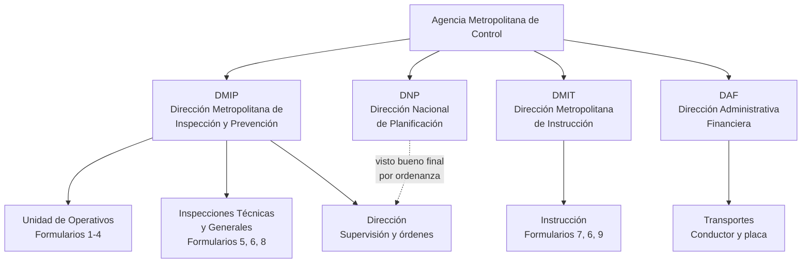

> `PENDIENTE DE VALIDACIÓN CON EL USUARIO` — El documento `AnalisisRolesFormularios.txt` ubica el rol *Director* como tercera subdivisión de la DMIP. Las transcripciones atribuyen el visto bueno final a la DNP por ordenanza. Se requiere precisar si son la misma figura o dos roles distintos.

### 3.4 Dotación declarada

| Grupo | Cantidad | Fuente |
|---|---|---|
| Inspectores Generales | 10 | Transcripción de revisión |
| Inspectores Técnicos | 10 | Transcripción de revisión |
| Personal CCF / TCC | 5 | Transcripción de revisión |
| Personal de la Unidad de Operativos | 25 a 26 | Transcripción de revisión |
| Conductores de la Unidad de Operativos | 3 para 2 unidades | Transcripción de revisión |
| Administraciones zonales | 10 | Verificado en el libro Excel |
| Conductores de la DAF | No determinado | `PENDIENTE DE VALIDACIÓN CON EL USUARIO` |
| Vehículos hábiles | No determinado | `PENDIENTE DE VALIDACIÓN CON EL USUARIO` |

---

## 4. ROLES Y PERMISOS

### 4.1 Definición de roles

| Código | Rol | Naturaleza | Alcance de escritura |
|---|---|---|---|
| `DMIP_OPERATIVOS` | DMIP — Operativos | Departamental | Formularios 1, 2, 3, 4 |
| `DMIP_INSPECCIONES` | DMIP — Inspecciones Técnicas y Generales | Departamental | Formularios 5, 6, 8 |
| `DMIT_INSTRUCTOR` | DMIT — Instrucción | Departamental | Formularios 7, 9 y cupo en el **4 y el 6** |
| `DAF` | DAF — Transportes | Transversal restringido | Únicamente los campos conductor y placa, en los nueve formularios |
| `DIRECTOR` | Dirección | Supervisión | Solo lectura. Exporta PDF y emite órdenes de servicio |
| `FUNCIONARIO` | Funcionario de campo | Consulta personal | Ninguna. Solo `GET /ordenes-servicio/mias` |
| `ADMINISTRADOR_DMIP` | Administración — DMIP | Técnico | Catálogos, personal, ventanas, parámetros, cuentas y flota |
| `ADMINISTRADOR_DMIT` | Administración — DMIT | Técnico | **Ninguna todavía** |
| `ADMINISTRADOR_DAF` | Administración — DAF | Técnico | **Ninguna todavía** |
| `ADMINISTRADOR` | Administrador del sistema | **Retirado el 2026-09-01** | **Ninguna.** Ver abajo |

> ### La administración se repartió en tres el 2026-09-01
>
> Hasta esa fecha había un único `ADMINISTRADOR` que lo abría todo. El negocio lo dividió
> por dirección: **`ADMINISTRADOR_DMIP` heredó todo lo que aquél tenía**, y los otros dos se
> crearon **sin accesos**, porque el enumerado es la parte cara del cambio —exige migración,
> `e_rol_departamental` es un tipo de PostgreSQL— y añadirlos entonces evita repetirla el
> día que se les dé trabajo.
>
> **`ADMINISTRADOR` se conserva vacío y no se puede retirar.** PostgreSQL no admite quitar
> un valor de un enumerado sin recrear el tipo y las doce columnas que lo usan. Sus cuentas
> pasaron a `ADMINISTRADOR_DMIP`, igual que su correspondencia con Auth central y su ventana
> de carga; **lo único que conserva el nombre viejo es `t_auditoria`**, donde 687 filas dicen
> quién hizo qué bajo qué rol en su momento y reescribirlas falsificaría el registro.
>
> **PER-09 sigue vigente**: los tres roles departamentales siguen viendo y anotando las
> ausencias de su propia gente en P-07. El reparto es entre administradores, no contra ellos.

### 4.2 Matriz de permisos por formulario

| # | Formulario | `DMIP_OPERATIVOS` | `DMIP_INSPECCIONES` | `DMIT_INSTRUCTOR` | `DAF` | `DIRECTOR` |
|---|---|:---:|:---:|:---:|:---:|:---:|
| 1 | Operativos de Control Fijos | **Escritura** | — | — | Conductor y placa | Lectura |
| 2 | Control de Punto de Mando Operativo (PMO) | **Escritura** | — | — | Conductor y placa | Lectura |
| 3 | Operativos de Control Limpiaparabrisas | **Escritura** | — | — | Conductor y placa | Lectura |
| 4 | Patrulla ECU Diurna | **Escritura** | — | **Cupo Instrucción** | Conductor y placa | Lectura |
| 5 | Patrulla Reacción Diurna (UIG - UIT) | — | **Escritura** | — | Conductor y placa | Lectura |
| 6 | Patrulla Reacción Nocturna | — | **Escritura** | **Cupo Instrucción** | Conductor y placa | Lectura |
| 7 | Operativo DMIT | — | — | **Escritura** | Conductor y placa | Lectura |
| 8 | Inspecciones Técnicas y Generales | — | **Escritura** | — | Conductor y placa | Lectura |
| 9 | Operativo de Control AMC-CBQ | — | — | **Escritura** | No aplica | Lectura |

### 4.3 Matriz de permisos por funcionalidad

| Funcionalidad | `DMIP_OPERATIVOS` | `DMIP_INSPECCIONES` | `DMIT_INSTRUCTOR` | `DAF` | `DIRECTOR` | `ADMINISTRADOR_DMIP` |
|---|:---:|:---:|:---:|:---:|:---:|:---:|
| Registrar operativo | Sus formularios | Sus formularios | Sus formularios | No | No | No |
| Editar operativo | Sus formularios | Sus formularios | Sus formularios | Conductor y placa | No | No |
| Eliminar operativo | Sus formularios | Sus formularios | Sus formularios | No | No | No |
| Consultar sus operativos | Sí | Sí | Sí | Todos | Todos | Todos |
| Ver Matriz Consolidada (P-04) | **No** | **No** | **No** | **No** | **Sí** | **No** |
| Ver Jornada del Día (P-13) | **Sí** | **Sí** | **Sí** | No | No | No |
| Asignar personal desde P-13 | **No** | **No** | **Donde participa** | No | No | No |
| Asignar conductor y placa | No | No | No | **Sí** | No | No |
| Exportar PDF del cuadro | No | No | No | No | **Sí** | No |
| Emitir Orden de Servicio | No | No | No | No | **Sí** | No |
| Administrar catálogos | No | No | No | No | No | **Sí** |
| Administrar personal (alta, edición, baja) | No | No | No | No | No | **Sí** |
| Consultar el maestro de personal | **Sí** | **Sí** | **Sí** | No | No | **Sí** |
| Registrar ausencias | **De su gente** | **De su gente** | **De su gente** | No | No | **De cualquiera** |

### 4.4 Reglas de aislamiento

| ID | Regla |
|---|---|
| PER-01 | Un departamento no puede escribir en formularios que no le pertenecen, ni siquiera manipulando la petición. La verificación es del lado del servidor |
| PER-02 | La Matriz Consolidada del Día (P-04) no se renderiza para perfiles departamentales. **Excepción desde el 2026-08-26, ampliada el 2026-09-01:** los **tres** roles departamentales disponen de P-13, que muestra los nueve formularios sin exportación ni cierre y **sin el personal de las secciones que cada uno solo lee**. Ver la nota de abajo |
| PER-03 | La DAF no puede crear ni eliminar operativos. Su acción se limita a completar dos campos sobre registros existentes |
| PER-04 | Los campos que la DAF no puede editar llegan deshabilitados desde el servidor y cualquier valor adicional en la petición es descartado |
| PER-05 | El rol Director no puede modificar la planificación. Sus acciones se limitan a consulta, exportación y emisión de órdenes |
| PER-06 | En un formulario con acceso **`APORTA`**, ese rol solo puede asignar personal de las áreas marcadas como compartidas, dentro de su cupo. Hoy son **dos**, los dos del `DMIT_INSTRUCTOR`: el **4 · Patrulla ECU Diurna** (cupo 2) y el **6 · Patrulla Reacción Nocturna** (cupo 1) |
| PER-08 | El rol compartido **no registra, no edita y no retira** el operativo: aportar personal no es tener el formulario. Lo hace cumplir el servidor —`operativos.service.ts`, `crear` y `exigirPropiedad`— y la pantalla no lo ofrece |
| PER-07 | Los módulos no autorizados se muestran atenuados y bloqueados en la navegación, no ocultos, para que el usuario comprenda que existen y no le corresponden |
| PER-09 | Los tres roles departamentales **consultan** el maestro de personal y **registran las ausencias de su propia dirección** (`func_direccion`). El alta, la edición y la baja siguen siendo del Administrador, y las cierra el servidor. Una ausencia solo la retira quien la anotó, o el Administrador |

> **Y el maestro se repartió entre dos administradores el 2026-09-01 por la tarde.**
>
> `ADMINISTRADOR_DMIP` administra **Unidad de Operativos**, **Inspector General** e
> **Inspector Técnico**. **Personal de Instrucción es solo de `ADMINISTRADOR_DMIT`.**
>
> **No hizo falta ningún concepto nuevo.** Esas cuatro etiquetas son **áreas**, y cada área
> pertenece a una dirección desde que existe `ROL_DEL_AREA`. La regla pedida es, palabra por
> palabra, «cada administrador alcanza las áreas de las direcciones que administra», que es lo
> que `direccionesAlAlcance` ya resolvía contra `t_rol_direccion`. La migración solo **borró dos
> filas**: las que daban al DMIP el personal de Instrucción y el de la DAF, puestas esa misma
> mañana cuando P-07 era de un solo rol.
>
> **Quién entra lo dice el `@Roles`; qué ve cada uno lo decide el alcance**, fila por fila, en el
> listado, en la ficha por identificador, en el alta, en la edición y en la baja. Abrir la
> pantalla a un rol más no le entrega el personal de nadie.
>
> **Y el formulario ofrece solo las áreas alcanzables**, por `GET /administracion/personal/areas`.
> No es una comprobación de permiso —ésa es del servidor— sino no ofrecer un camino que va a
> cerrarse: elegir un área ajena sería un 403 al pulsar Guardar, sin explicación en el formulario.
>
> `ADMINISTRADOR_DAF` **no entra en P-07**: la DAF tiene gente pero no tiene área, así que no hay
> ficha suya que crear desde ahí. Si algún día se registra personal de la DAF, hay que decidirlo.

> **`func_direccion` dejó de pedirse en el formulario el 2026-09-01, y sigue gobernando PER-09.**
>
> Se retiró el **campo**, no la columna. La dirección la deduce el servidor del **área**, con
> `ROL_DEL_AREA`, que es el mapa que ya declaraba desde siempre a qué departamento pertenece
> cada área. Nada cambia en la regla: quién ve cada ficha, quién le registra una ausencia y
> quién puede retirarla siguen decidiéndose por `func_direccion`.
>
> **Por qué sobraba el campo.** Pedía dos veces el mismo hecho y admitía que las dos respuestas
> se contradijeran: nada impedía guardar a alguien del área `OPERATIVOS` con dirección
> `DMIT_INSTRUCTOR`, y esa ficha quedaba en un maestro que no le correspondía, invisible para
> quien tenía que administrarla. El DTO además aceptaba **cualquier** valor del enumerado,
> incluidos `DIRECTOR` y los tres administradores, que no son direcciones con personal.
>
> **Mover a alguien de departamento es ahora cambiarle el área**, y sigue exigiendo alcanzar
> las dos direcciones —la de antes y la de después—, igual que antes. Conviene saberlo: el área
> parece un dato descriptivo y decide un permiso.
>
> **Lo que se perdió, y consta:** una ficha con dirección `DAF` ya no se crea desde la pantalla,
> porque la DAF tiene gente y no tiene área. Ese personal nunca fue convocable a un operativo
> —los formularios admiten gente por área y ninguna es suya—, y las fichas DAF existentes siguen
> intactas.

> `PENDIENTE DE VALIDACIÓN CON EL USUARIO` — El cupo exacto del rol `DMIT_INSTRUCTOR` en el formulario 6. La transcripción indica *"solo pueden tener acceso a asignar un personal aquí, nada más"*, lo que sugiere una persona, pero no se declara como número formal.

> ### La excepción pasó de un rol a tres el 2026-09-01, y con un recorte
>
> El negocio decidió que **los tres roles departamentales** abran P-13: quien registra
> necesita ver dónde encaja lo suyo en el día. Con ello PER-02 deja de tener una excepción
> y pasa a tener tres, sobre la regla que originó el encargo.
>
> **Lo que lo hace defendible es lo que se recortó al ampliarlo.** En una sección que el
> rol **solo lee**, el personal ya no viaja: se ve la rejilla del día —qué formularios se
> cargaron, con qué horario, en qué zonal y en qué punto— y **no se ve quién va** en el
> operativo ajeno. Eso último es lo que más daño hace si se filtra, y es lo único que no
> hace falta para tener una visión general.
>
> **Y la ampliación es de LECTURA, lo que no fue así hasta la tarde de ese mismo día.** La
> decisión decía «abrirla solo en lectura y sin el personal ajeno», y de las dos mitades se
> implementó únicamente la segunda: la pantalla ofrecía la acción de personal donde el
> acceso no era `LECTURA`, así que los dos departamentos nuevos podían asignar desde P-13
> sobre sus propios formularios. No fue una fuga —ya podían hacerlo desde P-01 y P-02, que
> son sus pantallas— sino un segundo camino que nadie decidió abrir.
>
> Se cerró con la columna **`frol_edita_desde_jornada`** de `t_formulario_rol`. Son dos
> preguntas distintas y ahora son dos campos distintos: `acceso` dice qué autoridad tiene
> el rol sobre el formulario, y esa columna dice si **P-13** es el sitio donde la ejerce.
> La conserva el departamento que **aporta** en algún formulario —hoy el DMIT, en los
> cuatro suyos—, que es la situación para la que P-13 se construyó: poner su gente en
> operativos que arma otro exige ver la rejilla del día para saber en cuál.
>
> **Conceder o retirar ese camino es un `UPDATE`, no un despliegue**, y en ninguna capa
> aparece escrito el nombre de un rol.
>
> La regla sale de `t_formulario_rol` y **no de una lista de roles**: participo, veo; solo
> leo, no. Por eso alcanza también al DMIT, que con ello pierde el teléfono ajeno que se le
> concedió el 27-AGO. Se prefirió una regla que se explica en una frase a una que dependiera
> de qué rol pregunta.
>
> **Lo que sigue viajando, y consta para que nadie lo tome por descuido:** el número de
> operativos de cada formulario y los totales del día. Se ve el volumen ajeno, no las
> personas. Si el negocio decidiera que eso también sobra, es otro recorte y otra decisión.
>
> **Sin exportación y sin cierre**, igual que antes: el PDF es RN-47 y es de la Dirección.
>
> ---
>
> **PER-02 TUVO SU PRIMERA EXCEPCIÓN EL 2026-08-26, Y CONVIENE SABER QUÉ NO CAMBIA.**
>
> El negocio decidió que **DMIT Instrucción vea la jornada completa** en una pantalla
> propia, P-13 · «Jornada del Día», con el personal editable solo en los formularios donde
> su rol tiene fila en `t_formulario_rol` —hoy el 4, el 6, el 7 y el 9— y el resto en
> lectura.
>
> **Amplía el alcance de lectura del DMIT de cuatro formularios a nueve.** Se tomó con el
> conflicto sobre la mesa: RN-48 declara que el cuadro circulaba por WhatsApp y que los
> intervenidos se anticipaban al operativo, y `FASE4` §15.2 listaba la restricción de la
> matriz como mitigación de la amenaza «fuga del cuadro completo».
>
> **Lo que NO cambió, y es la mitad que sostiene RN-44:** P-13 **no exporta el PDF** y **no
> cierra el cuadro**. El documento firmable —el artefacto que circulaba— sigue siendo
> exclusivo de la Dirección. Tampoco cambió ninguna regla de escritura: `exigirParticipacion`
> sigue rechazando con 403 cualquier asignación fuera de los formularios donde se participa,
> mire lo que mire la pantalla.
>
> **Y P-04 no se tocó.** P-13 es una pantalla aparte, con su propio endpoint, su propio
> servicio y sus propios componentes. Son dos pantallas con dos permisos, y no comparten
> ni una pieza.

> **PER-09 MOVIÓ UNA LÍNEA DE PROTECCIÓN DE DATOS, Y SE TOMÓ SABIÉNDOLO. 2026-08-27.**
>
> Hasta ese día P-07 era exclusiva del Administrador con un argumento escrito en el propio
> controlador: es **el único endpoint del módulo que devuelve cédulas y teléfonos de
> personas reales**, y el motivo de una ausencia «puede describir una condición de salud».
> El resto del sistema está construido sobre esa línea: `PersonaElegible` omite cédula y
> teléfono —hay una prueba que lo afirma—, y el selector de P-01 dice «no está disponible»
> sin decir por qué.
>
> El negocio pidió que los tres departamentos vieran a su personal desde la bandeja del
> Cuadro y lo confirmó con esa consecuencia delante. **Ven el maestro completo**, no solo
> su dirección; acotar la lectura por `func_direccion` sigue siendo posible y reduciría
> mucho la exposición.
>
> **Lo que no se abrió:** el alta, la edición y la baja. Editar toca el **área** —que
> decide en qué formularios aparece esa persona— y el **tipo de contrato** —que gobierna
> RN-26, quién puede salir de noche—.

> **Y SE ACOTÓ LA LECTURA EL MISMO 2026-08-27, POR PETICIÓN DEL NEGOCIO.**
>
> Cada rol departamental ve **solo el personal de su propia dirección** (`func_direccion`).
> El Administrador sigue viendo el maestro entero. Es lo que la nota de arriba dejaba
> apuntado como posible, y reduce mucho la exposición de cédulas y teléfonos.
>
> **VA POR DIRECCIÓN Y NO POR ÁREA**, aunque hoy los dos ejes coincidan en todas las
> fichas. `exigirSuDepartamento` ya decide **por dirección** quién puede anotar una
> ausencia a quién; acotar la lectura por área haría que una persona con
> `area = OPERATIVOS` y `direccion = DMIT_INSTRUCTOR` apareciera en la tabla de DMIP
> Operativos y el servidor le rechazara la ausencia al intentarlo. Leer y escribir se
> acotan con la misma vara.
>
> **EL FILTRO SALE DE QUIEN PREGUNTA, NO DE LO QUE MANDE.** Hasta ese día `direccion` y
> `area` se tomaban del `query` tal cual y nadie miraba al usuario: los tres roles se
> descargaban el maestro completo y la pantalla filtraba **en memoria**. Un filtro de
> cliente no restringe nada —la respuesta de red ya trae lo que oculta—. A un rol
> departamental se le **descarta** el parámetro en lugar de combinárselo, y hay una prueba
> que manda la dirección de otro departamento a mano.

> **PER-06 CAMBIÓ TRES VECES EN CUATRO DÍAS, Y EL CICLO SE CERRÓ DONDE EMPEZÓ.**
>
> El **4 · Patrulla ECU Diurna** era de aporte con cupo 2; el **25-AGO** el negocio lo
> escaló a `ESCRITURA` —los dos departamentos registraban—; el **27-AGO** volvió al
> modelo de aporte, con el mismo cupo.
>
> La gestión que queda fijada es: **DMIP Operativos registra** el operativo y el **DMIT
> asigna** hasta dos personas de Instrucción sobre él. El DMIT no edita ni retira ese
> operativo —PER-08—, y en P-02 y en P-13 solo se le ofrece la asignación de personal.
>
> **Dos consecuencias que conviene conocer.** La primera: `farea_es_compartida` vuelve a
> marcarse en `INSTRUCCION` para la ECU, y sin esa fila el DMIT no podría asignar a nadie
> —«participa con personal de: ninguna área»—, con el cambio pareciendo aplicado. La
> segunda: el **cierre del cuadro pasa a exigir el aporte** también en la ECU, porque
> `exigirAporteCompartido` alcanza a todo formulario con un rol `APORTA`. Es PV-41, y
> ahora afecta a dos formularios en vez de a uno.
>
> Quien lea las migraciones sin esta nota podría pensar que la del 25-AGO fue un error. No
> lo fue: fue una decisión que el negocio revisó.

> **PER-06 dejó de hablar de un solo formulario el 2026-08-25, y volvió a hablar de uno
> el 2026-08-26.** El negocio abrió primero el **4 · Patrulla ECU Diurna** al cupo del
> DMIT, con máximo 2 y mínimo 1; días después lo escaló y el DMIT pasó allí a **`ESCRITURA`**,
> es decir a registrar sus propios operativos en ese formulario. El cupo desapareció con el
> cambio —`ck_formulario_rol_cupo` lo prohíbe en `ESCRITURA`— y el único `APORTA` vigente
> vuelve a ser el del formulario 6. La redacción anterior de esta regla quedó desfasada
> respecto a la base durante un día; se corrige aquí.
>
> **El mínimo no existía como concepto** y se implementó donde podía existir: al **cerrar
> la jornada**, junto a INV-11. En cada asignación no cabe —rechazaría siempre a la primera
> persona, que por definición deja la composición incompleta, que es lo que ya razona
> PV-29—. La consecuencia hay que conocerla: **una jornada puede quedarse sin poder
> cerrarse** si no hay a quién asignar. Ver PV-41.
>
> **Aportar sigue sin ser registrar**, y eso no cambió: PER-08 lo dice ahora de forma
> expresa, porque antes solo estaba en el código.

---

### 4.5 Áreas de personal

Cuatro, y cada una pertenece a un departamento. **El valor guardado y la descripción que
se ve son cosas distintas**: renombrar la segunda no toca la base.

| Valor en la base | Descripción en pantalla | Departamento |
|---|---|---|
| `OPERATIVOS` | Unidad de Operativos | `DMIP_OPERATIVOS` |
| `INSTRUCCION` | Personal de Instrucción | `DMIT_INSTRUCTOR` |
| `TECNICO` | Inspector Técnico - DMIP | `DMIP_INSPECCIONES` |
| `GENERAL` | Inspector General - DMIP | `DMIP_INSPECCIONES` |

> **Eran cinco hasta el 2026-08-27.** Se retiró `CCF`: ningún formulario la admitía y no
> había ninguna persona en ella. **No venía de Auth central**, aunque lo pareciera: Auth
> entrega un tipo de inspector —`IG`, `IT`, `IS`, `IC`— que este sistema nunca convirtió
> en área. El área se captura a mano en P-07, junto al tipo de contrato, porque Auth no la
> sabe.

> **El emparejamiento con el departamento es el organigrama, no configuración.** Vive en
> el código —`talento-operativo/domain/areas-del-rol.ts`— y cambiarlo sería una
> reorganización, no marcar una casilla. Lo que sí se administra desde P-08 es **qué áreas
> admite cada formulario**, que es otro eje.

**Qué áreas admite cada formulario**, y qué ve cada departamento en él:

| # | Formulario | Áreas admitidas | Quien registra ve |
|---|---|---|---|
| 1 | Operativos de Control Fijos | Operativos | su área |
| 2 | Control de Punto de Mando Operativo | Operativos | su área |
| 3 | Operativos de Control Limpiaparabrisas | Operativos | su área |
| 4 | Patrulla ECU Diurna | Operativos, Instrucción\* | Operativos registra y ve la suya; el DMIT **solo aporta** Instrucción, cupo 2 |
| 5 | Patrulla Reacción Diurna | Técnico, General | las dos |
| 6 | Patrulla Reacción Nocturna | Técnico, General, Instrucción\* | Inspecciones las dos; el DMIT, Instrucción |
| 7 | **Operativo DMIT (eventuales)** | **Las cuatro** | **las cuatro: no se filtra por rol** |
| 8 | Inspecciones Técnicas y Generales | Técnico, General | las dos |
| 9 | Operativo de Control AMC-CBQ | Instrucción | su área |

\* marcada como compartida: es de donde el DMIT aporta su persona (PER-06).

> **El 7 es la excepción y lo dice el dato, no el código.** La columna
> `form_filtra_personal_por_rol` vale `false` solo ahí. Es el formulario de los
> eventuales: reúne gente de donde haga falta, y con el filtro su único departamento vería
> solo Instrucción. Marcarlo en otro formulario es un `UPDATE`, no un despliegue.

> **El filtro por rol acota la lista, no el permiso.** `GET /personal/elegible` devuelve la
> intersección de las áreas del formulario con las del departamento; `reglaAreaAdmitida`
> sigue aceptando cualquier área admitida, venga de quien venga. Lo ofrecido es siempre un
> subconjunto de lo permitido, así que nadie se encuentra un rechazo por algo que la
> pantalla le ofreció. Cerró un hueco real: en el 6 · REACN el DMIT veía inspectores que el
> servidor le rechazaba al asignarlos.

---

## 5. CATÁLOGO DE PROCESOS

### 5.1 Mapa de procesos

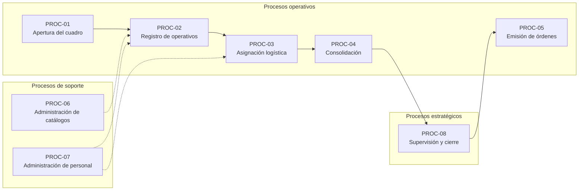

### 5.2 Fichas de proceso

| ID | Proceso | Tipo | Responsable | Entrada | Salida | Frecuencia |
|---|---|---|---|---|---|---|
| PROC-01 | Apertura del cuadro diario | Operativo | Sistema | Fecha | Cuadro en estado Borrador | Diaria |
| PROC-02 | Registro de operativos por departamento | Operativo | DMIP-Operativos, DMIP-Inspecciones, DMIT | Planificación propia de cada dirección | Operativos registrados con alerta logística pendiente | Diaria |
| PROC-03 | Asignación logística de transporte | Operativo | DAF | Operativos con transporte pendiente | Operativos con conductor y placa | Diaria |
| PROC-04 | Consolidación de la matriz | Operativo | Sistema | Operativos de los nueve formularios | Matriz Consolidada del Día | Continua |
| PROC-05 | Emisión de órdenes de servicio | Operativo | Director | Matriz consolidada aprobada | Órdenes individuales en PDF | Diaria |
| PROC-06 | Administración de catálogos | Soporte | Administrador | Solicitud por ticket | Catálogo actualizado | Bajo demanda |
| PROC-07 | Administración de personal | Soporte | Administrador | Novedades de talento humano | Maestro de personal actualizado | Mensual |
| PROC-08 | Supervisión y cierre del cuadro | Estratégico | Director | Matriz consolidada | Cuadro cerrado | Diaria |

### 5.3 Detalle de PROC-02 — Registro de operativos

| Atributo | Descripción |
|---|---|
| **Objetivo** | Que cada departamento registre sus propios operativos en los formularios que le corresponden |
| **Disparador** | Apertura del cuadro del día siguiente |
| **Precondiciones** | Cuadro creado; ventana de carga abierta para el rol; catálogos disponibles |
| **Postcondiciones** | Operativos registrados con identificador único, conductor y placa nulos, y alerta logística activa |
| **Actores** | ACT-01, ACT-02, ACT-03 |
| **Reglas aplicables** | RN-01 a RN-12, RN-20 a RN-35 |
| **Excepciones** | Ventana cerrada; regla de descanso incumplida; personal duplicado; condicionante nocturno sin conductor |
| **Indicador** | Operativos registrados por departamento y por día |

### 5.4 Detalle de PROC-03 — Asignación logística

| Atributo | Descripción |
|---|---|
| **Objetivo** | Asignar conductor y unidad vehicular a los operativos que lo requieren |
| **Disparador** | Cierre de la ventana de carga de los departamentos |
| **Precondiciones** | Existen operativos con `transporteAsignado` en falso |
| **Postcondiciones** | Operativos con conductor y placa, o marcados como propios medios. Alerta retirada |
| **Actores** | ACT-04 |
| **Reglas aplicables** | RN-36 a RN-43 |
| **Excepciones** | Conductor no disponible; conductor con descanso incumplido; demanda superior a la capacidad de flota |
| **Indicador** | Operativos pendientes de asignación al cierre de la ventana |

---

## 6. CASOS DE USO

### 6.1 Diagrama general

```mermaid
flowchart TB
  subgraph SIST["Sistema · Cuadro de Colores Operativo"]
    CU01(["CU-01<br/>Registrar operativo"])
    CU02(["CU-02<br/>Editar operativo"])
    CU03(["CU-03<br/>Eliminar operativo"])
    CU04(["CU-04<br/>Consultar mis operativos"])
    CU05(["CU-05<br/>Asignar transporte"])
    CU06(["CU-06<br/>Marcar propios medios"])
    CU07(["CU-07<br/>Consultar matriz consolidada"])
    CU08(["CU-08<br/>Exportar PDF del cuadro"])
    CU09(["CU-09<br/>Emitir orden de servicio"])
    CU10(["CU-10<br/>Cerrar el cuadro"])
    CU11(["CU-11<br/>Administrar catálogos"])
    CU12(["CU-12<br/>Administrar personal"])
    CU13(["CU-13<br/>Solicitar apoyo interdirección"])
    CU14(["CU-14<br/>Consultar mi orden de servicio"])
  end

  OP["DMIP Operativos"] --> CU01 & CU02 & CU03 & CU04 & CU13
  INS["DMIP Inspecciones"] --> CU01 & CU02 & CU03 & CU04 & CU13
  IT["DMIT Instrucción"] --> CU01 & CU02 & CU03 & CU04 & CU13
  DAF["DAF Transportes"] --> CU05 & CU06 & CU04
  DIR["Director"] --> CU07 & CU08 & CU09 & CU10
  ADM["Administrador"] --> CU11 & CU12
  FUN["Funcionario de campo"] --> CU14
```

### 6.2 Especificación de casos de uso

---

#### CU-01 · Registrar operativo

| Atributo | Detalle |
|---|---|
| **Actores** | ACT-01, ACT-02, ACT-03 |
| **Objetivo** | Registrar un operativo en un formulario autorizado para el departamento |
| **Precondiciones** | El cuadro del día existe; la ventana de carga del rol está abierta; el usuario tiene un formulario asignado |
| **Postcondiciones** | Se crea el operativo con identificador generado, conductor y placa nulos, y alerta logística activa |
| **Reglas** | RN-09 a RN-12, RN-14 a RN-20, RN-24 a RN-35 |

**Flujo principal**

1. El usuario abre el módulo de registro.
2. El sistema muestra únicamente los formularios autorizados para su rol.
3. El usuario selecciona el formulario. El sistema carga los catálogos propios de ese formulario y muestra el número de semana, el identificador previsto y la fecha del operativo como campos de solo lectura.
4. El usuario selecciona hora de inicio y fin.
5. Si el rango horario intersecta la franja de 20H00 a 05H00 y el formulario tiene condicionante nocturno, el sistema advierte que el conductor será obligatorio.
6. El usuario selecciona una o varias zonales.
7. El sistema filtra los puntos de encuentro correspondientes a las zonales seleccionadas dentro de ese formulario.
8. El usuario selecciona punto de encuentro, tipo de control e instituciones participantes.
9. El usuario agrega personal. Por cada persona, el sistema ejecuta las validaciones de descanso y duplicidad.
10. El usuario registra observaciones si corresponde.
11. El usuario confirma el registro.
12. El sistema genera el identificador, persiste el operativo, marca las celdas de conductor y placa en Amarillo de Alerta y confirma la operación.

**Flujos alternativos**

- **A1 · Punto de encuentro no catalogado.** En el paso 8 el usuario selecciona `ADICIONALES`. El sistema habilita un campo de texto libre y marca la celda para normalización posterior.
- **A2 · Tipo de control no catalogado.** Igual que A1, sobre el campo tipo de control.
- **A3 · Sin personal asignado.** El usuario confirma sin agregar personal. El sistema registra el operativo y marca la celda de personal en Amarillo de Alerta.

**Flujos de excepción**

- **E1 · Ventana de carga cerrada.** El sistema rechaza la operación e informa la hora de reapertura.
- **E2 · Personal con patrulla el día anterior.** El sistema impide agregar a la persona e indica el motivo.
- **E3 · Personal de nombramiento en horario nocturno o fin de semana.** El sistema impide la asignación e indica el tipo de contrato.
- **E4 · Personal con tope de salidas pesadas alcanzado.** El sistema impide la asignación e indica el acumulado.
- **E5 · Personal ya asignado en horario solapado.** El sistema indica el operativo en conflicto y su horario.
- **E6 · Condicionante nocturno sin conductor.** No aplica en el registro, dado que el conductor lo asigna la DAF. Ver nota de la sección 8.5.
- **E7 · Formulario no autorizado.** El servidor responde con error de autorización.

---

#### CU-02 · Editar operativo

| Atributo | Detalle |
|---|---|
| **Actores** | ACT-01, ACT-02, ACT-03 |
| **Precondiciones** | El operativo pertenece a un formulario del departamento; la ventana sigue abierta |
| **Postcondiciones** | Operativo actualizado; alertas recalculadas; auditoría registrada |

**Flujo principal**

1. El usuario localiza el operativo en su listado y solicita editarlo.
2. El sistema carga los datos en el formulario.
3. El usuario modifica los campos necesarios.
4. El sistema revalida todas las reglas, excluyendo el propio operativo del control de solapamiento.
5. El sistema persiste los cambios, recalcula las alertas y registra el departamento que modificó.

**Excepciones** — Las mismas que CU-01, más el rechazo si el operativo pertenece a otro departamento.

---

#### CU-03 · Eliminar operativo

| Atributo | Detalle |
|---|---|
| **Actores** | ACT-01, ACT-02, ACT-03 |
| **Precondiciones** | El operativo pertenece al departamento; la ventana sigue abierta; el cuadro no está cerrado |
| **Postcondiciones** | Operativo retirado; hecho registrado en auditoría |

**Flujo principal**

1. El usuario solicita eliminar el operativo.
2. El sistema solicita confirmación indicando identificador, punto, horario y formulario.
3. El usuario confirma.
4. El sistema retira el operativo y registra la eliminación con el usuario y el departamento.

> `PENDIENTE DE VALIDACIÓN CON EL USUARIO` — Si la eliminación debe ser física o lógica. El equipo recomienda baja lógica para preservar trazabilidad.

---

#### CU-05 · Asignar transporte

| Atributo | Detalle |
|---|---|
| **Actores** | ACT-04 |
| **Precondiciones** | Existen operativos con transporte pendiente; la ventana de la DAF está abierta |
| **Postcondiciones** | Operativo con conductor y placa; alerta retirada; auditoría actualizada |
| **Reglas** | RN-36 a RN-43 |

**Flujo principal**

1. El analista abre la bandeja de asignación logística.
2. El sistema lista los operativos de los nueve formularios, ordenando primero los pendientes.
3. El analista selecciona un operativo.
4. El sistema muestra los datos del operativo en modo lectura y habilita únicamente conductor y placa.
5. El analista selecciona el conductor. El sistema propone la placa del vehículo habitual.
6. El sistema valida las reglas de descanso del conductor y la ausencia de solapamiento.
7. El analista confirma.
8. El sistema persiste la asignación, marca el transporte como asignado y retira la alerta.

**Excepciones**

- **E1 · Conductor no disponible.** El sistema indica el motivo y la fecha de retorno.
- **E2 · Conductor con patrulla el día anterior.** El sistema impide la asignación.
- **E3 · Conductor con solapamiento horario.** El sistema indica el operativo en conflicto.
- **E4 · Demanda superior a la capacidad de flota.** El sistema advierte sin bloquear.
- **E5 · Intento de modificar otro campo.** El servidor descarta los campos no autorizados y responde con error.

---

#### CU-06 · Marcar como propios medios

| Atributo | Detalle |
|---|---|
| **Actores** | ACT-04 |
| **Objetivo** | Cerrar la asignación de un operativo que no requiere vehículo |
| **Postcondiciones** | Transporte marcado como resuelto sin conductor; alerta retirada |

**Flujo principal** — El analista selecciona el operativo, elige la opción de propios medios y confirma. El sistema marca `propiosMedios` y `transporteAsignado`, y retira la alerta.

---

#### CU-07 · Consultar Matriz Consolidada del Día

| Atributo | Detalle |
|---|---|
| **Actores** | ACT-05 |
| **Precondiciones** | Existe un cuadro para la fecha consultada |
| **Postcondiciones** | Ninguna. Es consulta |

**Flujo principal**

1. El Director accede a la matriz.
2. El sistema presenta los nueve formularios en orden, cada uno con su banner de color.
3. Por cada formulario con operativos, muestra las filas con sus alertas.
4. Por cada formulario sin operativos y con ventana vencida, muestra la leyenda de información no ingresada con el departamento responsable.
5. El Director puede filtrar por formulario.

---

#### CU-09 · Emitir Orden de Servicio

| Atributo | Detalle |
|---|---|
| **Actores** | ACT-05 |
| **Precondiciones** | El operativo tiene al menos un funcionario asignado |
| **Postcondiciones** | Se emite un documento por funcionario y se registra la emisión |
| **Reglas** | RN-44 a RN-48 |

**Flujo principal**

1. El Director selecciona un operativo de la matriz y solicita la emisión.
2. El sistema recupera los funcionarios asignados a ese operativo.
3. Por cada funcionario, genera un documento en formato vertical que expone exclusivamente horario, funcionario, conductor y placa.
4. El sistema entrega el documento y registra la emisión con código único.

**Excepciones**

- **E1 · Operativo sin personal.** El sistema informa que no hay destinatario.
- **E2 · Rol no autorizado.** El servidor rechaza la petición.

> `PENDIENTE DE VALIDACIÓN CON EL USUARIO` — El canal de entrega de la orden al funcionario: descarga por el Director, consulta en el sistema por el propio funcionario, o envío por correo institucional. Igualmente, el formato unificado del documento, dado que cada dirección maneja hoy el suyo.

---

#### CU-10 · Cerrar el cuadro

| Atributo | Detalle |
|---|---|
| **Actores** | ACT-05 |
| **Precondiciones** | Las ventanas de carga y de transporte han vencido |
| **Postcondiciones** | Cuadro en estado Cerrado; no admite modificaciones |

**Flujo principal** — El Director revisa la matriz, confirma el cierre y el sistema congela el cuadro registrando quién y cuándo lo cerró.

> `PENDIENTE DE VALIDACIÓN CON EL USUARIO` — El procedimiento de reapertura de un cuadro cerrado y quién lo autoriza.

---

#### CU-13 · Solicitar apoyo interdirección

| Atributo | Detalle |
|---|---|
| **Actores** | ACT-01, ACT-02, ACT-03 |
| **Objetivo** | Solicitar personal de otra dirección para un operativo conjunto |
| **Postcondiciones** | Solicitud registrada y notificada a la dirección requerida |

**Flujo principal**

1. El usuario, al registrar o editar un operativo, indica que requiere apoyo de otra dirección.
2. El sistema solicita la dirección destino y el perfil requerido.
3. El sistema registra la solicitud y notifica a la dirección destino.
4. La dirección destino asigna el personal solicitado.

> `PENDIENTE DE VALIDACIÓN CON EL USUARIO` — El flujo completo de aceptación o rechazo de la solicitud, y si el operativo conjunto debe aparecer como bloque adicional en la matriz, tal como se mencionó en la primera reunión.

---

## 7. HISTORIAS DE USUARIO

Las historias se agrupan por épica y conservan trazabilidad con los casos de uso y las reglas de negocio.

### Épica 1 · Registro descentralizado de operativos

---

**HU-01 · Ver únicamente mis formularios**

> Como **Asistente de Operativos de la DMIP**, necesito ver en el sistema solo los cuatro formularios que me corresponden, para no perderme entre bloques que no son de mi unidad.

| Criterio de aceptación |
|---|
| El selector de formularios ofrece exclusivamente los formularios 1, 2, 3 y 4 |
| Los cinco formularios restantes se muestran identificados pero bloqueados, para que el usuario comprenda que existen y no le corresponden |
| Si la petición se manipula para escribir en un formulario ajeno, el servidor la rechaza |

*Trazabilidad:* CU-01, PER-01, PER-07

---

**HU-02 · Registrar un operativo en pocos minutos**

> Como **matrizador de la Unidad de Operativos**, necesito que el formulario sea corto y directo, para registrar un operativo en dos o tres minutos y no percibirlo como una carga adicional de trabajo.

| Criterio de aceptación |
|---|
| Los campos calculados (número de semana, identificador y fecha) se presentan como información de solo lectura, no como casilleros por llenar |
| El formulario se presenta en disposición horizontal aprovechando el ancho de la pantalla |
| El resultado del registro se visualiza inmediatamente debajo del formulario |

*Trazabilidad:* CU-01, RN-06, RN-09

---

**HU-03 · No digitar códigos**

> Como **asistente administrativo**, necesito que el identificador del operativo se genere solo, porque al escribirlo a mano me equivoco en el año y en el secuencial.

| Criterio de aceptación |
|---|
| El identificador se compone del prefijo del formulario, un secuencial, el día, el mes y el año |
| El secuencial se reinicia cada día |
| El campo es de solo lectura y queda fuera del recorrido del tabulador |
| Si dos usuarios registran simultáneamente, no se genera un identificador duplicado |

*Trazabilidad:* CU-01, RN-09 a RN-12

---

**HU-04 · Elegir el día sin calcular fechas**

> Como **asistente administrativo**, necesito que el número de semana se calcule solo, porque al escribirlo me equivoco en el cambio de año.

| Criterio de aceptación |
|---|
| El número de semana se calcula conforme al estándar ISO 8601 a partir de la fecha del operativo |
| Se presenta con la indicación explícita de que no debe llenarse |
| Cualquier valor recibido desde el cliente para este campo se descarta en el servidor |

*Trazabilidad:* CU-01, RN-06

---

**HU-05 · Puntos de encuentro coherentes con la zonal**

> Como **asistente administrativo**, necesito que al elegir la zonal solo aparezcan los puntos de encuentro de esa zonal en ese formulario, para no asignar un punto que queda en el extremo opuesto de la ciudad.

| Criterio de aceptación |
|---|
| El filtrado es en cascada: formulario, luego zonal, luego punto |
| Las diez zonales aparecen siempre, aunque alguna no tenga puntos mapeados |
| Existe la opción `ADICIONALES` con campo de texto libre |

*Trazabilidad:* CU-01, RN-17 a RN-20

---

**HU-06 · Un operativo en dos zonales**

> Como **asistente administrativo**, necesito poder marcar dos zonales cuando el operativo reparte la jornada entre una y otra.

| Criterio de aceptación |
|---|
| El campo zonal admite selección múltiple |
| La matriz muestra todas las zonales asociadas al operativo |

*Trazabilidad:* CU-01, RN-19

---

**HU-07 · Teléfono confiable del personal**

> Como **funcionario de campo**, necesito que mi teléfono aparezca correcto en el cuadro, porque me han llamado un domingo por un operativo que no era el mío.

| Criterio de aceptación |
|---|
| El teléfono se obtiene del maestro de personal y no se digita en el formulario |
| Solo el perfil administrador puede corregirlo |

*Trazabilidad:* CU-01, CU-12, RN-34

---

### Épica 2 · Protección del descanso del personal

---

**HU-08 · Impedir patrullas en días consecutivos**

> Como **coordinadora de Inspección**, necesito que el sistema me impida asignar a patrulla a quien salió el día anterior, para no agotar al personal.

| Criterio de aceptación |
|---|
| La restricción aplica a patrulla diurna y nocturna indistintamente |
| El mensaje indica el nombre de la persona y el motivo, sin lenguaje técnico |
| La validación se ejecuta al agregar la persona, no al final del formulario |

*Trazabilidad:* CU-01, RN-24

---

**HU-09 · Repartir las salidas pesadas**

> Como **coordinadora**, necesito un tope de tres salidas nocturnas o de fin de semana por persona, para que la carga se reparta y no siempre salgan los mismos.

| Criterio de aceptación |
|---|
| Al alcanzar el tope, la persona deja de ser asignable a ese tipo de turno |
| El contador no se muestra en pantalla: el sistema impide la asignación en lugar de mostrar un número |

*Trazabilidad:* CU-01, RN-25, RN-35

---

**HU-10 · Respetar el tipo de contrato**

> Como **responsable de Talento Humano**, necesito que el personal de nombramiento no sea asignado a turnos nocturnos ni de fin de semana, porque su contrato no lo permite.

| Criterio de aceptación |
|---|
| El personal de nombramiento solo admite jornada de lunes a viernes de 08H00 a 16H30 |
| El personal de contrato ocasional admite lunes a domingo, incluidas noches |
| El sistema impide la asignación indebida, no se limita a advertirla |

*Trazabilidad:* CU-01, RN-26, RN-27, RN-33

---

**HU-11 · Excluir al personal no disponible**

> Como **asistente administrativo**, necesito que quien está de vacaciones o con reposo médico no aparezca en la lista, para no asignarlo por error.

| Criterio de aceptación |
|---|
| El personal no disponible no se ofrece en el desplegable |
| Si se fuerza la asignación, el mensaje indica el motivo y la fecha de retorno |

*Trazabilidad:* CU-01, CU-12, RN-30

---

**HU-12 · Evitar la duplicidad de personal**

> Como **Directora**, necesito que el sistema impida que una misma persona figure en dos operativos que se cruzan en el horario, porque ha ocurrido que aparece en dos puntos distintos a la misma hora.

| Criterio de aceptación |
|---|
| La validación considera todos los operativos del día, incluidos los de otros departamentos |
| Contempla operativos que cruzan la medianoche |
| El mensaje indica la persona, el operativo en conflicto y su horario |

*Trazabilidad:* CU-01, RN-28

---

### Épica 3 · Asignación logística

---

**HU-13 · Edición restringida a dos campos**

> Como **analista de Transportes**, necesito ver la planificación completa pero poder modificar únicamente el conductor y la placa.

| Criterio de aceptación |
|---|
| Todos los campos del operativo se presentan deshabilitados |
| Únicamente conductor y placa quedan habilitados, visualmente diferenciados |
| El servidor descarta cualquier otro campo que llegue en la petición |

*Trazabilidad:* CU-05, PER-03, PER-04, RN-36

---

**HU-14 · Bandeja de pendientes**

> Como **analista de Transportes**, necesito ver primero los operativos que aún no tienen vehículo, para atender lo urgente antes del cierre.

| Criterio de aceptación |
|---|
| El listado ordena los pendientes en primer lugar |
| Un contador muestra cuántos operativos siguen sin asignación |

*Trazabilidad:* CU-05

---

**HU-15 · Placa derivada del conductor**

> Como **analista**, necesito que al elegir el conductor la placa se complete sola, para no equivocarme al transcribirla.

| Criterio de aceptación |
|---|
| Al seleccionar el conductor, el sistema propone su vehículo habitual |
| La placa puede modificarse dentro de la flota disponible |

*Trazabilidad:* CU-05

---

**HU-16 · Reglas de descanso para conductores**

> Como **analista**, necesito que el sistema me impida asignar a un conductor agotado, porque los accidentes que hemos tenido vinieron de jornadas encadenadas.

| Criterio de aceptación |
|---|
| Aplican las mismas reglas de descanso definidas para el personal operativo |
| El mensaje explica el motivo de la restricción |

*Trazabilidad:* CU-05, RN-39

---

**HU-17 · Advertencia de capacidad**

> Como **analista**, necesito saber cuántos vehículos me están solicitando frente a los que tengo hábiles, para coordinar a tiempo.

| Criterio de aceptación |
|---|
| El sistema muestra la demanda frente a la capacidad declarada para la fecha |
| Al superarse la capacidad, se emite una advertencia sin bloquear la operación |

*Trazabilidad:* CU-05, RN-40

---

### Épica 4 · Supervisión y entregables

---

**HU-18 · Vista consolidada exclusiva**

> Como **Directora**, necesito ser la única que ve el cuadro completo, para que deje de circular por canales informales.

| Criterio de aceptación |
|---|
| La Matriz Consolidada solo se presenta al perfil Director |
| El documento exportable del cuadro completo solo lo emite el perfil Director |

*Trazabilidad:* CU-07, PER-02, RN-44, RN-45

> **REVISADA EL 2026-08-26.** El segundo criterio decía «los perfiles departamentales acceden
> únicamente a sus propias filas», y dejó de ser cierto: DMIT Instrucción ve los nueve
> formularios en P-13. Se sustituye por el criterio que **sigue vigente y es el que sostiene
> la historia** —«para que deje de circular por canales informales»—: el documento firmable
> lo emite solo la Dirección. Ver la nota de PER-02 en §4.4.

---

**HU-19 · Evidencia de formulario sin carga**

> Como **Directora**, necesito ver en el cuadro qué departamento no cargó su información, para que quede constancia y no vuelva a ocurrir.

| Criterio de aceptación |
|---|
| Si un formulario no tiene operativos y su ventana venció, la matriz muestra la leyenda de información no ingresada |
| La leyenda identifica al departamento responsable y la hora de cierre |
| La evidencia aparece también en el documento exportado |

*Trazabilidad:* CU-07, RN-50, RN-51

---

**HU-20 · Orden de servicio aislada**

> Como **funcionario en territorio**, necesito recibir solo mi asignación, sin conocer qué hace el resto de la Agencia ese día.

| Criterio de aceptación |
|---|
| El documento expone exclusivamente horario, funcionario, conductor y placa |
| Si el operativo tiene varios funcionarios, se emite un documento por persona y ninguno muestra a los demás |
| No incluye el resto de operativos de la jornada |

*Trazabilidad:* CU-09, RN-46, RN-47, RN-48

---

**HU-21 · Exportación del cuadro**

> Como **Directora**, necesito exportar el cuadro completo para la revisión formal.

| Criterio de aceptación |
|---|
| El documento se genera en orientación horizontal |
| Conserva los banners de color de cada formulario |
| Incluye el logotipo institucional y el número de orden de trabajo |
| Los controles de la interfaz no aparecen en el documento |

*Trazabilidad:* CU-08

---

### Épica 5 · Administración

---

**HU-22 · Catálogos por formulario**

> Como **administrador**, necesito mantener los puntos de encuentro, tipos de control e instituciones de cada formulario sin depender de un despliegue de código.

| Criterio de aceptación |
|---|
| Cada catálogo se administra por formulario |
| Un valor utilizado en cuadros históricos no se elimina físicamente, solo se desactiva |

*Trazabilidad:* CU-11, RN-16

---

**HU-23 · Maestro de personal**

> Como **administrador**, necesito registrar altas, bajas y ausencias del personal, porque cada mes entra y sale gente.

| Criterio de aceptación |
|---|
| El maestro registra nombre, teléfono, área, tipo de contrato y estado |
| Las ausencias se registran con rango de fechas y motivo |

*Trazabilidad:* CU-12, RN-30, RN-34

---

## 8. REGLAS DE NEGOCIO

Cada regla indica su fuente. Las reglas sin respaldo textual aparecen marcadas.

### 8.1 Temporalidad y ciclo

| ID | Regla | Fuente |
|---|---|---|
| RN-01 | El Cuadro de Colores es diario y se elabora el día anterior al de ejecución | Transcripciones |
| RN-02 | El cuadro es el compilado de la planificación que cada dirección realiza en sus propios instrumentos; no es la planificación en sí | Transcripciones |
| RN-03 | La operación se desarrolla de lunes a domingo, de 08H00 a 24H00 | Transcripciones |
| RN-04 | No se opera entre las 00H00 y las 08H00, salvo operativo especial | Transcripciones |
| RN-05 | Existe un único cuadro por fecha | Derivada de RN-01 |
| RN-06 | El número de semana se calcula automáticamente conforme a ISO 8601 y es de solo lectura | Transcripciones |
| RN-07 | Los horarios se registran únicamente en horas completas y medias horas | Transcripciones |
| RN-08 | No se registra horario de almuerzo | Transcripciones |

### 8.2 Identificación de operativos

| ID | Regla | Fuente |
|---|---|---|
| RN-09 | El identificador se genera automáticamente y no se digita | Transcripciones y Excel |
| RN-10 | El formato es prefijo, secuencial, día, mes y año | Excel, Hoja2 |
| RN-11 | Cada formulario tiene sus propios prefijos, según la tabla del apartado 16 | Excel, Hoja2 |
| RN-12 | El secuencial se reinicia cada día | Transcripciones |
| RN-13 | Un operativo puede agrupar a varios funcionarios bajo un mismo identificador | Cuadro real |
| RN-61 | Un operativo **adicional** lleva el prefijo propio del formulario para adicionales —`OCAPMO` en el PMO— y **numera en serie aparte**: el primero del día es el `001` aunque el formulario ya tenga operativos ordinarios | Negocio, 2026-08-20 |

### 8.3 Estructura de formularios

| ID | Regla | Fuente |
|---|---|---|
| RN-14 | El cuadro se compone de nueve formularios independientes | `AnalisisRolesFormularios.txt` |
| RN-15 | Cada formulario administra su información de forma independiente: personal, conductor y vehículo propios | Transcripciones |
| RN-15b | Cada departamento dispone de su propia área de personal, y al registrar solo se le ofrece la suya. **Excepción:** el formulario de reunión eventual ofrece las cuatro | Negocio, 2026-08-27 |
| RN-16 | Cada formulario despliega sus propios catálogos de puntos de encuentro, tipos de control e instituciones | Excel, Hoja2 |
| RN-17 | El punto de encuentro depende de la zonal seleccionada | Transcripciones |
| RN-18 | Las diez zonales se ofrecen siempre, sin filtrar por operativo | Transcripciones y Excel |
| RN-19 | Un operativo puede abarcar dos o más zonales cuando la jornada se reparte | Transcripciones |
| RN-20 | Los catálogos que lo prevén incluyen la opción `ADICIONALES` con captura de texto libre | Excel, Hoja2 |
| RN-21 | Los nueve formularios comparten la misma cabecera de nueve columnas | Verificado en Excel, Hoja2 |
| RN-22 | El formato del cuadro pertenece a la DMIP por ordenanza. Ninguna dirección puede añadir columnas propias | Transcripciones |
| RN-23 | Si se aprueba una columna nueva, todas las áreas deben llenarla | Transcripciones |

> **Precisión sobre RN-18, dos cambios posteriores.** Nació como «las diez zonales se
> ofrecen siempre», y hoy hay que leerla con dos matices:
>
> 1. **Al registrar (2026-09-02) la lista sí se filtra**: cada formulario ofrece solo las
>    zonales donde tiene al menos un punto de encuentro vigente. El punto es obligatorio y
>    ningún formulario admite captura libre, así que una zonal sin puntos no es una lista
>    vacía sino un registro imposible de terminar. La lista completa se conserva para
>    administración (P-08), que existe justamente para sembrar la zonal que aún no tiene
>    ninguno.
> 2. **El catálogo de zonales dejó de ser cerrado (2026-09-04, RF-051b).** El Administrador
>    puede crear, renombrar, desactivar y reactivar zonales. La matriz CRUD (§13) y
>    CU-11 ya contemplaban `Zonal | C R U D`; lo que faltaba era el requerimiento explícito
>    y su implementación, que hasta esa fecha solo cubría la lectura. El ámbito distrital
>    (DMQ) no se administra: es único y ya existe.

### 8.4 Personal, descanso y rotación

| ID | Regla | Fuente |
|---|---|---|
| RN-24 | Quien salió en patrulla un día no puede ser asignado a patrulla al día siguiente, ni diurna ni nocturna | Transcripciones |
| RN-25 | Máximo tres salidas pesadas —nocturnas o de fin de semana— por persona | Transcripciones |
| RN-26 | El personal de nombramiento cumple jornada de lunes a viernes de 08H00 a 16H30 | Transcripciones |
| RN-27 | El personal de contrato ocasional cubre de lunes a domingo, incluidas noches | Transcripciones |
| RN-28 | Una misma persona no puede figurar en dos operativos con horarios solapados | Transcripciones |
| RN-29 | La asignación debe ser rotativa y equitativa | Transcripciones |
| RN-30 | Vacaciones, permisos, calamidad y reposo médico excluyen a la persona de la asignación | Transcripciones |
| RN-31 | Las patrullas diurna y nocturna se integran con un inspector general y un inspector técnico | Transcripciones |
| RN-32 | La patrulla nocturna suma una persona del área de Instrucción | Transcripciones y Excel |
| RN-33 | En patrullas nocturnas y fines de semana no participa personal de nombramiento | Transcripciones |
| RN-34 | El teléfono está asociado a la persona en el maestro y no se digita en el formulario | Transcripciones |
| RN-35 | El acumulado de salidas no se muestra en pantalla: el sistema impide la asignación indebida | Transcripciones |
| RN-36 | *`PENDIENTE DE VALIDACIÓN CON EL USUARIO`* — Límite máximo de horas de jornada por persona y por día. Las transcripciones describen jornadas de dieciséis horas como situación a evitar, sin fijar el umbral | Inferida |
| RN-37 | *`PENDIENTE DE VALIDACIÓN CON EL USUARIO`* — Período de cómputo del tope de tres salidas pesadas: semanal, mensual u otro | Inferida |

### 8.5 Transporte y vehículos

| ID | Regla | Fuente |
|---|---|---|
| RN-38 | La DAF únicamente puede completar los campos conductor y placa | Transcripciones y `AnalisisRolesFormularios.txt` |
| RN-39 | La DAF no puede crear ni eliminar operativos | Derivada de RN-38 |
| RN-40 | Conductor y placa nacen nulos al registrar el operativo y se marcan en Amarillo de Alerta | Transcripciones |
| RN-41 | Los formularios 1 y 3 operan por propios medios: conductor y placa no se activan | Excel, Hoja2 |
| RN-42 | El formulario 9 no habilita conductor ni placa | Excel, Hoja2 |
| RN-43 | En los formularios 2, 5, 6, 7 y 9, si el horario comprende de 20H00 a 05H00 debe asignarse conductor obligatoriamente; en caso contrario la planificación no se guarda | Excel, Hoja2 |
| RN-44 | Las reglas de descanso aplican igualmente a los conductores | Transcripciones |
| RN-45 | El desplegable de conductores excluye a quienes están en vacaciones o compensación | Excel, Hoja2 |
| RN-46 | El sistema advierte cuando la demanda de vehículos supera la capacidad declarada, sin bloquear | Transcripciones |

> **Inconsistencia detectada en la fuente.** El formulario 9 (AMC-CBQ) presenta simultáneamente el condicionante nocturno de RN-43 y la indicación de que conductor y placa no se habilitan (RN-42). Ambas provienen del mismo libro Excel y se contradicen. `PENDIENTE DE VALIDACIÓN CON EL USUARIO`.

> **Nota sobre RN-43.** El condicionante establece que sin conductor no se guarda la planificación, pero la asignación del conductor corresponde exclusivamente a la DAF, que interviene después del registro. Se requiere precisar si la validación debe ejecutarse al cierre del cuadro en lugar de al registrar. `PENDIENTE DE VALIDACIÓN CON EL USUARIO`.

### 8.6 Seguridad de la información

| ID | Regla | Fuente |
|---|---|---|
| RN-47 | El cuadro completo deja de circular por canales informales | Transcripciones |
| RN-48 | Solo la Dirección y el Supervisor acceden a la vista consolidada | Transcripciones |
| RN-49 | Cada funcionario recibe únicamente su orden de servicio | Transcripciones |
| RN-50 | La orden de servicio expone exclusivamente horario, funcionario, conductor y placa | Transcripciones y `AnalisisRolesFormularios.txt` |
| RN-51 | El motivo declarado de la restricción es que la filtración del cuadro permitía a los intervenidos anticiparse al operativo | Transcripciones |

### 8.7 Alertas y evidencia

| ID | Regla | Fuente |
|---|---|---|
| RN-52 | Las celdas sin información se marcan en Amarillo de Alerta | Excel y propuesta del PO |
| RN-53 | Si un formulario no fue cargado, la matriz muestra la leyenda de información no ingresada | Transcripciones |
| RN-54 | La evidencia registra el departamento responsable y la hora de cierre | Transcripciones |
| RN-55 | La alerta desaparece automáticamente cuando la información se completa | Derivada de RN-52 |

### 8.8 Ventanas de carga

| ID | Regla | Fuente |
|---|---|---|
| RN-56 | La carga de los departamentos cierra en la tarde del día anterior, y a continuación se abre la ventana de la DAF | Transcripciones |
| RN-57 | El cuadro debe quedar cerrado y disponible a las 16H30 | Transcripciones |
| RN-58 | Una vez cerrado el cuadro no se admiten modificaciones sin autorización de la Dirección | Transcripciones |
| RN-59 | *`PENDIENTE DE VALIDACIÓN CON EL USUARIO`* — Hora exacta de cierre de la carga departamental. Las fuentes indican 14H00 en una sesión y 15H00 en otra. Se recomienda parametrizar el valor en base de datos | Contradicción entre fuentes |
| RN-60 | *`PENDIENTE DE VALIDACIÓN CON EL USUARIO`* — Antelación mínima entre el registro y el inicio del operativo. Las fuentes mencionan cuatro u ocho horas sin precisar el sentido | Ambigüedad en fuente |
| RN-62 | El **operativo adicional se registra fuera de la ventana de carga**, y es la única excepción a RN-56. Se dispone por urgencia el mismo día en que se ejecuta, cuando la carga del departamento ya cerró. La excepción es **auditada**: la traza deja constancia de si la ventana estaba abierta o cerrada al crearlo | Negocio, 2026-08-20 |
| RN-63 | Sobre un cuadro **ya cerrado**, un rol departamental **no** puede disponer un adicional. La **Dirección sí**: RN-58 no exige que el cuadro sea inmutable, exige *autorización de la Dirección*, y ella es la autorización. Es el caso normal: la urgencia llega después de consolidar la matriz y cerrar | Negocio, 2026-08-20 |
| RN-65 | Un adicional dispuesto sobre un cuadro cerrado **desactualiza la matriz ya distribuida**. La matriz no se almacena: se regenera al pedirla, y entonces incluye el adicional, separado de lo planificado y nombrando su origen | Negocio, 2026-08-20 |
| RN-64 | Un adicional **no admite adicionales**. Lo que se dispone por urgencia cuelga de lo planificado, no de otra urgencia. Y un operativo del que cuelgan adicionales vigentes **no se retira** hasta retirarlos a ellos | Negocio, 2026-08-20 |

### 8.bis Reglas de la planificación logística de la DAF

Salen del **levantamiento con Planificación de Transporte del 2026-08-28** y del análisis del
`HORARIO AGOSTO.xlsx`. Se numeran `RN-DAF-nn` y **no se renumeran a la serie `RN-nn`**: el
código las cita así desde su implementación, y renumerarlas rompería la trazabilidad entre el
comentario que justifica cada validación y el acta que la originó.

Las que están **implementadas** lo indican; las demás siguen pendientes de una segunda reunión.

| ID | Regla | Fuente | Estado |
|---|---|---|---|
| RN-DAF-01 | Un vehículo **no puede estar en dos operativos con horarios cruzados**. El sistema ya lo comprobaba para el conductor (VAL-21) y no para la placa: la misma podía servir a varios operativos simultáneos sin aviso | Transcripción + ausencia detectada en código | **Implementada** 2026-08-31 · `VEHICULO_OCUPADO` |
| RN-DAF-02 | Si el **mismo funcionario** cubre operativos consecutivos, debe llevarlo el mismo conductor. *«De ley por ley tengo que poner el mismo conductor»* | Transcripción | Pendiente · depende de Q-05 |
| RN-DAF-03 | El vehículo debe tener **destino declarado** al terminar la jornada: una zonal del catálogo, o el domicilio del conductor. *«Si no se les pone dónde dejar el vehículo se vuelve un despelote»* | Transcripción + columna COORDINACIÓN, 393 filas | **Implementada** 2026-08-31 |
| RN-DAF-04 | El conductor con **parqueadero autorizado** conserva el mismo vehículo al día siguiente. *«Tendría que dejarle con la misma 7895»* | Transcripción | Dato implementado; la propuesta automática, pendiente |
| RN-DAF-05 | Un vehículo **en mantenimiento no se asigna** en esas fechas. Se registra con taller y hora de la cita | Transcripción · `CITA AMBACAR 08H00` | **Implementada** 2026-08-31 |
| RN-DAF-06 | El **conductor de nombramiento** no excede su jornada contractual: no sale de noche ni en fin de semana. *«Trabajó solo hasta las 4 y media según su contrato»* | Transcripción | **Implementada** 2026-08-31 · reutiliza RN-26 y RN-33 |
| RN-DAF-07 | Dos operativos simultáneos pueden **compartir vehículo** si ambos lo aceptan | Transcripción | Pendiente · mecanismo sin definir |
| RN-DAF-08 | Cuando la demanda supera la flota, la DAF **solicita priorización** a los departamentos | Transcripción | Pendiente · canal sin definir |
| RN-DAF-09 | El encadenamiento debe respetar el **tiempo de traslado** entre puntos. Avisa, no bloquea | Transcripción · Chocó Andino, 1 h 30 | Pendiente · **umbral sin acordar (Q-03)** |

> **Lo que estas reglas no dicen, y conviene que no se suponga.** El catálogo de zonales de
> reposo **no está definido**: la hoja de agosto usa cinco —MATRIZ, ELOY ALFARO, CALDERÓN,
> QUITUMBE, LOS CHILLOS— y la transcripción menciona cuatro. Es la pregunta **Q-01**. La
> tabla `t_ubicacion_flota` se creó **vacía** a propósito y la carga el Administrador:
> sembrar las cinco del Excel habría convertido una suposición en dato maestro.

---

## 9. REQUERIMIENTOS FUNCIONALES

### 9.1 Módulo de Cuadro Diario

| ID | Requerimiento | Prioridad | Regla asociada | Caso de uso |
|---|---|---|---|---|
| RF-001 | El sistema debe crear un cuadro por fecha, con número de orden de trabajo y número de semana calculado | Alta | RN-01, RN-05, RN-06 | CU-01 |
| RF-002 | El sistema debe impedir la existencia de dos cuadros para la misma fecha | Alta | RN-05 | — |
| RF-003 | El sistema debe registrar el estado del cuadro: borrador, en transporte, aprobado y cerrado | Alta | RN-58 | CU-10 |
| RF-004 | El sistema debe permitir consultar cuadros de fechas anteriores | Media | — | CU-07 |

### 9.2 Módulo de Formularios Operativos

| ID | Requerimiento | Prioridad | Regla asociada | Caso de uso |
|---|---|---|---|---|
| RF-005 | El sistema debe ofrecer al usuario únicamente los formularios autorizados para su rol | Alta | RN-14, PER-01 | CU-01 |
| RF-006 | El sistema debe cargar los catálogos propios del formulario seleccionado | Alta | RN-16 | CU-01 |
| RF-007 | El sistema debe generar automáticamente el identificador al guardar | Alta | RN-09 a RN-12 | CU-01 |
| RF-008 | El sistema debe presentar número de semana, identificador y fecha como información de solo lectura | Alta | RN-06, RN-09 | CU-01 |
| RF-009 | El sistema debe ofrecer horas únicamente en intervalos de treinta minutos | Alta | RN-07 | CU-01 |
| RF-010 | El sistema debe permitir la selección de una o varias zonales | Alta | RN-19 | CU-01 |
| RF-011 | El sistema debe filtrar los puntos de encuentro según formulario y zonales seleccionadas | Alta | RN-17 | CU-01 |
| RF-012 | El sistema debe habilitar captura de texto libre al seleccionar `ADICIONALES` | Media | RN-20 | CU-01 |
| RF-013 | El sistema debe permitir la selección múltiple de instituciones participantes | Alta | RN-16 | CU-01 |
| RF-014 | El sistema debe ofrecer únicamente el personal de las áreas admitidas por el formulario | Alta | RN-15 | CU-01 |
| RF-014b | El sistema debe acotar además esa lista a las áreas del **departamento que consulta**, salvo en los formularios marcados como de reunión eventual | Alta | RN-15b | CU-01 |
| RF-014c | El sistema debe permitir al Administrador cambiar las áreas admitidas de un formulario sin desplegar | Media | RN-15 | CU-11 |
| RF-015 | El sistema debe recuperar el teléfono desde el maestro de personal sin permitir su edición | Alta | RN-34 | CU-01 |
| RF-016 | El sistema debe permitir editar un operativo propio mientras la ventana permanezca abierta | Alta | RN-58 | CU-02 |
| RF-017 | El sistema debe permitir eliminar un operativo propio, dejando registro | Media | — | CU-03 |
| RF-018 | El sistema debe listar al usuario únicamente los operativos de sus formularios | Alta | PER-02 | CU-04 |
| RF-019 | El sistema debe permitir registrar una solicitud de apoyo a otra dirección | Media | — | CU-13 |

### 9.3 Módulo de Validaciones

| ID | Requerimiento | Prioridad | Regla asociada |
|---|---|---|---|
| RF-020 | El sistema debe impedir asignar a patrulla a quien salió en patrulla el día anterior | Alta | RN-24 |
| RF-021 | El sistema debe impedir la asignación al superarse el tope de salidas pesadas | Alta | RN-25 |
| RF-022 | El sistema debe impedir asignar personal de nombramiento a turnos nocturnos o de fin de semana | Alta | RN-26, RN-33 |
| RF-023 | El sistema debe impedir la asignación de personal no disponible | Alta | RN-30 |
| RF-024 | El sistema debe impedir el solapamiento horario de una misma persona | Alta | RN-28 |
| RF-025 | El sistema debe contemplar el cruce de medianoche en el cálculo de solapamiento | Alta | RN-28 |
| RF-026 | El sistema debe aplicar las mismas validaciones de descanso a los conductores | Alta | RN-44 |
| RF-027 | El sistema debe expresar los mensajes de rechazo en lenguaje comprensible, indicando persona y motivo | Alta | — |
| RF-028 | El sistema debe validar los permisos en el servidor, con independencia de lo que muestre la interfaz | Alta | PER-01 |

### 9.4 Módulo de Asignación Logística

| ID | Requerimiento | Prioridad | Regla asociada | Caso de uso |
|---|---|---|---|---|
| RF-029 | El sistema debe presentar a la DAF los operativos de los nueve formularios, con los pendientes en primer lugar | Alta | RN-38 | CU-05 |
| RF-030 | El sistema debe habilitar a la DAF exclusivamente los campos conductor y placa | Alta | RN-38, PER-04 | CU-05 |
| RF-031 | El sistema debe descartar en el servidor cualquier campo no autorizado enviado por la DAF | Alta | PER-04 | CU-05 |
| RF-032 | El sistema debe proponer la placa del vehículo habitual al seleccionar el conductor | Media | — | CU-05 |
| RF-033 | El sistema debe excluir del desplegable a los conductores no disponibles | Alta | RN-45 | CU-05 |
| RF-034 | El sistema debe permitir marcar un operativo como propios medios | Media | RN-41 | CU-06 |
| RF-035 | El sistema debe retirar la alerta logística al completarse la asignación | Alta | RN-55 | CU-05 |
| RF-036 | El sistema debe advertir cuando la demanda de vehículos supere la capacidad declarada | Media | RN-46 | CU-05 |
| RF-037 | El sistema debe ocultar los campos de conductor y placa en los formularios que operan por propios medios | Media | RN-41, RN-42 | CU-01 |

### 9.5 Módulo de Supervisión

| ID | Requerimiento | Prioridad | Regla asociada | Caso de uso |
|---|---|---|---|---|
| RF-038 | El sistema debe presentar la Matriz Consolidada agrupada por los nueve formularios, con su color distintivo | Alta | RN-14, RN-21 | CU-07 |
| RF-039 | El sistema debe restringir la Matriz Consolidada (P-04) al perfil Director, con su exportación y su cierre | Alta | RN-48, PER-02 | CU-07 |
| RF-039b | El sistema debe ofrecer a DMIT Instrucción la Jornada del Día (P-13): los nueve formularios, el personal editable donde participa, **sin exportación y sin cierre** | Alta | PER-02, PER-06 | CU-07 |
| RF-040 | El sistema debe mostrar la leyenda de información no ingresada en los formularios sin carga | Alta | RN-53, RN-54 | CU-07 |
| RF-041 | El sistema debe permitir filtrar la matriz por formulario | Media | — | CU-07 |
| RF-042 | El sistema debe exportar la matriz en documento horizontal con logotipo institucional | Alta | — | CU-08 |
| RF-043 | El sistema debe excluir los controles de interfaz del documento exportado | Alta | — | CU-08 |
| RF-044 | El sistema debe permitir el cierre del cuadro por parte del Director | Alta | RN-58 | CU-10 |

### 9.6 Módulo de Órdenes de Servicio

| ID | Requerimiento | Prioridad | Regla asociada | Caso de uso |
|---|---|---|---|---|
| RF-045 | El sistema debe emitir una orden de servicio por cada funcionario asignado al operativo | Alta | RN-49 | CU-09 |
| RF-046 | La orden debe exponer exclusivamente horario, funcionario, conductor y placa | Alta | RN-50 | CU-09 |
| RF-047 | La orden se genera en formato vertical con logotipo institucional | Alta | — | CU-09 |
| RF-048 | El sistema debe restringir la emisión al perfil Director | Alta | PER-05 | CU-09 |
| RF-049 | El sistema debe registrar cada emisión con código único, emisor y fecha | Alta | — | CU-09 |
| RF-050 | El sistema debe permitir al funcionario consultar únicamente sus propias órdenes | Media | RN-49 | CU-14 |

### 9.7 Módulo de Administración

| ID | Requerimiento | Prioridad | Regla asociada | Caso de uso |
|---|---|---|---|---|
| RF-051 | El sistema debe permitir administrar puntos de encuentro por zonal y por formulario | Alta | RN-16, RN-17 | CU-11 |
| RF-051b | El sistema debe permitir administrar el catálogo de zonales del cuadro: crear, renombrar, desactivar y reactivar. El código se autogenera del nombre; la baja es lógica (RF-058) y **arrastra la baja de los puntos de encuentro de la zonal**. Mientras la zonal esté desactivada, **sus puntos no se pueden reactivar**: primero se reactiva la zonal, y solo entonces se reactivan sus puntos (uno a uno; reactivar la zonal no los reactiva en bloque). El ámbito distrital (DMQ) no se administra | Alta | RN-18 | CU-11 |
| RF-052 | El sistema debe permitir administrar tipos de control por formulario | Alta | RN-16 | CU-11 |
| RF-053 | El sistema debe permitir administrar instituciones por formulario | Alta | RN-16 | CU-11 |
| RF-054 | El sistema debe permitir administrar el maestro de personal | Alta | RN-34 | CU-12 |
| RF-055 | El sistema debe permitir registrar ausencias con rango de fechas y motivo | Alta | RN-30 | CU-12 |
| RF-056 | El sistema debe permitir administrar conductores y vehículos | Alta | RN-45 | CU-12 |
| RF-057 | El sistema debe permitir declarar la capacidad de flota por fecha | Media | RN-46 | CU-12 |
| RF-058 | El sistema debe desactivar lógicamente los valores de catálogo utilizados en cuadros históricos, sin eliminarlos | Alta | — | CU-11 |
| RF-059 | El sistema debe permitir parametrizar las ventanas de carga por rol | Alta | RN-56, RN-59 | CU-11 |

### 9.8 Módulo de Auditoría

| ID | Requerimiento | Prioridad | Regla asociada |
|---|---|---|---|
| RF-060 | El sistema debe registrar qué departamento creó cada operativo | Alta | — |
| RF-061 | El sistema debe registrar qué departamento realizó la última modificación | Alta | — |
| RF-062 | El sistema debe registrar el detalle de los cambios: campo, valor anterior y valor nuevo | Media | — |
| RF-063 | El sistema debe registrar qué rol asignó a cada persona en operativos compartidos | Media | RN-32 | 

### 9.9 Módulo de Acceso

| ID | Requerimiento | Prioridad | Observación |
|---|---|---|---|
| RF-064 | El sistema debe resolver el rol del usuario y aplicarlo en todas las verificaciones del servidor | Alta | — |
| RF-065 | El sistema debe presentar un selector de perfil provisional mientras el microservicio de Active Directory no esté disponible | Alta | Componente temporal, replicando el patrón existente en el proyecto de referencia |
| RF-066 | El sistema debe mostrar atenuados y bloqueados los módulos no autorizados | Media | PER-07 |

---

## 10. REQUERIMIENTOS NO FUNCIONALES

### 10.1 Arquitectura y tecnología

| ID | Requerimiento | Criterio de verificación |
|---|---|---|
| RNF-001 | El backend se implementa sobre NestJS 11 con arquitectura por módulo en tres capas: presentación, aplicación e infraestructura | Estructura de carpetas conforme al estándar institucional |
| RNF-002 | El acceso a datos se realiza mediante Prisma ORM sobre PostgreSQL | Ausencia de TypeORM en el módulo nuevo |
| RNF-003 | La base de datos reside en instancia propia, independiente del sistema legado | Contenedor y volumen dedicados |
| RNF-004 | Los nombres de tablas y columnas mantienen la convención `snake_case` con prefijo por tabla | Revisión del esquema |
| RNF-005 | El frontend se implementa sobre React 19, Vite 7, TypeScript, Tailwind CSS 4 y daisyUI 5 | `package.json` |
| RNF-006 | Los formularios se construyen con Formik y Yup | Revisión de código |
| RNF-007 | Las tablas se construyen con TanStack Table | Revisión de código |
| RNF-008 | Las peticiones HTTP se canalizan por el cliente centralizado del proyecto | Ausencia de llamadas directas a la librería HTTP |
| RNF-009 | No se incorporan dependencias fuera del stack sin autorización previa | Convención institucional `codigo-limpio-amc` |
| RNF-010 | Los módulos legados del proyecto de referencia quedan deshabilitados | Verificación del módulo raíz |

### 10.2 Interfaz y experiencia de usuario

| ID | Requerimiento | Criterio de verificación |
|---|---|---|
| RNF-011 | La interfaz respeta la paleta institucional del manual Nueva Imagen 2025 | Azul marino `#20347d`, azul medio `#1b77bb`, celeste `#72b9e7`, acción `#3744d0` |
| RNF-012 | La tipografía oficial es Montserrat, con mayúsculas en títulos y etiquetas | Revisión visual |
| RNF-013 | El estilo es minimalista, con cajas rectas y sin degradados | Revisión visual |
| RNF-014 | El rojo institucional y los colores complementarios se emplean solo como acento, nunca como fondo completo | Revisión visual |
| RNF-015 | El formulario de registro se presenta en disposición horizontal, aprovechando el ancho de pantalla | Revisión visual |
| RNF-016 | La interfaz es responsiva desde escritorio hasta dispositivo móvil | Pruebas en tres resoluciones |
| RNF-017 | Los mensajes se redactan en español, en lenguaje comprensible para el usuario final | Revisión de textos |
| RNF-018 | El sistema soporta tema claro y oscuro | Conmutador funcional |

### 10.3 Rendimiento

| ID | Requerimiento | Criterio de verificación |
|---|---|---|
| RNF-019 | El registro de un operativo se completa en un máximo de tres minutos de interacción del usuario | Medición con usuario real |
| RNF-020 | La Matriz Consolidada se presenta en menos de tres segundos con la carga de un día completo | `PENDIENTE DE VALIDACIÓN CON EL USUARIO` — umbral propuesto por el equipo |
| RNF-021 | Las validaciones de descanso se resuelven en el servidor sin degradar la experiencia de captura | Medición en pruebas |

### 10.4 Seguridad

| ID | Requerimiento | Criterio de verificación |
|---|---|---|
| RNF-022 | La autorización se verifica en el servidor en cada operación de escritura | Pruebas de manipulación de peticiones |
| RNF-023 | Los datos de operativos ajenos no se transmiten al cliente de perfiles no autorizados | Inspección de respuestas |
| RNF-024 | La orden de servicio no incluye información de terceros | Inspección del documento generado |
| RNF-025 | La integración con Active Directory se incorpora en la fase final, sin alterar la lógica de autorización ya construida | Diseño desacoplado del guard |
| RNF-026 | Toda operación de escritura queda registrada con usuario, rol y momento | Consulta de auditoría |

### 10.5 Mantenibilidad

| ID | Requerimiento | Criterio de verificación |
|---|---|---|
| RNF-027 | Cada archivo conserva la cabecera de comentario institucional | Revisión de código |
| RNF-028 | El código no contiene variables, importaciones ni funciones sin uso | `npm run lint` sin advertencias |
| RNF-029 | Se evita el uso del tipo `any`; se emplean interfaces y DTO tipados | Revisión de código |
| RNF-030 | La nomenclatura de código y mensajes se mantiene en español | Revisión de código |
| RNF-031 | Los catálogos son parametrizables sin necesidad de despliegue | Prueba funcional |
| RNF-032 | Las ventanas horarias son parametrizables en base de datos | Prueba funcional |

### 10.6 Despliegue

| ID | Requerimiento | Criterio de verificación |
|---|---|---|
| RNF-033 | El despliegue se realiza mediante Docker con construcción multietapa | `Dockerfile` funcional |
| RNF-034 | La orquestación incluye base de datos, backend y frontend en contenedores independientes | `docker-compose.yml` |
| RNF-035 | El contenedor de aplicación se ejecuta con usuario no privilegiado | Inspección de la imagen |
| RNF-036 | Los puertos no colisionan con los del sistema legado | Configuración documentada |

### 10.7 Disponibilidad y continuidad

| ID | Requerimiento | Observación |
|---|---|---|
| RNF-037 | El sistema debe estar disponible de lunes a domingo en horario de 08H00 a 24H00 | Derivado de RN-03 |
| RNF-038 | *`PENDIENTE DE VALIDACIÓN CON EL USUARIO`* — Política de respaldo y restauración de la base de datos | — |
| RNF-039 | *`PENDIENTE DE VALIDACIÓN CON EL USUARIO`* — Política de retención de cuadros históricos | — |

---

## 11. FLUJOS

### 11.1 Flujo general del proceso

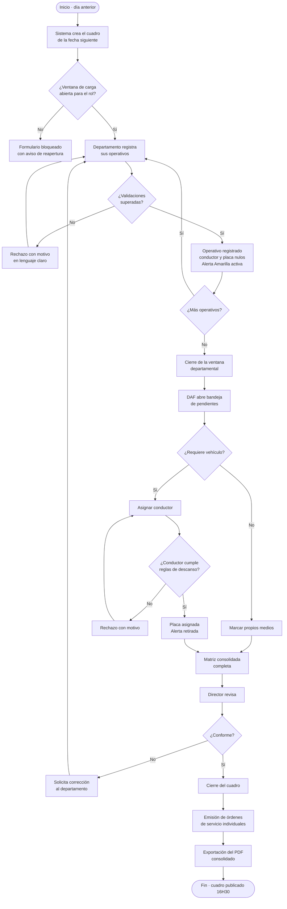

### 11.2 Flujo de estados del operativo

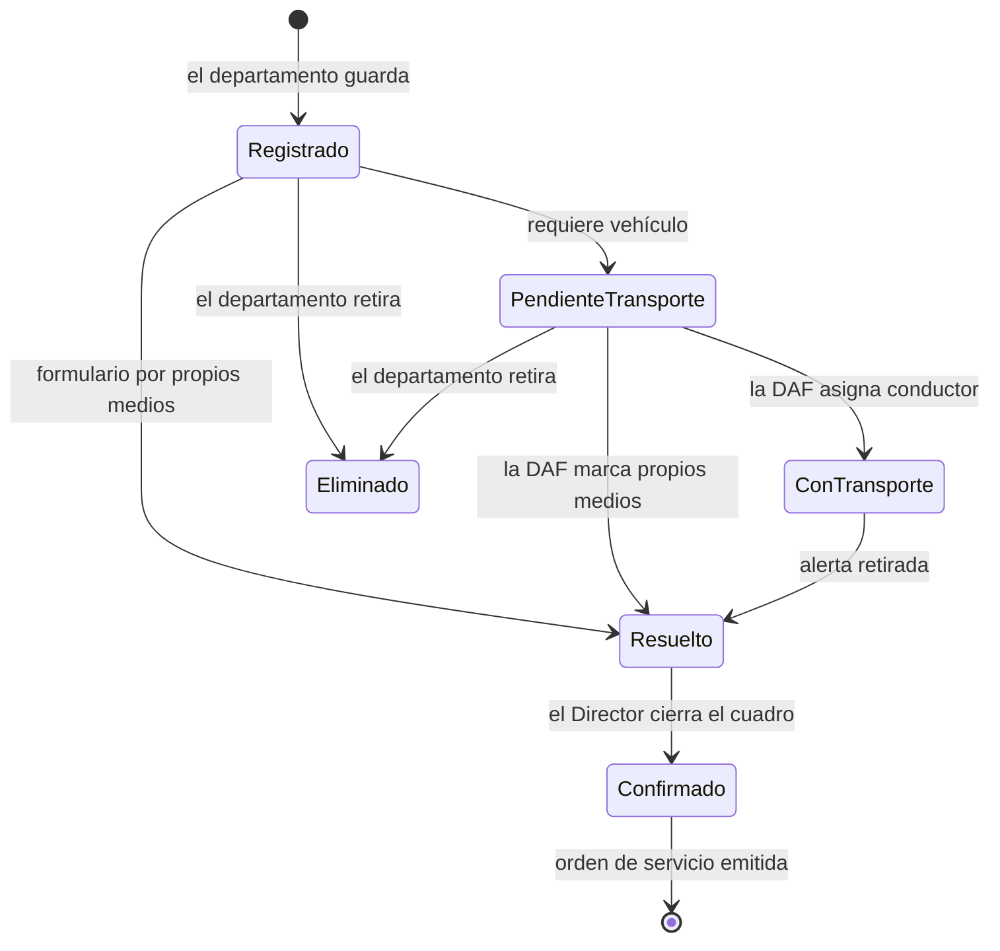

### 11.3 Flujo de estados del cuadro

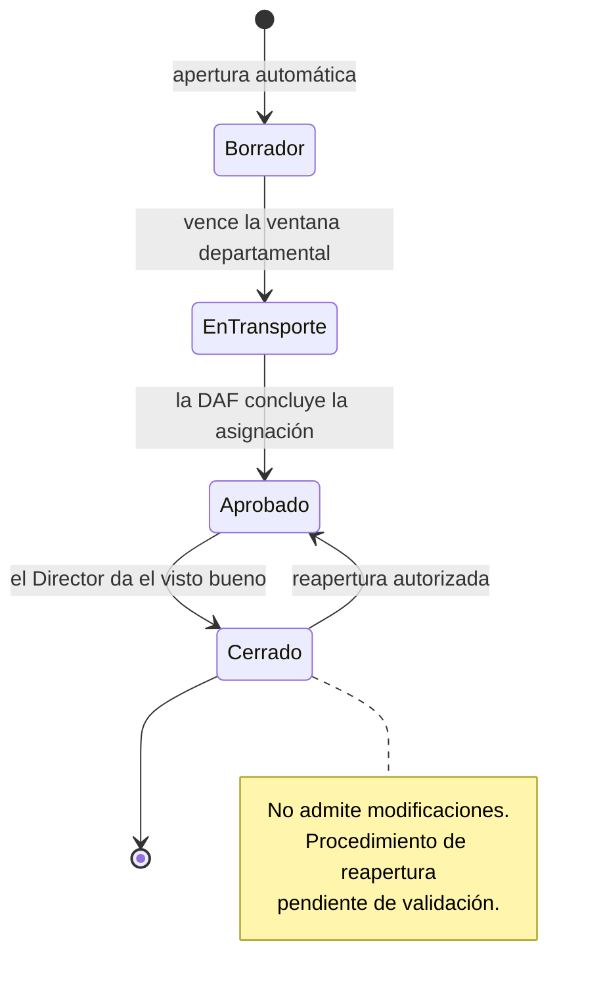

### 11.4 Ciclo de la alerta logística

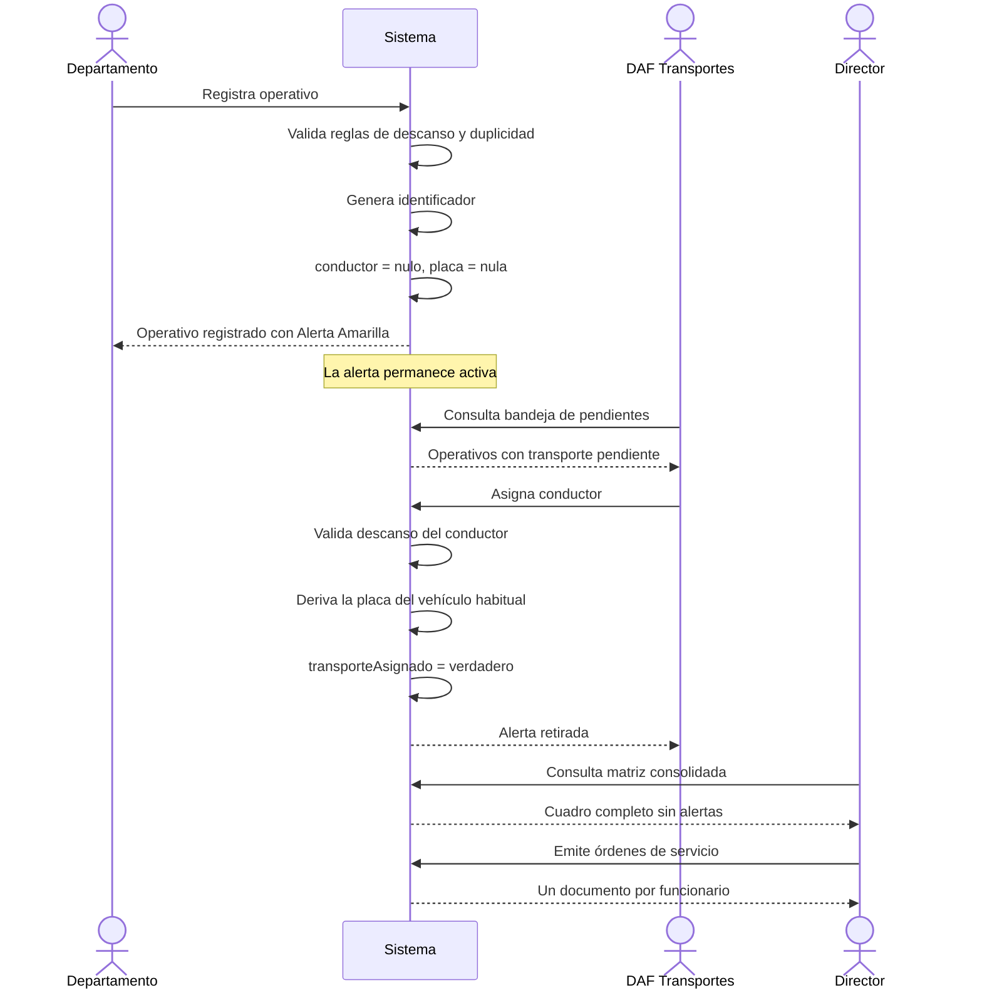

---

## 12. BPMN

### 12.1 Proceso de negocio integral

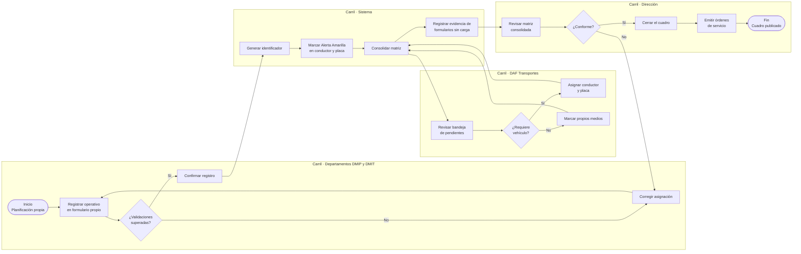

### 12.2 Subproceso · Validación de asignación de personal

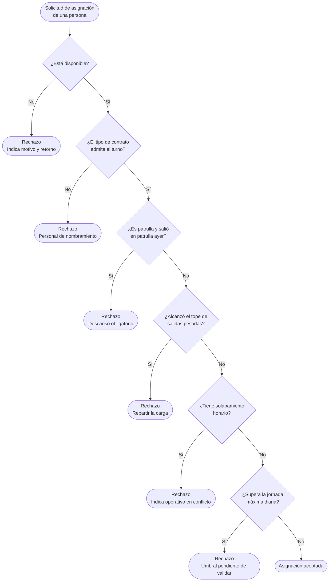

### 12.3 Subproceso · Emisión de órdenes de servicio

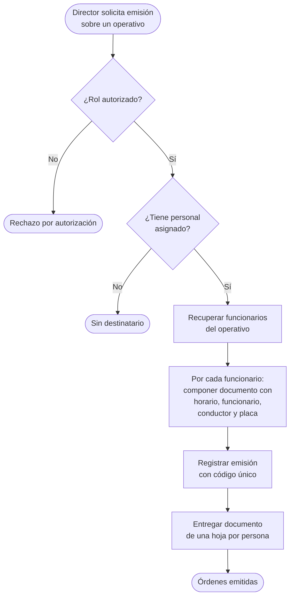

---

## 13. MATRIZ CRUD

Convención: **C** crear, **R** consultar, **U** actualizar, **D** eliminar. El guion indica ausencia de permiso.

### 13.1 Matriz CRUD por entidad y rol

| Entidad | `DMIP_OPERATIVOS` | `DMIP_INSPECCIONES` | `DMIT_INSTRUCTOR` | `DAF` | `DIRECTOR` | `ADMINISTRADOR_DMIP` |
|---|---|---|---|---|---|---|
| Cuadro diario | R | R | R | R | R U | C R U |
| Operativo · formularios 1-4 | C R U D | R¹ | R¹ | R U² | R | R |
| Operativo · formularios 5, 6, 8 | R¹ | C R U D | R U³ | R U² | R | R |
| Operativo · formularios 7, 9 | R¹ | R¹ | C R U D | R U² | R | R |
| Asignación de personal | C R U D | C R U D | C R U D | R | R | R |
| Zonales del operativo | C R U D | C R U D | C R U D | R | R | R |
| Instituciones del operativo | C R U D | C R U D | C R U D | R | R | R |
| Conductor y placa del operativo | R | R | R | **R U** | R | R |
| Orden de servicio | — | — | — | — | **C R** | R |
| Formulario · definición | R | R | R | R | R | C R U D |
| Punto de encuentro | R | R | R | R | R | C R U D |
| Tipo de control | R | R | R | R | R | C R U D |
| Institución | R | R | R | R | R | C R U D |
| Zonal | R | R | R | R | R | C R U D |
| Funcionario | R | R | R | R | R | C R U D |
| Disponibilidad | R | R | R | R | R | C R U D |
| Conductor | R | R | R | R | R | C R U D |
| Vehículo | R | R | R | R | R | C R U D |
| Capacidad de flota | — | — | — | R | R | C R U D |
| Ventana de carga | R | R | R | R | R | C R U D |
| Auditoría | — | — | — | — | R | R |
| Solicitud de apoyo | C R U | C R U | C R U | — | R | R |

**Notas:**
1. Lectura restringida a los operativos propios del departamento. No accede a los de otros formularios.
2. Actualización limitada exclusivamente a los campos conductor y placa.
3. En el formulario 6, la actualización se limita a la asignación del cupo de personal de Instrucción.

### 13.2 Matriz CRUD por caso de uso

| Caso de uso | Entidades afectadas | Operación |
|---|---|---|
| CU-01 Registrar operativo | Operativo, Asignación de personal, Zonales, Instituciones | C |
| CU-02 Editar operativo | Operativo, Asignación de personal, Zonales, Instituciones, Auditoría | U, C |
| CU-03 Eliminar operativo | Operativo, Auditoría | D, C |
| CU-04 Consultar mis operativos | Operativo | R |
| CU-05 Asignar transporte | Operativo, Auditoría | U, C |
| CU-06 Marcar propios medios | Operativo, Auditoría | U, C |
| CU-07 Consultar matriz | Operativo, Formulario, Catálogos | R |
| CU-08 Exportar PDF | Operativo, Formulario | R |
| CU-09 Emitir orden de servicio | Orden de servicio, Operativo, Funcionario | C, R |
| CU-10 Cerrar el cuadro | Cuadro diario, Auditoría | U, C |
| CU-11 Administrar catálogos | Punto, Tipo de control, Institución, Zonal | C R U D |
| CU-12 Administrar personal | Funcionario, Disponibilidad, Conductor, Vehículo | C R U D |
| CU-13 Solicitar apoyo | Solicitud de apoyo | C |
| CU-14 Consultar mi orden | Orden de servicio | R |

---

## 14. MATRIZ RACI

Convención: **R** responsable de ejecutar, **A** rinde cuentas, **C** consultado, **I** informado.

### 14.1 RACI de procesos operativos

| Actividad | DMIP Operativos | DMIP Inspecciones | DMIT Instrucción | DAF Transportes | Dirección | Administrador |
|---|:---:|:---:|:---:|:---:|:---:|:---:|
| Apertura del cuadro diario | I | I | I | I | A | R |
| Registro de operativos formularios 1-4 | **R** | I | I | I | A | — |
| Registro de operativos formularios 5, 6, 8 | I | **R** | C | I | A | — |
| Registro de operativos formularios 7, 9 | I | I | **R** | I | A | — |
| Asignación de cupo en formulario 6 | I | C | **R** | I | A | — |
| Asignación de conductor y placa | I | I | I | **R** | A | — |
| Consolidación de la matriz | I | I | I | I | **A/R** | — |
| Revisión y cierre del cuadro | I | I | I | I | **A/R** | — |
| Emisión de órdenes de servicio | I | I | I | I | **A/R** | — |
| Exportación del cuadro | I | I | I | I | **A/R** | — |
| Distribución de órdenes al personal | I | I | I | I | **A/R** | — |

### 14.2 RACI de procesos de soporte

| Actividad | DMIP Operativos | DMIP Inspecciones | DMIT Instrucción | DAF Transportes | Dirección | Administrador |
|---|:---:|:---:|:---:|:---:|:---:|:---:|
| Alta de punto de encuentro | C | C | C | I | A | **R** |
| Alta de tipo de control | C | C | C | I | A | **R** |
| Alta de institución participante | C | C | C | I | A | **R** |
| Alta y baja de personal | C | C | C | I | A | **R** |
| Registro de ausencias | C | C | C | C | A | **R** |
| Alta de conductores y vehículos | I | I | I | **C** | A | **R** |
| Declaración de capacidad de flota | I | I | I | **R** | A | C |
| Parametrización de ventanas horarias | C | C | C | C | **A** | **R** |
| Normalización de valores capturados como adicionales | C | C | C | I | A | **R** |

### 14.3 RACI del proyecto

| Fase | Business Analyst | Product Owner | Arquitecto | Tech Lead | Desarrollo | QA | DevOps |
|---|:---:|:---:|:---:|:---:|:---:|:---:|:---:|
| Análisis funcional | **R** | **A** | C | C | I | C | I |
| Documentación funcional | **R** | **A** | C | C | I | C | I |
| Diseño técnico | C | **A** | **R** | C | C | I | C |
| Modelo de datos | C | I | **R** | C | C | I | C |
| Implementación backend | I | I | C | **A** | **R** | C | I |
| Implementación frontend | I | I | C | **A** | **R** | C | I |
| Pruebas funcionales | C | **A** | I | C | C | **R** | I |
| Despliegue | I | I | C | **A** | C | C | **R** |
| Capacitación a usuarios | **R** | **A** | I | I | C | C | I |

---

## 15. CATÁLOGO DE ENTIDADES

### 15.1 Modelo conceptual

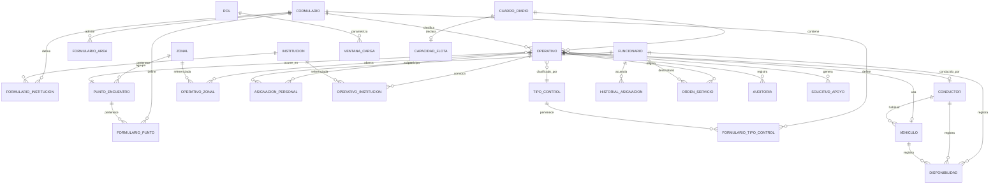

### 15.2 Fichas de entidad

---

**ENT-01 · CUADRO_DIARIO**
Representa la jornada operativa completa. Es la raíz de agregación.

| Atributo | Tipo | Obligatorio | Descripción |
|---|---|---|---|
| Fecha | Fecha | Sí | Fecha de ejecución. Única en el sistema |
| Orden de trabajo | Texto | Sí | Identificador institucional del día |
| Número de semana | Entero | Sí | Calculado conforme a ISO 8601 |
| Año de la semana | Entero | Sí | Complemento del número de semana |
| Estado | Enumerado | Sí | Borrador, En transporte, Aprobado, Cerrado |
| Cerrado por | Referencia | No | Usuario que ejecutó el cierre |
| Fecha de cierre | Fecha y hora | No | Momento del cierre |

*Reglas asociadas:* RN-01, RN-05, RN-06, RN-58

---

**ENT-02 · FORMULARIO**
Define cada uno de los nueve bloques del cuadro, su propiedad departamental y su comportamiento.

| Atributo | Tipo | Obligatorio | Descripción |
|---|---|---|---|
| Número | Entero | Sí | Del 1 al 9 |
| Código | Texto | Sí | Identificador corto |
| Nombre | Texto | Sí | Denominación oficial |
| Prefijos de identificador | Lista de texto | Sí | Siglas para la generación del código |
| Color de fondo | Texto | Sí | Valor hexadecimal del banner |
| Color de acento | Texto | Sí | Valor hexadecimal complementario |
| Nombre del color | Texto | Sí | Denominación en lenguaje natural |
| Rol dueño | Enumerado | Sí | Departamento con escritura plena |
| Rol compartido | Enumerado | No | Departamento con escritura acotada |
| Cupo del rol compartido | Entero | No | Número máximo de asignaciones del rol compartido |
| Áreas de personal admitidas | Lista | Sí | Áreas cuyo personal puede asignarse |
| Política de vehículo | Enumerado | Sí | No aplica, Condicional, Requerido, Obligatorio |
| Condicionante nocturno | Booleano | Sí | Indica si aplica la exigencia de conductor en franja 20H00 a 05H00 |
| Es patrulla | Booleano | Sí | Determina si aplican las reglas de descanso de patrulla |

*Reglas asociadas:* RN-14, RN-15, RN-16, RN-41, RN-42, RN-43

---

**ENT-03 · OPERATIVO**
Fila del cuadro. Unidad mínima de planificación.

| Atributo | Tipo | Obligatorio | Descripción |
|---|---|---|---|
| Identificador de operativo | Texto | Sí | Generado automáticamente |
| Secuencial del día | Entero | Sí | Se reinicia cada jornada |
| Cuadro | Referencia | Sí | Cuadro diario al que pertenece |
| Formulario | Referencia | Sí | Bloque que lo clasifica |
| Hora de inicio | Texto | Sí | En intervalos de treinta minutos |
| Hora de fin | Texto | Sí | En intervalos de treinta minutos |
| Es nocturno | Booleano | Sí | Derivado del rango horario |
| Duración en horas | Decimal | Sí | Calculada |
| Punto de encuentro | Referencia | No | Nulo cuando se captura como adicional |
| Punto capturado como adicional | Texto | No | Texto libre cuando no existe en catálogo |
| Tipo de control | Referencia | No | Nulo cuando se captura como adicional |
| Tipo capturado como adicional | Texto | No | Texto libre cuando no existe en catálogo |
| Conductor | Referencia | No | **Nulo al registrar.** Lo completa la DAF |
| Vehículo | Referencia | No | **Nulo al registrar.** Lo completa la DAF |
| Transporte asignado | Booleano | Sí | Distingue el nulo pendiente del nulo definitivo |
| Propios medios | Booleano | Sí | Indica que no requiere vehículo |
| Observaciones | Texto largo | No | Coordinaciones y novedades |
| Alerta activa | Booleano | Sí | Señala información pendiente |
| Detalle de alertas | Estructura | No | Campo, nivel y mensaje de cada alerta |
| Creado por rol | Enumerado | Sí | Departamento que registró |
| Modificado por rol | Enumerado | Sí | Departamento que modificó por última vez |

*Reglas asociadas:* RN-09 a RN-13, RN-40, RN-52, RN-55

---

**ENT-04 · FUNCIONARIO**

| Atributo | Tipo | Obligatorio | Descripción |
|---|---|---|---|
| Cédula | Texto | Sí | Identificación única |
| Apellidos y nombres | Texto | Sí | — |
| Teléfono | Texto | No | Asociado a la persona. No editable desde el formulario |
| Cargo | Texto | No | Denominación funcional |
| Área | Enumerado | Sí | Cuatro valores. Ver la tabla de abajo |
| Tipo de contrato | Enumerado | Sí | Nombramiento u Ocasional |
| Dirección | Enumerado | Sí | Departamento al que pertenece |
| Activo | Booleano | Sí | Permite la baja lógica |

*Reglas asociadas:* RN-26, RN-27, RN-34

---

**ENT-05 · DISPONIBILIDAD**
Registra las ausencias que excluyen a una persona, conductor o vehículo de la asignación.

| Atributo | Tipo | Obligatorio |
|---|---|---|
| Funcionario, conductor o vehículo | Referencia | Sí |
| Estado | Enumerado | Sí |
| Desde | Fecha | Sí |
| Hasta | Fecha | Sí |
| Motivo | Texto | No |

*Estados:* Disponible, Vacaciones, Reposo médico, Calamidad, Permiso, Mantenimiento
*Reglas asociadas:* RN-30, RN-45

---

**ENT-06 · HISTORIAL_ASIGNACION**
Alimenta las reglas de descanso. Se consolida al cerrar cada cuadro.

| Atributo | Tipo | Obligatorio | Descripción |
|---|---|---|---|
| Funcionario | Referencia | Sí | — |
| Fecha | Fecha | Sí | Jornada registrada |
| Fue patrulla | Booleano | Sí | Determina el bloqueo del día siguiente |
| Fue nocturna | Booleano | Sí | Suma al tope de salidas pesadas |
| Fue fin de semana | Booleano | Sí | Suma al tope de salidas pesadas |
| Horas de jornada | Decimal | Sí | Acumulado del día |

*Reglas asociadas:* RN-24, RN-25, RN-36

---

**ENT-07 · CONDUCTOR** · **ENT-08 · VEHICULO**

Conductor mantiene nombre, teléfono y vehículo habitual. Vehículo mantiene placa y descripción. Ambos admiten registro de disponibilidad.

*Reglas asociadas:* RN-44, RN-45

---

**ENT-09 · ZONAL** · **ENT-10 · PUNTO_ENCUENTRO** · **ENT-11 · TIPO_CONTROL** · **ENT-12 · INSTITUCION**

Catálogos maestros. Los tres últimos se vinculan a los formularios mediante tablas puente, dado que cada formulario expone su propio subconjunto. El punto de encuentro pertenece siempre a una zonal, lo que permite el filtrado en cascada.

*Reglas asociadas:* RN-16, RN-17, RN-18

---

**ENT-13 · ORDEN_SERVICIO**

| Atributo | Tipo | Obligatorio |
|---|---|---|
| Operativo | Referencia | Sí |
| Funcionario | Referencia | Sí |
| Código | Texto | Sí |
| Emitida por | Referencia | Sí |
| Fecha de emisión | Fecha y hora | Sí |
| Ruta del documento | Texto | No |

Existe una orden por combinación de operativo y funcionario.
*Reglas asociadas:* RN-49, RN-50

---

**ENT-14 · VENTANA_CARGA**
Parametriza los horarios de cierre por rol, de modo que la Dirección pueda modificarlos sin intervención técnica.

| Atributo | Tipo | Obligatorio |
|---|---|---|
| Rol | Enumerado | Sí |
| Tipo de ventana | Enumerado | Sí |
| Día y hora de apertura | Texto | No |
| Día y hora de cierre | Texto | No |
| Zona horaria | Texto | Sí |
| Mensaje de cierre | Texto | Sí |

*Reglas asociadas:* RN-56, RN-59

---

**ENT-15 · CAPACIDAD_FLOTA** · **ENT-16 · AUDITORIA** · **ENT-17 · SOLICITUD_APOYO**

Capacidad de flota declara vehículos y conductores hábiles por fecha. Auditoría registra campo, valor anterior, valor nuevo, usuario, rol y momento. Solicitud de apoyo vincula un operativo con la dirección a la que se solicita personal.

*Reglas asociadas:* RN-46, RF-060 a RF-063

---

## 16. CATÁLOGO DE FORMULARIOS

### 16.1 Cabecera común

Los nueve formularios comparten la misma estructura de nueve columnas, verificada en la Hoja2 del libro Excel. Lo que varía entre ellos es el contenido de los catálogos, no la estructura.

| # | Columna |
|---|---|
| 1 | ID OPERATIVO |
| 2 | HORARIO |
| 3 | PERSONAL ASIGNADO / TELÉFONO |
| 4 | ZONAL |
| 5 | PUNTO DE ENCUENTRO |
| 6 | TIPO DE CONTROL |
| 7 | INSTITUCIONES PARTICIPANTES |
| 8 | CONDUCTOR / TELÉFONO |
| 9 | PLACA DEL VEHÍCULO |

> **IMPLEMENTADO EL 2026-08-27, Y CON EL TELÉFONO EN COLUMNA PROPIA.**
>
> Hasta esa fecha el teléfono **no se pintaba en ninguna tabla**: el dato viajaba en
> `PersonaAsignada` y se descartaba al componer la celda. RF-015, RN-34 y HU-07 lo pedían
> —«necesito que mi teléfono aparezca correcto en el cuadro, porque me han llamado un
> domingo por un operativo que no era el mío»— y no estaba.
>
> **La Hoja2 agrupa «PERSONAL ASIGNADO / TELÉFONO» en una columna; la implementación usa
> dos**, por decisión del negocio del 27-AGO con el instrumento delante. El efecto en
> pantalla es el mismo que en el Excel porque **las filas se agrupan**: un operativo con
> tres asignados ocupa tres renglones, con nombre y teléfono en el suyo, y todo lo demás
> —identificador, horario, punto, acciones— en una sola celda que los abarca.
>
> **Está en las cuatro pantallas del cuadro —P-01, P-02, P-04 y P-13— y en el PDF de la
> matriz.** P-13 se sumó el mismo día, después que las otras tres.
>
> **Que el DMIT vea el teléfono de las otras dos direcciones es una decisión, no un
> descuido.** P-13 muestra los nueve formularios por el acuerdo del 2026-08-26, y dejar
> ahí una columna vacía en las secciones ajenas habría sido peor que no tenerla: la
> pantalla diría que esa gente no tiene teléfono. Queda anotado junto a PER-02 porque es
> la misma línea que aquel acuerdo movió.
>
> **P-13 conserva su columna de acciones, y ahí la agrupación añade una regla propia:**
> «Agregar personal» es del operativo, no de la persona, así que va en el primer renglón y
> abarca los demás. Repetirlo daría tres botones que abren el mismo panel. Hay una prueba
> que lo fija, y al romperla caen otras cuatro.
>
> **El PDF cambió más que la pantalla.** Su celda decía `ULLOA +2`: nombraba a una persona
> de tres y no daba ningún teléfono, en el artefacto que se reparte. Ahora imprime a
> todos, con altura de fila variable, y los anchos siguen sumando `ANCHO_UTIL` exacto
> —los 50 puntos del teléfono salen de zonal, punto, tipo, conductor y observaciones—.

> El campo OBSERVACIONES aparece en la propuesta final del Product Owner y en el cuadro real, pero no en la cabecera de la Hoja2. Se incorpora al modelo por su uso efectivo. `PENDIENTE DE VALIDACIÓN CON EL USUARIO`.

### 16.2 Resumen de los nueve formularios

| # | Formulario | Prefijos | Color | Departamento | Personal admitido | Vehículo | Condicionante nocturno |
|---|---|---|---|---|---|---|---|
| 1 | Operativos de Control Fijos | `OCF` | Verde azulado `#A2C4C9` | DMIP Operativos | Operativos | Propios medios | No |
| 2 | Control de Punto de Mando Operativo | `OCPMO`, `OCAPMO` | Naranja claro `#FCE5CD` | DMIP Operativos | Operativos | Condicional | **Sí** |
| 3 | Operativos de Control Limpiaparabrisas | `OCL` | Azul `#B4C6E7` | DMIP Operativos | Operativos | Propios medios | No |
| 4 | Patrulla ECU Diurna | `OCECU` | Gris `#D9D9D9` | DMIP Operativos | Instrucción, Unidad de Operativos | Requerido | No |
| 5 | Patrulla Reacción Diurna (UIG - UIT) | `IGECU`, `ITECU` | Rosado `#FFCCCC` | DMIP Inspecciones | Inspectores Generales, Inspectores Técnicos | Requerido | **Sí** |
| 6 | Patrulla Reacción Nocturna | `ICNECU`, `IGNECU`, `ITNECU` | Rojo claro `#F4CCCC` | DMIP Inspecciones + cupo DMIT | Instrucción, Generales, Técnicos | Requerido | **Sí** |
| 7 | Operativo DMIT | `OC`, `IC`, `OCA`, `ICA` | Naranja fuerte `#FCE4D6` | DMIT Instrucción | Instrucción, Unidad de Operativos | Requerido | **Sí** |
| 8 | Inspecciones Técnicas y Generales | `IG`, `IT`, `IGA`, `ITA` | Morado `#CCCCFF` | DMIP Inspecciones | Inspectores Generales, Inspectores Técnicos | Requerido | No |
| 9 | Operativo de Control AMC-CBQ | `OCB` | Verde pastel `#D9EAD3` | DMIT Instrucción | Instrucción | No se habilita | **Sí** — contradictorio |

> **Inconsistencia en la fuente.** El formulario 9 declara simultáneamente el condicionante nocturno y la no habilitación de conductor y placa. `PENDIENTE DE VALIDACIÓN CON EL USUARIO`.

> **Observación sobre el número de códigos.** La Hoja2 indica textualmente que el formulario 5 debe generar tres códigos pero enumera dos prefijos; el formulario 6 indica un código y enumera tres; el formulario 8 indica dos y enumera cuatro. `PENDIENTE DE VALIDACIÓN CON EL USUARIO`.
>
> **RESUELTO PARA EL FORMULARIO 6 (2026-09-17):** genera **tres** códigos, uno por área —`IGNECU`
> (Inspector General), `ITNECU` (Inspector Técnico) e `INECU` (Instrucción)—, un operativo por
> persona (`form_varios_por_persona`, como el 5 y el 8). Y **el DMIT pasa a REGISTRAR** su cupo de
> Instrucción como operativo propio `INECU` (antes solo lo aportaba y quedaba sin código): es una
> **excepción a PER-08 acotada a este cupo del 6**, con la restricción de área que impone
> `reglaAreaDelRegistranteInvitado` (un registrante invitado —ESCRITURA no dueño— solo pone áreas
> compartidas).

### 16.3 Catálogos por formulario

**Formulario 1 · Operativos de Control Fijos**

| Catálogo | Valores |
|---|---|
| Zonales | Las diez zonales |
| Puntos de encuentro | HCAM · KFC – Caja del Seguro · Parque Tumbaco · Parque Central de Pifo · Estación Río Coca · Rocafuerte y García Moreno · Tejar |
| Tipos de control | Control espacio público · Control licenciamiento · Control libadores · Control espacio público - licenciamiento · Control licenciamiento - libadores · Control espacio público - licenciamiento - libadores · Control espacio público - libadores · Control espacio público (todas las facultades) |
| Instituciones | AMC · Secretaría de Seguridad · CACMQ |
| Conductor | Propios medios |
| Placa | No se activa |

**Formulario 2 · Control de Punto de Mando Operativo (PMO)**

| Catálogo | Valores |
|---|---|
| Zonales | Las diez zonales |
| Puntos de encuentro | PMO La Basílica · PMO Plaza Gabriela Mistral · PMO NNUU y Shyris · PMO Cumbayá · PMO Chaquiñán · PMO Plaza Argentina (Túnel Guayasamín) · PMO Panecillo · PMO La Carolina · PMO Centro Histórico |
| Tipos de control | Los ocho del formulario 1, más `ADICIONALES` |
| Instituciones | AMC · Secretaría de Seguridad · CACMQ |
| Conductor | Lista de conductores, o propios medios. Se activa solo en horario extraordinario |
| Placa | Se despliega solo cuando se habilita la asignación de conductor |

**Formulario 3 · Operativos de Control Limpiaparabrisas**

| Catálogo | Valores |
|---|---|
| Zonales | Las diez zonales |
| Puntos de encuentro | Ingreso de la Estación El Recreo · Quicentro Sur · Plaza Argentina (Túnel Guayasamín) |
| Tipos de control | Control espacio público (todas las facultades) |
| Instituciones | AMC · Secretaría de Seguridad · CACMQ |
| Conductor | Propios medios |
| Placa | No se activa |

**Formulario 4 · Patrulla ECU Diurna**

| Catálogo | Valores |
|---|---|
| Zonales | DMQ |
| Puntos de encuentro | AMC Matriz · AMC Eloy Alfaro · AMC Valles Los Chillos · AMC Valles Tumbaco |
| Tipos de control | Alertas ECU 911 |
| Instituciones | AMC · Secretaría de Seguridad · CACMQ · PPNN · EMGIRS |
| Personal | Dos listas: personal de Instrucción y personal de la Unidad de Operativos |

**Formulario 5 · Patrulla Reacción Diurna (UIG - UIT)**

| Catálogo | Valores |
|---|---|
| Zonales | DMQ |
| Puntos de encuentro | AMC Matriz |
| Tipos de control | Alertas ECU 911 |
| Instituciones | AMC · Secretaría de Seguridad · CACMQ · PPNN · EMGIRS |
| Personal | Dos listas: Inspectores Generales e Inspectores Técnicos |

**Formulario 6 · Patrulla Reacción Nocturna**

| Catálogo | Valores |
|---|---|
| Zonales | DMQ |
| Puntos de encuentro | AMC Matriz |
| Tipos de control | Alertas ECU 911 |
| Instituciones | AMC · Secretaría de Seguridad · CACMQ · PPNN · EMGIRS |
| Personal | Tres listas: Instrucción, Inspectores Generales e Inspectores Técnicos |

**Formulario 7 · Operativo DMIT**

| Catálogo | Valores |
|---|---|
| Zonales | Las diez zonales |
| Puntos de encuentro | Treinta y cinco valores: administraciones zonales, distritos de Policía Nacional, comandos CACMQ de las diez zonales, UVC Calderón, UPC Buenos Aires, UPC La Gasca y PPC Eugenio Espejo |
| Tipos de control | Veintidós valores, entre ellos Intervenciones de control · Operativos de control · Quito en Control · Control de fauna urbana · Atención a denuncias · Entrega de actas de advertencia |
| Instituciones | Dieciséis valores, entre ellos AMC · Secretaría de Seguridad · CACMQ · PPNN · Comisaría · Fuerzas Armadas · AMT · Cuerpo de Bomberos · Migración · EMGIRS · COE · EPMMOP |
| Personal | Dos listas: Instrucción y Unidad de Operativos |

**Formulario 8 · Inspecciones Técnicas y Generales**

| Catálogo | Valores |
|---|---|
| Zonales | Las diez zonales |
| Puntos de encuentro | Las diez sedes AMC zonales |
| Tipos de control | Veinticuatro valores, con el detalle completo de re-inspecciones: por caducidad, nulidad total, inexistencia, instrucción, apelación, actuación previa, inadmisión, advertencia, con dron; más Programación de control de oficio · Denuncias ciudadanas · Emergencias · Redes sociales · CCF / ITCC · IVA · `ADICIONALES` |
| Instituciones | AMC · Secretaría de Seguridad · CACMQ · PPNN · EMGIRS |
| Personal | Dos listas: Inspectores Generales e Inspectores Técnicos |

**Formulario 9 · Operativo de Control AMC-CBQ**

| Catálogo | Valores |
|---|---|
| Zonales | DMQ |
| Puntos de encuentro | Estación de bomberos Veintimilla y Reina Victoria |
| Tipos de control | Control de todas las competencias de AMC |
| Instituciones | AMC · CBQ · CACMQ |
| Personal | Personal de Instrucción |

> `PENDIENTE DE VALIDACIÓN CON EL USUARIO` — La matriz de correspondencia entre cada zonal y sus puntos de encuentro, por formulario. La Hoja2 enumera zonales y puntos en columnas paralelas sin establecer la relación entre ambos. El Product Owner asumió el compromiso de entregarla.

---

## 17. CATÁLOGO DE REPORTES

| ID | Reporte | Emisor | Formato | Contenido | Estado |
|---|---|---|---|---|---|
| REP-01 | Matriz Consolidada del Día | Director | Documento horizontal | Los nueve formularios con sus banners de color, todas las filas, alertas y evidencia de formularios sin carga. Incluye logotipo institucional, orden de trabajo, fecha y bloque de firmas | Definido |
| REP-02 | Orden de Servicio Individual | Director | Documento vertical | Horario, funcionario, conductor y placa. Una hoja por funcionario | Definido |
| REP-03 | Operativos por departamento | Departamento | Consulta en pantalla | Filas propias del departamento con su estado de asignación logística | Definido |
| REP-04 | Bandeja de asignación logística | DAF | Consulta en pantalla | Operativos de los nueve formularios, con pendientes en primer lugar | Definido |
| REP-05 | Resumen de capacidad de flota | DAF | Consulta en pantalla | Vehículos solicitados frente a vehículos hábiles declarados | Definido |
| REP-06 | Estadísticas por unidad | Departamento | Consulta en pantalla | Operativos ejecutados por día, semana y formulario | `PENDIENTE DE VALIDACIÓN CON EL USUARIO` — indicadores exactos por definir |
| REP-07 | Histórico de cuadros | Director | Consulta en pantalla | Cuadros de fechas anteriores | `PENDIENTE DE VALIDACIÓN CON EL USUARIO` — política de retención por definir |
| REP-08 | Auditoría de cambios | Director | Consulta en pantalla | Modificaciones por operativo, con departamento y momento | Definido |

### 17.1 Especificación de REP-01 · Matriz Consolidada

| Elemento | Contenido |
|---|---|
| Encabezado | Logotipo institucional, denominación de la Dirección Nacional de Planificación, número de orden de trabajo, fecha en lenguaje natural y número de semana |
| Cuerpo | Nueve secciones, una por formulario, cada una encabezada por su banner de color y el nombre del departamento responsable |
| Filas | Las nueve columnas de la cabecera común, más observaciones |
| Marcado | Celdas pendientes en Amarillo de Alerta; celdas críticas con borde distintivo |
| Evidencia | Leyenda de información no ingresada en los formularios sin carga |
| Pie | Bloque de firmas de elaboración, revisión y aprobación; fecha y hora de generación |
| Exclusiones | Ningún control de interfaz aparece en el documento |

### 17.2 Especificación de REP-02 · Orden de Servicio

| Elemento | Contenido |
|---|---|
| Encabezado | Logotipo institucional, denominación del documento, código del operativo, orden de trabajo y fecha |
| Aviso | Texto que declara que el documento contiene únicamente la asignación del destinatario |
| Cuerpo | Cuatro datos: horario, funcionario asignado con su cargo y teléfono, conductor con su teléfono, y placa del vehículo |
| Firmas | Dos bloques: funcionario asignado y Dirección |
| Pie | Fecha de generación, numeración de hoja y perfil emisor |
| Exclusiones | No incluye punto de encuentro de otros operativos, instituciones participantes, observaciones ni ninguna otra fila de la jornada |

---

## 18. CATÁLOGO DE NOTIFICACIONES

> **Advertencia sobre esta sección.** Las fuentes analizadas describen la necesidad de avisar en tres situaciones concretas, pero no establecen canales, destinatarios formales ni plantillas. Los eventos se documentan a partir de lo declarado; los canales quedan marcados como pendientes.

> **NINGUNA DE LAS SIETE ESTÁ CONSTRUIDA, Y CONVIENE DECIRLO AQUÍ. 2026-08-27.**
>
> No hay tabla de notificaciones, ni módulo, ni endpoint: la campana de la barra superior
> devuelve la lista vacía por código y dice «Sin notificaciones por leer» siempre. Es
> coherente con esta sección —cinco de las siete filas siguen `PENDIENTE DE VALIDACIÓN`—,
> pero quien mire la pantalla sin leer esto lo tomará por una avería.
>
> **El primer caso concreto llegó el 2026-08-27 y se resolvió sin abrir un canal.** El
> negocio pidió que el DMIT se enterase cuando DMIP Operativos registra un operativo de la
> 4 · Patrulla ECU Diurna que necesita a su gente. Ninguna fila de esta tabla lo cubre —la
> más cercana, NOT-01, es «solicitud de apoyo», que es otra cosa—, y construir el
> subsistema entero habría obligado a **decidir por el negocio** lo que el negocio dejó sin
> validar: si el aviso caduca con el cuadro del día, si lo recibe el departamento o una
> persona, y qué pasa al retirar el operativo.
>
> Se hizo lo contrario: **el aviso se da donde el DMIT ya trabaja**, en su propia jornada
> (P-13), y es `ALV-08` de §18.1. No inventa canal, no inventa destinatario y no crea
> estado que mantener. Cuando el negocio valide los canales, esta decisión no estorba: un
> aviso en pantalla y una notificación conviven, como ya conviven ALV-07 y NOT-03.

| ID | Evento | Destinatario | Momento | Canal | Estado |
|---|---|---|---|---|---|
| NOT-01 | Solicitud de apoyo a otra dirección | Dirección requerida | Al registrarse la solicitud | `PENDIENTE DE VALIDACIÓN` | Evento declarado en fuente |
| NOT-02 | Operativo pendiente de asignación logística | DAF Transportes | Al cerrarse la ventana departamental | `PENDIENTE DE VALIDACIÓN` | Evento declarado en fuente |
| NOT-03 | Formulario sin información al vencer la ventana | Dirección | Al vencimiento de la ventana | Visible en la matriz y en el documento exportado | Definido |
| NOT-04 | Demanda de vehículos superior a la capacidad | DAF Transportes y Dirección | Al superarse el umbral | Aviso en pantalla | Definido |
| NOT-05 | Orden de servicio emitida | Funcionario asignado | Al emitirse | `PENDIENTE DE VALIDACIÓN` | Canal por definir |
| NOT-06 | Cuadro cerrado y publicado | Directores y Supervisor | Al cierre | `PENDIENTE DE VALIDACIÓN` | Canal por definir |
| NOT-07 | Recordatorio de cierre próximo | Departamentos con carga pendiente | Antes del vencimiento | `PENDIENTE DE VALIDACIÓN` | Propuesta del equipo, no declarada en fuente |

### 18.1 Alertas visuales en pantalla

A diferencia de las notificaciones, las alertas visuales sí están completamente definidas en las fuentes.

| ID | Alerta | Condición | Presentación |
|---|---|---|---|
| ALV-01 | Personal sin asignar | El operativo no tiene funcionarios | Celda de personal en Amarillo de Alerta |
| ALV-02 | Conductor pendiente | El formulario requiere vehículo y la DAF no ha asignado | Celda de conductor en Amarillo de Alerta |
| ALV-03 | Placa pendiente | Consecuencia de ALV-02 | Celda de placa en Amarillo de Alerta |
| ALV-04 | Conductor obligatorio no asignado | Formulario con condicionante nocturno y horario en franja 20H00 a 05H00 | Celda de conductor en Amarillo de Alerta con borde crítico |
| ALV-05 | Observaciones vacías | El operativo no registra observaciones | Celda de observaciones en Amarillo de Alerta |
| ALV-06 | Valor capturado como adicional | El punto o el tipo de control se capturó como texto libre | Celda marcada para normalización posterior |
| ALV-07 | Formulario sin información | El formulario no tiene filas y su ventana venció | Fila de evidencia dentro del banner |
| ALV-08 | Personal pendiente **del departamento que consulta** | El operativo no tiene a nadie de un área que a ese rol le toca poner | Recuento **en todas las pantallas**, y línea con el nombre del área en cada fila de P-13 |

> **ALV-08 no es ALV-01, y confundirlas quita justo lo que aporta.** ALV-01 mira el
> operativo —«no tiene a nadie»— y es igual para todos. ALV-08 mira **a quien consulta**:
> en la 6 · Patrulla Reacción Nocturna un operativo vacío le falta personal de tres áreas,
> y de esas tres al DMIT solo le toca **una**. Reclamarle las otras dos sería pedirle gente
> que el servidor le rechazaría al asignarla, con «participa con personal de».
>
> Por eso se deriva en el servidor y no en el navegador: sale de `t_formulario_area` y
> `farea_es_compartida`, que es el mismo dato que aplica `reglaCupoCompartido` al asignar.
> Viaja como `areasPendientesDelRol` en cada fila de `GET /jornada/:fecha`, y **es
> únicamente de esa ruta**: la matriz del Director no lo lleva, porque la Dirección no
> asigna personal.

> **Y SE VE EN TODAS LAS PANTALLAS, NO SOLO EN P-13. Precisado el 2026-08-27**, el mismo
> día, a petición del negocio: «debe mostrarse en todos los formularios para que el
> personal tome acciones».
>
> El motivo es el que hace útil un aviso: **el que solo aparece en la pantalla a la que
> hay que entrar para verlo no avisa de nada**. El recuento vive en el marco de la
> aplicación (`MainLayout`), encima del contenido, y termina en un enlace a la Jornada
> del Día, porque un aviso que no se puede resolver desde donde se lee obliga a buscar
> el camino.
>
> **Tres cosas que lo hacen aceptable y que no conviene deshacer.** No se monta para
> quien no participa, y entonces **no pide nada** —la ruta está reservada por rol y
> preguntar desde otro perfil dejaría un 403 en cada navegación—. No se repite en P-13,
> que tiene su propio recuento y ese sí sigue a la fecha del selector. Y **un fallo de la
> consulta no se convierte en banner**: un 404 significa «el cuadro de mañana todavía no
> está abierto», que es lo más corriente del día, y pintarlo en rojo en las nueve
> pantallas enseñaría a no leer los avisos.

---

## 19. CATÁLOGO DE VALIDACIONES

### 19.1 Validaciones de formato y obligatoriedad

| ID | Campo | Validación | Mensaje al usuario | Severidad |
|---|---|---|---|---|
| VAL-01 | Formulario | Debe pertenecer a los autorizados para el rol | El formulario seleccionado no corresponde a su departamento | Bloqueante |
| VAL-02 | Hora de inicio | Obligatoria, en intervalos de treinta minutos | Indique la hora de inicio del operativo | Bloqueante |
| VAL-03 | Hora de fin | Obligatoria, en intervalos de treinta minutos y posterior a la de inicio | La hora de fin debe ser posterior a la de inicio | Bloqueante |
| VAL-04 | Zonal | Al menos una selección | Elija al menos una zonal | Bloqueante |
| VAL-05 | Punto de encuentro | Obligatorio; debe pertenecer a la zonal y al formulario | Elija el punto de encuentro | Bloqueante |
| VAL-06 | Punto adicional | Obligatorio si se seleccionó la opción de captura libre | Escriba el punto de encuentro adicional | Bloqueante |
| VAL-07 | Tipo de control | Obligatorio; debe pertenecer al formulario | Elija el tipo de control | Bloqueante |
| VAL-08 | Tipo adicional | Obligatorio si se seleccionó la opción de captura libre | Escriba el tipo de control adicional | Bloqueante |
| VAL-09 | Instituciones | Al menos una selección | Elija al menos una institución participante | Bloqueante |
| VAL-10 | Personal | Debe pertenecer a las áreas admitidas por el formulario. **La validación no mira el departamento**: el filtro por rol acota lo que se ofrece, no lo que se acepta | Este formulario solo admite personal de las áreas indicadas | Bloqueante |
| VAL-11 | Observaciones | Opcional | — | Informativa |

### 19.2 Validaciones de descanso y rotación

| ID | Validación | Condición de rechazo | Mensaje al usuario | Regla |
|---|---|---|---|---|
| VAL-12 | Disponibilidad del personal | La persona registra ausencia vigente en la fecha | La persona no está disponible: se indica el motivo y la fecha de retorno | RN-30 |
| VAL-13 | Tipo de contrato | Personal de nombramiento en turno nocturno o fin de semana | El personal de nombramiento cumple jornada de lunes a viernes de 08H00 a 16H30 | RN-26, RN-33 |
| VAL-14 | Patrulla consecutiva | El formulario es de patrulla y la persona salió en patrulla el día anterior | La persona salió en patrulla ayer y no puede repetir al día siguiente | RN-24 |
| VAL-15 | Tope de salidas pesadas | La persona alcanzó el tope en turno nocturno o de fin de semana | La persona alcanzó el tope de salidas pesadas. Considere repartir la carga | RN-25 |
| VAL-16 | Solapamiento de personal | Intersección horaria con otro operativo del mismo día | La persona ya está asignada a otro operativo en ese horario | RN-28 |
| VAL-17 | Jornada máxima diaria | La suma de asignaciones supera el umbral | La persona superaría la jornada máxima del día | RN-36 · umbral pendiente |
| VAL-18 | Cupo del rol compartido | El rol compartido intenta superar su cupo en el formulario | Su departamento solo puede asignar el cupo establecido en este formulario | PER-06 |

### 19.3 Validaciones de transporte

| ID | Validación | Condición de rechazo | Mensaje al usuario | Regla |
|---|---|---|---|---|
| VAL-19 | Disponibilidad del conductor | El conductor registra ausencia vigente | El conductor no está disponible: se indica el motivo | RN-45 |
| VAL-20 | Patrulla consecutiva del conductor | El conductor condujo en patrulla el día anterior | El conductor condujo en patrulla ayer y no puede repetir | RN-44 |
| VAL-21 | Solapamiento del conductor | Intersección horaria con otro operativo | El conductor ya está comprometido en otro operativo en ese horario | RN-44 |
| VAL-22 | Jornada del conductor | La suma de asignaciones supera el umbral | El conductor superaría la jornada máxima al volante | RN-44 |
| VAL-23 | Condicionante nocturno | Formulario con condicionante, horario en franja 20H00 a 05H00 y sin conductor | Este operativo requiere conductor asignado por su horario nocturno | RN-43 |
| VAL-24 | Capacidad de flota | Los vehículos solicitados superan los hábiles declarados | La demanda de vehículos supera la capacidad declarada para la fecha | RN-46 · advertencia |
| VAL-25 | Campos no autorizados | La DAF envía campos distintos de conductor y placa | Transportes solo puede modificar el conductor y la placa | RN-38 · bloqueante |

### 19.4 Validaciones de proceso

| ID | Validación | Condición de rechazo | Mensaje al usuario | Regla |
|---|---|---|---|---|
| VAL-26 | Ventana de carga | El rol intenta escribir fuera de su ventana | La ventana de carga de su departamento está cerrada. Se indica la reapertura | RN-56 |
| VAL-27 | Cuadro cerrado | Se intenta modificar un cuadro en estado cerrado | El cuadro fue cerrado por la Dirección y no admite modificaciones | RN-58 |
| VAL-28 | Autorización de escritura | El rol no es dueño del formulario | Su perfil no tiene permiso de escritura sobre este formulario | PER-01 |
| VAL-29 | Autorización de emisión | Un rol distinto de Director intenta emitir órdenes | La emisión de órdenes de servicio corresponde a la Dirección | PER-05 |
| VAL-30 | Emisión sin destinatario | Se solicita orden sobre un operativo sin personal | Este operativo no tiene personal asignado | RF-045 |
| VAL-31 | Unicidad del cuadro | Se intenta crear un cuadro para una fecha existente | Ya existe un cuadro para esa fecha | RN-05 |
| VAL-32 | Unicidad del identificador | Colisión de secuencial en registro concurrente | Se resuelve internamente mediante transacción | RN-12 |

### 19.5 Criterio de redacción de mensajes

Las fuentes son explícitas sobre la importancia de este punto. El Product Owner describió repetidamente situaciones en que el personal desconoce el motivo de un rechazo. En consecuencia, todo mensaje de validación debe:

- Nombrar a la persona, el conductor o el operativo implicado, no limitarse a describir el error.
- Explicar el motivo en términos operativos y no técnicos.
- Sugerir una acción cuando sea posible.
- Evitar formulaciones genéricas del tipo error de validación o dato inválido.

**Ejemplo comparativo:**

| Redacción inadecuada | Redacción conforme |
|---|---|
| Error de validación en el campo personal | La persona indicada salió en patrulla ayer. No puede tener patrulla dos días seguidos, ni diurna ni nocturna |
| Conflicto de horario | La persona ya está asignada al operativo `OCPMO-004` de 18H00 a 23H00 en PMO La Basílica |
| Recurso no disponible | El conductor indicado se encuentra de vacaciones hasta el 8 de agosto |

---

## 20. SÍNTESIS DE PUNTOS PENDIENTES

Consolidación de todos los elementos marcados a lo largo del documento.

| # | Pendiente | Sección | Impacto |
|---|---|---|---|
| 1 | Ubicación del rol Director: subdivisión de la DMIP o Dirección Nacional de Planificación | 3.3 | Medio |
| 2 | Número de conductores y vehículos hábiles | 3.4 | Alto |
| 3 | Cupo exacto del rol DMIT en el formulario 6 | 4.4 | Medio |
| 4 | Eliminación física o lógica de operativos | CU-03 | Bajo |
| 5 | Canal de entrega de la orden de servicio al funcionario | CU-09 | Alto |
| 6 | Formato unificado de la orden de servicio | CU-09 | Alto |
| 7 | Procedimiento de reapertura del cuadro cerrado | CU-10 | Medio |
| 8 | Flujo completo de la solicitud de apoyo interdirección | CU-13 | Medio |
| 9 | Límite máximo de horas de jornada por persona | RN-36 | Alto |
| 10 | Período de cómputo del tope de salidas pesadas | RN-37 | Alto |
| 11 | Contradicción del formulario 9: condicionante nocturno frente a vehículo no habilitado | RN-42, RN-43 | Alto |
| 12 | Momento de verificación del condicionante nocturno | RN-43 | Alto |
| 13 | Hora exacta de cierre de la carga departamental | RN-59 | Alto |
| 14 | Antelación mínima entre registro e inicio del operativo | RN-60 | Medio |
| 15 | Umbral de rendimiento de la matriz consolidada | RNF-020 | Bajo |
| 16 | Política de respaldo y restauración | RNF-038 | Medio |
| 17 | Política de retención de cuadros históricos | RNF-039 | Medio |
| 18 | Inclusión formal del campo observaciones en la cabecera | 16.1 | Bajo |
| 19 | Número de códigos por formulario frente a prefijos enumerados | 16.2 | Medio |
| 20 | Matriz de correspondencia entre zonal y punto de encuentro por formulario | 16.3 | **Bloqueante** |
| 21 | Base de personal certificada con teléfono y tipo de contrato | 3.4 | **Bloqueante** |
| 22 | Indicadores del reporte de estadísticas por unidad | REP-06 | Bajo |
| 23 | Canales de las notificaciones NOT-01, NOT-02, NOT-05 y NOT-06 | 18 | Medio |
| 24 | Alcance definitivo respecto al módulo de transporte legado | 2.2 | **Bloqueante** |

---

## 21. TRAZABILIDAD

### 21.1 De objetivo a requerimiento

| Objetivo | Reglas | Casos de uso | Requerimientos |
|---|---|---|---|
| OBJ-01 Eliminar la transcripción manual | RN-14, RN-15 | CU-01 | RF-005, RF-006, RF-007 |
| OBJ-02 Distribuir la carga entre departamentos | RN-14, PER-01 | CU-01, CU-02 | RF-005, RF-018, RF-028 |
| OBJ-03 Proteger el descanso del personal | RN-24 a RN-27, RN-30, RN-33 | CU-01 | RF-020 a RF-023, RF-026 |
| OBJ-04 Impedir duplicidad | RN-28 | CU-01, CU-05 | RF-024, RF-025 |
| OBJ-05 Retirar el cuadro de canales informales | RN-47 a RN-51 | CU-07, CU-09 | RF-039, RF-045 a RF-048 |
| OBJ-06 Establecer cierres verificables | RN-56 a RN-58 | CU-10 | RF-044, RF-059 |
| OBJ-07 Evidenciar la omisión de carga | RN-53, RN-54 | CU-07 | RF-040 |
| OBJ-08 Generar identificadores automáticos | RN-09 a RN-12 | CU-01 | RF-007, RF-008 |

### 21.2 De fuente a regla

| Fuente | Reglas derivadas |
|---|---|
| Transcripciones del Product Owner | RN-01 a RN-08, RN-12, RN-17 a RN-19, RN-22 a RN-35, RN-38, RN-44, RN-46 a RN-51, RN-53, RN-54, RN-56 a RN-58 |
| Libro `CUADRO_DE_COLORES.xlsx`, Hoja2 | RN-10, RN-11, RN-16, RN-18, RN-20, RN-21, RN-32, RN-41 a RN-43, RN-45 |
| Transcripción del desarrollador | RN-02, RN-47, RN-51 |
| Transcripción del matrizador | RN-17, RN-18 |
| Documento `AnalisisRolesFormularios.txt` | RN-14, RN-38, RN-50, matriz de permisos completa |
| Cuadro real del 25 de julio de 2026 | RN-13, verificación de RN-21 |
| Propuesta final del Product Owner | RN-21, RN-52 |

---

## 22. CIERRE Y SIGUIENTE FASE

Esta documentación traduce a especificación funcional el análisis de la Fase 1. Establece nueve formularios independientes con su propiedad departamental, un motor de validaciones que convierte en bloqueos las reglas de descanso que hoy se incumplen, un flujo de asignación logística que aísla a la DAF en dos campos, y un esquema de entregables que sustituye la difusión del cuadro completo por órdenes individuales.

Quedan **veinticuatro puntos pendientes** de validación, de los cuales **tres son bloqueantes** para iniciar la Fase 3: la matriz de correspondencia entre zonal y punto de encuentro, la base de personal certificada, y la delimitación definitiva del alcance respecto al módulo de transporte del sistema legado.

Los diecisiete puntos de impacto medio y bajo pueden resolverse durante la fase de diseño técnico sin detener el trabajo, siempre que se registren como decisiones pendientes y no se resuelvan por inferencia del equipo.

**Recomendación:** convocar una sesión de validación con el Product Owner sobre los veinticuatro puntos, priorizando los tres bloqueantes, antes de iniciar el diseño técnico.

---

*Fin del documento. A la espera de revisión y aprobación para iniciar la Fase 3.*
