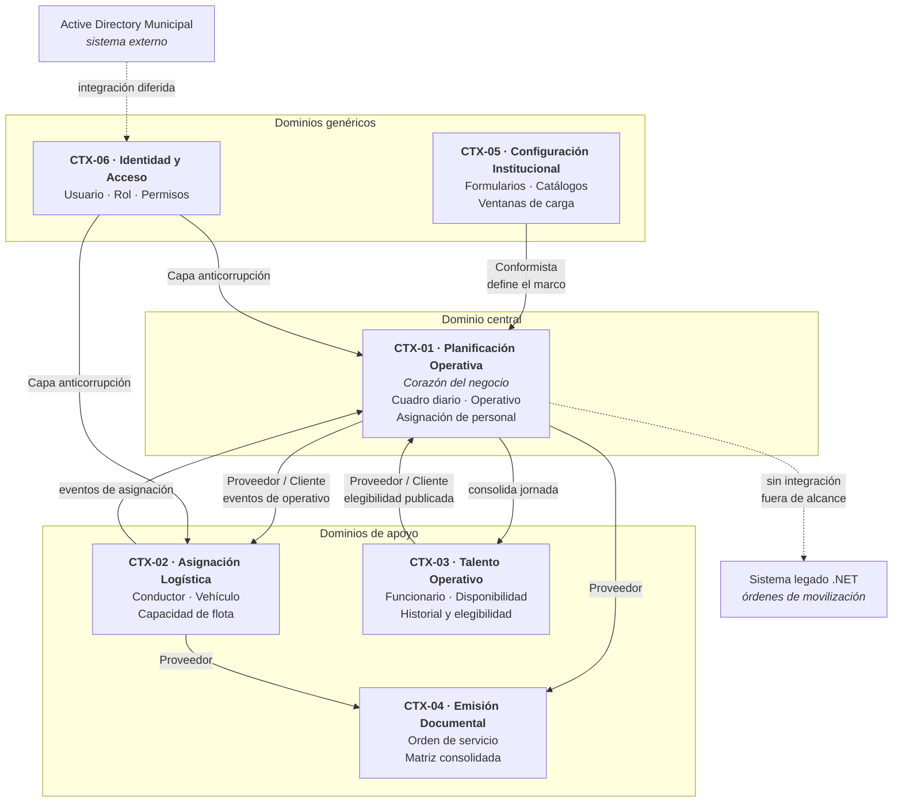
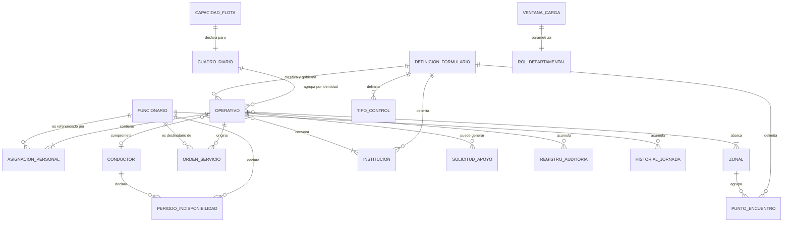
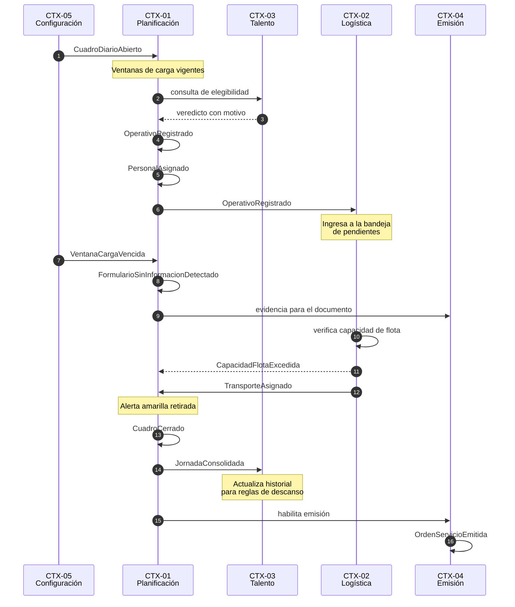
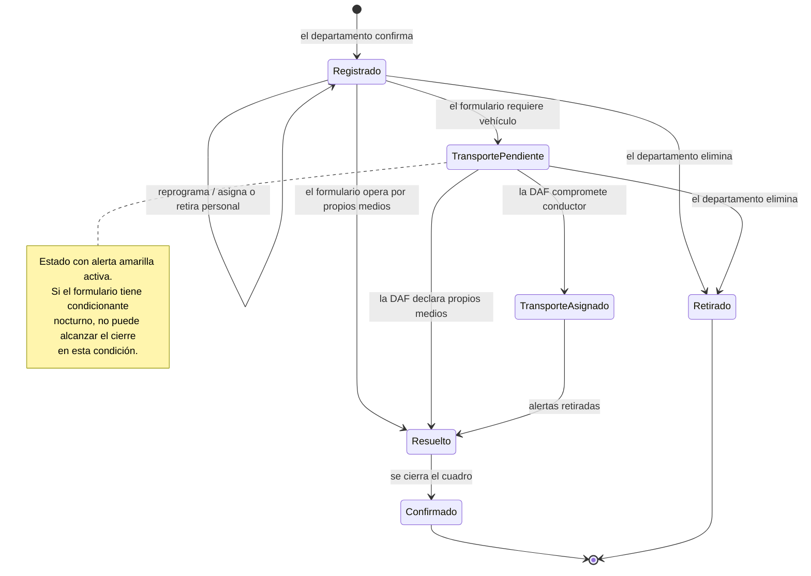
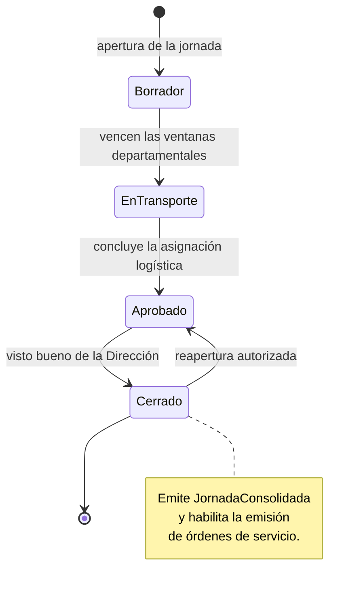

# ANÁLISIS DE DOMINIO
## Módulo Transportes / Cuadro de Colores Operativo — Agencia Metropolitana de Control

| | |
|---|---|
| **Fase** | 3 — Análisis de dominio |
| **Naturaleza** | Análisis conceptual. No contiene implementación |
| **Entrada** | Documentación funcional (Fase 2) |
| **Salida esperada** | Base para el diseño técnico y el modelo de persistencia |
| **Enfoque** | Diseño guiado por el dominio |

---

## 1. PROPÓSITO Y ENFOQUE

Este documento traduce la documentación funcional a un modelo conceptual de dominio. Su finalidad no es describir tablas ni clases, sino identificar **dónde están las fronteras naturales del negocio**, qué conceptos tienen identidad propia, cuáles son meros valores, y qué invariantes deben protegerse de forma transaccional.

El ejercicio importa especialmente en este proyecto por dos razones concretas que surgen de las fuentes. La primera es que el Product Owner describió un proceso donde **tres departamentos escriben en paralelo** sobre el mismo cuadro: *"llenan las dos en paralelo, no primero la una ni la otra"*. Esa concurrencia condiciona directamente cómo se delimitan los agregados, porque un agregado demasiado grande convertiría la colaboración en contención. La segunda es que la Dirección Administrativa Financiera interviene **después** y solo sobre dos campos, lo que plantea una decisión de modelado que conviene resolver explícitamente y no por omisión.

A lo largo del documento se marcan con `PENDIENTE DE VALIDACIÓN CON EL USUARIO` los puntos donde el modelo depende de una decisión funcional aún abierta.

---

## 2. LENGUAJE UBICUO

Las transcripciones muestran variaciones de nomenclatura para un mismo concepto, y en un caso dos definiciones distintas para la misma sigla. Fijar el vocabulario es la primera tarea del análisis, porque el modelo hereda las ambigüedades del lenguaje si no se resuelven antes.

### 2.1 Términos del dominio

| Término | Definición adoptada | Variantes observadas en las fuentes |
|---|---|---|
| **Cuadro de Colores** | Compilado diario de los operativos que cada dirección ejecutará al día siguiente. No es un instrumento de planificación | Matriz de colores, cuadro, cuadrito de colores |
| **Formulario** | Cada uno de los nueve bloques independientes del cuadro, con departamento dueño y catálogos propios | Bloque, sección, banner |
| **Operativo** | Unidad mínima de planificación. Una fila del cuadro. Puede agrupar a varios funcionarios | Fila, registro, ID |
| **Identificador de operativo** | Código compuesto por prefijo, secuencial diario y fecha | ID, código, secuencial |
| **Punto de encuentro** | Lugar donde el personal se concentra para iniciar el operativo | Punto, lugar de encuentro |
| **Salida pesada** | Turno nocturno o de fin de semana, sujeto a tope de rotación | Salida tediosa, salida dura |
| **Patrulla** | Operativo de recorrido continuo sujeto a la regla de descanso del día siguiente | — |
| **Propios medios** | Modalidad en que el personal se traslada sin vehículo institucional | A pie, sin vehículo |
| **Orden de servicio** | Documento individual que informa a un funcionario únicamente de su propia asignación | Ticket de salida |
| **Ventana de carga** | Intervalo durante el cual un departamento puede escribir en el cuadro | Hora tope, cierre, bloqueo |
| **Alerta amarilla** | Marca visual sobre una celda con información pendiente | Amarillo de alerta |

### 2.2 Ambigüedades resueltas y pendientes

| Término | Situación | Resolución |
|---|---|---|
| **PMO** | Dos definiciones en las fuentes: *punto de monitoreo organizado* y *Punto de Mando Operativo* | Se adopta **Punto de Mando Operativo**, por ser la denominación del documento aprobado |
| **DAF** | Aparece como DAF, ADAF y ADAP | Se adopta **DAF**, Dirección Administrativa Financiera |
| **Orden de servicio / orden de movilización** | Se usan indistintamente en conversación | Son documentos **distintos**. La orden de movilización pertenece al sistema legado y queda fuera del dominio |
| **Zonal DMQ** | Aparece junto a las diez zonales sin ser una de ellas | Es un **ámbito de movilidad distrital**, no una zonal. Requiere tratamiento diferenciado en el modelo |

> `PENDIENTE DE VALIDACIÓN CON EL USUARIO` — Si DMQ debe modelarse como una zonal más del catálogo o como un ámbito distinto. La Hoja2 lo lista dentro del desplegable de zonales, lo que sugiere lo primero, pero conceptualmente designa la ausencia de zonal específica.

---

## 3. CONTEXTOS DELIMITADOS

### 3.1 Criterio de división

Las fronteras se trazaron atendiendo a tres señales: **quién es dueño de la decisión**, **qué vocabulario se usa** y **qué cambia junto**. El resultado son seis contextos, uno de ellos central y el resto de apoyo o genéricos.

Conviene notar que la frontera más interesante no coincide con la estructura organizativa. La DAF y los departamentos operativos comparten el mismo artefacto —el operativo— pero razonan sobre él con lenguajes distintos: para la DMIP un operativo es *una asignación de personal a un punto*; para la DAF es *una solicitud de unidad vehicular*. Esa diferencia de perspectiva sobre el mismo objeto es la señal clásica de una frontera de contexto.

### 3.2 Mapa de contextos

### 3.3 Fichas de contexto

---

#### CTX-01 · Planificación Operativa *(dominio central)*

| Aspecto | Descripción |
|---|---|
| **Responsabilidad** | Registrar qué operativos se ejecutarán mañana, con qué personal, en qué punto y bajo qué tipo de control |
| **Dueños** | DMIP Operativos, DMIP Inspecciones, DMIT Instrucción |
| **Lenguaje propio** | Operativo, formulario, punto de encuentro, tipo de control, asignación de personal |
| **Decisión que protege** | Que ningún funcionario quede asignado en condiciones que vulneren su descanso o que lo dupliquen en dos lugares |
| **Por qué es central** | Es donde reside la complejidad real del negocio y donde se materializa el valor del proyecto |

---

#### CTX-02 · Asignación Logística *(apoyo)*

| Aspecto | Descripción |
|---|---|
| **Responsabilidad** | Determinar qué conductor y qué unidad vehicular cubren cada operativo que lo requiere |
| **Dueño** | DAF Transportes |
| **Lenguaje propio** | Unidad vehicular, flota hábil, conductor autorizado, capacidad declarada |
| **Decisión que protege** | Que no se comprometa un conductor agotado ni se prometa más flota de la disponible |
| **Relación con CTX-01** | Cliente aguas abajo. Recibe operativos ya conformados y devuelve la asignación |

---

#### CTX-03 · Talento Operativo *(apoyo)*

| Aspecto | Descripción |
|---|---|
| **Responsabilidad** | Mantener quién existe, en qué condición contractual, si está disponible y qué carga acumula |
| **Dueños** | Administrador del sistema, con insumo de Talento Humano |
| **Lenguaje propio** | Funcionario, área, tipo de contrato, disponibilidad, carga acumulada, elegibilidad |
| **Decisión que protege** | Que la información de la persona sea la fuente única y certera, incluido su teléfono |
| **Relación con CTX-01** | Proveedor. Publica un servicio de elegibilidad que la planificación consume |

> Este contexto merece una nota. Podría parecer un simple maestro de datos, pero contiene la lógica más delicada del proyecto: las políticas de descanso. Tratarlo como un catálogo pasivo sería el error de modelado más probable y el más costoso, porque dispersaría esas reglas por toda la planificación.

---

#### CTX-04 · Emisión Documental *(apoyo)*

| Aspecto | Descripción |
|---|---|
| **Responsabilidad** | Componer los entregables formales y garantizar el aislamiento de la información |
| **Dueño** | Dirección |
| **Lenguaje propio** | Orden de servicio, matriz consolidada, aislamiento, destinatario |
| **Decisión que protege** | Que un funcionario nunca reciba información de la asignación de otro |
| **Relación** | Cliente aguas abajo de CTX-01 y CTX-02 |

---

#### CTX-05 · Configuración Institucional *(genérico)*

| Aspecto | Descripción |
|---|---|
| **Responsabilidad** | Definir los nueve formularios, sus catálogos, sus políticas de vehículo y las ventanas horarias |
| **Dueño** | Administrador del sistema |
| **Lenguaje propio** | Formulario, catálogo, política, ventana de carga, vigencia |
| **Decisión que protege** | Que el marco normativo del cuadro se modifique sin intervención técnica |
| **Relación con CTX-01** | Aguas arriba. La planificación se conforma a lo que este contexto define |

---

#### CTX-06 · Identidad y Acceso *(genérico)*

| Aspecto | Descripción |
|---|---|
| **Responsabilidad** | Resolver quién es el usuario y qué rol ostenta |
| **Estado** | Diferido. El microservicio de Active Directory está en desarrollo |
| **Tratamiento** | Capa anticorrupción hacia los demás contextos: el dominio conoce el concepto de rol, no la mecánica de autenticación |

> El aislamiento mediante capa anticorrupción no es aquí una elegancia teórica sino una necesidad práctica: permite que el resto del sistema se construya y pruebe con un mecanismo provisional de selección de perfil y que la integración posterior no obligue a tocar la lógica de autorización.

### 3.4 Relaciones entre contextos

| Origen | Destino | Patrón | Justificación |
|---|---|---|---|
| CTX-05 | CTX-01 | Conformista | La planificación acepta sin negociación la definición de formularios y catálogos |
| CTX-03 | CTX-01 | Proveedor / Cliente | La planificación consulta elegibilidad; el proveedor publica un lenguaje explícito |
| CTX-01 | CTX-02 | Proveedor / Cliente | La logística no existe sin operativos previamente registrados |
| CTX-02 | CTX-01 | Notificación por evento | La asignación devuelve el resultado sin acoplarse al modelo de planificación |
| CTX-01, CTX-02 | CTX-04 | Proveedor / Cliente | La emisión documental compone a partir de datos ya consolidados |
| CTX-06 | Todos | Capa anticorrupción | Aísla la mecánica de autenticación de la semántica de rol |
| CTX-01 | CTX-03 | Notificación por evento | Al cerrarse el cuadro, la jornada se consolida en el historial |

---

## 4. LA DECISIÓN DE MODELADO CENTRAL

Antes de enumerar agregados conviene resolver explícitamente la pregunta que condiciona todo el modelo: **¿quién es dueño del operativo cuando la DAF asigna el conductor?**

### 4.1 El problema

Un operativo lo crea un departamento de planificación, que decide horario, punto, tipo de control y personal. Dos horas después, la DAF completa conductor y placa sobre ese mismo registro. Ambos actúan sobre el mismo objeto, en momentos distintos, con autoridad sobre partes distintas.

### 4.2 Alternativas evaluadas

**Alternativa A — Un solo agregado.** El operativo contiene la asignación de transporte como parte de sí mismo. La DAF invoca un método del propio operativo.

*A favor:* simplicidad, un solo lugar donde vive el estado del operativo, invariantes fáciles de expresar.
*En contra:* el agregado tiene dos dueños con reglas de autorización distintas, y su ciclo de vida mezcla dos ritmos —el de planificación y el de logística—.

**Alternativa B — Dos agregados separados.** El operativo y la asignación de transporte son agregados independientes vinculados por identidad.

*A favor:* fronteras de autoridad nítidas, la DAF nunca toca el agregado de planificación.
*En contra:* la consistencia entre ambos pasa a ser eventual, y la matriz consolidada —que es una sola vista— tendría que componerse desde dos fuentes en cada consulta. Además el condicionante nocturno exige evaluar conjuntamente horario y conductor, lo que cruzaría la frontera.

### 4.3 Recomendación

Se recomienda la **Alternativa A con separación interna explícita**: el operativo es un único agregado, pero la asignación de transporte se modela dentro de él como un **objeto de valor con estado propio**, modificable únicamente a través de una operación de dominio específica y bien nombrada.

El razonamiento es que la frontera real aquí no es de consistencia sino de **autorización**, y la autorización se resuelve mejor en la capa de aplicación que fragmentando el modelo. El operativo tiene una invariante que cruza ambas partes —el condicionante nocturno relaciona el horario con la existencia de conductor—, y esa invariante es precisamente el tipo de regla que justifica mantener las cosas dentro de un mismo agregado.

> `PENDIENTE DE VALIDACIÓN CON EL USUARIO` — Esta recomendación depende de cómo se resuelva el momento de verificación del condicionante nocturno (punto 12 de la síntesis de pendientes de la Fase 2). Si la validación se traslada al cierre del cuadro, la Alternativa B se vuelve igualmente viable.

---

## 5. AGREGADOS

### 5.1 Criterio de delimitación

Un agregado agrupa lo que debe cambiar de forma consistente en una sola transacción. En este dominio el criterio decisivo fue la **concurrencia declarada por el negocio**: los departamentos escriben en paralelo y esperan no estorbarse. Cualquier delimitación que obligue a bloquear el cuadro completo para registrar un operativo contradice la operación descrita en las reuniones.

Esto lleva a una decisión que conviene explicitar: **el Cuadro Diario no contiene a los Operativos**. Aunque conceptualmente el cuadro *es* el conjunto de operativos del día, tratarlo como agregado raíz convertiría cada registro en una escritura sobre el mismo objeto, con tres departamentos compitiendo. El cuadro se modela como un agregado pequeño que gobierna el **estado y el ciclo de vida de la jornada**, mientras que cada operativo es raíz de su propio agregado y referencia al cuadro por identidad.

### 5.2 Inventario de agregados

```mermaid
flowchart TB
  subgraph AG1["AG-01 · Cuadro Diario"]
    A1R(["<b>CuadroDiario</b><br/>raíz"])
    A1V1["FechaOperativa<br/><i>objeto de valor</i>"]
    A1V2["OrdenDeTrabajo<br/><i>objeto de valor</i>"]
    A1V3["SemanaISO<br/><i>objeto de valor</i>"]
    A1V4["EstadoCuadro<br/><i>objeto de valor</i>"]
    A1R --- A1V1 & A1V2 & A1V3 & A1V4
  end

  subgraph AG2["AG-02 · Operativo"]
    A2R(["<b>Operativo</b><br/>raíz"])
    A2E1["AsignacionPersonal<br/><i>entidad</i>"]
    A2V1["IdentificadorOperativo<br/><i>objeto de valor</i>"]
    A2V2["RangoHorario<br/><i>objeto de valor</i>"]
    A2V3["UbicacionOperativa<br/><i>objeto de valor</i>"]
    A2V4["ClasificacionControl<br/><i>objeto de valor</i>"]
    A2V5["AsignacionTransporte<br/><i>objeto de valor</i>"]
    A2V6["ConjuntoAlertas<br/><i>objeto de valor</i>"]
    A2V7["TrazaAutoria<br/><i>objeto de valor</i>"]
    A2R --- A2E1 & A2V1 & A2V2 & A2V3 & A2V4 & A2V5 & A2V6 & A2V7
  end

  subgraph AG3["AG-03 · Funcionario"]
    A3R(["<b>Funcionario</b><br/>raíz"])
    A3E1["PeriodoIndisponibilidad<br/><i>entidad</i>"]
    A3V1["Telefono<br/><i>objeto de valor</i>"]
    A3V2["CondicionLaboral<br/><i>objeto de valor</i>"]
    A3V3["CargaAcumulada<br/><i>objeto de valor</i>"]
    A3R --- A3E1 & A3V1 & A3V2 & A3V3
  end

  subgraph AG4["AG-04 · Recurso de Movilización"]
    A4R(["<b>Conductor</b><br/>raíz"])
    A4E1["PeriodoIndisponibilidad<br/><i>entidad</i>"]
    A4V1["UnidadVehicular<br/><i>objeto de valor</i>"]
    A4R --- A4E1 & A4V1
  end

  subgraph AG5["AG-05 · Definición de Formulario"]
    A5R(["<b>DefinicionFormulario</b><br/>raíz"])
    A5V1["IdentidadVisual<br/><i>objeto de valor</i>"]
    A5V2["PoliticaVehiculo<br/><i>objeto de valor</i>"]
    A5V3["PoliticaPersonal<br/><i>objeto de valor</i>"]
    A5V4["ReglaIdentificacion<br/><i>objeto de valor</i>"]
    A5V5["CatalogosPermitidos<br/><i>objeto de valor</i>"]
    A5R --- A5V1 & A5V2 & A5V3 & A5V4 & A5V5
  end

  subgraph AG6["AG-06 · Orden de Servicio"]
    A6R(["<b>OrdenServicio</b><br/>raíz"])
    A6V1["DatoAislado<br/><i>objeto de valor</i>"]
    A6R --- A6V1
  end

  A2R -.->|"referencia<br/>por identidad"| A1R
  A2R -.->|"referencia<br/>por identidad"| A5R
  A2E1 -.->|"referencia<br/>por identidad"| A3R
  A2V5 -.->|"referencia<br/>por identidad"| A4R
  A6R -.->|"referencia<br/>por identidad"| A2R
  A6R -.->|"referencia<br/>por identidad"| A3R
```

### 5.3 Fichas de agregado

---

#### AG-01 · Cuadro Diario

| Aspecto | Detalle |
|---|---|
| **Raíz** | `CuadroDiario` |
| **Identidad** | La fecha operativa. Es identidad natural y única |
| **Contexto** | CTX-01 Planificación Operativa |
| **Contiene** | Únicamente objetos de valor. No contiene operativos |
| **Referencias externas** | Ninguna |

**Invariantes protegidas**

| ID | Invariante |
|---|---|
| INV-01 | Existe a lo sumo un cuadro por fecha operativa |
| INV-02 | El número de semana se deriva de la fecha y no se asigna manualmente |
| INV-03 | La transición de estados sigue el orden: Borrador → En transporte → Aprobado → Cerrado |
| INV-04 | Un cuadro cerrado no admite transición salvo reapertura autorizada |

**Razón de ser del agregado.** Gobierna el ciclo de vida de la jornada. Su tamaño reducido es deliberado: al no contener operativos, el cierre del cuadro no compite con el registro concurrente.

---

#### AG-02 · Operativo *(agregado principal)*

| Aspecto | Detalle |
|---|---|
| **Raíz** | `Operativo` |
| **Identidad** | Identificador de operativo, único dentro del cuadro |
| **Contexto** | CTX-01, con una operación delegada a CTX-02 |
| **Contiene** | Asignaciones de personal como entidades internas; el resto como objetos de valor |
| **Referencias externas** | Cuadro diario, definición de formulario, funcionarios, conductor. Todas por identidad |

**Invariantes protegidas**

| ID | Invariante | Origen |
|---|---|---|
| INV-05 | El secuencial del identificador es único dentro del cuadro | RN-12 |
| INV-06 | El rango horario tiene hora de fin posterior a la de inicio, admitiendo cruce de medianoche | RN-07 |
| INV-07 | El punto de encuentro pertenece a alguna de las zonales seleccionadas y al formulario | RN-17 |
| INV-08 | El tipo de control pertenece al catálogo del formulario, salvo captura como adicional | RN-16 |
| INV-09 | Toda persona asignada pertenece a un área admitida por el formulario | RN-15 |
| INV-10 | Ninguna persona figura dos veces en el mismo operativo | Derivada |
| INV-11 | Si el formulario tiene condicionante nocturno y el horario intersecta la franja restringida, la asignación de transporte no puede permanecer en estado pendiente al cerrarse el cuadro | RN-43 |
| INV-12 | El conjunto de alertas es siempre coherente con el estado actual del operativo | RN-52, RN-55 |
| INV-13 | Si el formulario opera por propios medios, la asignación de transporte no admite conductor | RN-41, RN-42 |

**Operaciones de dominio**

| Operación | Autoridad | Efecto |
|---|---|---|
| Registrar | Departamento dueño del formulario | Crea el operativo con transporte pendiente y alertas iniciales |
| Reprogramar horario | Departamento dueño | Recalcula condición nocturna y revalida alertas |
| Asignar personal | Departamento dueño, o compartido dentro de su cupo | Añade una asignación tras verificar elegibilidad |
| Retirar personal | Departamento dueño | Elimina la asignación y recalcula alertas |
| Asignar transporte | DAF exclusivamente | Transición del estado de transporte a asignado |
| Declarar propios medios | DAF exclusivamente | Transición del estado de transporte a resuelto sin unidad |
| Retirar | Departamento dueño | Baja del operativo |

> La operación *Asignar transporte* es el punto donde el agregado admite una autoridad distinta a la de su creador. Se modela como operación explícita y no como modificación genérica de atributos, precisamente para que la restricción sea visible en el modelo y no dependa solo de la capa de aplicación.

---

#### AG-03 · Funcionario

| Aspecto | Detalle |
|---|---|
| **Raíz** | `Funcionario` |
| **Identidad** | Cédula de identidad |
| **Contexto** | CTX-03 Talento Operativo |
| **Contiene** | Períodos de indisponibilidad como entidades internas |

**Invariantes protegidas**

| ID | Invariante | Origen |
|---|---|---|
| INV-14 | Los períodos de indisponibilidad de una misma persona no se solapan | Derivada |
| INV-15 | El teléfono es único por persona y solo se modifica desde este agregado | RN-34 |
| INV-16 | La condición laboral determina la jornada admisible y no admite excepción | RN-26, RN-27 |

**Responsabilidad singular.** Este agregado es el único que puede responder a la pregunta *¿puede esta persona salir en este turno?*. Concentrar ahí esa capacidad evita que las políticas de descanso se dispersen por la planificación.

---

#### AG-04 · Recurso de Movilización

| Aspecto | Detalle |
|---|---|
| **Raíz** | `Conductor` |
| **Identidad** | Identificador del conductor |
| **Contexto** | CTX-02 Asignación Logística |
| **Contiene** | Períodos de indisponibilidad; la unidad vehicular habitual como objeto de valor |

**Invariantes protegidas**

| ID | Invariante | Origen |
|---|---|---|
| INV-17 | Un conductor no disponible no puede ser comprometido | RN-45 |
| INV-18 | Las políticas de descanso aplican al conductor en los mismos términos que al personal operativo | RN-44 |

> **Nota de modelado.** Se evaluó si el vehículo debía ser agregado independiente. Se descartó porque las fuentes nunca describen la gestión del vehículo con autonomía respecto del conductor: el negocio razona en términos de *conductor con su unidad*. Si en el futuro apareciera gestión de mantenimiento o asignación de vehículos sin conductor, la separación se justificaría. `PENDIENTE DE VALIDACIÓN CON EL USUARIO`.

---

#### AG-05 · Definición de Formulario

| Aspecto | Detalle |
|---|---|
| **Raíz** | `DefinicionFormulario` |
| **Identidad** | Número de formulario, del 1 al 9 |
| **Contexto** | CTX-05 Configuración Institucional |
| **Contiene** | Sus políticas y la delimitación de sus catálogos permitidos |

**Invariantes protegidas**

| ID | Invariante | Origen |
|---|---|---|
| INV-19 | Todo formulario tiene exactamente un rol dueño | RN-14 |
| INV-20 | Si existe rol compartido, existe también su cupo | PER-06 |
| INV-21 | Los nueve formularios comparten la misma estructura de columnas | RN-21, RN-22 |
| INV-22 | Un valor de catálogo utilizado en cuadros históricos no se elimina, solo se desactiva | RF-058 |

---

#### AG-06 · Orden de Servicio

| Aspecto | Detalle |
|---|---|
| **Raíz** | `OrdenServicio` |
| **Identidad** | Código único de emisión |
| **Contexto** | CTX-04 Emisión Documental |
| **Contiene** | El dato aislado como objeto de valor inmutable |

**Invariantes protegidas**

| ID | Invariante | Origen |
|---|---|---|
| INV-23 | Existe a lo sumo una orden vigente por combinación de operativo y funcionario | RN-49 |
| INV-24 | La orden expone exclusivamente horario, funcionario, conductor y placa | RN-50 |
| INV-25 | Una orden emitida es inmutable; una corrección genera una nueva emisión | Derivada |

> La invariante INV-24 es la razón de ser del contexto. Modelar el dato aislado como objeto de valor cerrado —y no como referencia al operativo completo— hace que la fuga de información sea estructuralmente imposible y no dependa de recordar qué campos omitir al componer el documento.

---

#### Agregados menores

| ID | Agregado | Identidad | Contexto | Propósito |
|---|---|---|---|---|
| AG-07 | `VentanaCarga` | Rol | CTX-05 | Parametriza el intervalo de escritura de cada departamento |
| AG-08 | `CapacidadFlota` | Fecha | CTX-02 | Declara vehículos y conductores hábiles de la jornada |
| AG-09 | `SolicitudApoyo` | Identificador propio | CTX-01 | Vincula un operativo con la dirección a la que se solicita personal |
| AG-10 | `RegistroAuditoria` | Identificador propio | Transversal | Traza el cambio con su autor y momento |

---

## 6. ENTIDADES

Se listan únicamente los conceptos con identidad y ciclo de vida propios. Los conceptos sin identidad se tratan en la sección siguiente.

| ID | Entidad | Agregado | Identidad | Ciclo de vida |
|---|---|---|---|---|
| ENT-01 | `CuadroDiario` | AG-01 · raíz | Fecha operativa | Se abre automáticamente, transita estados, se cierra |
| ENT-02 | `Operativo` | AG-02 · raíz | Identificador de operativo | Se registra, se modifica, recibe transporte, se confirma o se retira |
| ENT-03 | `AsignacionPersonal` | AG-02 · interna | Identidad local dentro del operativo | Se crea al asignar, se elimina al retirar. No sobrevive al operativo |
| ENT-04 | `Funcionario` | AG-03 · raíz | Cédula | Alta, cambios de condición, baja lógica |
| ENT-05 | `PeriodoIndisponibilidad` | AG-03 y AG-04 · interna | Identidad local | Se abre y se cierra con fechas |
| ENT-06 | `Conductor` | AG-04 · raíz | Identificador propio | Alta, disponibilidad variable, baja |
| ENT-07 | `DefinicionFormulario` | AG-05 · raíz | Número del formulario | Configuración estable con vigencia opcional |
| ENT-08 | `OrdenServicio` | AG-06 · raíz | Código de emisión | Se emite y permanece inmutable |
| ENT-09 | `VentanaCarga` | AG-07 · raíz | Rol | Parámetro modificable por la Dirección |
| ENT-10 | `CapacidadFlota` | AG-08 · raíz | Fecha | Se declara por jornada |
| ENT-11 | `SolicitudApoyo` | AG-09 · raíz | Identificador propio | Se solicita, se atiende o se desatiende |
| ENT-12 | `RegistroAuditoria` | AG-10 · raíz | Identificador propio | Se crea y no se modifica |

### 6.1 Nota sobre el historial de asignaciones

El historial que alimenta las reglas de descanso —qué días salió cada persona en patrulla y cuántas salidas pesadas acumula— admite dos lecturas de modelado.

Puede entenderse como **entidad independiente**, un registro por persona y día. O puede entenderse como **proyección derivada** de los operativos confirmados, reconstruible en cualquier momento.

Se recomienda la segunda lectura con materialización: el historial es conceptualmente derivado, pero consultarlo en cada validación de asignación exigiría recorrer todos los cuadros anteriores. Se modela entonces como **proyección persistida** dentro de CTX-03, actualizada por el evento de consolidación de jornada. Esto preserva la coherencia conceptual sin penalizar la operación.

---

## 7. OBJETOS DE VALOR

Los objetos de valor son donde este dominio gana claridad. Varias reglas que en la documentación funcional aparecen dispersas se concentran naturalmente en un objeto de valor bien delimitado.

### 7.1 Objetos de valor del operativo

---

**OV-01 · IdentificadorOperativo**

Compuesto por prefijo del formulario, secuencial diario y fecha. Su regla de formación —secuencial que se reinicia cada día— es intrínseca al concepto, no una responsabilidad del operativo.

| Componente | Descripción |
|---|---|
| Prefijo | Determinado por el formulario y el tipo de personal |
| Secuencial | Reinicia cada jornada |
| Fecha | Día, mes y año del operativo |

*Comportamiento propio:* comparación por valor, representación textual normalizada, extracción de la fecha.
*Reglas que absorbe:* RN-09, RN-10, RN-11, RN-12

---

**OV-02 · RangoHorario**

Probablemente el objeto de valor más rentable del modelo. Concentra cuatro reglas que de otro modo se repetirían en validaciones dispersas.

| Responsabilidad | Descripción |
|---|---|
| Validez | La hora de fin es posterior a la de inicio, contemplando el cruce de medianoche |
| Granularidad | Solo admite intervalos de treinta minutos |
| Condición nocturna | Determina si intersecta la franja de 20H00 a 05H00 |
| Duración | Calcula las horas efectivas, incluido el cruce de medianoche |
| Solapamiento | Sabe responder si se cruza con otro rango |

*Reglas que absorbe:* RN-07, RN-28, RN-43
*Observación:* la lógica de solapamiento con cruce de medianoche es la fuente de error más probable en todo el sistema. Encapsularla en un único objeto de valor es la decisión de diseño que más reduce ese riesgo.

---

**OV-03 · UbicacionOperativa**

Agrupa las zonales del operativo y el punto de encuentro, incluyendo la posibilidad de captura libre.

| Componente | Descripción |
|---|---|
| Zonales | Una o varias. Nunca vacío |
| Punto de encuentro | Referencia al catálogo, o texto capturado libremente |
| Origen del punto | Distingue si proviene del catálogo o de captura adicional |

*Reglas que absorbe:* RN-17, RN-18, RN-19, RN-20
*Observación:* la dualidad entre valor catalogado y valor capturado aparece dos veces en el dominio —punto de encuentro y tipo de control—. Modelarla como un patrón consistente evita duplicar la lógica y facilita el trabajo posterior de normalización que corresponde al Gestor de Calidad.

---

**OV-04 · ClasificacionControl**

Mismo patrón que el anterior aplicado al tipo de control, más las instituciones participantes.

| Componente | Descripción |
|---|---|
| Tipo de control | Referencia al catálogo, o texto capturado libremente |
| Instituciones participantes | Conjunto no vacío |

*Reglas que absorbe:* RN-16, RN-20

---

**OV-05 · AsignacionTransporte**

Aquí el análisis corrige una decisión de la documentación funcional. En la Fase 2 el estado del transporte se expresó mediante dos indicadores booleanos independientes: *transporte asignado* y *propios medios*. Esa representación admite combinaciones sin significado —por ejemplo, transporte asignado y propios medios simultáneamente ciertos— y obliga a razonar sobre pares de valores.

Se recomienda sustituirlos por un objeto de valor con **tres estados mutuamente excluyentes**:

| Estado | Significado | Alerta |
|---|---|---|
| `Pendiente` | El operativo requiere vehículo y la DAF no ha intervenido | Activa |
| `Asignado` | Existe conductor y unidad vehicular | Retirada |
| `PropiosMedios` | La DAF determinó que no requiere vehículo | Retirada |

*Comportamiento propio:* transiciones válidas, respuesta a la pregunta de si sigue pendiente.
*Reglas que absorbe:* RN-40, RN-41, RN-42, RN-55
*Beneficio:* la alerta amarilla deja de ser un cálculo sobre dos indicadores y pasa a derivarse directamente del estado.

---

**OV-06 · ConjuntoAlertas**

Colección inmutable de alertas, cada una con campo afectado, nivel y mensaje. Se recalcula íntegramente ante cualquier cambio del operativo, en lugar de mantenerse incrementalmente.

*Reglas que absorbe:* RN-52 a RN-55
*Observación:* el recálculo total es deliberado. Mantener alertas de forma incremental produciría estados residuales cuando la condición que las originó desaparece, que es exactamente el defecto que hoy tiene el cuadro en Excel.

---

**OV-07 · TrazaAutoria**

Registra qué rol creó y qué rol modificó por última vez. Es objeto de valor porque carece de identidad propia y se reemplaza íntegramente.

*Reglas que absorbe:* RF-060, RF-061

---

### 7.2 Objetos de valor del talento operativo

---

**OV-08 · CondicionLaboral**

Encapsula el tipo de contrato y, con él, la jornada admisible. No es un simple enumerado: es el concepto que responde a *¿puede esta persona trabajar en este turno?*

| Condición | Jornada admisible |
|---|---|
| Nombramiento | Lunes a viernes, de 08H00 a 16H30. Sin turnos nocturnos ni de fin de semana |
| Ocasional | Lunes a domingo, incluidos turnos nocturnos |

*Reglas que absorbe:* RN-26, RN-27, RN-33

---

**OV-09 · CargaAcumulada**

Representa el desgaste acumulado de una persona. Concentra las dos reglas de rotación.

| Componente | Descripción |
|---|---|
| Salidas pesadas acumuladas | Turnos nocturnos y de fin de semana en el período |
| Tope aplicable | Tres, conforme a la regla vigente |
| Salió en patrulla el día anterior | Determina el bloqueo del día siguiente |
| Horas acumuladas en la jornada | Para el control de jornada máxima |

*Reglas que absorbe:* RN-24, RN-25, RN-36
*Nota:* el período de cómputo del tope permanece `PENDIENTE DE VALIDACIÓN CON EL USUARIO`, así como el umbral de jornada máxima.

---

**OV-10 · Telefono**

Objeto de valor con formato normalizado. Su modelado explícito responde a un problema real declarado: *"hay veces que ponen cualquier teléfono y les llaman un domingo"*. Al ser valor asociado a la persona y no campo del operativo, la posibilidad de digitación errónea desaparece del formulario.

*Reglas que absorbe:* RN-34

---

**OV-11 · AreaPersonal**

Determina en qué formularios puede participar una persona. Valores: General, Técnico, Instrucción, Operativos, CCF.

*Reglas que absorbe:* RN-15, RN-31, RN-32

---

### 7.3 Objetos de valor de configuración

| ID | Objeto de valor | Contenido | Reglas |
|---|---|---|---|
| OV-12 | `IdentidadVisual` | Color de fondo, color de acento y denominación del color del banner | RN-52 |
| OV-13 | `PoliticaVehiculo` | No aplica, Condicional, Requerido u Obligatorio, más el indicador de condicionante nocturno | RN-41 a RN-43 |
| OV-14 | `PoliticaPersonal` | Áreas admitidas, rol dueño, rol compartido y su cupo | RN-15, PER-06 |
| OV-15 | `ReglaIdentificacion` | Prefijos aplicables y criterio de selección entre ellos | RN-10, RN-11 |
| OV-16 | `CatalogosPermitidos` | Delimitación de puntos, tipos de control e instituciones del formulario | RN-16 |
| OV-17 | `IntervaloCarga` | Tipo de ventana, apertura, cierre y zona horaria | RN-56, RN-59 |
| OV-18 | `Vigencia` | Rango de fechas durante el cual el formulario está activo | Formularios temporales |

### 7.4 Objetos de valor transversales

| ID | Objeto de valor | Contenido | Observación |
|---|---|---|---|
| OV-19 | `FechaOperativa` | Fecha de la jornada | Identidad natural del cuadro |
| OV-20 | `SemanaISO` | Número de semana y año | Derivado, nunca asignado |
| OV-21 | `OrdenDeTrabajo` | Código institucional de la jornada | Derivado de la fecha |
| OV-22 | `EstadoCuadro` | Borrador, En transporte, Aprobado, Cerrado | Con transiciones válidas propias |
| OV-23 | `UnidadVehicular` | Placa y descripción | Asociada al conductor |
| OV-24 | `DatoAislado` | Horario, funcionario, conductor y placa | Cerrado por construcción. Garantiza INV-24 |
| OV-25 | `RolDepartamental` | Identificación del departamento con autoridad | Concepto de dominio, no de infraestructura |

---

## 8. RELACIONES DEL DOMINIO

### 8.1 Modelo conceptual de relaciones

### 8.2 Naturaleza de cada relación

Distinguir el tipo de relación importa más que su cardinalidad, porque determina si dos conceptos deben cambiar juntos o pueden evolucionar por separado.

| Relación | Tipo | Justificación |
|---|---|---|
| Cuadro Diario → Operativo | **Referencia por identidad** | El operativo pertenece conceptualmente al cuadro, pero se modela por referencia para permitir la escritura concurrente de tres departamentos |
| Operativo → Definición de Formulario | **Referencia por identidad** | El formulario es configuración estable con ciclo de vida propio. El operativo lo consulta, no lo posee |
| Operativo → Asignación de Personal | **Composición** | La asignación no tiene sentido fuera del operativo y desaparece con él |
| Asignación de Personal → Funcionario | **Referencia por identidad** | La persona existe con independencia de sus asignaciones |
| Operativo → Conductor | **Referencia por identidad, opcional** | La opcionalidad es semánticamente rica: distingue el pendiente del definitivo. Ver OV-05 |
| Funcionario → Período de Indisponibilidad | **Composición** | El período carece de sentido sin la persona |
| Zonal → Punto de Encuentro | **Agregación** | El punto pertenece a una zonal, pero la relación con el formulario es independiente |
| Formulario → Catálogos | **Delimitación** | El formulario no posee los valores del catálogo: acota cuáles son aplicables |
| Operativo → Orden de Servicio | **Generación** | La orden se origina en el operativo pero, una vez emitida, es independiente e inmutable |

### 8.3 Relaciones que atraviesan contextos

Estas son las que requieren atención especial, porque no pueden resolverse mediante navegación directa.

| Relación | Contextos | Mecanismo propuesto |
|---|---|---|
| Operativo consulta elegibilidad de una persona | CTX-01 → CTX-03 | Servicio de dominio publicado por CTX-03 que responde con un veredicto y su motivo, no con los datos internos del funcionario |
| Operativo recibe asignación de transporte | CTX-02 → CTX-01 | Operación explícita sobre el agregado, con autorización verificada en la capa de aplicación |
| Orden de servicio compone su contenido | CTX-04 ← CTX-01, CTX-02 | Objeto de valor cerrado construido en el momento de la emisión. No mantiene vínculo navegable con el operativo |
| Consolidación de jornada al cierre | CTX-01 → CTX-03 | Evento de dominio que actualiza la proyección de historial |
| Verificación de capacidad de flota | CTX-02 | Consulta interna, con notificación hacia CTX-01 solo cuando se excede |

> **Observación sobre la elegibilidad.** Que CTX-03 responda con un veredicto y no con los datos de la persona es una decisión con consecuencias prácticas. Si la planificación recibiera el tipo de contrato, el historial y las ausencias, terminaría implementando las reglas de descanso por su cuenta, y esas reglas se duplicarían en cada punto de validación. Publicar el veredicto mantiene la política en un solo lugar.

---

## 9. EVENTOS DE DOMINIO

### 9.1 Criterio de identificación

Se consideró evento de dominio todo hecho que **el negocio nombra en pasado y del que se derivan consecuencias en otro punto del proceso**. Los cambios de estado sin consecuencia externa no se modelan como eventos.

### 9.2 Catálogo de eventos

| ID | Evento | Emitido por | Se produce cuando | Consumidores |
|---|---|---|---|---|
| EVT-01 | `CuadroDiarioAbierto` | AG-01 | Se crea el cuadro de la jornada siguiente | Departamentos, para habilitar la carga |
| EVT-02 | `OperativoRegistrado` | AG-02 | Un departamento confirma un nuevo operativo | CTX-02 para la bandeja de pendientes; CTX-04 para la matriz |
| EVT-03 | `OperativoReprogramado` | AG-02 | Cambia el horario, punto o clasificación | CTX-02, si la condición nocturna se altera |
| EVT-04 | `PersonalAsignado` | AG-02 | Se incorpora una persona al operativo | CTX-04 para la futura emisión de órdenes |
| EVT-05 | `PersonalRetirado` | AG-02 | Se retira una persona del operativo | CTX-04, para invalidar órdenes previstas |
| EVT-06 | `OperativoRetirado` | AG-02 | Se elimina el operativo | CTX-02, CTX-04 |
| EVT-07 | `TransporteAsignado` | AG-02 | La DAF asigna conductor y unidad | CTX-01 para retirar la alerta; CTX-02 para el control de flota |
| EVT-08 | `OperativoDeclaradoPropiosMedios` | AG-02 | La DAF determina que no requiere vehículo | CTX-01 para retirar la alerta |
| EVT-09 | `VentanaCargaVencida` | AG-07 | Se alcanza la hora de cierre de un rol | CTX-01 para bloquear escritura y evaluar formularios sin información |
| EVT-10 | `FormularioSinInformacionDetectado` | CTX-01 | Vence la ventana y un formulario no tiene operativos | CTX-04 para incorporar la evidencia al documento |
| EVT-11 | `CapacidadFlotaExcedida` | AG-08 | La demanda supera los vehículos hábiles declarados | CTX-02 y Dirección |
| EVT-12 | `CuadroCerrado` | AG-01 | La Dirección da el visto bueno final | CTX-04 para habilitar la emisión; CTX-03 para consolidar jornada |
| EVT-13 | `JornadaConsolidada` | CTX-03 | Se procesa el cierre del cuadro | Proyección de historial que alimenta las reglas de descanso |
| EVT-14 | `OrdenServicioEmitida` | AG-06 | Se genera el documento individual | Notificación al funcionario, canal por definir |
| EVT-15 | `ApoyoInterdireccionSolicitado` | AG-09 | Un departamento requiere personal de otro | Dirección requerida |
| EVT-16 | `CuadroReabierto` | AG-01 | Se autoriza modificar un cuadro cerrado | Todos los contextos, para revertir bloqueos |

> `PENDIENTE DE VALIDACIÓN CON EL USUARIO` — EVT-16 depende de que se defina el procedimiento de reapertura y quién lo autoriza.

### 9.3 Flujo de eventos de una jornada

### 9.4 Eventos y consistencia

La distinción entre consistencia inmediata y eventual determina qué debe ocurrir dentro de una misma transacción.

| Situación | Tipo de consistencia | Justificación |
|---|---|---|
| Registrar un operativo con su personal | **Inmediata** | Un operativo sin personal válido no debe existir ni un instante |
| Recalcular las alertas del operativo | **Inmediata** | La alerta forma parte del estado del propio agregado |
| Retirar la alerta al asignar transporte | **Inmediata** | Ocurre dentro del mismo agregado |
| Actualizar la bandeja de pendientes de la DAF | **Eventual** | Es una proyección de lectura en otro contexto |
| Detectar formularios sin información | **Eventual** | Se evalúa al vencer la ventana, no en cada escritura |
| Consolidar el historial de jornada | **Eventual** | Ocurre tras el cierre y no condiciona la operación del día |
| Advertir exceso de capacidad de flota | **Eventual** | Es advertencia, no bloqueo |

---

## 10. POLÍTICAS Y SERVICIOS DE DOMINIO

Ciertas reglas no pertenecen naturalmente a ninguna entidad porque involucran a varias o consultan estado externo. Se modelan como políticas explícitas.

| ID | Política o servicio | Contexto | Responsabilidad | Reglas |
|---|---|---|---|---|
| POL-01 | `PoliticaDescansoPersonal` | CTX-03 | Determina si una persona puede asumir un turno, considerando disponibilidad, condición laboral, patrulla del día anterior, carga acumulada y jornada | RN-24 a RN-27, RN-30, RN-33, RN-36 |
| POL-02 | `PoliticaDescansoConductor` | CTX-02 | Aplica los mismos criterios al conductor | RN-44, RN-45 |
| POL-03 | `PoliticaExclusividadHoraria` | CTX-01 | Verifica que una persona o conductor no figure en operativos con horarios cruzados | RN-28 |
| POL-04 | `GeneradorIdentificador` | CTX-01 | Compone el identificador y garantiza la unicidad del secuencial diario | RN-09 a RN-12 |
| POL-05 | `EvaluadorVentanaCarga` | CTX-05 | Determina si un rol puede escribir en un momento dado | RN-56 a RN-59 |
| POL-06 | `CalculadorAlertas` | CTX-01 | Deriva el conjunto de alertas del estado actual del operativo | RN-52 a RN-55 |
| POL-07 | `VerificadorCapacidadFlota` | CTX-02 | Compara demanda contra capacidad declarada | RN-46 |
| POL-08 | `PoliticaAutorizacionFormulario` | CTX-01 | Determina si un rol puede escribir en un formulario y con qué alcance | PER-01 a PER-06 |
| POL-09 | `ComponedorDatoAislado` | CTX-04 | Construye el contenido de la orden garantizando que solo incluya los cuatro datos autorizados | RN-50 |

> **Sobre POL-01.** Es la pieza con mayor densidad de negocio del sistema y la que justifica que CTX-03 sea un contexto y no un catálogo. Su ubicación determina si las reglas de descanso viven en un solo lugar o se dispersan por cada punto de captura. La recomendación es que resida en el contexto de Talento Operativo y se exponga como servicio publicado.

---

## 11. CICLOS DE VIDA

### 11.1 Ciclo de vida del operativo

### 11.2 Ciclo de vida del cuadro

---

## 12. HALLAZGOS DEL ANÁLISIS

El ejercicio de modelado produjo cinco observaciones que afectan a la documentación funcional previa y conviene resolver antes del diseño técnico.

### HAL-01 · El estado del transporte requiere tres valores, no dos indicadores

La Fase 2 representó la asignación mediante dos indicadores booleanos independientes. Esa representación admite cuatro combinaciones de las cuales solo tres tienen significado. Se recomienda sustituirlos por el objeto de valor descrito en OV-05, con estados mutuamente excluyentes. **Impacto: bajo. Beneficio: elimina una clase completa de estados inválidos.**

### HAL-02 · El cuadro no debe contener a los operativos

Aunque conceptualmente el cuadro es el conjunto de sus operativos, modelarlo como agregado contenedor contradice la operación concurrente descrita por el negocio. Se recomienda la separación por identidad. **Impacto: medio. Afecta al diseño de persistencia y al control de concurrencia.**

### HAL-03 · Las reglas de descanso pertenecen al contexto de Talento, no al de Planificación

Es la decisión de mayor alcance del análisis. Ubicarlas en Planificación las dispersaría por cada punto de captura y haría que su mantenimiento dependiera de recordar todos los lugares donde se aplican. **Impacto: alto. Determina la estructura de módulos del sistema.**

### HAL-04 · El dato aislado debe ser un objeto cerrado, no una vista del operativo

Si la orden de servicio mantuviera una referencia navegable al operativo, el aislamiento dependería de recordar qué campos omitir al componer cada documento. Modelarlo como objeto de valor construido en la emisión hace que la fuga sea estructuralmente imposible. **Impacto: bajo. Beneficio: convierte una regla de disciplina en una garantía del modelo.**

### HAL-05 · La dualidad entre valor catalogado y valor capturado es un patrón, no dos casos

Aparece en punto de encuentro y en tipo de control con idéntica semántica. Tratarla como patrón único simplifica el modelo y facilita el trabajo posterior de normalización de catálogos. **Impacto: bajo.**

---

## 13. PENDIENTES QUE CONDICIONAN EL MODELO

| # | Pendiente | Elemento del dominio afectado | Consecuencia si no se resuelve |
|---|---|---|---|
| 1 | Momento de verificación del condicionante nocturno | INV-11, decisión de la sección 4 | La delimitación del agregado Operativo queda provisional |
| 2 | Contradicción del formulario 9 entre condicionante nocturno y vehículo no habilitado | OV-13, INV-13 | La política de vehículo no puede expresarse sin ambigüedad |
| 3 | Umbral de jornada máxima diaria | OV-09, POL-01 | La política de descanso queda incompleta |
| 4 | Período de cómputo del tope de salidas pesadas | OV-09, POL-01 | La carga acumulada no puede calcularse |
| 5 | Cupo del rol compartido en el formulario 6 | OV-14, INV-20 | La política de personal queda indeterminada |
| 6 | Tratamiento de DMQ como zonal o como ámbito | OV-03 | La ubicación operativa admite dos lecturas |
| 7 | Procedimiento de reapertura del cuadro | EVT-16, OV-22 | Las transiciones de estado quedan incompletas |
| 8 | Gestión autónoma de vehículos | AG-04 | La delimitación del recurso de movilización queda provisional |
| 9 | Canal de entrega de la orden de servicio | EVT-14 | El evento carece de consumidor definido |
| 10 | Baja física o lógica de operativos | Ciclo de vida del operativo | El estado *Retirado* queda sin semántica precisa |

---

## 14. SÍNTESIS

El dominio se organiza en **seis contextos delimitados**, con la Planificación Operativa como núcleo y cinco contextos de apoyo o genéricos a su alrededor. Se identificaron **diez agregados**, de los cuales el Operativo concentra la complejidad y las invariantes más delicadas; **doce entidades** con identidad propia; **veinticinco objetos de valor**; **dieciséis eventos de dominio**; y **nueve políticas** que expresan reglas que no pertenecen a ninguna entidad en particular.

La decisión estructural más relevante es ubicar las políticas de descanso en el contexto de Talento Operativo y exponerlas como servicio de elegibilidad. De ella depende que las reglas que motivaron el proyecto —las que impiden que una persona trabaje dieciséis horas o salga en patrulla dos días seguidos— vivan en un solo lugar y no se dispersen por cada formulario.

La segunda decisión en importancia es no convertir el cuadro diario en agregado contenedor, para preservar la concurrencia que el negocio describe como su forma habitual de trabajo.

Quedan **diez pendientes** que condicionan la precisión del modelo. Ninguno impide avanzar al diseño técnico, pero cada uno deja una zona del modelo expresada de forma provisional que deberá revisarse cuando se resuelva.

---

*Fin del análisis de dominio. A la espera de revisión para continuar con el diseño técnico.*
