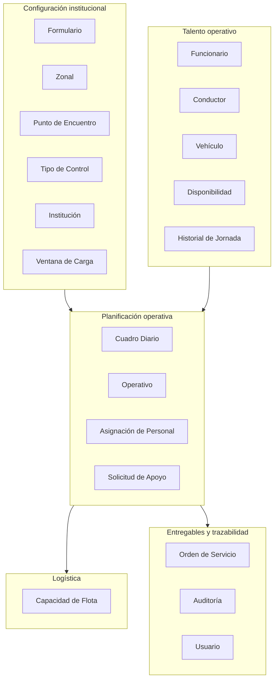
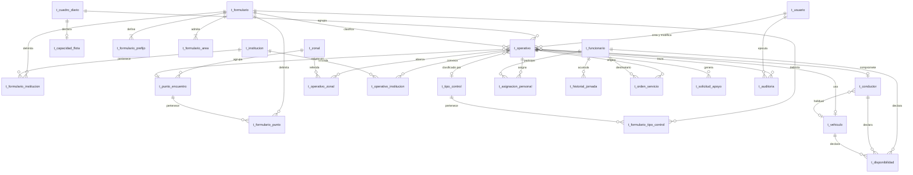

# DISEÑO DE BASE DE DATOS — POSTGRESQL
## Módulo Transportes / Cuadro de Colores Operativo — Agencia Metropolitana de Control

| | |
|---|---|
| **Fase** | 4.1 — Diseño de persistencia |
| **Motor** | PostgreSQL 18 |
| **Base** | `transportedb`, instancia propia e independiente |
| **Esquema** | `public` |
| **Acceso** | Prisma ORM |
| **Entrada** | Análisis de dominio (Fase 3) y arquitectura técnica (Fase 4) |

---

## 1. MODELO LÓGICO

### 1.1 Criterio de construcción

El modelo lógico traduce los agregados del análisis de dominio a entidades de datos, sin comprometerse todavía con tipos ni con detalles del motor. La correspondencia no es mecánica: un agregado puede resolverse en varias tablas cuando contiene colecciones, y un objeto de valor puede resolverse en columnas de la tabla que lo contiene o en una tabla propia según se consulte de forma independiente.

| Agregado de dominio | Entidades lógicas resultantes |
|---|---|
| AG-01 Cuadro Diario | Cuadro Diario |
| AG-02 Operativo | Operativo, Asignación de Personal, Operativo-Zonal, Operativo-Institución |
| AG-03 Funcionario | Funcionario, Disponibilidad, Historial de Jornada |
| AG-04 Recurso de Movilización | Conductor, Vehículo, Disponibilidad |
| AG-05 Definición de Formulario | Formulario, Formulario-Punto, Formulario-Tipo, Formulario-Institución, Formulario-Área, Formulario-Prefijo |
| AG-06 Orden de Servicio | Orden de Servicio |
| AG-07 Ventana de Carga | Ventana de Carga |
| AG-08 Capacidad de Flota | Capacidad de Flota |
| AG-09 Solicitud de Apoyo | Solicitud de Apoyo |
| AG-10 Registro de Auditoría | Auditoría |
| Catálogos maestros | Zonal, Punto de Encuentro, Tipo de Control, Institución |
| Identidad (provisional) | Usuario |

### 1.2 Entidades lógicas por subsistema



### 1.3 Definición lógica de entidades

| Entidad | Descripción | Identificador natural | Volumen estimado |
|---|---|---|---|
| **Formulario** | Cada uno de los nueve bloques del cuadro | Número del formulario | 9 filas, estable |
| **Zonal** | Administración zonal del Distrito, más el ámbito DMQ | Código de zonal | 11 filas, estable |
| **Punto de Encuentro** | Lugar de concentración, siempre dentro de una zonal | Nombre más zonal | ~70 filas, crecimiento lento |
| **Tipo de Control** | Clasificación del operativo | Nombre | ~60 filas, crecimiento lento |
| **Institución** | Entidad participante | Sigla | ~16 filas, estable |
| **Ventana de Carga** | Intervalo de escritura por rol | Rol | 6 filas, estable |
| **Funcionario** | Persona asignable a operativos | Cédula | ~50 filas, rotación mensual |
| **Conductor** | Persona habilitada para conducir | Cédula | ~15 filas |
| **Vehículo** | Unidad de la flota | Placa | ~20 filas |
| **Disponibilidad** | Ausencia de una persona, conductor o vehículo | Sustituto | Crecimiento moderado |
| **Historial de Jornada** | Carga acumulada por persona y día | Funcionario más fecha | ~50 filas por día |
| **Cuadro Diario** | Jornada operativa | Fecha | 1 fila por día, ~365 al año |
| **Operativo** | Fila del cuadro | Cuadro más identificador | ~50 filas por día, ~18.000 al año |
| **Asignación de Personal** | Vínculo entre operativo y persona | Operativo más funcionario | ~80 filas por día |
| **Solicitud de Apoyo** | Petición de personal a otra dirección | Sustituto | Bajo |
| **Capacidad de Flota** | Recursos hábiles declarados por fecha | Fecha | 1 fila por día |
| **Orden de Servicio** | Documento individual emitido | Operativo más funcionario | ~80 filas por día |
| **Auditoría** | Traza de escritura | Sustituto | Alto crecimiento |
| **Usuario** | Identidad del sistema | Correo institucional | ~20 filas |

---

## 2. MODELO RELACIONAL

### 2.1 Diagrama entidad-relación



### 2.2 Cardinalidades y reglas de integridad referencial

| Relación | Cardinalidad | Al eliminar el padre | Justificación |
|---|---|---|---|
| `t_cuadro_diario` → `t_operativo` | 1 : N | `CASCADE` | El operativo no tiene sentido sin su jornada |
| `t_formulario` → `t_operativo` | 1 : N | `RESTRICT` | Un formulario con historial no se elimina; se desactiva |
| `t_operativo` → `t_asignacion_personal` | 1 : N | `CASCADE` | Composición. La asignación muere con el operativo |
| `t_funcionario` → `t_asignacion_personal` | 1 : N | `RESTRICT` | La persona con historial no se elimina; se desactiva |
| `t_operativo` → `t_operativo_zonal` | 1 : N | `CASCADE` | Composición |
| `t_zonal` → `t_operativo_zonal` | 1 : N | `RESTRICT` | Catálogo con historial |
| `t_operativo` → `t_operativo_institucion` | 1 : N | `CASCADE` | Composición |
| `t_punto_encuentro` → `t_operativo` | 1 : N opcional | `RESTRICT` | Nulo cuando el punto se capturó como texto libre |
| `t_tipo_control` → `t_operativo` | 1 : N opcional | `RESTRICT` | Nulo cuando el tipo se capturó como texto libre |
| `t_conductor` → `t_operativo` | 1 : N opcional | `RESTRICT` | Nulo mientras la DAF no asigna |
| `t_vehiculo` → `t_operativo` | 1 : N opcional | `RESTRICT` | Nulo mientras la DAF no asigna |
| `t_zonal` → `t_punto_encuentro` | 1 : N | `RESTRICT` | El punto pertenece siempre a una zonal |
| `t_formulario` → tablas puente | 1 : N | `CASCADE` | La delimitación desaparece con el formulario |
| `t_funcionario` → `t_disponibilidad` | 1 : N | `CASCADE` | La ausencia carece de sentido sin la persona |
| `t_funcionario` → `t_historial_jornada` | 1 : N | `CASCADE` | Proyección derivada de la persona |
| `t_operativo` → `t_orden_servicio` | 1 : N | `RESTRICT` | La orden emitida es evidencia y no se borra en cascada |
| `t_operativo` → `t_auditoria` | 1 : N | `SET NULL` | La traza sobrevive al registro auditado |
| `t_conductor` → `t_vehiculo` | N : 1 opcional | `SET NULL` | Vehículo habitual, no obligatorio |

> **Decisión sobre la auditoría.** Es la única relación con `SET NULL`. Si al eliminar un operativo se borrara su traza, desaparecería justamente la evidencia de que existió y de quién lo eliminó. La auditoría conserva el identificador de la entidad en una columna propia, de modo que el rastro permanece legible aunque la fila original ya no exista.

---

## 3. CLAVES

### 3.1 Estrategia general

Se emplean **claves primarias sustitutas** de tipo entero autoincremental en todas las tablas principales, y **claves compuestas naturales** en las tablas puente.

La decisión de no usar claves naturales como primarias —por ejemplo, la cédula del funcionario o la placa del vehículo— responde a un hecho verificado en las fuentes: los datos maestros del negocio son inestables. El personal rota cada mes, las placas cambian con la flota y los códigos de zonal podrían modificarse si Quito crea una zonal nueva, situación que el Product Owner mencionó expresamente. Una clave natural inestable propaga el cambio a todas las tablas que la referencian.

Las claves naturales se conservan como **claves candidatas** con restricción de unicidad, que es donde cumplen su función real: impedir duplicados.

### 3.2 Claves primarias

| Tabla | Clave primaria | Tipo |
|---|---|---|
| `t_formulario` | `form_id` | Sustituta |
| `t_zonal` | `zona_id` | Sustituta |
| `t_punto_encuentro` | `pcto_id` | Sustituta |
| `t_tipo_control` | `tico_id` | Sustituta |
| `t_institucion` | `inst_id` | Sustituta |
| `t_ventana_carga` | `vcar_id` | Sustituta |
| `t_usuario` | `usua_id` | Sustituta |
| `t_funcionario` | `func_id` | Sustituta |
| `t_conductor` | `cond_id` | Sustituta |
| `t_vehiculo` | `vehi_id` | Sustituta |
| `t_disponibilidad` | `disp_id` | Sustituta |
| `t_historial_jornada` | `hist_id` | Sustituta |
| `t_cuadro_diario` | `cuad_id` | Sustituta |
| `t_operativo` | `oper_id` | Sustituta |
| `t_asignacion_personal` | `aper_id` | Sustituta |
| `t_solicitud_apoyo` | `sapo_id` | Sustituta |
| `t_capacidad_flota` | `capa_id` | Sustituta |
| `t_orden_servicio` | `oser_id` | Sustituta |
| `t_auditoria` | `audi_id` | Sustituta |
| `t_formulario_prefijo` | `fpre_id` | Sustituta |
| `t_formulario_area` | `(form_id, farea_area)` | Compuesta natural |
| `t_formulario_punto` | `(form_id, pcto_id)` | Compuesta natural |
| `t_formulario_tipo_control` | `(form_id, tico_id)` | Compuesta natural |
| `t_formulario_institucion` | `(form_id, inst_id)` | Compuesta natural |
| `t_operativo_zonal` | `(oper_id, zona_id)` | Compuesta natural |
| `t_operativo_institucion` | `(oper_id, inst_id)` | Compuesta natural |

### 3.3 Claves candidatas y únicas

| Tabla | Clave candidata | Regla de negocio que protege |
|---|---|---|
| `t_formulario` | `form_numero` | Los nueve formularios están numerados del 1 al 9 |
| `t_formulario` | `form_codigo` | Código único de referencia |
| `t_zonal` | `zona_codigo` | Identificación estable de la zonal |
| `t_punto_encuentro` | `(pcto_nombre, zona_id)` | Un punto no se repite dentro de la misma zonal |
| `t_tipo_control` | `tico_nombre` | Sin tipos duplicados |
| `t_institucion` | `inst_sigla` | Sin instituciones duplicadas |
| `t_ventana_carga` | `vcar_rol` | Un solo intervalo vigente por rol |
| `t_usuario` | `usua_correo` | Identidad única |
| `t_funcionario` | `func_cedula` | Una persona, un registro |
| `t_conductor` | `cond_cedula` | Un conductor, un registro |
| `t_vehiculo` | `vehi_placa` | Una unidad, un registro |
| `t_cuadro_diario` | `cuad_fecha` | **RN-05:** un solo cuadro por fecha |
| `t_cuadro_diario` | `cuad_orden_trabajo` | Orden de trabajo irrepetible |
| `t_operativo` | `(cuad_id, oper_identificador)` | **RN-09:** identificador único en la jornada |
| `t_operativo` | `(cuad_id, form_id, oper_secuencial)` | **RN-12:** secuencial reiniciado por día y formulario |
| `t_asignacion_personal` | `(oper_id, func_id)` | **INV-10:** una persona no figura dos veces en el mismo operativo |
| `t_historial_jornada` | `(func_id, hist_fecha)` | Una fila de carga por persona y día |
| `t_capacidad_flota` | `capa_fecha` | Una declaración de capacidad por jornada |
| `t_orden_servicio` | `oser_codigo` | Código de emisión irrepetible |
| `t_orden_servicio` | `(oper_id, func_id, oser_vigente)` parcial | **INV-23:** una orden vigente por persona y operativo |

> **Nota sobre la última.** La restricción es un índice único parcial que aplica solo cuando `oser_vigente` es verdadero. Esto permite conservar el historial de órdenes anuladas y reemitidas —previsto por INV-25, que exige inmutabilidad y reemisión en lugar de corrección— sin violar la unicidad.

### 3.4 Claves foráneas

Todas las claves foráneas se declaran explícitamente con su acción de eliminación, conforme a la tabla del apartado 2.2. Se indexan siempre, porque PostgreSQL no crea índices automáticos sobre ellas y su ausencia degrada tanto las uniones como la verificación de integridad al eliminar el padre.

---

## 4. NORMALIZACIÓN

### 4.1 Análisis por forma normal

**Primera forma normal.** Todos los atributos son atómicos. Este punto obligó a revisar un diseño preliminar en el que el formulario almacenaba sus prefijos de identificador y sus áreas de personal admitidas como arreglos de PostgreSQL. Aunque el motor lo permite, un arreglo es un grupo repetitivo y vulnera la primera forma normal. Más allá del purismo, el problema es práctico: **el prefijo del identificador depende del área del personal asignado** —el formulario 8 usa `IG` para inspector general e `IT` para inspector técnico—, y esa dependencia no puede expresarse en un arreglo plano.

La corrección consiste en dos tablas propias:

| Tabla | Sustituye a | Aporte |
|---|---|---|
| `t_formulario_prefijo` | Arreglo `form_prefijos` | Permite asociar cada prefijo a su criterio de aplicación |
| `t_formulario_area` | Arreglo `form_areas_admitidas` | Permite consultar por área y marcar cuáles corresponden al rol compartido |

**Segunda forma normal.** No existen dependencias parciales. Las tablas con clave compuesta —las puente— no tienen atributos no clave, salvo `t_operativo_zonal`, que incorpora un orden de secuencia dependiente de la clave completa.

**Tercera forma normal.** Se eliminaron las dependencias transitivas detectadas en el diseño preliminar:

| Dependencia transitiva | Tratamiento |
|---|---|
| El operativo guardaba el nombre del punto además de su identificador | Se elimina el nombre. Se obtiene por unión |
| El operativo guardaba el color del banner del formulario | Se elimina. Es atributo del formulario |
| La asignación guardaba el teléfono del funcionario | Se elimina. **RN-34** exige que el teléfono viva únicamente en la persona |
| El cuadro guardaba el conteo de operativos | Se elimina. Es un agregado calculable |

**Forma normal de Boyce-Codd.** Todas las tablas la cumplen. No hay determinantes que no sean claves candidatas.

### 4.2 Desnormalizaciones deliberadas

Se aceptan cuatro desviaciones, cada una con justificación explícita. Documentarlas evita que una revisión posterior las corrija creyéndolas errores.

| # | Desnormalización | Ubicación | Justificación |
|---|---|---|---|
| 1 | **Alertas en JSONB** | `t_operativo.oper_alertas` | Las alertas son un valor derivado que se lee siempre completo y nunca se consulta por campo individual. Normalizarlas en una tabla obligaría a una unión adicional en cada lectura de la matriz para reconstruir algo que se recalcula íntegramente ante cualquier cambio |
| 2 | **Indicador redundante de alerta** | `t_operativo.oper_alerta_activa` | Deriva del contenido de `oper_alertas`, pero permite indexar y filtrar sin inspeccionar el documento JSON |
| 3 | **Dato aislado congelado en JSONB** | `t_orden_servicio.oser_dato_aislado` | Es una decisión de dominio, no de rendimiento. La orden debe reflejar la información **al momento de su emisión** aunque el operativo cambie después. Reconstruirla por unión produciría un documento distinto del entregado |
| 4 | **Atributos derivados del horario** | `t_operativo.oper_es_nocturno`, `oper_cruza_medianoche`, `oper_duracion_horas` | Derivan de las horas de inicio y fin, pero intervienen en filtros y validaciones muy frecuentes. Calcularlos en cada consulta impediría indexarlos |

> **Sobre la desnormalización 3.** Es la más importante y conviene no perderla de vista. Si mañana la DAF cambia el conductor de un operativo cuya orden ya se emitió, la orden entregada al funcionario sigue diciendo lo que decía cuando se imprimió. Esa es la conducta correcta: el documento es evidencia de lo comunicado, no una vista en vivo.

### 4.3 Consistencia de los valores derivados

Los atributos derivados se recalculan en la capa de aplicación dentro de la misma transacción que modifica su origen. No se emplean disparadores de base de datos, por dos razones: la lógica de negocio queda en un solo lugar —el servicio— y no repartida entre aplicación y motor, y las convenciones institucionales verificadas no contemplan lógica en disparadores.

---

## 5. MODELO FÍSICO

### 5.1 Convenciones aplicadas

| Elemento | Convención | Ejemplo |
|---|---|---|
| Tabla | `t_` + sustantivo singular | `t_operativo` |
| Columna | prefijo de la tabla + nombre | `oper_hora_inicio` |
| Clave primaria | prefijo + `_id` | `oper_id` |
| Clave foránea | prefijo de la tabla referida + `_id` | `cuad_id` |
| Enumerado | `e_` + nombre | `e_estado_transporte` |
| Índice | `idx_` + tabla + columnas | `idx_operativo_cuadro_form` |
| Único | `uq_` + tabla + columnas | `uq_operativo_cuad_ident` |
| Verificación | `ck_` + tabla + regla | `ck_operativo_hora_formato` |
| Foránea | `fk_` + tabla origen + tabla destino | `fk_operativo_cuadro` |

### 5.2 Tipos de dato adoptados

| Concepto | Tipo físico | Justificación |
|---|---|---|
| Identificadores | `SERIAL` / `INTEGER` | El volumen no justifica `BIGINT`. Con 18.000 operativos al año, el rango de entero cubre siglos |
| Fecha operativa | `DATE` | El cuadro es diario. Almacenar hora carecería de sentido |
| Marca de tiempo | `TIMESTAMPTZ(3)` | Con zona horaria. Las ventanas de carga dependen de ello |
| Hora de operativo | `VARCHAR(5)` | Formato `HH:MM`. Ver nota siguiente |
| Texto corto | `VARCHAR(n)` con longitud acotada | Documenta la expectativa y evita datos anómalos |
| Texto libre | `TEXT` | Observaciones, sin límite útil |
| Documento estructurado | `JSONB` | Alertas y dato aislado |
| Decimal | `NUMERIC(4,1)` | Horas de jornada. Evita el error de coma flotante |
| Enumerado | Tipo `ENUM` nativo | Menor almacenamiento y validación en el motor |
| Color | `CHAR(7)` | Valor hexadecimal con almohadilla |

> **Sobre la hora como texto.** Se evaluó `TIME`. Se optó por `VARCHAR(5)` con verificación de formato por una razón concreta del dominio: los operativos pueden cruzar la medianoche, y la comparación de tipos `TIME` en ese escenario induce a errores sutiles —una hora de fin de `02:00` es *menor* que una de inicio de `22:00`—. Al tratar la hora como valor textual, toda la aritmética queda obligatoriamente en el objeto de valor `RangoHorario`, que sí contempla el cruce. La verificación por expresión regular garantiza que solo se almacenen intervalos de treinta minutos.

### 5.3 Tipos enumerados

| Enumerado | Valores |
|---|---|
| `e_rol_departamental` | `DMIP_OPERATIVOS`, `DMIP_INSPECCIONES`, `DMIT_INSTRUCTOR`, `DAF`, `DIRECTOR`, `ADMINISTRADOR` (retirado el 2026-09-01), `FUNCIONARIO`, `ADMINISTRADOR_DMIP`, `ADMINISTRADOR_DMIT`, `ADMINISTRADOR_DAF` |
| `e_estado_cuadro` | `BORRADOR`, `EN_TRANSPORTE`, `APROBADO`, `CERRADO` |
| `e_estado_transporte` | `PENDIENTE`, `ASIGNADO`, `PROPIOS_MEDIOS` |
| `e_politica_vehiculo` | `NO_APLICA`, `CONDICIONAL`, `REQUERIDO`, `OBLIGATORIO` |
| `e_area_personal` | `GENERAL`, `TECNICO`, `INSTRUCCION`, `OPERATIVOS`, `CCF` |
| `e_tipo_contrato` | `NOMBRAMIENTO`, `OCASIONAL` |
| `e_estado_disponibilidad` | `DISPONIBLE`, `VACACIONES`, `REPOSO_MEDICO`, `CALAMIDAD`, `PERMISO`, `MANTENIMIENTO` |
| `e_tipo_ventana` | `SEMANAL`, `DIARIO`, `INTERVALO` |
| `e_accion_auditoria` | `CREAR`, `ACTUALIZAR`, `ELIMINAR`, `CERRAR`, `REABRIR`, `EMITIR` |
| `e_estado_solicitud` | `SOLICITADA`, `ATENDIDA`, `RECHAZADA`, `VENCIDA` |

---

## 6. DICCIONARIO DE DATOS

### 6.1 `t_formulario` — Definición de los nueve bloques

| Columna | Tipo | Nulo | Predeterminado | Descripción |
|---|---|---|---|---|
| `form_id` | `SERIAL` | No | — | Clave primaria sustituta |
| `form_numero` | `INTEGER` | No | — | Número del 1 al 9. Único |
| `form_codigo` | `VARCHAR(40)` | No | — | Código corto de referencia. Único |
| `form_nombre` | `VARCHAR(160)` | No | — | Denominación oficial del formulario |
| `form_color_fondo` | `CHAR(7)` | No | — | Color del banner en hexadecimal |
| `form_color_acento` | `CHAR(7)` | No | — | Color complementario del banner |
| `form_color_nombre` | `VARCHAR(40)` | No | — | Denominación del color en lenguaje natural |
| `form_rol_dueno` | `e_rol_departamental` | No | — | Departamento con escritura plena |
| `form_rol_compartido` | `e_rol_departamental` | Sí | `NULL` | Departamento que **aporta personal**, no escritura. Desde el 2026-08-25 son dos: el 4 y el 6 |
| `form_cupo_compartido` | `INTEGER` | Sí | `NULL` | **Máximo** de asignaciones del rol compartido. El mínimo no vive aquí: se exige al cerrar |
| `form_politica_vehiculo` | `e_politica_vehiculo` | No | `CONDICIONAL` | Determina si se habilitan conductor y placa |
| `form_condicionante_noct` | `BOOLEAN` | No | `false` | Exige conductor si el horario toca la franja 20H00–05H00 |
| `form_es_patrulla` | `BOOLEAN` | No | `false` | Activa la regla de descanso de patrulla consecutiva |
| `form_orden` | `INTEGER` | No | — | Orden de presentación en la matriz |
| `form_vigencia_desde` | `DATE` | Sí | `NULL` | Inicio de vigencia. Nulo indica permanente |
| `form_vigencia_hasta` | `DATE` | Sí | `NULL` | Fin de vigencia. Para formularios temporales |
| `form_activo` | `BOOLEAN` | No | `true` | Baja lógica |
| `form_creado_en` | `TIMESTAMPTZ(3)` | No | `now()` | Marca de creación |

### 6.2 `t_formulario_prefijo` — Prefijos del identificador

| Columna | Tipo | Nulo | Descripción |
|---|---|---|---|
| `fpre_id` | `SERIAL` | No | Clave primaria |
| `form_id` | `INTEGER` | No | Formulario al que pertenece |
| `fpre_prefijo` | `VARCHAR(12)` | No | Sigla del identificador, por ejemplo `IGECU` |
| `fpre_area_aplica` | `e_area_personal` | Sí | Área que determina el uso de este prefijo |
| `fpre_es_predeterminado` | `BOOLEAN` | No | Prefijo a usar cuando ninguna regla de área aplica |

> Esta tabla resuelve la dependencia detectada en la normalización: en el formulario 8, el identificador comienza con `IG` o con `IT` según el área de la persona asignada.

### 6.3 `t_formulario_area` — Áreas de personal admitidas

| Columna | Tipo | Nulo | Descripción |
|---|---|---|---|
| `form_id` | `INTEGER` | No | Formulario. Parte de la clave |
| `farea_area` | `e_area_personal` | No | Área admitida. Parte de la clave |
| `farea_es_compartida` | `BOOLEAN` | No | Indica si esta área corresponde al rol compartido |

### 6.4 `t_zonal` — Administraciones zonales

| Columna | Tipo | Nulo | Predeterminado | Descripción |
|---|---|---|---|---|
| `zona_id` | `SERIAL` | No | — | Clave primaria |
| `zona_codigo` | `VARCHAR(30)` | No | — | Código estable. Único |
| `zona_nombre` | `VARCHAR(90)` | No | — | Denominación oficial |
| `zona_es_dmq` | `BOOLEAN` | No | `false` | Marca el ámbito distrital, que no es una zonal específica |
| `zona_orden` | `INTEGER` | No | — | Orden de presentación |
| `zona_activo` | `BOOLEAN` | No | `true` | Baja lógica |

### 6.5 `t_punto_encuentro` — Puntos de concentración

| Columna | Tipo | Nulo | Predeterminado | Descripción |
|---|---|---|---|---|
| `pcto_id` | `SERIAL` | No | — | Clave primaria |
| `pcto_nombre` | `VARCHAR(200)` | No | — | Denominación del punto |
| `zona_id` | `INTEGER` | No | — | Zonal a la que pertenece |
| `pcto_activo` | `BOOLEAN` | No | `true` | Baja lógica |

### 6.6 `t_tipo_control` y `t_institucion`

| Columna | Tipo | Nulo | Descripción |
|---|---|---|---|
| `tico_id` / `inst_id` | `SERIAL` | No | Clave primaria |
| `tico_nombre` | `VARCHAR(200)` | No | Denominación del tipo de control. Única |
| `inst_sigla` | `VARCHAR(40)` | No | Sigla institucional. Única |
| `inst_nombre` | `VARCHAR(200)` | No | Denominación completa |
| `tico_activo` / `inst_activo` | `BOOLEAN` | No | Baja lógica |

### 6.7 `t_ventana_carga` — Parámetros horarios por rol

| Columna | Tipo | Nulo | Predeterminado | Descripción |
|---|---|---|---|---|
| `vcar_id` | `SERIAL` | No | — | Clave primaria |
| `vcar_rol` | `e_rol_departamental` | No | — | Rol parametrizado. Único |
| `vcar_tipo` | `e_tipo_ventana` | No | — | Semanal, diario o intervalo |
| `vcar_dia_apertura` | `SMALLINT` | Sí | `NULL` | Día ISO de apertura, del 1 al 7 |
| `vcar_hora_apertura` | `VARCHAR(5)` | Sí | `NULL` | Hora de apertura en formato `HH:MM` |
| `vcar_dia_cierre` | `SMALLINT` | Sí | `NULL` | Día ISO de cierre |
| `vcar_hora_cierre` | `VARCHAR(5)` | Sí | `NULL` | Hora de cierre |
| `vcar_zona_horaria` | `VARCHAR(60)` | No | `America/Guayaquil` | Zona de evaluación |
| `vcar_mensaje_cierre` | `VARCHAR(400)` | No | — | Texto mostrado al usuario al rechazar |
| `vcar_activo` | `BOOLEAN` | No | `true` | Permite desactivar la restricción |

### 6.8 `t_funcionario` — Personal operativo

| Columna | Tipo | Nulo | Predeterminado | Descripción |
|---|---|---|---|---|
| `func_id` | `SERIAL` | No | — | Clave primaria |
| `func_cedula` | `VARCHAR(13)` | No | — | Identificación. Única |
| `func_apellidos` | `VARCHAR(90)` | No | — | Apellidos |
| `func_nombres` | `VARCHAR(90)` | No | — | Nombres |
| `func_telefono` | `VARCHAR(20)` | Sí | `NULL` | **RN-34.** Único origen del teléfono. No se digita en el operativo |
| `func_cargo` | `VARCHAR(90)` | Sí | `NULL` | Denominación funcional |
| `func_area` | `e_area_personal` | No | — | Determina en qué formularios puede participar |
| `func_tipo_contrato` | `e_tipo_contrato` | No | — | Determina la jornada admisible |
| `func_direccion` | `e_rol_departamental` | No | — | Departamento al que pertenece |
| `func_activo` | `BOOLEAN` | No | `true` | Baja lógica. La rotación es mensual |
| `func_creado_en` | `TIMESTAMPTZ(3)` | No | `now()` | Alta |
| `func_actualizado_en` | `TIMESTAMPTZ(3)` | No | `now()` | Última modificación |

### 6.9 `t_conductor` y `t_vehiculo`

| Columna | Tipo | Nulo | Descripción |
|---|---|---|---|
| `cond_id` | `SERIAL` | No | Clave primaria |
| `cond_cedula` | `VARCHAR(13)` | No | Identificación. Única |
| `cond_nombre_completo` | `VARCHAR(160)` | No | Nombre del conductor |
| `cond_telefono` | `VARCHAR(20)` | Sí | Teléfono de contacto |
| `cond_licencia_tipo` | `VARCHAR(10)` | Sí | Tipo de licencia profesional |
| `vehi_id` | `INTEGER` | Sí | Vehículo habitual asignado |
| `cond_activo` | `BOOLEAN` | No | Baja lógica |

| Columna | Tipo | Nulo | Descripción |
|---|---|---|---|
| `vehi_id` | `SERIAL` | No | Clave primaria |
| `vehi_placa` | `VARCHAR(10)` | No | Placa. Única |
| `vehi_descripcion` | `VARCHAR(160)` | Sí | Marca, modelo y características |
| `vehi_activo` | `BOOLEAN` | No | Baja lógica |

### 6.10 `t_disponibilidad` — Ausencias

| Columna | Tipo | Nulo | Descripción |
|---|---|---|---|
| `disp_id` | `SERIAL` | No | Clave primaria |
| `func_id` | `INTEGER` | Sí | Funcionario, si aplica |
| `cond_id` | `INTEGER` | Sí | Conductor, si aplica |
| `vehi_id` | `INTEGER` | Sí | Vehículo, si aplica |
| `disp_estado` | `e_estado_disponibilidad` | No | Motivo tipificado de la ausencia |
| `disp_desde` | `DATE` | No | Inicio del período |
| `disp_hasta` | `DATE` | No | Fin del período |
| `disp_motivo` | `VARCHAR(220)` | Sí | Detalle en lenguaje natural |
| `disp_registrado_por` | `INTEGER` | No | Usuario que registró |
| `disp_creado_en` | `TIMESTAMPTZ(3)` | No | Marca de registro |

> Las tres referencias son mutuamente excluyentes: exactamente una debe estar informada. Se protege con verificación, detallada en el apartado de restricciones.

### 6.11 `t_historial_jornada` — Carga acumulada

| Columna | Tipo | Nulo | Predeterminado | Descripción |
|---|---|---|---|---|
| `hist_id` | `SERIAL` | No | — | Clave primaria |
| `func_id` | `INTEGER` | No | — | Funcionario |
| `hist_fecha` | `DATE` | No | — | Jornada registrada |
| `hist_fue_patrulla` | `BOOLEAN` | No | `false` | **RN-24.** Bloquea patrulla al día siguiente |
| `hist_fue_nocturna` | `BOOLEAN` | No | `false` | **RN-25.** Suma al tope de salidas pesadas |
| `hist_fue_fin_semana` | `BOOLEAN` | No | `false` | **RN-25.** Suma al tope de salidas pesadas |
| `hist_horas_jornada` | `NUMERIC(4,1)` | No | `0` | **RN-36.** Control de jornada máxima |
| `hist_operativos` | `SMALLINT` | No | `0` | Cantidad de operativos del día |
| `hist_consolidado_en` | `TIMESTAMPTZ(3)` | No | `now()` | Momento de consolidación tras el cierre |

### 6.12 `t_cuadro_diario` — Jornada operativa

| Columna | Tipo | Nulo | Predeterminado | Descripción |
|---|---|---|---|---|
| `cuad_id` | `SERIAL` | No | — | Clave primaria |
| `cuad_fecha` | `DATE` | No | — | **RN-05.** Fecha de ejecución. Única |
| `cuad_orden_trabajo` | `VARCHAR(40)` | No | — | Código institucional. Único |
| `cuad_nro_semana` | `SMALLINT` | No | — | **RN-06.** Semana ISO 8601, derivada |
| `cuad_anio_semana` | `SMALLINT` | No | — | Año de la semana ISO |
| `cuad_estado` | `e_estado_cuadro` | No | `BORRADOR` | Estado del ciclo de vida |
| `cuad_cerrado_por` | `INTEGER` | Sí | `NULL` | Usuario que ejecutó el cierre |
| `cuad_cerrado_en` | `TIMESTAMPTZ(3)` | Sí | `NULL` | Momento del cierre |
| `cuad_reaperturas` | `SMALLINT` | No | `0` | Cantidad de reaperturas autorizadas |
| `cuad_creado_en` | `TIMESTAMPTZ(3)` | No | `now()` | Apertura del cuadro |

### 6.13 `t_operativo` — Tabla central

| Columna | Tipo | Nulo | Predeterminado | Descripción |
|---|---|---|---|---|
| `oper_id` | `SERIAL` | No | — | Clave primaria |
| `cuad_id` | `INTEGER` | No | — | Cuadro al que pertenece |
| `form_id` | `INTEGER` | No | — | Formulario que lo clasifica |
| `oper_identificador` | `VARCHAR(50)` | No | — | **RN-09.** Código generado. Único en el cuadro |
| `oper_secuencial` | `INTEGER` | No | — | **RN-12.** Reinicia cada día por formulario |
| `oper_hora_inicio` | `VARCHAR(5)` | No | — | Formato `HH:MM`, solo `:00` o `:30` |
| `oper_hora_fin` | `VARCHAR(5)` | No | — | Formato `HH:MM`, solo `:00` o `:30` |
| `oper_es_nocturno` | `BOOLEAN` | No | `false` | Derivado. Intersecta la franja 20H00–05H00 |
| `oper_cruza_medianoche` | `BOOLEAN` | No | `false` | Derivado. La hora de fin es menor que la de inicio |
| `oper_duracion_horas` | `NUMERIC(4,1)` | No | — | Derivado. Contempla el cruce de medianoche |
| `pcto_id` | `INTEGER` | Sí | `NULL` | Punto del catálogo. Nulo si se capturó libre |
| `oper_punto_libre` | `VARCHAR(220)` | Sí | `NULL` | **RN-20.** Punto capturado como adicional |
| `tico_id` | `INTEGER` | Sí | `NULL` | Tipo del catálogo. Nulo si se capturó libre |
| `oper_tipo_libre` | `VARCHAR(220)` | Sí | `NULL` | **RN-20.** Tipo capturado como adicional |
| `oper_estado_transporte` | `e_estado_transporte` | No | `PENDIENTE` | **HAL-01.** Tres estados excluyentes |
| `cond_id` | `INTEGER` | Sí | `NULL` | **RN-40.** Nulo hasta que la DAF asigna |
| `vehi_id` | `INTEGER` | Sí | `NULL` | **RN-40.** Nulo hasta que la DAF asigna |
| `oper_asignado_en` | `TIMESTAMPTZ(3)` | Sí | `NULL` | Momento de la asignación logística |
| `oper_observaciones` | `TEXT` | Sí | `NULL` | Coordinaciones y novedades |
| `oper_alerta_activa` | `BOOLEAN` | No | `true` | Derivado. Permite filtrar sin abrir el JSON |
| `oper_alertas` | `JSONB` | Sí | `NULL` | Detalle de alertas: campo, nivel y mensaje |
| `oper_creado_por_rol` | `e_rol_departamental` | No | — | Departamento que registró |
| `oper_creado_por` | `INTEGER` | No | — | Usuario que registró |
| `oper_modificado_por_rol` | `e_rol_departamental` | No | — | Departamento de la última modificación |
| `oper_modificado_por` | `INTEGER` | No | — | Usuario de la última modificación |
| `oper_version` | `INTEGER` | No | `1` | Bloqueo optimista |
| `oper_creado_en` | `TIMESTAMPTZ(3)` | No | `now()` | Registro |
| `oper_actualizado_en` | `TIMESTAMPTZ(3)` | No | `now()` | Última modificación |

### 6.14 `t_asignacion_personal`

| Columna | Tipo | Nulo | Descripción |
|---|---|---|---|
| `aper_id` | `SERIAL` | No | Clave primaria |
| `oper_id` | `INTEGER` | No | Operativo |
| `func_id` | `INTEGER` | No | Funcionario asignado |
| `aper_asignado_por_rol` | `e_rol_departamental` | No | **PER-06.** Distingue al rol dueño del compartido |
| `aper_es_responsable` | `BOOLEAN` | No | Marca al responsable del grupo |
| `aper_creado_en` | `TIMESTAMPTZ(3)` | No | Marca de asignación |

### 6.15 `t_operativo_zonal` y `t_operativo_institucion`

| Columna | Tipo | Nulo | Descripción |
|---|---|---|---|
| `oper_id` | `INTEGER` | No | Operativo. Parte de la clave |
| `zona_id` / `inst_id` | `INTEGER` | No | Referencia. Parte de la clave |
| `ozon_orden` | `SMALLINT` | No | **RN-19.** Orden cuando la jornada se reparte entre zonales |

### 6.16 `t_capacidad_flota`

| Columna | Tipo | Nulo | Descripción |
|---|---|---|---|
| `capa_id` | `SERIAL` | No | Clave primaria |
| `capa_fecha` | `DATE` | No | Jornada declarada. Única |
| `capa_vehiculos_habiles` | `SMALLINT` | No | Unidades disponibles |
| `capa_conductores_habiles` | `SMALLINT` | No | Conductores disponibles |
| `capa_observacion` | `VARCHAR(300)` | Sí | Novedades de la flota |
| `capa_declarado_por` | `INTEGER` | No | Usuario de la DAF que declaró |
| `capa_declarado_en` | `TIMESTAMPTZ(3)` | No | Momento de la declaración |

### 6.17 `t_orden_servicio`

| Columna | Tipo | Nulo | Predeterminado | Descripción |
|---|---|---|---|---|
| `oser_id` | `SERIAL` | No | — | Clave primaria |
| `oper_id` | `INTEGER` | No | — | Operativo de origen |
| `func_id` | `INTEGER` | No | — | Funcionario destinatario |
| `oser_codigo` | `VARCHAR(50)` | No | — | Código de emisión. Único |
| `oser_dato_aislado` | `JSONB` | No | — | **INV-24.** Horario, funcionario, conductor y placa, congelados |
| `oser_emitida_por` | `INTEGER` | No | — | Usuario del rol Director |
| `oser_emitida_en` | `TIMESTAMPTZ(3)` | No | `now()` | Momento de emisión |
| `oser_vigente` | `BOOLEAN` | No | `true` | **INV-25.** Falso cuando se reemite |
| `oser_ruta_pdf` | `VARCHAR(300)` | Sí | `NULL` | Ubicación del documento |

### 6.18 `t_solicitud_apoyo`

| Columna | Tipo | Nulo | Descripción |
|---|---|---|---|
| `sapo_id` | `SERIAL` | No | Clave primaria |
| `oper_id` | `INTEGER` | No | Operativo que requiere apoyo |
| `sapo_rol_solicitante` | `e_rol_departamental` | No | Departamento que solicita |
| `sapo_rol_requerido` | `e_rol_departamental` | No | Departamento al que se solicita |
| `sapo_area_requerida` | `e_area_personal` | Sí | Perfil solicitado |
| `sapo_cantidad` | `SMALLINT` | No | Número de personas requeridas |
| `sapo_estado` | `e_estado_solicitud` | No | Estado de la solicitud |
| `sapo_observacion` | `VARCHAR(400)` | Sí | Detalle del requerimiento |
| `sapo_creado_en` | `TIMESTAMPTZ(3)` | No | Momento de la solicitud |

### 6.19 `t_auditoria`

| Columna | Tipo | Nulo | Descripción |
|---|---|---|---|
| `audi_id` | `BIGSERIAL` | No | Clave primaria. Tipo largo por volumen |
| `oper_id` | `INTEGER` | Sí | Operativo, cuando aplica. `SET NULL` al eliminar |
| `audi_entidad` | `VARCHAR(60)` | No | Nombre de la tabla afectada |
| `audi_entidad_id` | `INTEGER` | No | Identificador de la fila afectada |
| `audi_accion` | `e_accion_auditoria` | No | Operación realizada |
| `audi_campo` | `VARCHAR(60)` | Sí | Campo modificado, en actualizaciones |
| `audi_valor_anterior` | `TEXT` | Sí | Valor previo |
| `audi_valor_nuevo` | `TEXT` | Sí | Valor resultante |
| `audi_usuario` | `INTEGER` | No | Usuario que ejecutó |
| `audi_rol` | `e_rol_departamental` | No | Rol con el que actuó |
| `audi_correlacion` | `VARCHAR(60)` | Sí | Identificador de correlación de la petición |
| `audi_momento` | `TIMESTAMPTZ(3)` | No | Marca de tiempo |

### 6.20 `t_usuario`

| Columna | Tipo | Nulo | Descripción |
|---|---|---|---|
| `usua_id` | `SERIAL` | No | Clave primaria |
| `usua_correo` | `VARCHAR(160)` | No | Correo institucional. Único |
| `usua_nombre` | `VARCHAR(160)` | No | Nombre completo |
| `usua_rol` | `e_rol_departamental` | No | Rol asignado |
| `usua_identificador_ad` | `VARCHAR(120)` | Sí | Identificador en Active Directory. Se poblará al integrar |
| `usua_activo` | `BOOLEAN` | No | Baja lógica |

> Esta tabla es provisional en su alcance: mantiene la identidad mientras el microservicio de Active Directory no esté disponible. Su estructura ya prevé la columna de correspondencia para que la integración no requiera migración.

---

## 7. RESTRICCIONES

### 7.1 Restricciones de verificación

Las verificaciones expresan en el motor las reglas que no deben poder violarse ni siquiera por un defecto de la aplicación. Se limitan a invariantes estructurales; las reglas de negocio complejas —descanso, rotación, solapamiento— viven en la capa de aplicación, donde pueden devolver un mensaje comprensible.

| Restricción | Tabla | Regla |
|---|---|---|
| `ck_operativo_hora_inicio` | `t_operativo` | La hora de inicio cumple el patrón `HH:MM` con minutos `00` o `30` |
| `ck_operativo_hora_fin` | `t_operativo` | Igual para la hora de fin |
| `ck_operativo_duracion` | `t_operativo` | La duración es mayor que cero y no supera 24 horas |
| `ck_operativo_punto` | `t_operativo` | Está informado el punto del catálogo **o** el punto libre, nunca ambos ni ninguno |
| `ck_operativo_tipo` | `t_operativo` | Igual para el tipo de control |
| `ck_operativo_transporte` | `t_operativo` | Si el estado es `ASIGNADO`, conductor y vehículo están informados. Si es `PENDIENTE` o `PROPIOS_MEDIOS`, ambos son nulos |
| `ck_operativo_secuencial` | `t_operativo` | El secuencial es mayor que cero |
| `ck_operativo_version` | `t_operativo` | La versión es mayor que cero |
| `ck_disponibilidad_sujeto` | `t_disponibilidad` | Exactamente una de las tres referencias está informada |
| `ck_disponibilidad_rango` | `t_disponibilidad` | La fecha de fin es mayor o igual que la de inicio |
| `ck_formulario_numero` | `t_formulario` | El número está entre 1 y 9 |
| `ck_formulario_color_fondo` | `t_formulario` | El color cumple el patrón hexadecimal de siete caracteres |
| `ck_formulario_color_acento` | `t_formulario` | Igual para el color de acento |
| `ck_formulario_vigencia` | `t_formulario` | Si ambas fechas están informadas, la de fin es posterior |
| `ck_formulario_compartido` | `t_formulario` | Si hay rol compartido, hay cupo; y si hay cupo, hay rol compartido |
| `ck_cuadro_semana` | `t_cuadro_diario` | El número de semana está entre 1 y 53 |
| `ck_cuadro_cierre` | `t_cuadro_diario` | Si el estado es `CERRADO`, están informados el usuario y el momento de cierre |
| `ck_ventana_horas` | `t_ventana_carga` | Las horas informadas cumplen el patrón `HH:MM` |
| `ck_ventana_dias` | `t_ventana_carga` | Los días informados están entre 1 y 7 |
| `ck_capacidad_positiva` | `t_capacidad_flota` | Vehículos y conductores hábiles son mayores o iguales que cero |
| `ck_historial_horas` | `t_historial_jornada` | Las horas de jornada están entre 0 y 24 |
| `ck_solicitud_cantidad` | `t_solicitud_apoyo` | La cantidad solicitada es mayor que cero |

> **Sobre `ck_operativo_transporte`.** Es la restricción más valiosa del conjunto. Traduce a garantía del motor el hallazgo HAL-01 del análisis de dominio: con dos indicadores booleanos independientes, la base admitía combinaciones sin sentido. Con un estado de tres valores más esta verificación, un operativo `ASIGNADO` sin conductor es sencillamente imposible de almacenar.

### 7.2 Restricciones de unicidad

| Restricción | Tabla | Columnas | Regla protegida |
|---|---|---|---|
| `uq_formulario_numero` | `t_formulario` | `form_numero` | Nueve formularios numerados |
| `uq_formulario_codigo` | `t_formulario` | `form_codigo` | Código de referencia |
| `uq_zonal_codigo` | `t_zonal` | `zona_codigo` | Código de zonal |
| `uq_punto_nombre_zonal` | `t_punto_encuentro` | `pcto_nombre`, `zona_id` | Sin puntos duplicados en la misma zonal |
| `uq_tipo_control_nombre` | `t_tipo_control` | `tico_nombre` | Sin tipos duplicados |
| `uq_institucion_sigla` | `t_institucion` | `inst_sigla` | Sin instituciones duplicadas |
| `uq_ventana_rol` | `t_ventana_carga` | `vcar_rol` | Un intervalo por rol |
| `uq_funcionario_cedula` | `t_funcionario` | `func_cedula` | Una persona, un registro |
| `uq_conductor_cedula` | `t_conductor` | `cond_cedula` | Un conductor, un registro |
| `uq_vehiculo_placa` | `t_vehiculo` | `vehi_placa` | Una unidad, un registro |
| `uq_cuadro_fecha` | `t_cuadro_diario` | `cuad_fecha` | **RN-05** |
| `uq_cuadro_orden` | `t_cuadro_diario` | `cuad_orden_trabajo` | Orden de trabajo irrepetible |
| `uq_operativo_cuad_ident` | `t_operativo` | `cuad_id`, `oper_identificador` | **RN-09** |
| `uq_operativo_cuad_form_sec` | `t_operativo` | `cuad_id`, `form_id`, `oper_secuencial` | **RN-12** |
| `uq_asignacion_oper_func` | `t_asignacion_personal` | `oper_id`, `func_id` | **INV-10** |
| `uq_historial_func_fecha` | `t_historial_jornada` | `func_id`, `hist_fecha` | Una carga por persona y día |
| `uq_capacidad_fecha` | `t_capacidad_flota` | `capa_fecha` | Una declaración por jornada |
| `uq_orden_codigo` | `t_orden_servicio` | `oser_codigo` | Código irrepetible |
| `uq_orden_vigente` | `t_orden_servicio` | `oper_id`, `func_id` **parcial** | **INV-23.** Solo cuando `oser_vigente` es verdadero |
| `uq_formulario_prefijo_area` | `t_formulario_prefijo` | `form_id`, `fpre_area_aplica` | Un prefijo por área en cada formulario |

### 7.3 Restricciones de no nulidad

Se declaran obligatorias todas las columnas que representan información sin la cual la fila carece de sentido. Se destacan tres decisiones donde la nulidad es **semánticamente significativa** y por tanto deliberada:

| Columna | Se admite nulo | Significado del nulo |
|---|---|---|
| `t_operativo.cond_id` | Sí | La DAF aún no ha asignado, o el operativo va por propios medios. El estado de transporte desambigua ambos casos |
| `t_operativo.pcto_id` | Sí | El punto se capturó como texto libre. La verificación garantiza que entonces `oper_punto_libre` esté informado |
| `t_funcionario.func_telefono` | Sí | La base de personal aún no está completa. Su ausencia genera alerta, no impide operar |

---

## 8. ÍNDICES

### 8.1 Criterio

Cada índice responde a una consulta identificada en los casos de uso. No se indexa de forma preventiva: un índice sin consulta que lo aproveche solo penaliza la escritura, y en este sistema la escritura es concurrente y sensible.

### 8.2 Índices por tabla

| Índice | Tabla y columnas | Tipo | Consulta que resuelve |
|---|---|---|---|
| `idx_operativo_cuad_form` | `t_operativo (cuad_id, form_id, oper_secuencial)` | B-tree | Composición de la matriz consolidada agrupada por banner y ordenada |
| `idx_operativo_transporte` | `t_operativo (cuad_id, oper_estado_transporte)` | B-tree | Bandeja de pendientes de la DAF |
| `idx_operativo_conductor` | `t_operativo (cond_id, oper_hora_inicio, oper_hora_fin)` | B-tree parcial, `cond_id IS NOT NULL` | Detección de solapamiento de conductor |
| `idx_operativo_alerta` | `t_operativo (cuad_id)` | B-tree parcial, `oper_alerta_activa = true` | Recuento de pendientes del día |
| `idx_operativo_creador` | `t_operativo (oper_creado_por_rol, cuad_id)` | B-tree | Listado de operativos propios del departamento |
| `idx_operativo_punto` | `t_operativo (pcto_id)` | B-tree | Integridad referencial y estadísticas por punto |
| `idx_asignacion_funcionario` | `t_asignacion_personal (func_id)` | B-tree | Detección de solapamiento de personal |
| `idx_asignacion_operativo` | `t_asignacion_personal (oper_id)` | B-tree | Carga del personal de cada fila de la matriz |
| `idx_historial_func_fecha` | `t_historial_jornada (func_id, hist_fecha DESC)` | B-tree | **RN-24.** Consulta de patrulla del día anterior |
| `idx_historial_pesadas` | `t_historial_jornada (func_id)` | B-tree parcial, `hist_fue_nocturna OR hist_fue_fin_semana` | **RN-25.** Conteo de salidas pesadas |
| `idx_disponibilidad_func` | `t_disponibilidad (func_id, disp_desde, disp_hasta)` | B-tree parcial, `func_id IS NOT NULL` | Verificación de disponibilidad de personal |
| `idx_disponibilidad_cond` | `t_disponibilidad (cond_id, disp_desde, disp_hasta)` | B-tree parcial, `cond_id IS NOT NULL` | Verificación de disponibilidad de conductores |
| `idx_punto_zonal` | `t_punto_encuentro (zona_id)` | B-tree | Filtrado en cascada zonal a punto |
| `idx_formulario_punto_form` | `t_formulario_punto (form_id)` | B-tree | Catálogo de puntos del formulario |
| `idx_operativo_zonal_zona` | `t_operativo_zonal (zona_id)` | B-tree | Estadísticas por zonal |
| `idx_orden_funcionario` | `t_orden_servicio (func_id, oser_emitida_en DESC)` | B-tree | Consulta de órdenes propias |
| `idx_orden_operativo` | `t_orden_servicio (oper_id)` | B-tree | Verificación de emisión previa |
| `idx_auditoria_operativo` | `t_auditoria (oper_id, audi_momento DESC)` | B-tree | Traza de cambios de un operativo |
| `idx_auditoria_entidad` | `t_auditoria (audi_entidad, audi_entidad_id)` | B-tree | Traza de entidades distintas del operativo |
| `idx_auditoria_momento` | `t_auditoria (audi_momento DESC)` | B-tree | Consulta cronológica y purga futura |
| `idx_funcionario_area` | `t_funcionario (func_area)` | B-tree parcial, `func_activo = true` | Personal elegible por área |
| `idx_cuadro_fecha_estado` | `t_cuadro_diario (cuad_fecha DESC, cuad_estado)` | B-tree | Listado de cuadros recientes |

### 8.3 Índices sobre claves foráneas

PostgreSQL no crea índices automáticos sobre las claves foráneas. Su ausencia degrada las uniones y, sobre todo, la verificación de integridad al eliminar filas del padre. Todas las claves foráneas del modelo quedan indexadas, sea por un índice propio o por formar parte del prefijo de un índice compuesto de los listados arriba.

### 8.4 Índices descartados

Documentar lo que no se indexa evita que se añada después sin criterio.

| Índice evaluado | Motivo del descarte |
|---|---|
| GIN sobre `oper_alertas` | Las alertas nunca se consultan por su contenido. Se lee el documento completo o se filtra por `oper_alerta_activa` |
| GIN sobre `oser_dato_aislado` | El dato aislado se lee al recuperar la orden, nunca se busca por su interior |
| Índice de texto sobre observaciones | No existe requerimiento de búsqueda por contenido de observaciones |
| Índice sobre `oper_es_nocturno` | La cardinalidad es baja y la columna siempre aparece junto a filtros más selectivos |
| Índice sobre catálogos pequeños | Con menos de cien filas, el recorrido secuencial es más rápido que el índice |

---

## 9. OPTIMIZACIÓN

### 9.1 Consultas críticas

Se identificaron cinco consultas que concentran el rendimiento del sistema.

| # | Consulta | Frecuencia | Estrategia |
|---|---|---|---|
| 1 | Composición de la matriz consolidada del día | Alta, cada carga de pantalla del Director | Índice `idx_operativo_cuad_form`. Carga anticipada de personal, zonales e instituciones en consultas agrupadas, evitando el problema de consulta por fila |
| 2 | Verificación de solapamiento de personal | Muy alta, en cada asignación | Índice `idx_asignacion_funcionario`. Acotada por cuadro para no recorrer el histórico |
| 3 | Consulta de patrulla del día anterior | Muy alta, en cada asignación | Índice `idx_historial_func_fecha` descendente. Resuelve con una sola lectura |
| 4 | Conteo de salidas pesadas | Muy alta, en cada asignación | Índice parcial `idx_historial_pesadas`, que solo contiene las filas relevantes |
| 5 | Bandeja de pendientes de la DAF | Media, durante la ventana de transporte | Índice `idx_operativo_transporte` |

### 9.2 Prevención del problema de consultas repetidas

La matriz consolidada presenta nueve formularios con hasta cincuenta operativos, cada uno con su personal, sus zonales y sus instituciones. Recuperarlos de forma perezosa produciría cientos de consultas por pantalla.

La estrategia es cargar en profundidad mediante la inclusión de relaciones de Prisma, que el cliente traduce a un número acotado de consultas agrupadas —una por relación— en lugar de una por fila. La medición del número real de consultas por carga de la matriz debe formar parte de las pruebas.

### 9.3 Estrategia de crecimiento

| Tabla | Crecimiento anual estimado | Tratamiento |
|---|---|---|
| `t_operativo` | ~18.000 filas | Sin particionamiento. El volumen es modesto |
| `t_asignacion_personal` | ~29.000 filas | Sin particionamiento |
| `t_historial_jornada` | ~18.000 filas | Sin particionamiento |
| `t_orden_servicio` | ~29.000 filas | Sin particionamiento |
| `t_auditoria` | Alto, varias veces el resto | Candidata a particionamiento por rango de fecha si supera el millón de filas |

> **Sobre el particionamiento.** Se descarta en el diseño inicial. Con los volúmenes proyectados, particionar añadiría complejidad sin beneficio medible. La única candidata razonable a mediano plazo es la auditoría, y conviene revisarla cuando se defina su política de retención, hoy pendiente.

### 9.4 Configuración y mantenimiento

| Aspecto | Recomendación |
|---|---|
| Recolección de estadísticas | Autovacuum en su configuración predeterminada. El volumen no exige ajuste |
| Análisis tras carga inicial | Ejecutar `ANALYZE` después de poblar los catálogos, para que el planificador disponga de estadísticas reales |
| Registro de consultas lentas | Activar el umbral de consulta lenta en 500 milisegundos durante la puesta en marcha |
| Extensión de estadísticas de consultas | Habilitar `pg_stat_statements` para identificar patrones costosos con datos reales |
| Zona horaria del servidor | `America/Guayaquil`. Las ventanas de carga dependen de ello |
| Codificación | `UTF8` con ordenamiento español |

### 9.5 Optimizaciones aplicadas en el diseño

| Decisión | Beneficio |
|---|---|
| Índices parciales en columnas con muchos nulos | El índice de conductor solo contiene operativos con conductor asignado, reduciendo su tamaño de forma sustancial |
| Indicador `oper_alerta_activa` redundante | Permite filtrar y contar pendientes sin inspeccionar el documento JSON |
| Atributos horarios derivados y persistidos | Evitan recalcular en cada consulta y permiten indexar |
| Enumerados nativos en lugar de tablas de catálogo | Menor almacenamiento, validación en el motor y ausencia de uniones para valores que no cambian |
| Claves sustitutas enteras | Índices más compactos que con claves naturales de texto |
| `SMALLINT` en columnas de rango acotado | Semana, día, cantidades y contadores |

---

## 10. MODELO PRISMA

### 10.1 Configuración

```prisma
generator client {
  provider = "prisma-client-js"
}

datasource db {
  provider = "postgresql"
  url      = env("DATABASE_URL")
}
```

### 10.2 Enumerados

```prisma
enum RolDepartamental {
  DMIP_OPERATIVOS
  DMIP_INSPECCIONES
  DMIT_INSTRUCTOR
  DAF
  DIRECTOR
  ADMINISTRADOR
  FUNCIONARIO
  ADMINISTRADOR_DMIP
  ADMINISTRADOR_DMIT
  ADMINISTRADOR_DAF

  @@map("e_rol_departamental")
}

enum EstadoCuadro {
  BORRADOR
  EN_TRANSPORTE
  APROBADO
  CERRADO

  @@map("e_estado_cuadro")
}

/// Reemplaza los dos indicadores booleanos del diseño preliminar.
/// Ver hallazgo HAL-01 del análisis de dominio.
enum EstadoTransporte {
  PENDIENTE
  ASIGNADO
  PROPIOS_MEDIOS

  @@map("e_estado_transporte")
}

enum PoliticaVehiculo {
  NO_APLICA
  CONDICIONAL
  REQUERIDO
  OBLIGATORIO

  @@map("e_politica_vehiculo")
}

enum AreaPersonal {
  GENERAL
  TECNICO
  INSTRUCCION
  OPERATIVOS
  CCF

  @@map("e_area_personal")
}

enum TipoContrato {
  NOMBRAMIENTO
  OCASIONAL

  @@map("e_tipo_contrato")
}

enum EstadoDisponibilidad {
  DISPONIBLE
  VACACIONES
  REPOSO_MEDICO
  CALAMIDAD
  PERMISO
  MANTENIMIENTO

  @@map("e_estado_disponibilidad")
}

enum TipoVentana {
  SEMANAL
  DIARIO
  INTERVALO

  @@map("e_tipo_ventana")
}

enum AccionAuditoria {
  CREAR
  ACTUALIZAR
  ELIMINAR
  CERRAR
  REABRIR
  EMITIR

  @@map("e_accion_auditoria")
}

enum EstadoSolicitud {
  SOLICITADA
  ATENDIDA
  RECHAZADA
  VENCIDA

  @@map("e_estado_solicitud")
}
```

### 10.3 Configuración institucional

```prisma
model Formulario {
  id                  Int               @id @default(autoincrement()) @map("form_id")
  numero              Int               @unique(map: "uq_formulario_numero") @map("form_numero")
  codigo              String            @unique(map: "uq_formulario_codigo") @map("form_codigo") @db.VarChar(40)
  nombre              String            @map("form_nombre") @db.VarChar(160)
  colorFondo          String            @map("form_color_fondo") @db.Char(7)
  colorAcento         String            @map("form_color_acento") @db.Char(7)
  colorNombre         String            @map("form_color_nombre") @db.VarChar(40)
  rolDueno            RolDepartamental  @map("form_rol_dueno")
  rolCompartido       RolDepartamental? @map("form_rol_compartido")
  cupoCompartido      Int?              @map("form_cupo_compartido")
  politicaVehiculo    PoliticaVehiculo  @default(CONDICIONAL) @map("form_politica_vehiculo")
  condicionanteNoct   Boolean           @default(false) @map("form_condicionante_noct")
  esPatrulla          Boolean           @default(false) @map("form_es_patrulla")
  orden               Int               @map("form_orden")
  vigenciaDesde       DateTime?         @map("form_vigencia_desde") @db.Date
  vigenciaHasta       DateTime?         @map("form_vigencia_hasta") @db.Date
  activo              Boolean           @default(true) @map("form_activo")
  creadoEn            DateTime          @default(now()) @map("form_creado_en") @db.Timestamptz(3)

  prefijos      FormularioPrefijo[]
  areas         FormularioArea[]
  puntos        FormularioPunto[]
  tiposControl  FormularioTipoControl[]
  instituciones FormularioInstitucion[]
  operativos    Operativo[]

  @@index([orden], map: "idx_formulario_orden")
  @@index([rolDueno], map: "idx_formulario_rol_dueno")
  @@map("t_formulario")
}

/// Normaliza el arreglo de prefijos del diseño preliminar.
/// El prefijo depende del área del personal: el formulario 8 usa IG o IT.
model FormularioPrefijo {
  id              Int           @id @default(autoincrement()) @map("fpre_id")
  formularioId    Int           @map("form_id")
  prefijo         String        @map("fpre_prefijo") @db.VarChar(12)
  areaAplica      AreaPersonal? @map("fpre_area_aplica")
  esPredeterminado Boolean      @default(false) @map("fpre_es_predeterminado")

  formulario Formulario @relation(fields: [formularioId], references: [id], onDelete: Cascade, map: "fk_formulario_prefijo_formulario")

  @@unique([formularioId, areaAplica], map: "uq_formulario_prefijo_area")
  @@index([formularioId], map: "idx_formulario_prefijo_form")
  @@map("t_formulario_prefijo")
}

model FormularioArea {
  formularioId Int          @map("form_id")
  area         AreaPersonal @map("farea_area")
  esCompartida Boolean      @default(false) @map("farea_es_compartida")

  formulario Formulario @relation(fields: [formularioId], references: [id], onDelete: Cascade, map: "fk_formulario_area_formulario")

  @@id([formularioId, area])
  @@map("t_formulario_area")
}

model Zonal {
  id       Int     @id @default(autoincrement()) @map("zona_id")
  codigo   String  @unique(map: "uq_zonal_codigo") @map("zona_codigo") @db.VarChar(30)
  nombre   String  @map("zona_nombre") @db.VarChar(90)
  esDmq    Boolean @default(false) @map("zona_es_dmq")
  orden    Int     @map("zona_orden")
  activo   Boolean @default(true) @map("zona_activo")

  puntos     PuntoEncuentro[]
  operativos OperativoZonal[]

  @@map("t_zonal")
}

model PuntoEncuentro {
  id      Int     @id @default(autoincrement()) @map("pcto_id")
  nombre  String  @map("pcto_nombre") @db.VarChar(200)
  zonalId Int     @map("zona_id")
  activo  Boolean @default(true) @map("pcto_activo")

  zonal       Zonal             @relation(fields: [zonalId], references: [id], map: "fk_punto_zonal")
  formularios FormularioPunto[]
  operativos  Operativo[]

  @@unique([nombre, zonalId], map: "uq_punto_nombre_zonal")
  @@index([zonalId], map: "idx_punto_zonal")
  @@map("t_punto_encuentro")
}

model TipoControl {
  id     Int     @id @default(autoincrement()) @map("tico_id")
  nombre String  @unique(map: "uq_tipo_control_nombre") @map("tico_nombre") @db.VarChar(200)
  activo Boolean @default(true) @map("tico_activo")

  formularios FormularioTipoControl[]
  operativos  Operativo[]

  @@map("t_tipo_control")
}

model Institucion {
  id     Int     @id @default(autoincrement()) @map("inst_id")
  sigla  String  @unique(map: "uq_institucion_sigla") @map("inst_sigla") @db.VarChar(40)
  nombre String  @map("inst_nombre") @db.VarChar(200)
  activo Boolean @default(true) @map("inst_activo")

  formularios FormularioInstitucion[]
  operativos  OperativoInstitucion[]

  @@map("t_institucion")
}

model FormularioPunto {
  formularioId Int @map("form_id")
  puntoId      Int @map("pcto_id")

  formulario Formulario     @relation(fields: [formularioId], references: [id], onDelete: Cascade, map: "fk_form_punto_form")
  punto      PuntoEncuentro @relation(fields: [puntoId], references: [id], onDelete: Cascade, map: "fk_form_punto_punto")

  @@id([formularioId, puntoId])
  @@index([formularioId], map: "idx_formulario_punto_form")
  @@map("t_formulario_punto")
}

model FormularioTipoControl {
  formularioId Int @map("form_id")
  tipoId       Int @map("tico_id")

  formulario Formulario  @relation(fields: [formularioId], references: [id], onDelete: Cascade, map: "fk_form_tico_form")
  tipo       TipoControl @relation(fields: [tipoId], references: [id], onDelete: Cascade, map: "fk_form_tico_tico")

  @@id([formularioId, tipoId])
  @@map("t_formulario_tipo_control")
}

model FormularioInstitucion {
  formularioId  Int @map("form_id")
  institucionId Int @map("inst_id")

  formulario  Formulario  @relation(fields: [formularioId], references: [id], onDelete: Cascade, map: "fk_form_inst_form")
  institucion Institucion @relation(fields: [institucionId], references: [id], onDelete: Cascade, map: "fk_form_inst_inst")

  @@id([formularioId, institucionId])
  @@map("t_formulario_institucion")
}

model VentanaCarga {
  id            Int              @id @default(autoincrement()) @map("vcar_id")
  rol           RolDepartamental @unique(map: "uq_ventana_rol") @map("vcar_rol")
  tipo          TipoVentana      @map("vcar_tipo")
  diaApertura   Int?             @map("vcar_dia_apertura") @db.SmallInt
  horaApertura  String?          @map("vcar_hora_apertura") @db.VarChar(5)
  diaCierre     Int?             @map("vcar_dia_cierre") @db.SmallInt
  horaCierre    String?          @map("vcar_hora_cierre") @db.VarChar(5)
  zonaHoraria   String           @default("America/Guayaquil") @map("vcar_zona_horaria") @db.VarChar(60)
  mensajeCierre String           @map("vcar_mensaje_cierre") @db.VarChar(400)
  activo        Boolean          @default(true) @map("vcar_activo")

  @@map("t_ventana_carga")
}
```

### 10.4 Talento operativo

```prisma
model Funcionario {
  id            Int              @id @default(autoincrement()) @map("func_id")
  cedula        String           @unique(map: "uq_funcionario_cedula") @map("func_cedula") @db.VarChar(13)
  apellidos     String           @map("func_apellidos") @db.VarChar(90)
  nombres       String           @map("func_nombres") @db.VarChar(90)
  /// RN-34: único origen del teléfono. No se digita en el operativo.
  telefono      String?          @map("func_telefono") @db.VarChar(20)
  cargo         String?          @map("func_cargo") @db.VarChar(90)
  area          AreaPersonal     @map("func_area")
  tipoContrato  TipoContrato     @map("func_tipo_contrato")
  direccion     RolDepartamental @map("func_direccion")
  activo        Boolean          @default(true) @map("func_activo")
  creadoEn      DateTime         @default(now()) @map("func_creado_en") @db.Timestamptz(3)
  actualizadoEn DateTime         @updatedAt @map("func_actualizado_en") @db.Timestamptz(3)

  asignaciones     AsignacionPersonal[]
  disponibilidades Disponibilidad[]
  historial        HistorialJornada[]
  ordenes          OrdenServicio[]

  @@index([area], map: "idx_funcionario_area")
  @@index([tipoContrato], map: "idx_funcionario_contrato")
  @@map("t_funcionario")
}

model Conductor {
  id                 Int     @id @default(autoincrement()) @map("cond_id")
  cedula             String  @unique(map: "uq_conductor_cedula") @map("cond_cedula") @db.VarChar(13)
  nombreCompleto     String  @map("cond_nombre_completo") @db.VarChar(160)
  telefono           String? @map("cond_telefono") @db.VarChar(20)
  licenciaTipo       String? @map("cond_licencia_tipo") @db.VarChar(10)
  vehiculoHabitualId Int?    @map("vehi_id")
  activo             Boolean @default(true) @map("cond_activo")

  vehiculoHabitual Vehiculo?        @relation(fields: [vehiculoHabitualId], references: [id], onDelete: SetNull, map: "fk_conductor_vehiculo")
  operativos       Operativo[]
  disponibilidades Disponibilidad[]

  @@index([vehiculoHabitualId], map: "idx_conductor_vehiculo")
  @@map("t_conductor")
}

model Vehiculo {
  id          Int     @id @default(autoincrement()) @map("vehi_id")
  placa       String  @unique(map: "uq_vehiculo_placa") @map("vehi_placa") @db.VarChar(10)
  descripcion String? @map("vehi_descripcion") @db.VarChar(160)
  activo      Boolean @default(true) @map("vehi_activo")

  conductores      Conductor[]
  operativos       Operativo[]
  disponibilidades Disponibilidad[]

  @@map("t_vehiculo")
}

model Disponibilidad {
  id            Int                  @id @default(autoincrement()) @map("disp_id")
  funcionarioId Int?                 @map("func_id")
  conductorId   Int?                 @map("cond_id")
  vehiculoId    Int?                 @map("vehi_id")
  estado        EstadoDisponibilidad @map("disp_estado")
  desde         DateTime             @map("disp_desde") @db.Date
  hasta         DateTime             @map("disp_hasta") @db.Date
  motivo        String?              @map("disp_motivo") @db.VarChar(220)
  registradoPor Int                  @map("disp_registrado_por")
  creadoEn      DateTime             @default(now()) @map("disp_creado_en") @db.Timestamptz(3)

  funcionario Funcionario? @relation(fields: [funcionarioId], references: [id], onDelete: Cascade, map: "fk_disponibilidad_funcionario")
  conductor   Conductor?   @relation(fields: [conductorId], references: [id], onDelete: Cascade, map: "fk_disponibilidad_conductor")
  vehiculo    Vehiculo?    @relation(fields: [vehiculoId], references: [id], onDelete: Cascade, map: "fk_disponibilidad_vehiculo")

  @@index([funcionarioId, desde, hasta], map: "idx_disponibilidad_func")
  @@index([conductorId, desde, hasta], map: "idx_disponibilidad_cond")
  @@index([vehiculoId, desde, hasta], map: "idx_disponibilidad_vehi")
  @@map("t_disponibilidad")
}

/// Proyección persistida que alimenta las políticas de descanso.
/// Se actualiza con el evento CuadroCerrado.
model HistorialJornada {
  id             Int      @id @default(autoincrement()) @map("hist_id")
  funcionarioId  Int      @map("func_id")
  fecha          DateTime @map("hist_fecha") @db.Date
  fuePatrulla    Boolean  @default(false) @map("hist_fue_patrulla")
  fueNocturna    Boolean  @default(false) @map("hist_fue_nocturna")
  fueFinSemana   Boolean  @default(false) @map("hist_fue_fin_semana")
  horasJornada   Decimal  @default(0) @map("hist_horas_jornada") @db.Decimal(4, 1)
  operativos     Int      @default(0) @map("hist_operativos") @db.SmallInt
  consolidadoEn  DateTime @default(now()) @map("hist_consolidado_en") @db.Timestamptz(3)

  funcionario Funcionario @relation(fields: [funcionarioId], references: [id], onDelete: Cascade, map: "fk_historial_funcionario")

  @@unique([funcionarioId, fecha], map: "uq_historial_func_fecha")
  @@index([funcionarioId, fecha(sort: Desc)], map: "idx_historial_func_fecha")
  @@map("t_historial_jornada")
}
```

### 10.5 Planificación operativa

```prisma
model CuadroDiario {
  id           Int          @id @default(autoincrement()) @map("cuad_id")
  fecha        DateTime     @unique(map: "uq_cuadro_fecha") @map("cuad_fecha") @db.Date
  ordenTrabajo String       @unique(map: "uq_cuadro_orden") @map("cuad_orden_trabajo") @db.VarChar(40)
  nroSemana    Int          @map("cuad_nro_semana") @db.SmallInt
  anioSemana   Int          @map("cuad_anio_semana") @db.SmallInt
  estado       EstadoCuadro @default(BORRADOR) @map("cuad_estado")
  cerradoPor   Int?         @map("cuad_cerrado_por")
  cerradoEn    DateTime?    @map("cuad_cerrado_en") @db.Timestamptz(3)
  reaperturas  Int          @default(0) @map("cuad_reaperturas") @db.SmallInt
  creadoEn     DateTime     @default(now()) @map("cuad_creado_en") @db.Timestamptz(3)

  operativos Operativo[]
  capacidad  CapacidadFlota?

  @@index([fecha(sort: Desc), estado], map: "idx_cuadro_fecha_estado")
  @@map("t_cuadro_diario")
}

model Operativo {
  id                Int              @id @default(autoincrement()) @map("oper_id")
  cuadroId          Int              @map("cuad_id")
  formularioId      Int              @map("form_id")
  identificador     String           @map("oper_identificador") @db.VarChar(50)
  secuencial        Int              @map("oper_secuencial")

  horaInicio        String           @map("oper_hora_inicio") @db.VarChar(5)
  horaFin           String           @map("oper_hora_fin") @db.VarChar(5)
  esNocturno        Boolean          @default(false) @map("oper_es_nocturno")
  cruzaMedianoche   Boolean          @default(false) @map("oper_cruza_medianoche")
  duracionHoras     Decimal          @map("oper_duracion_horas") @db.Decimal(4, 1)

  puntoEncuentroId  Int?             @map("pcto_id")
  puntoLibre        String?          @map("oper_punto_libre") @db.VarChar(220)
  tipoControlId     Int?             @map("tico_id")
  tipoLibre         String?          @map("oper_tipo_libre") @db.VarChar(220)

  /// Asignación logística. Escritura exclusiva del rol DAF.
  estadoTransporte  EstadoTransporte @default(PENDIENTE) @map("oper_estado_transporte")
  conductorId       Int?             @map("cond_id")
  vehiculoId        Int?             @map("vehi_id")
  asignadoEn        DateTime?        @map("oper_asignado_en") @db.Timestamptz(3)

  observaciones     String?          @map("oper_observaciones") @db.Text
  alertaActiva      Boolean          @default(true) @map("oper_alerta_activa")
  alertas           Json?            @map("oper_alertas") @db.JsonB

  creadoPorRol      RolDepartamental @map("oper_creado_por_rol")
  creadoPor         Int              @map("oper_creado_por")
  modificadoPorRol  RolDepartamental @map("oper_modificado_por_rol")
  modificadoPor     Int              @map("oper_modificado_por")
  version           Int              @default(1) @map("oper_version")
  creadoEn          DateTime         @default(now()) @map("oper_creado_en") @db.Timestamptz(3)
  actualizadoEn     DateTime         @updatedAt @map("oper_actualizado_en") @db.Timestamptz(3)

  cuadro         CuadroDiario    @relation(fields: [cuadroId], references: [id], onDelete: Cascade, map: "fk_operativo_cuadro")
  formulario     Formulario      @relation(fields: [formularioId], references: [id], map: "fk_operativo_formulario")
  puntoEncuentro PuntoEncuentro? @relation(fields: [puntoEncuentroId], references: [id], map: "fk_operativo_punto")
  tipoControl    TipoControl?    @relation(fields: [tipoControlId], references: [id], map: "fk_operativo_tipo")
  conductor      Conductor?      @relation(fields: [conductorId], references: [id], map: "fk_operativo_conductor")
  vehiculo       Vehiculo?       @relation(fields: [vehiculoId], references: [id], map: "fk_operativo_vehiculo")

  zonales       OperativoZonal[]
  personal      AsignacionPersonal[]
  instituciones OperativoInstitucion[]
  ordenes       OrdenServicio[]
  solicitudes   SolicitudApoyo[]
  auditoria     Auditoria[]

  @@unique([cuadroId, identificador], map: "uq_operativo_cuad_ident")
  @@unique([cuadroId, formularioId, secuencial], map: "uq_operativo_cuad_form_sec")
  @@index([cuadroId, formularioId, secuencial], map: "idx_operativo_cuad_form")
  @@index([cuadroId, estadoTransporte], map: "idx_operativo_transporte")
  @@index([conductorId, horaInicio, horaFin], map: "idx_operativo_conductor")
  @@index([creadoPorRol, cuadroId], map: "idx_operativo_creador")
  @@index([puntoEncuentroId], map: "idx_operativo_punto")
  @@map("t_operativo")
}

model AsignacionPersonal {
  id              Int              @id @default(autoincrement()) @map("aper_id")
  operativoId     Int              @map("oper_id")
  funcionarioId   Int              @map("func_id")
  /// PER-06: distingue al rol dueño del rol compartido en el formulario 6.
  asignadoPorRol  RolDepartamental @map("aper_asignado_por_rol")
  esResponsable   Boolean          @default(false) @map("aper_es_responsable")
  creadoEn        DateTime         @default(now()) @map("aper_creado_en") @db.Timestamptz(3)

  operativo   Operativo   @relation(fields: [operativoId], references: [id], onDelete: Cascade, map: "fk_asignacion_operativo")
  funcionario Funcionario @relation(fields: [funcionarioId], references: [id], map: "fk_asignacion_funcionario")

  @@unique([operativoId, funcionarioId], map: "uq_asignacion_oper_func")
  @@index([funcionarioId], map: "idx_asignacion_funcionario")
  @@index([operativoId], map: "idx_asignacion_operativo")
  @@map("t_asignacion_personal")
}

model OperativoZonal {
  operativoId Int @map("oper_id")
  zonalId     Int @map("zona_id")
  orden       Int @default(1) @map("ozon_orden") @db.SmallInt

  operativo Operativo @relation(fields: [operativoId], references: [id], onDelete: Cascade, map: "fk_oper_zonal_operativo")
  zonal     Zonal     @relation(fields: [zonalId], references: [id], map: "fk_oper_zonal_zonal")

  @@id([operativoId, zonalId])
  @@index([zonalId], map: "idx_operativo_zonal_zona")
  @@map("t_operativo_zonal")
}

model OperativoInstitucion {
  operativoId   Int @map("oper_id")
  institucionId Int @map("inst_id")

  operativo   Operativo   @relation(fields: [operativoId], references: [id], onDelete: Cascade, map: "fk_oper_inst_operativo")
  institucion Institucion @relation(fields: [institucionId], references: [id], map: "fk_oper_inst_institucion")

  @@id([operativoId, institucionId])
  @@map("t_operativo_institucion")
}

model SolicitudApoyo {
  id             Int              @id @default(autoincrement()) @map("sapo_id")
  operativoId    Int              @map("oper_id")
  rolSolicitante RolDepartamental @map("sapo_rol_solicitante")
  rolRequerido   RolDepartamental @map("sapo_rol_requerido")
  areaRequerida  AreaPersonal?    @map("sapo_area_requerida")
  cantidad       Int              @default(1) @map("sapo_cantidad") @db.SmallInt
  estado         EstadoSolicitud  @default(SOLICITADA) @map("sapo_estado")
  observacion    String?          @map("sapo_observacion") @db.VarChar(400)
  creadoEn       DateTime         @default(now()) @map("sapo_creado_en") @db.Timestamptz(3)

  operativo Operativo @relation(fields: [operativoId], references: [id], onDelete: Cascade, map: "fk_solicitud_operativo")

  @@index([rolRequerido, estado], map: "idx_solicitud_requerido")
  @@map("t_solicitud_apoyo")
}

model CapacidadFlota {
  id                  Int      @id @default(autoincrement()) @map("capa_id")
  cuadroId            Int      @unique(map: "uq_capacidad_cuadro") @map("cuad_id")
  fecha               DateTime @unique(map: "uq_capacidad_fecha") @map("capa_fecha") @db.Date
  vehiculosHabiles    Int      @map("capa_vehiculos_habiles") @db.SmallInt
  conductoresHabiles  Int      @map("capa_conductores_habiles") @db.SmallInt
  observacion         String?  @map("capa_observacion") @db.VarChar(300)
  declaradoPor        Int      @map("capa_declarado_por")
  declaradoEn         DateTime @default(now()) @map("capa_declarado_en") @db.Timestamptz(3)

  cuadro CuadroDiario @relation(fields: [cuadroId], references: [id], onDelete: Cascade, map: "fk_capacidad_cuadro")

  @@map("t_capacidad_flota")
}
```

### 10.6 Entregables y trazabilidad

```prisma
model OrdenServicio {
  id            Int      @id @default(autoincrement()) @map("oser_id")
  operativoId   Int      @map("oper_id")
  funcionarioId Int      @map("func_id")
  codigo        String   @unique(map: "uq_orden_codigo") @map("oser_codigo") @db.VarChar(50)
  /// INV-24: contenido congelado en la emisión.
  /// Solo horario, funcionario, conductor y placa.
  datoAislado   Json     @map("oser_dato_aislado") @db.JsonB
  emitidaPor    Int      @map("oser_emitida_por")
  emitidaEn     DateTime @default(now()) @map("oser_emitida_en") @db.Timestamptz(3)
  /// INV-25: una orden emitida es inmutable. La corrección genera reemisión.
  vigente       Boolean  @default(true) @map("oser_vigente")
  rutaPdf       String?  @map("oser_ruta_pdf") @db.VarChar(300)

  operativo   Operativo   @relation(fields: [operativoId], references: [id], map: "fk_orden_operativo")
  funcionario Funcionario @relation(fields: [funcionarioId], references: [id], map: "fk_orden_funcionario")

  @@index([funcionarioId, emitidaEn(sort: Desc)], map: "idx_orden_funcionario")
  @@index([operativoId], map: "idx_orden_operativo")
  @@map("t_orden_servicio")
}

model Auditoria {
  id            BigInt           @id @default(autoincrement()) @map("audi_id")
  operativoId   Int?             @map("oper_id")
  entidad       String           @map("audi_entidad") @db.VarChar(60)
  entidadId     Int              @map("audi_entidad_id")
  accion        AccionAuditoria  @map("audi_accion")
  campo         String?          @map("audi_campo") @db.VarChar(60)
  valorAnterior String?          @map("audi_valor_anterior") @db.Text
  valorNuevo    String?          @map("audi_valor_nuevo") @db.Text
  usuario       Int              @map("audi_usuario")
  rol           RolDepartamental @map("audi_rol")
  correlacion   String?          @map("audi_correlacion") @db.VarChar(60)
  momento       DateTime         @default(now()) @map("audi_momento") @db.Timestamptz(3)

  operativo Operativo? @relation(fields: [operativoId], references: [id], onDelete: SetNull, map: "fk_auditoria_operativo")

  @@index([operativoId, momento(sort: Desc)], map: "idx_auditoria_operativo")
  @@index([entidad, entidadId], map: "idx_auditoria_entidad")
  @@index([momento(sort: Desc)], map: "idx_auditoria_momento")
  @@map("t_auditoria")
}

model Usuario {
  id             Int              @id @default(autoincrement()) @map("usua_id")
  correo         String           @unique(map: "uq_usuario_correo") @map("usua_correo") @db.VarChar(160)
  nombre         String           @map("usua_nombre") @db.VarChar(160)
  rol            RolDepartamental @map("usua_rol")
  /// Se poblará al integrar el microservicio de Active Directory.
  identificadorAd String?         @map("usua_identificador_ad") @db.VarChar(120)
  activo         Boolean          @default(true) @map("usua_activo")
  creadoEn       DateTime         @default(now()) @map("usua_creado_en") @db.Timestamptz(3)

  @@index([rol, activo], map: "idx_usuario_rol")
  @@map("t_usuario")
}
```

### 10.7 Elementos no expresables en Prisma

Prisma no soporta restricciones de verificación ni índices parciales en su lenguaje de esquema. Estos elementos se incorporan mediante **migraciones manuales complementarias**, aplicadas después de la migración generada.

| Elemento | Cantidad | Tratamiento |
|---|---|---|
| Restricciones de verificación | 22 | Migración con sentencias `ALTER TABLE ... ADD CONSTRAINT` |
| Índices parciales | 6 | Migración con `CREATE INDEX ... WHERE` |
| Índice único parcial de órdenes vigentes | 1 | Migración con `CREATE UNIQUE INDEX ... WHERE oser_vigente` |

> **Advertencia operativa.** Al ejecutar `prisma migrate dev` tras un cambio de esquema, Prisma no detecta estos objetos y podría no preservarlos si regenera la tabla. La práctica recomendada es mantenerlos en migraciones propias, numeradas y documentadas en el `README` de la carpeta `prisma/`, y verificar su presencia tras cada migración estructural.

---

## 11. PENDIENTES QUE AFECTAN AL MODELO

| # | Pendiente | Elemento afectado |
|---|---|---|
| 1 | Matriz de correspondencia zonal ↔ punto por formulario | Carga inicial de `t_formulario_punto` |
| 2 | Base de personal certificada | Carga inicial de `t_funcionario` |
| 3 | Catálogo de conductores y vehículos | Carga inicial de `t_conductor` y `t_vehiculo` |
| 4 | Umbral de jornada máxima diaria | Consultas sobre `t_historial_jornada` |
| 5 | Período de cómputo del tope de salidas pesadas | Consultas sobre `t_historial_jornada` |
| 6 | Contradicción del formulario 9 | Valor de `form_politica_vehiculo` y `form_condicionante_noct` |
| 7 | Baja física o lógica de operativos | Posible columna de baja lógica en `t_operativo` |
| 8 | Política de retención de auditoría | Estrategia de crecimiento y eventual particionamiento |
| 9 | Tratamiento de DMQ como zonal o ámbito | Semántica de `zona_es_dmq` |

---

## 12. SÍNTESIS

El modelo comprende **veintiséis tablas**, **diez tipos enumerados**, **veintidós restricciones de verificación**, **veinte restricciones de unicidad** y **veintidós índices**, todos derivados de consultas identificadas en los casos de uso.

Dos decisiones merecen destacarse. La primera es la normalización de los prefijos de identificador y las áreas de personal, que en el diseño preliminar eran arreglos de PostgreSQL: el cambio no responde a purismo sino a que el prefijo depende del área de la persona asignada, dependencia que un arreglo no puede expresar. La segunda es la restricción `ck_operativo_transporte`, que convierte en garantía del motor el hallazgo del análisis de dominio sobre los estados inválidos del transporte.

Se documentan además **cuatro desnormalizaciones deliberadas**, cada una justificada, para que una revisión posterior no las corrija creyéndolas defectos. La más importante es el dato aislado congelado en la orden de servicio: no es una optimización, es la conducta correcta de un documento que constituye evidencia de lo comunicado.

Quedan **nueve pendientes** que afectan principalmente a la carga inicial de datos y a dos parámetros de las políticas de descanso. Ninguno impide crear el esquema.

---

*Fin del diseño de base de datos. A la espera de revisión para iniciar la implementación.*
