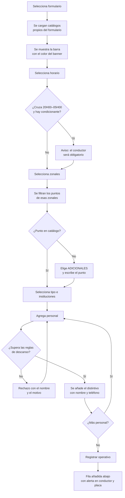
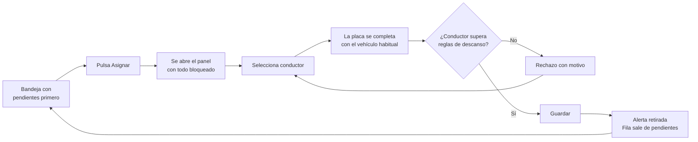

# DISEÑO DE INTERFAZ
## Módulo Transportes / Cuadro de Colores Operativo — Agencia Metropolitana de Control

| | |
|---|---|
| **Fase** | 5 — Diseño de experiencia e interfaz |
| **Base visual** | Proyecto `transporte-frontend`, sin estilos nuevos |
| **Stack** | React 19 · Tailwind CSS 4 · daisyUI 5 |
| **Entrada** | Documentación funcional (Fase 2) y arquitectura técnica (Fase 4) |

---

## 1. PRINCIPIO RECTOR

Este diseño **no introduce ni una sola clase nueva**. Cada pantalla se compone exclusivamente con los componentes, clases utilitarias y variables de tema ya presentes en `transporte-frontend`. Antes de diseñar se inventarió el sistema visual real del proyecto —tokens, tema de daisyUI, hojas de estilo propias y patrones de composición de las páginas existentes— y todo lo que sigue se construye sobre ese inventario.

La única excepción son los **nueve colores de banner del cuadro de colores**, que no son decisiones de diseño sino datos institucionales: provienen del libro Excel aprobado por la Dirección, los entrega el backend en la respuesta y se aplican como color en línea sobre la fila de banner. El frontend no los define ni los interpreta.

---

## 2. SISTEMA VISUAL HEREDADO

### 2.1 Tema de daisyUI

Verificado en `src/index.css`. Estos son los únicos colores semánticos disponibles.

| Token | Claro | Oscuro | Uso en este módulo |
|---|---|---|---|
| `primary` | `#1b77bb` | `#1b77bb` | Acción principal, encabezados de sección |
| `secondary` | `#20347d` | `#20347d` | Títulos de página, barra lateral |
| `accent` | `#3744d0` | `#3744d0` | Acción destacada, énfasis |
| `neutral` | `#72b9e7` | `#72b9e7` | Elementos neutros |
| `success` | `#6ed0bd` | `#6ed0bd` | Confirmaciones |
| `info` | `#8fa1ff` | `#8fa1ff` | Avisos informativos, realce de fila |
| `warning` | `#f48a42` | `#f48a42` | Alerta logística pendiente |
| `error` | `#cb1f03` | `#ea3446` | Errores y reglas incumplidas |
| `base-100` | `#ffffff` | `#0d1630` | Superficie de panel |
| `base-200` | `#f1f3f6` | `#121f40` | Fondo de aplicación |
| `base-300` | `#d6deef` | `#233766` | Bordes y separadores |
| `base-content` | `#26365f` | `#edf4ff` | Texto |

> **Observación para la Dirección.** El manual de marca Nueva Imagen 2025, presente en el propio repositorio, señala `#3744d0` como color primario de acción. El tema del proyecto lo tiene asignado a `accent` y usa `#1b77bb` como `primary`. Dado que la instrucción es respetar el diseño existente y no inventar estilos, este diseño **usa el tema tal como está**. Si la DNP desea alinear ambos, la modificación es una línea del tema y afecta a todo el sistema por igual. `PENDIENTE DE VALIDACIÓN CON EL USUARIO`.

### 2.2 Clases de composición verificadas

Extraídas de las páginas existentes del proyecto. Son las que se reutilizan tal cual.

> **Revisado contra el código el 2026-08-21.** Tres filas se habían quedado atrás y decían lo
> contrario de lo que hace el proyecto: el panel bajó de `rounded-3xl` a `rounded-md` el 20-AGO
> —regla de marca de cajas rectas—, y el gris de Tailwind salió de la interfaz el 21-AGO en favor
> del token del tema, que sí cumple contraste en tema oscuro. El estado vacío nunca fue cursivo.
>
> **Actualizado el 2026-09-14 para heredar el diseño de `instruccion-frontend`:** paneles y
> sidebar vuelven a `rounded-3xl` (esquinas redondeadas). El contenedor de página (`.app-page-shell`)
> pasa a **ancho completo** (`max-width: none`): las pantallas aprovechan todo el espacio disponible
> del área de contenido, sin margen lateral muerto en pantallas anchas. Las tablas suman
> **`table-zebra`** (filas alternas) y el paso del cursor pasa de
> `hover:bg-info/10` a **`hover:bg-primary/5`**. Y los botones de color quedan **planos** —sin la
> sombra propia que añadía `refinamiento.css`—, como los de instruccion; se conserva el contorno
> del secundario y el realce del ghost para no perder contraste. Todo del mismo sistema AMC.
>
> **Esta tabla es la fuente de verdad de la regla 1 de `CLAUDE.md`** —«no se introducen clases
> nuevas»—, así que mantenerla al día no es cortesía: si miente, la regla no se puede cumplir.
>
> **TIPOGRAFÍA CENTRALIZADA EN TOKENS (2026-09-15).** El peso, el interlineado y la interletra
> de toda la jerarquía —títulos, antetítulos, encabezados de sección, cabeceras de tabla,
> etiquetas, botones y distintivos— salen de un solo bloque de variables en `refinamiento.css`
> (`--app-peso-*`, `--app-interlineado-*`, `--app-tracking-*`, `--app-titulo-pagina`), no de
> literales repetidos ni de utilidades por componente. Por eso las clases de antetítulo y título
> de sección de arriba **ya no llevan `tracking-[0.18em]`**: la interletra la pone el token. La
> familia (Montserrat) y los tamaños de la maqueta densa no se tocan; el tope de peso sigue en 600.

| Elemento | Clases exactas del proyecto |
|---|---|
| Contenedor de página | `app-page-shell` — rejilla, ancho completo hasta **80rem** y centrada (heredado de instruccion, 2026-09-14) |
| Antetítulo | `page-heading-kicker font-semibold uppercase` — el tamaño (11px, eyebrow) lo fija el token `--app-antetitulo` en `refinamiento.css`, no una utilidad en línea |
| Título de página | `page-heading-title` |
| Subtítulo | `page-heading-subtitle` |
| Panel de datos | `app-modules-panel app-data-panel app-shell-surface overflow-visible rounded-3xl border border-base-300 bg-base-100 shadow-[0_12px_32px_rgba(15,23,42,0.12)] backdrop-blur-[2px]` |
| Cabecera de sección | `app-section-header flex flex-col gap-3 border-b border-base-300 px-6 py-4 sm:flex-row sm:items-center sm:justify-between` |
| Título de sección | `app-section-heading text-sm font-semibold uppercase text-primary/95` |
| Cuerpo del panel | `app-data-panel-body px-2 pb-4 pt-2 md:px-4` |
| Rejilla de tarjetas | `grid grid-cols-1 gap-3 md:grid-cols-2 xl:grid-cols-3` — órdenes en P-06, zonales en P-08 |
| Tarjeta | `rounded-md border border-base-300 bg-base-100 p-4` — `p-3` cuando va **dentro** de un panel |
| Tabla | `table table-sm table-zebra w-full text-sm` |
| Tabla de operativos (matriz P-04, jornada P-13, registro P-01, mis operativos P-02) | `table table-sm` **sin `table-zebra`** — la banda se pinta POR OPERATIVO (o por GRUPO del 8), no por `<tr>` (2026-09-14). Un operativo ocupa varios renglones (uno por persona, o las copias agrupadas del 8); `table-zebra` los rayaba a ellos y el bloque salía a dos tonos. Se alterna `bg-base-200` (impares en blanco, sin clase) según el índice del operativo/grupo. En la matriz y la jornada, además, `border-t border-base-300` en la primera fila hace de separador |
| Encabezado de tabla | `text-xs uppercase tracking-wider text-base-content/70` |
| Fila de filtros | `input input-bordered input-xs w-full font-normal normal-case` |
| Fila con paso del cursor | `hover:bg-primary/5` |
| Fila seleccionada | `bg-primary/5` |
| Buscador | `input input-bordered input-sm w-full sm:max-w-md` |
| Botón principal | `btn btn-primary btn-sm` |
| Botón secundario | `btn btn-ghost btn-sm` |
| Botón de paginación | `btn btn-ghost btn-xs` |
| Distintivo | `badge badge-primary badge-sm whitespace-nowrap` |
| Estado vacío | `py-6 text-center text-sm text-base-content/70`, con el `px-` de las celdas de esa tabla |
| Código generado por el sistema | `font-mono text-xs font-semibold` — identificador de operativo, código de orden |
| Rótulo sobre el banner del formulario | `badge badge-sm` con `backgroundColor` del servidor y `color` de `colorDeTextoSobre()`. **Nunca `text-white` fijo** |

> **El cambio de tema no se anima, desde el 26-AGO.** `<html data-cambiando-tema>` durante
> un fotograma, con `transition: none` bajo ese atributo. No es una clase del inventario:
> es un atributo de datos, y la regla 1 de `CLAUDE.md` no lo alcanza.
>
> Sin él, los fondos saltaban de golpe mientras dieciocho selectores animaban `color`
> durante 180 ms, y en ese lapso el texto quedaba a **1,60:1**. Ver `.interface-design/system.md`.
| Dato de identidad | `font-mono text-xs` — cédula, placa, usuario |
| Cargando | `loading loading-spinner loading-lg text-primary` |
| Aviso | `alert alert-info` · `alert-warning` · `alert-error` · `alert-success` — **relleno tenue, borde del color y texto legible** desde el 24-AGO: el manual prohíbe el rojo y los complementarios como fondos completos, y `alert-warning` a sangre daba **2.45:1**. Se visten en `styles/ui/avisos-y-distintivos.css` |
| Distintivo de estado | `badge badge-info` · `badge-warning` · `badge-error` · `badge-success` — mismo tratamiento y mismo motivo |
| Envoltorio de tabla | `overflow-x-auto` |
| Recorte de texto en una línea | `truncate` — puntos suspensivos cuando el texto excede su caja; exige un ancho definido en el contenedor. **Documentada el 2026-09-07**: ya se usaba y faltaba aquí. En uso en `AlertList`, `PanelPuntosEncuentro`, `SelectorPersonal` y la barra de perfil |
| Encoger un hijo flex | `min-w-0` — un elemento flex no baja de su contenido salvo con esto; es lo que hace funcionar a `truncate` dentro de una fila o un distintivo. **Documentada el 2026-09-07**. En uso en `MarcoModal`, `PanelPuntosEncuentro`, `SelectorPersonal`, `ModalDirectorioAuth` |
| Recorte de contenido de una caja | `overflow-hidden` — contiene lo que desborda un contenedor de tamaño fijo. **Documentada el 2026-09-07**. En uso en `MainLayout`, `Navbar`, `Sidebar`, `PanelPuntosEncuentro` |
| Forzar que un rótulo envuelva | `whitespace-normal` — **Añadida el 2026-09-07.** `.label` de daisyUI es `white-space: nowrap`; un rótulo largo de checkbox o un texto de ayuda envuelto en `.label` se salía de la ventana. `whitespace-normal` (con `min-w-0` en el hijo) devuelve el envolvido. En uso en las casillas de rol de `ModalUsuario` |
| Control con dato de longitud libre que no desborda | **Añadidas el 2026-09-07.** `.btn` y `.badge` de daisyUI son `flex-shrink:0` y de alto/altura fija, así que un dato largo en su rótulo (nombre, correo, placa, institución, nombre de formulario o de zonal) crece a lo ancho y desborda su caja. Dos remedios según el control: **botón** → `h-auto max-w-full` (crece hacia abajo y el rótulo se parte en varias líneas; la fila debe ir `w-full`), en `PanelPuntosEncuentro` y `SelectorFormulario`; **distintivo** → `min-w-0 max-w-full` en el `badge` y `min-w-0 truncate` en el dato (se recorta con puntos suspensivos y el valor íntegro va al `title`, porque el distintivo es de altura fija), en `SelectorPersonal`, `SelectorTokens`, `ModalUsuario`, `ModalDirectorioAuth`, `PanelEdicionOperativo` y `PanelAdicionalOperativo` |
| Celda que abarca varios renglónes | `rowSpan` en el `<td>`. **No es una clase**, así que la regla 1 no la alcanza; se anota aquí porque es técnica nueva en el proyecto desde el 2026-08-27 |

> **El botón de baja lleva icono y rótulo, desde el 2026-08-27.** `btn btn-ghost btn-xs
> text-error` con `<Iconos nombre="eliminar" />` —un tacho de basura— delante de la
> palabra **Eliminar**. Está en P-02 y en las ausencias de P-07.
>
> **El rótulo no se quita.** Regla 13 de `CLAUDE.md`: el icono acompaña, nunca sustituye;
> y en la misma fila «Editar» y «Adicional» son palabras, de modo que un botón que solo
> fuera un dibujo obligaría a adivinar cuál es. El icono no lleva `aria-label` —FontAwesome
> ya pone `aria-hidden`— ni color ni tamaño propios: hereda el rojo de `text-error`.
>
> **Y dejó de decir «Retirar» porque «Retirar» no era exacto.** La baja de un operativo
> **borra la fila** cuando todavía no hay una orden emitida (PV-10), y la de una ausencia
> la borra siempre. El texto de confirmación ya lo decía —«Se borra de la base y no se
> puede deshacer»—; era el rótulo el que desentonaba.
>
> **En P-11 el botón sigue diciendo «Retirar», y sin icono.** Ahí la baja es lógica: la
> correspondencia de rol se conserva porque explica los operativos que ya existen, y la
> propia pantalla lo escribe encima de la tabla. Un tacho de basura prometería algo que
> no ocurre.

#### Topes de tamaño

Van aparte porque **no describen un elemento, sino cuánto se le deja crecer**, y porque cada
uno se autorizó por su caso. La regla 1 obliga a consultar antes de escribir un valor que no
esté aquí: son los únicos admitidos.

| Tope | Dónde y por qué |
|---|---|
| `max-w-sm` · `max-w-lg` · `max-w-2xl` | Los tres anchos de `MarcoModal`. `lg` es el de un formulario corriente |
| `max-w-4xl` | **Añadido el 2026-08-27.** Cuarto ancho de `MarcoModal`, y **solo para ventanas que contienen una lista, no un formulario**. Lo trajo el personal de P-13: en 672 px las dos columnas de candidatos dejaban celdas de 328 px y el motivo del servidor se partía en tres renglones; con 896 px la celda sube a 440 px y cabe en dos, igual que en P-01. **No se use para capturar**: un formulario a 896 px devuelve las líneas largas que el reparto de P-01 existe para evitar |
| `max-w-md` · `max-w-xs` | Buscadores, como `sm:max-w-md` y `sm:max-w-xs`. El segundo, en las tres pantallas de administración |
| `max-h-full` | Tarjeta de `MarcoModal`, con `overflow-y-auto`: la ventana nunca sobrepasa el alto de la pantalla |
| `max-h-32` | Bandeja de elementos ya elegidos —distintivos— en `SelectorTokens` y `SelectorPersonal`. Un distintivo mide 24 px y con `gap-2` la fila ocupa 32: deja ver dos filas |
| `max-h-48` | Listas cortas de selección |
| `max-h-80` | **Añadido el 2026-08-26**, y anotado aquí el 27. Lista de candidatos de `SelectorPersonal`: con `max-h-48` cabían tres personas y asignar treinta obligaba a desplazar decenas de veces. Los valores que había antes eran 32, 48 y `full` |

> **Un tope de tamaño se decide midiendo, no eligiendo.** Las tres filas con fecha de arriba
> nacieron de una medición sobre la hoja compilada, no de una preferencia; quien quiera
> cambiarlas debería repetir la medición antes, porque lo que hay detrás de cada número es
> el ancho de una celda y el número de renglones que ocupa un texto que redacta el servidor.

### 2.3 Componentes reutilizados

| Componente | Ruta en el proyecto | Uso en este módulo |
|---|---|---|
| `Table` | `components/tabla/Table.tsx` | Listados con TanStack Table |
| `FilterByColumn` | `components/tabla/FilterByColumn.tsx` | Filtros por columna |
| `RowActions` | `components/tabla/RowActions.tsx` | Acciones por fila |
| `TextInput`, `SelectInput`, `TextAreaInput` | `components/forms/FormikField.tsx` | Todos los campos del formulario |
| `Boton` | `components/common/Boton.tsx` | Botones con icono y contador |
| `Alert` | `components/common/Alert.tsx` | Avisos de resultado |
| `Loading` | `components/common/Loading.tsx` | Estado de carga |
| `ModalConfirmacion` | `components/common/ModalConfirmacion.tsx` | Confirmación de eliminación |
| `ModalExito` | `components/common/ModalExito.tsx` | Confirmación de operación |
| `ModalContainer` | `components/modals/ModalContainer.tsx` | Envoltorio de modales |
| `Paginacion` | `components/common/Paginacion.tsx` | Paginación de listados |
| `Collapse` | `components/common/Collapse.tsx` | Secciones plegables |
| `Iconos` | `components/common/Iconos.tsx` | Catálogo de iconos FontAwesome |
| `RutaProtegida` | `components/common/RutaProtegida.tsx` | Protección de rutas por rol |
| `SelectorRolPruebas` | `components/navbar/SelectorRolPruebas.tsx` | Cambio de perfil provisional |

### 2.4 Puntos de corte

Los verificados en las hojas de estilo del proyecto: `767px` como límite de móvil y `768px` como inicio de escritorio en `page-header.css`, más los puntos estándar de Tailwind `sm` 640, `md` 768, `lg` 1024, `xl` 1280.

---

## 3. MAPA DE PANTALLAS

### 3.1 Inventario

| ID | Pantalla | Ruta | Perfiles |
|---|---|---|---|
| **P-01** | Registro de operativo | `/cuadro/registro` | DMIP Operativos, DMIP Inspecciones, DMIT |
| **P-02** | Mis operativos | `/cuadro/mis-operativos` | DMIP Operativos, DMIP Inspecciones, DMIT |
| **P-03** | Asignación de transporte | `/cuadro/transporte` | DAF |
| **P-04** | Matriz Consolidada del Día | `/cuadro/matriz` | Director |
| **P-13** | Jornada del Día | `/cuadro/jornada` | DMIT Instrucción. Desde el 2026-08-27 avisa de qué personal le toca poner (ALV-08): recuento en `alert alert-warning` con `role="status"` en la cabecera, y línea `text-xs text-base-content/70` bajo el botón de cada fila. **El color va arriba y las palabras abajo**: un distintivo de color por fila, en una tabla de doce columnas, deja de señalar nada |

> **ALV-08 se pinta en el marco, no en cada página.** `AvisoPersonalPendiente` se monta
> en `MainLayout`, dentro de `<main>` y encima del `<Outlet>`, con
> `alert alert-warning mb-4` y `role="status"`; el enlace de salida usa
> `btn btn-ghost btn-xs`. Todas son clases del inventario de §2.2. **En P-13 no se
> pinta**: esa pantalla lleva el suyo, que sigue a la fecha del selector en lugar de
> hablar siempre de la jornada que se está armando.
| **P-05** | Órdenes de servicio | `/cuadro/ordenes` | Director |
| **P-06** | Mis órdenes | `/mis-ordenes` | Funcionario |
| **P-07** | Administración de personal | `/administracion/personal` | Administrador, y los tres departamentales en consulta (PER-09) |
| **P-08** | Administración de catálogos | `/administracion/catalogos-cuadro` | Administrador |
| **P-09** | Administración de ventanas | `/administracion/ventanas` | Administrador |
| **M-01** | Modal de confirmación de retiro | — | Departamentales |
| **M-02** | Modal de detalle de operativo | — | Director, DAF |
| **M-03** | Modal de éxito | — | Todos |

### 3.2 Navegación lateral

Se agrega al `navigation.ts` existente empleando el campo `allowedRoles` ya previsto. Los ítems no autorizados se muestran atenuados, no ocultos, conforme a PER-07.

```
CUADRO DE COLORES
├── Registro de operativo      → DMIP_OPERATIVOS, DMIP_INSPECCIONES, DMIT
├── Mis operativos             → DMIP_OPERATIVOS, DMIP_INSPECCIONES, DMIT
├── Asignación de transporte   → DAF
├── Jornada del Día            → DMIT_INSTRUCTOR
├── Matriz Consolidada         → DIRECTOR
└── Órdenes de servicio        → DIRECTOR

ADMINISTRACIÓN
├── Personal y disponibilidad  → ADMINISTRADOR_DMIP
├── Catálogos del cuadro       → ADMINISTRADOR_DMIP
└── Ventanas de carga          → ADMINISTRADOR_DMIP
```

---

## 4. WIREFRAMES

### 4.1 P-01 · Registro de operativo

Disposición horizontal a ancho completo, con la matriz de resultado debajo. Responde a la instrucción del Product Owner de que el formulario se vea corto.

```
┌──────────────────────────────────────────────────────────────────────────────┐
│ [☰]                        S I G O C                    [Perfil ▾] [🔔] [☀] │  ← Navbar heredado
├────────────┬─────────────────────────────────────────────────────────────────┤
│            │                                                                 │
│  SIGOC     │  PLANIFICACIÓN OPERATIVA · DMIP OPERATIVOS      ← kicker        │
│  Sistema   │  Registro de operativo                          ← título        │
│  de        │  Cuadro del viernes 31 de julio de 2026 · Semana 31             │
│  Gestión   │                                                                 │
│            │  ┌───────────────────────────────────────────────────────────┐  │
│ ▸ Cuadro   │  │ ⓘ Ventana de carga abierta hasta las 15H00.               │  │  ← alert alert-info
│   • Regis…│  └───────────────────────────────────────────────────────────┘  │
│   • Mis op│                                                                 │
│   • Asign…│  ┌───────────────────────────────────────────────────────────┐  │
│   • Matriz│  │ REGISTRAR OPERATIVO          Semana 31 │ OCF-004 │ 31-JUL │  │  ← section-header
│   • Órden…│  ├───────────────────────────────────────────────────────────┤  │     + badges de solo lectura
│            │  │                                                           │  │
│ ▸ Adminis… │  │ Formulario*        Hora inicio*   Hora fin*   Zonal*      │  │
│            │  │ [1. Fijos    ▾]    [08:00 ▾]      [16:30 ▾]   [☑ Espejo ]│  │  ← rejilla 1→2→3→4 col
│            │  │ ▬▬▬▬ Verde azulado                            [☐ Delicia]│  │
│            │  │                                                           │  │
│            │  │ Punto de encuentro*  Tipo de control*  Instituciones*     │  │
│            │  │ [El Tejar      ▾]    [Control esp… ▾]  [☑ AMC  ☐ CACMQ ] │  │
│            │  │                                                           │  │
│            │  │ Personal asignado*                                        │  │
│            │  │ [Buscar funcionario…        ▾] [+ Agregar]                │  │
│            │  │ (SEGOVIA EDISON · 98 514 4231 ✕)                          │  │  ← badge badge-primary
│            │  │                                                           │  │
│            │  │ Observaciones                                             │  │
│            │  │ [                                                       ] │  │
│            │  │                                                           │  │
│            │  │ ⚠ Conductor y placa los asigna Transportes. Quedarán en   │  │  ← alert alert-warning
│            │  │   Amarillo de Alerta hasta que la DAF los complete.       │  │
│            │  │                                                           │  │
│            │  │ [Registrar Operativo]  [Limpiar]                          │  │
│            │  └───────────────────────────────────────────────────────────┘  │
│            │                                                                 │
│            │  ┌───────────────────────────────────────────────────────────┐  │
│            │  │ MIS OPERATIVOS DEL DÍA                        4 registros │  │
│            │  ├───────────────────────────────────────────────────────────┤  │
│            │  │ ID │ FORM │ HORARIO │ PERSONAL │ PUNTO │ COND │ ACCIONES  │  │
│            │  │ ───┼──────┼─────────┼──────────┼───────┼──────┼────────── │  │
│            │  │ OCF│ 1    │ 08H00…  │ SEGOVIA  │ Tejar │ ⚠Pend│ [✎] [🗑]  │  │
│            │  └───────────────────────────────────────────────────────────┘  │
└────────────┴─────────────────────────────────────────────────────────────────┘
```

### 4.2 P-03 · Asignación de transporte

```
┌──────────────────────────────────────────────────────────────────────────────┐
│  DIRECCIÓN ADMINISTRATIVA FINANCIERA                                         │
│  Asignación de transporte                                                    │
│  Cuadro del 31 de julio de 2026 · Ventana de 15H00 a 16H30                   │
│                                                                              │
│  ┌────────────────────────────────────────────────────────────────────────┐  │
│  │ ⓘ Edición restringida. Solo puede completar conductor y placa.         │  │  ← alert alert-info
│  └────────────────────────────────────────────────────────────────────────┘  │
│                                                                              │
│  ┌────────────────────────────────────────────────────────────────────────┐  │
│  │ ASIGNAR TRANSPORTE A  ICNECU-001-31-JUL-2026            [Cancelar]     │  │  ← panel de edición
│  ├────────────────────────────────────────────────────────────────────────┤  │     (oculto hasta seleccionar)
│  │ Formulario         Horario          Zonal           Punto              │  │
│  │ [6. Reacc. Noct ]  [18H00 A 23H30]  [DMQ        ]   [AMC Matriz     ]  │  │  ← disabled
│  │ ▒▒▒▒▒▒▒▒▒▒▒▒▒▒▒▒  ▒▒▒▒▒▒▒▒▒▒▒▒▒▒▒  ▒▒▒▒▒▒▒▒▒▒▒▒▒   ▒▒▒▒▒▒▒▒▒▒▒▒▒▒▒▒▒  │  │
│  │                                                                        │  │
│  │ Personal asignado                                Tipo de control       │  │
│  │ [YUNDA JESSICA · CAMPAÑA JUAN · NARVAEZ IVAN ]   [Alertas ECU 911  ]  │  │  ← disabled
│  │                                                                        │  │
│  │ Conductor / Teléfono  [Editable]     Placa del vehículo  [Editable]    │  │
│  │ ┃[Seleccione conductor…        ▾]    ┃[PMA7892                     ]   │  │  ← focus:input-primary
│  │                                                                        │  │
│  │ [Guardar asignación]  [Marcar propios medios]                          │  │
│  └────────────────────────────────────────────────────────────────────────┘  │
│                                                                              │
│  ┌────────────────────────────────────────────────────────────────────────┐  │
│  │ PLANIFICACIONES RECIBIDAS      Flota 12/15 · 4 pendientes              │  │
│  ├────────────────────────────────────────────────────────────────────────┤  │
│  │ [Buscar…                    ]                       [Limpiar filtros]  │  │
│  │ ID │ FORMULARIO │ HORARIO │ PERSONAL │ PUNTO │ COND │ PLACA │ ACCIÓN   │  │
│  │ ───┼────────────┼─────────┼──────────┼───────┼──────┼───────┼───────── │  │
│  │ ICN│ 6. Reacc…  │ 18H00…  │ 3 pers.  │ Matriz│ ⚠Pend│ ⚠Pend │[Asignar] │  │
│  │ IG-│ 8. Inspec… │ 09H00…  │ 1 pers.  │ AMC   │ ⚠Pend│ ⚠Pend │[Asignar] │  │
│  │ OCF│ 1. Fijos   │ 08H00…  │ 1 pers.  │ Tejar │ Prop.│ N/A   │[Revisar] │  │
│  │                                            « ‹  Página 1 de 3  › »     │  │
│  └────────────────────────────────────────────────────────────────────────┘  │
└──────────────────────────────────────────────────────────────────────────────┘
```

### 4.3 P-04 · Matriz Consolidada del Día

```
┌──────────────────────────────────────────────────────────────────────────────┐
│  DIRECCIÓN NACIONAL DE PLANIFICACIÓN                                         │
│  Matriz Consolidada del Día                                                  │
│  AMC-2026-JUL-31 · viernes 31 de julio de 2026 · Semana 31                   │
│                                                                              │
│  [En transporte]  [24 operativos]  [7 alertas]  [Flota 18/15 ⚠]              │  ← badges
│                                                                              │
│  ┌────────────────────────────────────────────────────────────────────────┐  │
│  │ MATRIZ CONSOLIDADA        [Todos los formularios ▾]  [Exportar PDF]    │  │
│  ├────────────────────────────────────────────────────────────────────────┤  │
│  │ ████ 1. OPERATIVOS DE CONTROL FIJOS   DMIP Operativos · 3 operativos   │  │  ← banner con color
│  │ ID      │HORARIO│PERSONAL │ZONAL│PUNTO │TIPO│INST│COND│PLACA│OBS│ACC   │  │     del backend
│  │ ────────┼───────┼─────────┼─────┼──────┼────┼────┼────┼─────┼───┼───── │  │
│  │ OCF-001 │07H00… │SEGOVIA  │M.Sáe│Tejar │Esp.│AMC │Prop│ N/A │…  │[📄]  │  │
│  │                                                                        │  │
│  │ ████ 2. CONTROL DE PUNTO DE MANDO OPERATIVO (PMO)  · 5 operativos      │  │
│  │ OCPMO-1 │18H00… │TACO R.  │M.Sáe│Basíli│Esp.│AMC │VIVA│PMA…│…  │[📄]  │  │
│  │                                                                        │  │
│  │ ████ 6. PATRULLA REACCIÓN NOCTURNA   DMIP Insp. + DMIT · 1 operativo   │  │
│  │ ICNECU-1│18H00… │3 person.│DMQ  │Matriz│ECU │AMC │▓▓▓▓│▓▓▓▓│…  │[📄]  │  │  ← celdas en amarillo
│  │                                                                        │  │
│  │ ████ 7. OPERATIVO DMIT                            DMIT · 0 operativos  │  │
│  │ │ La información de este formulario no fue ingresada.                │ │  │  ← fila de evidencia
│  │ │ Responsable: DMIT Instrucción · cierre 15H00                       │ │  │
│  └────────────────────────────────────────────────────────────────────────┘  │
│                                                                              │
│  Leyenda  ▓ Asignación logística pendiente   ▓ Vehículo obligatorio sin cond.│
└──────────────────────────────────────────────────────────────────────────────┘
```

### 4.4 P-02 · Mis operativos

```
┌──────────────────────────────────────────────────────────────────────────────┐
│  DMIP · INSPECCIONES TÉCNICAS Y GENERALES                                    │
│  Mis operativos                                                              │
│  Formularios 5, 6 y 8 · Cuadro del 31 de julio de 2026                       │
│                                                                              │
│  ┌────────────────────────────────────────────────────────────────────────┐  │
│  │ OPERATIVOS REGISTRADOS      6 registros    [+ Nuevo operativo]         │  │
│  ├────────────────────────────────────────────────────────────────────────┤  │
│  │ [Buscar…                          ]              [Limpiar filtros]     │  │
│  │ ID │FORMULARIO│HORARIO│PERSONAL│PUNTO│COND│ESTADO   │ACCIONES          │  │
│  │ [f]│[filtrar ]│[filtr]│[filtra]│[fil]│    │[filtrar]│                  │  │  ← fila de filtros
│  │ ───┼──────────┼───────┼────────┼─────┼────┼─────────┼───────────────── │  │
│  │ IG-│8. Inspec.│09H00… │REDROVAN│AMC  │⚠   │Pendiente│[✎ Editar][🗑]    │  │
│  │ ICN│6. Reacc. │18H00… │3 pers. │Matr.│⚠   │Pendiente│[✎ Editar][🗑]    │  │
│  │                                            « ‹  Página 1 de 1  › »     │  │
│  └────────────────────────────────────────────────────────────────────────┘  │
│  La Matriz Consolidada del Día es exclusiva de la Dirección.                 │
└──────────────────────────────────────────────────────────────────────────────┘
```

> **Ese pie sigue siendo cierto, y desde el 2026-08-26 conviene precisarlo.** La Matriz
> Consolidada —P-04, con su exportación y su cierre— sigue siendo solo de la Dirección. Lo
> que cambió es que **DMIT Instrucción tiene una pantalla propia**, P-13 · «Jornada del
> Día», donde ve los nueve formularios y asigna personal en los suyos. Para ese perfil el
> pie de P-02 se queda corto; para los otros dos departamentales, no.

### 4.5 P-07 · Administración de personal

```
┌──────────────────────────────────────────────────────────────────────────────┐
│  ADMINISTRACIÓN                                                              │
│  Personal y disponibilidad                                                   │
│                                                                              │
│  ┌────────────────────────────────────────────────────────────────────────┐  │
│  │ MAESTRO DE PERSONAL      52 registros    [+ Nuevo funcionario]         │  │
│  ├────────────────────────────────────────────────────────────────────────┤  │
│  │ [Buscar…              ]  [Área ▾] [Contrato ▾] [Estado ▾] [Limpiar]    │  │
│  │ CÉDULA│APELLIDOS Y NOMBRES│ÁREA│CONTRATO│TELÉFONO│ESTADO│ACCIONES      │  │
│  │ ──────┼───────────────────┼────┼────────┼────────┼──────┼───────────── │  │
│  │ 17…   │YUNDA JESSICA      │Gral│Ocasion.│98 715… │Activo│[✎][📅][🗑]   │  │
│  │ 17…   │ORTEGA PAOLA       │Gral│Ocasion.│99 251… │Vacac.│[✎][📅][🗑]   │  │
│  └────────────────────────────────────────────────────────────────────────┘  │
│                                                                              │
│  ┌────────────────────────────────────────────────────────────────────────┐  │
│  │ AUSENCIAS REGISTRADAS                                                  │  │
│  │ FUNCIONARIO │ MOTIVO      │ DESDE      │ HASTA      │ ACCIONES         │  │
│  │ ORTEGA PAOLA│ Vacaciones  │ 28-JUL-26  │ 08-AGO-26  │ [✎] [🗑]         │  │
│  └────────────────────────────────────────────────────────────────────────┘  │
└──────────────────────────────────────────────────────────────────────────────┘
```

### 4.6 M-01 · Modal de confirmación

Se emplea `ModalConfirmacion` tal como existe, sin modificaciones.

```
                ┌─────────────────────────────────────┐
                │              ⚠                      │  ← bg-warning/15, text-warning
                │                                     │
                │      ¿Retirar este operativo?       │  ← text-lg font-bold
                │                                     │
                │  Se quitará IG-002-31-JUL-2026,     │  ← text-sm text-gray-600
                │  AMC Matriz, 09H00 A 18H00, del     │
                │  formulario 8. Inspecciones         │
                │  Técnicas y Generales.              │
                │                                     │
                │  [  Cancelar  ]  [   Confirmar   ]  │  ← btn-outline / btn-primary
                └─────────────────────────────────────┘
```

---

## 5. MOCKUPS · ESPECIFICACIÓN DE COMPOSICIÓN

Cada mockup indica las clases exactas del proyecto que se emplean. No hay ninguna clase inventada.

### 5.1 P-01 · Registro de operativo

**Contenedor y encabezado**

| Zona | Composición |
|---|---|
| Contenedor | `app-page-shell` |
| Antetítulo | `<p class="page-heading-kicker font-semibold uppercase">` con la dirección y rama del usuario |
| Título | `<h1 class="page-heading-title text-2xl font-bold">Registro de operativo</h1>` |
| Subtítulo | `<p class="page-heading-subtitle text-sm">` con la fecha del cuadro y el número de semana |
| Aviso de ventana | `alert alert-info` cuando está abierta, `alert alert-error` cuando está cerrada |

**Panel del formulario**

| Zona | Composición |
|---|---|
| Panel | `app-modules-panel app-data-panel app-shell-surface overflow-visible rounded-3xl border border-base-300 bg-base-100 shadow-[0_12px_32px_rgba(15,23,42,0.12)] backdrop-blur-[2px]` |
| Cabecera | `app-section-header flex flex-col gap-3 border-b border-base-300 px-6 py-4 sm:flex-row sm:items-center sm:justify-between` |
| Título de sección | `app-section-heading text-sm font-semibold uppercase text-primary/95` |
| Datos calculados | Tres `badge badge-ghost badge-sm` con semana, identificador y fecha. **No son campos**: son información de solo lectura, conforme a RN-06 y RN-09 |
| Cuerpo | `px-6 py-5` con rejilla `grid grid-cols-1 gap-4 sm:grid-cols-2 lg:grid-cols-3 xl:grid-cols-4` |

**Campos**

Todos con los componentes de `FormikField.tsx`, que ya aportan etiqueta, marca de obligatorio y mensaje de error.

| Campo | Componente | Notas de composición |
|---|---|---|
| Formulario | `SelectInput` | Debajo, una barra `h-1.5 w-full rounded-full` con el color del banner en línea desde la respuesta |
| Hora inicio y fin | `SelectInput` en `grid grid-cols-2 gap-2` | 48 opciones en intervalos de treinta minutos |
| Zonal | Lista de casillas en `max-h-32 overflow-y-auto rounded-lg border border-base-300 p-2` con `checkbox checkbox-sm` | Selección múltiple, RN-19 |
| Punto de encuentro | `SelectInput` | Al elegir `ADICIONALES` aparece un `TextInput` debajo |
| Tipo de control | `SelectInput` | Mismo comportamiento con `ADICIONALES` |
| Instituciones | Lista de casillas, igual que zonal | Selección múltiple |
| Personal | `SelectInput` más `btn btn-ghost btn-sm` de agregar. Los seleccionados como `badge badge-primary badge-sm` con botón de retiro | El teléfono se muestra en el distintivo, no se digita |
| Observaciones | `TextAreaInput` | Ocupa `col-span-full` |
| Aviso de transporte | `alert alert-warning` fijo al pie del formulario | Explica que conductor y placa los asigna la DAF |
| Acciones | `btn btn-primary btn-sm` y `btn btn-ghost btn-sm` | |

### 5.2 P-03 · Panel de asignación de transporte

Es la pantalla donde el diseño expresa visualmente una regla de negocio. El contraste entre campos bloqueados y editables debe ser inequívoco.

| Zona | Composición |
|---|---|
| Campos bloqueados | `input input-bordered w-full` con `disabled`. daisyUI ya aplica el aspecto atenuado |
| Etiqueta de editable | `badge badge-accent badge-xs` con el texto *Editable*, junto a la etiqueta del campo |
| Campos editables | `select input-bordered w-full focus:input-primary` — el mismo tratamiento de foco que usa `FormikField` |
| Acción principal | `btn btn-primary btn-sm` |
| Acción alternativa | `btn btn-ghost btn-sm` para propios medios |
| Indicador de flota | `badge badge-ghost badge-sm` en estado normal, `badge badge-error badge-sm` al superarse la capacidad |

### 5.3 P-04 · Matriz Consolidada

| Zona | Composición |
|---|---|
| Fila de banner | `<tr>` con `<td colSpan>` y `style` con el color de fondo recibido del backend. Texto `text-xs font-bold uppercase tracking-[0.1em]` |
| Cabecera de columnas | `text-xs uppercase tracking-wider text-gray-500` |
| Fila de datos | `hover:bg-primary/5` |
| Celda con alerta | `bg-warning/25 font-semibold` más `title` con el motivo |
| Celda con alerta crítica | `bg-warning/25 font-semibold ring-1 ring-error ring-inset` |
| Fila de evidencia | `<tr>` con `bg-error/10 text-sm italic` y el mensaje de formulario no ingresado |
| Acción por fila | `btn btn-ghost btn-xs` con icono de documento |
| Exportación | `btn btn-primary btn-sm` |

> El uso de `bg-warning/25` para el Amarillo de Alerta merece explicación. El color institucional de alerta declarado en el Excel es el amarillo puro. El tema del proyecto define `warning` como `#f48a42`, un naranja. Aplicar el amarillo puro sería introducir un color fuera del tema. Se emplea por tanto la opacidad del `warning` del tema, que preserva la semántica de advertencia sin salirse del sistema visual. `PENDIENTE DE VALIDACIÓN CON EL USUARIO` sobre si la Dirección exige el amarillo exacto del Excel.

### 5.4 Distintivos de estado

Reutilizando el patrón `estadoBadgeMap` que ya existe en `config/env.ts`, se agregan las claves de este módulo con los distintivos del tema.

| Estado | Distintivo |
|---|---|
| Borrador | `badge-neutral` |
| En transporte | `badge-warning` |
| Aprobado | `badge-info` |
| Cerrado | `badge-success` |
| Transporte pendiente | `badge-warning` |
| Transporte asignado | `badge-success` |
| Propios medios | `badge-ghost` |
| Ventana abierta | `badge-success` |
| Ventana cerrada | `badge-error` |

---

## 6. FLUJOS DE INTERFAZ

### 6.1 Flujo maestro por perfil


### 6.2 Flujo de captura del formulario



### 6.3 Flujo de asignación de transporte



---

## 7. VALIDACIONES EN LA INTERFAZ

### 7.1 Principio

Las validaciones del navegador existen para dar respuesta inmediata, **no como control efectivo**. Toda regla se verifica también en el servidor. Los esquemas de Yup se ubican en `config/validationSchemas.ts`, junto a los ya existentes.

### 7.2 Validaciones de formulario

| Campo | Validación en el cliente | Momento | Presentación del error |
|---|---|---|---|
| Formulario | Requerido. Debe pertenecer a los del rol | Al enviar | `input-error` más mensaje bajo el campo |
| Hora inicio | Requerido | Al perder el foco | `input-error` |
| Hora fin | Requerido y posterior al inicio, contemplando cruce de medianoche | Al perder el foco | `input-error` |
| Zonal | Al menos una selección | Al enviar | Borde `border-error` en la lista |
| Punto de encuentro | Requerido | Al enviar | `input-error` |
| Punto adicional | Requerido si se eligió `ADICIONALES` | Al enviar | `input-error` |
| Tipo de control | Requerido | Al enviar | `input-error` |
| Tipo adicional | Requerido si se eligió `ADICIONALES` | Al enviar | `input-error` |
| Instituciones | Al menos una selección | Al enviar | Borde `border-error` |
| Personal | Al menos una persona | Al enviar | `alert alert-error` sobre el bloque |
| Observaciones | Sin validación. Su ausencia genera alerta amarilla, no error | — | — |

### 7.3 Validaciones que solo resuelve el servidor

Estas no se replican en el navegador porque dependen de datos que el cliente no posee. Se presentan al recibir la respuesta.

| Validación | Código de respuesta | Presentación |
|---|---|---|
| Persona con patrulla el día anterior | 409 | `alert alert-error` con el nombre y el motivo, sin perder lo capturado |
| Personal de nombramiento en turno no admitido | 409 | Igual |
| Tope de salidas pesadas alcanzado | 409 | Igual |
| Persona no disponible | 409 | Igual, indicando el motivo y la fecha de retorno |
| Solapamiento horario | 409 | Igual, indicando el operativo en conflicto |
| Jornada máxima superada | 409 | Igual |
| Ventana de carga cerrada | 423 | Formulario deshabilitado y `alert alert-error` con la hora de reapertura |
| Formulario no autorizado | 403 | `alert alert-error` |
| Campos no permitidos para la DAF | 400 | `alert alert-error` |

### 7.4 Redacción de mensajes

El campo `mensaje` de la respuesta se muestra tal cual. Está redactado en el servidor conforme al criterio de la Fase 2: nombra a la persona implicada y explica el motivo en términos operativos.

| Redacción inadecuada | Redacción conforme |
|---|---|
| Error de validación | La persona indicada salió en patrulla ayer. No puede tener patrulla dos días seguidos |
| Conflicto de horario | YUNDA JESSICA ya está asignada al operativo IG-002 de 09H00 a 18H00 en AMC Matriz |
| Recurso no disponible | El conductor RUIZ ESTEBAN se encuentra de vacaciones hasta el 8 de agosto |

---

## 8. ESTADOS DE PANTALLA

### 8.1 Estados transversales

Todos con los componentes existentes del proyecto.

| Estado | Composición | Cuándo |
|---|---|---|
| **Cargando inicial** | `Loading` con `loading loading-spinner loading-lg text-primary` | Primera carga de la pantalla |
| **Recarga silenciosa** | Sin indicador. Se conserva el contenido previo | Al revalidar datos ya mostrados, siguiendo el patrón de caché de las páginas existentes |
| **Vacío** | `p-4 text-center text-sm italic text-gray-500` | Sin resultados |
| **Vacío por filtro** | Mismo estilo, con texto que sugiere limpiar el filtro | Filtros activos sin coincidencias |
| **Error de carga** | `alert alert-error` con botón de reintento | Fallo de red o del servidor |
| **Guardando** | Botón con `loading loading-spinner loading-xs` y `disabled` | Durante el envío |
| **Éxito** | `ModalExito` o `alert alert-success` | Tras completar la operación |
| **Solo lectura** | Campos con `disabled` | Ventana cerrada o perfil sin permiso |

### 8.2 Estados por pantalla

**P-01 · Registro de operativo**

| Estado | Comportamiento |
|---|---|
| Ventana abierta | Formulario habilitado. `alert alert-info` con la hora de cierre |
| Ventana cerrada | Todos los campos `disabled`, botón deshabilitado, `alert alert-error` con la hora de reapertura |
| Sin formularios asignados | Panel oculto. Mensaje explicando que el perfil no administra formularios de carga |
| Cargando catálogos | Los desplegables dependientes deshabilitados con texto de carga |
| Sin zonal seleccionada | El desplegable de punto muestra la opción de elegir primero una zonal |
| Personal rechazado | `alert alert-error` sobre el bloque de personal. Lo capturado se conserva |
| Registro exitoso | `ModalExito`, formulario limpio salvo el formulario seleccionado, fila añadida abajo |

**P-03 · Asignación de transporte**

| Estado | Comportamiento |
|---|---|
| Antes de las 15H00 | Bandeja visible en solo lectura. `alert alert-info` indicando que aún no es su turno |
| Ventana abierta | Bandeja y panel operativos |
| Después de las 16H30 | Todo en solo lectura. `alert alert-error` |
| Sin pendientes | Estado vacío con mensaje de que no hay asignaciones por realizar |
| Panel cerrado | Solo la bandeja visible |
| Panel abierto | Panel sobre la bandeja, con la fila seleccionada marcada con `bg-primary/5` |
| Flota excedida | `badge badge-error badge-sm` y `alert alert-warning` sobre la bandeja |

**P-04 · Matriz Consolidada**

| Estado | Comportamiento |
|---|---|
| Cuadro en borrador | Se muestra con `badge badge-neutral`. Exportación habilitada con advertencia de que hay carga pendiente |
| Cuadro en transporte | `badge badge-warning`. Se destacan los pendientes |
| Cuadro cerrado | `badge badge-success`. Emisión de órdenes habilitada |
| Formulario sin carga | Fila de evidencia dentro del banner |
| Sin operativos en todo el cuadro | Estado vacío. Exportación deshabilitada |
| Exportando | Botón con indicador de carga y `disabled` |
| Operativo sin personal | El botón de emitir orden queda deshabilitado con explicación en el `title` |

**P-07 · Administración de personal**

| Estado | Comportamiento |
|---|---|
| Listado vacío | Estado vacío con invitación a registrar el primer funcionario |
| Funcionario con ausencia vigente | `badge badge-warning` con el motivo en la columna de estado |
| Funcionario inactivo | Fila con `opacity-60` y `badge badge-ghost` |
| Intento de baja con historial | `ModalConfirmacion` advirtiendo que se realizará baja lógica |

---

## 9. DISEÑO RESPONSIVO

### 9.1 Puntos de corte

Los del proyecto, sin agregar ninguno.

| Punto | Ancho | Origen |
|---|---|---|
| Móvil | hasta 767 px | `page-header.css` del proyecto |
| `sm` | desde 640 px | Tailwind |
| `md` | desde 768 px | Tailwind y `page-header.css` |
| `lg` | desde 1024 px | Tailwind |
| `xl` | desde 1280 px | Tailwind |

> **El contenedor de página tiene su propio umbral, y no es un punto de ruptura.**
> `app-page-shell` deja de crecer cuando el espacio disponible supera su tope, y ese
> espacio es la ventana **menos** la barra lateral (`16.375rem`) y el relleno del `<main>`
> (`lg:px-8`). Con el tope en **110rem** eso ocurre por encima de **1824 px de ventana**;
> con el de 80rem que rigió hasta el 2026-08-26, por encima de **1606 px**.
>
> **Es la razón de que el recorte no se detectara durante meses.** La disposición se
> verificó a 1440 px, donde el disponible es 1114 px y el tope no llegaba a actuar. En un
> monitor de 1920 sí: sobraban 157 px a cada lado, y con la barra lateral plegada, 288.

### 9.2 Comportamiento del armazón

Heredado sin modificación de `MainLayout` y `app-shell-layout.css`: la barra lateral pasa a cajón deslizante por debajo de `lg`, la barra superior permanece fija y el contenedor `app-page-shell` reduce su separación y elimina la altura mínima en móvil.

### 9.3 Rejilla del formulario de registro

| Anchura | Columnas | Resultado |
|---|---|---|
| Móvil | 1 | Campos apilados. El formulario requiere desplazamiento vertical |
| `sm` desde 640 px | 2 | Se reduce a la mitad la altura |
| `lg` desde 1024 px | 3 | Formulario en tres filas |
| `xl` desde 1280 px | 4 | **Disposición objetivo.** Formulario completo sin desplazamiento |

La configuración de cuatro columnas en pantalla ancha es la que responde a la instrucción del Product Owner sobre que el formulario se perciba corto. En el escritorio de oficina, que es donde se opera, el formulario entra completo.

> **Cuatro es el tope, y lo seguirá siendo.** Ninguna rejilla del proyecto declara `2xl:`,
> así que ensanchar el contenedor **no añade columnas**: los puntos de ruptura de Tailwind
> miden la ventana, no el contenedor, y a 1920 px ya rige `xl`.
>
> Lo que cambió el **2026-08-26** al subir el tope de `app-page-shell` de 80rem a 110rem es
> **el ancho de esas cuatro columnas**, que pasan de unos 296 px a unos 377 px. Los campos
> dejan de apretarse y las etiquetas largas dejan de partirse en dos líneas, que es lo que
> alargaba el formulario. Va en la misma dirección que la instrucción del Product Owner.
>
> Pasar a cinco columnas sería otra decisión, y cambiaría la disposición que esta sección
> llama **objetivo**. No se hizo.

### 9.4 Tablas

Las tablas del cuadro tienen entre ocho y once columnas, lo que excede cualquier pantalla estrecha.

| Anchura | Tratamiento |
|---|---|
| Escritorio | Tabla completa dentro de `overflow-x-auto` |
| Tableta | Igual, con desplazamiento horizontal |
| Móvil | Desplazamiento horizontal con la primera columna del identificador visible. Se conserva la tabla en lugar de convertirla en tarjetas, para no introducir un patrón que el proyecto no usa |

> **Nota de alcance.** La Matriz Consolidada está pensada para revisión en escritorio. El Product Owner describió su uso por parte de la Dirección en oficina. La consulta en movilidad relevante es la de la orden de servicio individual, que sí se diseña para móvil.

### 9.5 Adaptación por pantalla

| Pantalla | Móvil | Tableta | Escritorio |
|---|---|---|---|
| P-01 Registro | Campos apilados, matriz con desplazamiento | Dos columnas | Cuatro columnas, sin desplazamiento |
| P-02 Mis operativos | Tabla con desplazamiento, filtros apilados | Tabla con desplazamiento | Tabla completa |
| P-03 Transporte | Panel apilado, bandeja con desplazamiento | Dos columnas en el panel | Panel en cuatro columnas |
| P-04 Matriz | Desplazamiento horizontal | Desplazamiento horizontal | Tabla completa |
| P-06 Mis órdenes | **Optimizada para móvil.** Tarjetas apiladas | Tarjetas en dos columnas | Tarjetas en tres columnas |
| P-07 a P-09 Administración | Tabla con desplazamiento | Tabla con desplazamiento | Tabla completa |

### 9.6 P-06 · Mis órdenes en móvil

Es la única pantalla concebida principalmente para el teléfono, porque su destinatario es el funcionario en territorio.

```
┌───────────────────────────┐
│  MI ORDEN DE SERVICIO     │
│  31 de julio de 2026      │
│                           │
│ ┌───────────────────────┐ │  ← card bg-base-100 border
│ │ ICNECU-001-31-JUL-26  │ │     border-base-300 rounded-2xl
│ │                       │ │
│ │ HORARIO               │ │
│ │ 18H00 A 23H30         │ │
│ │                       │ │
│ │ CONDUCTOR             │ │
│ │ VIVANCO JORGE         │ │
│ │ 97 863 1797           │ │
│ │                       │ │
│ │ PLACA                 │ │
│ │ PMA7892               │ │
│ │                       │ │
│ │ [Descargar PDF]       │ │
│ └───────────────────────┘ │
│                           │
│ Este documento contiene   │
│ únicamente su asignación. │
└───────────────────────────┘
```

---

## 10. ACCESIBILIDAD

### 10.1 Criterio

Se toma como referencia el nivel AA de las pautas de accesibilidad para contenido web. Todo lo que sigue se resuelve con los componentes existentes; ninguna medida exige estilos nuevos.

### 10.2 Contraste

| Combinación | Relación aproximada | Cumple AA |
|---|---|---|
| `base-content` `#26365f` sobre `base-100` `#ffffff` | 11,4 : 1 | Sí |
| `primary` `#1b77bb` sobre blanco | 4,6 : 1 | Sí, texto normal |
| `secondary` `#20347d` sobre blanco | 10,9 : 1 | Sí |
| Blanco sobre `primary` `#1b77bb` | 4,6 : 1 | Sí |
| Blanco sobre `error` `#cb1f03` | 5,9 : 1 | Sí |
| `text-gray-500` sobre blanco | 4,8 : 1 | Sí |
| Texto sobre celda con `bg-warning/25` | Por verificar | `PENDIENTE DE VERIFICACIÓN` |
| Texto sobre banners de color del cuadro | Por verificar | `PENDIENTE DE VERIFICACIÓN` |

> **Punto de atención.** Los nueve colores de banner provienen del Excel institucional y no se eligieron con criterio de contraste. Son tonos pastel claros —verde azulado, naranja claro, rosado, gris— sobre los que el texto oscuro del tema debería leerse bien, pero conviene medirlo con la herramienta correspondiente antes de la puesta en marcha. Si alguno no alcanza el umbral, la solución que no altera el dato institucional es oscurecer el texto del banner, no cambiar el color de fondo.

### 10.3 Navegación por teclado

| Requisito | Implementación |
|---|---|
| Orden de tabulación lógico | El orden del documento coincide con el orden visual de la rejilla |
| Campos calculados fuera del recorrido | Semana, identificador y fecha son distintivos, no campos, por lo que no reciben foco |
| Foco visible | daisyUI aporta el anillo de foco. No se anula en ninguna parte |
| Escape cierra modales | Comportamiento ya presente en `ModalContainer` |
| Enter envía el formulario | Comportamiento nativo del elemento de formulario |
| Foco al abrir modal | `ModalConfirmacion` ya aplica `autoFocus` al botón de confirmar |
| Retorno del foco al cerrar | Vuelve al elemento que abrió el modal |

### 10.4 Semántica y lectores de pantalla

| Elemento | Tratamiento |
|---|---|
| Encabezados | Jerarquía correcta: uno por página, secciones en segundo nivel |
| Tablas | `<th>` con `scope`. La fila de banner se marca con `<th colspan>` para que se anuncie como encabezado de grupo |
| Formularios | Etiqueta asociada a cada campo. `FormikField` ya lo resuelve |
| Campos obligatorios | Marca visual con asterisco más `aria-required` |
| Errores | `aria-invalid` en el campo y mensaje asociado con `aria-describedby` |
| Avisos | `role="alert"` en los mensajes de error, `role="status"` en los informativos |
| Modales | `role="dialog"` y `aria-modal`, ya presentes en `ModalConfirmacion` |
| Botones de icono | `aria-label` descriptivo. `Boton` ya acepta la propiedad de etiqueta |
| Estado de carga | `aria-busy` en la región que se actualiza |

### 10.5 La información no depende solo del color

Es el punto de accesibilidad más relevante de este módulo, porque el sistema completo se llama *cuadro de colores*.

| Información | Señal de color | Señal alternativa |
|---|---|---|
| Formulario al que pertenece la fila | Color del banner | Número y nombre del formulario en el texto del banner |
| Alerta logística pendiente | Fondo amarillo | Texto *Pendiente* en la celda más `title` con el motivo |
| Alerta crítica | Borde rojo | Texto del motivo en el `title`, distinguible del informativo |
| Formulario sin carga | Fondo rojo claro | Frase explícita de información no ingresada |
| Estado del cuadro | Color del distintivo | Texto del estado dentro del distintivo |
| Campo editable de la DAF | Borde y foco distintos | Distintivo con el texto *Editable* junto a la etiqueta |
| Ventana abierta o cerrada | Color del aviso | Texto con la hora de cierre o reapertura |

### 10.6 Otras consideraciones

| Aspecto | Tratamiento |
|---|---|
| Tamaño mínimo de área táctil | Los botones `btn-sm` de daisyUI alcanzan el mínimo recomendado. Se evita `btn-xs` en móvil |
| Movimiento reducido | El proyecto no emplea animaciones intensas. Las transiciones existentes son de duración breve |
| Escalado de texto | La composición usa unidades relativas, por lo que tolera el aumento del tamaño de fuente del navegador |
| Idioma | El documento se declara en español, coherente con el contenido |
| Tema oscuro | Disponible mediante el conmutador heredado. Todas las combinaciones de color se verifican en ambos temas |

---

## 11. PENDIENTES DE DISEÑO

| # | Pendiente | Impacto |
|---|---|---|
| 1 | Color primario de acción: el manual señala `#3744d0`, el tema usa `#1b77bb` | Medio. Afecta a todo el sistema, no solo a este módulo |
| 2 | Tono exacto del Amarillo de Alerta: el Excel indica amarillo puro, el tema define `warning` como naranja | Medio |
| 3 | Verificación de contraste sobre los nueve banners de color | Medio |
| 4 | Formato definitivo de la orden de servicio impresa | Alto |
| 5 | Canal de entrega de la orden al funcionario, que determina si P-06 es necesaria | Alto |
| 6 | Indicadores del panel de estadísticas por unidad | Bajo |
| 7 | Comportamiento de la matriz en móvil si la Dirección requiere consultarla desde el teléfono | Bajo |

---

## 12. SÍNTESIS

Se diseñaron **nueve pantallas y tres modales**, compuestos íntegramente con el sistema visual existente de `transporte-frontend`: su tema de daisyUI, sus clases de composición verificadas en las páginas actuales y sus quince componentes reutilizables. No se introduce ninguna clase, color ni patrón nuevo.

La única excepción documentada son los nueve colores de banner del cuadro, que son datos institucionales entregados por el backend y no decisiones de diseño.

Tres decisiones de composición responden directamente a instrucciones del negocio. La primera es la rejilla de cuatro columnas del formulario de registro, que traduce la petición del Product Owner de que la captura se perciba corta. La segunda es el contraste inequívoco entre campos bloqueados y editables en la pantalla de la DAF, que hace visible una regla de autorización. La tercera es que **ninguna información depende exclusivamente del color**, lo que en un sistema llamado *cuadro de colores* exigía atención deliberada.

Quedan **siete pendientes de diseño**, dos de los cuales —el color primario de acción y el tono del amarillo de alerta— revelan tensiones entre el manual de marca institucional y el tema efectivamente implementado en el proyecto. Ambas se documentan sin resolverlas, porque hacerlo excedería la instrucción de respetar el diseño existente.

---

*Fin del diseño de interfaz. A la espera de revisión para iniciar la implementación.*
