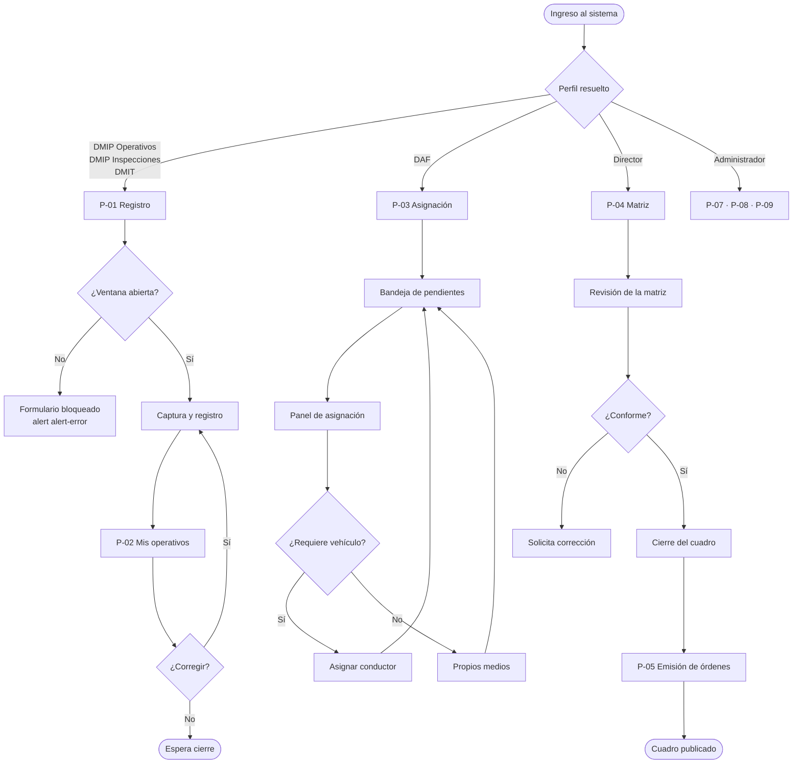
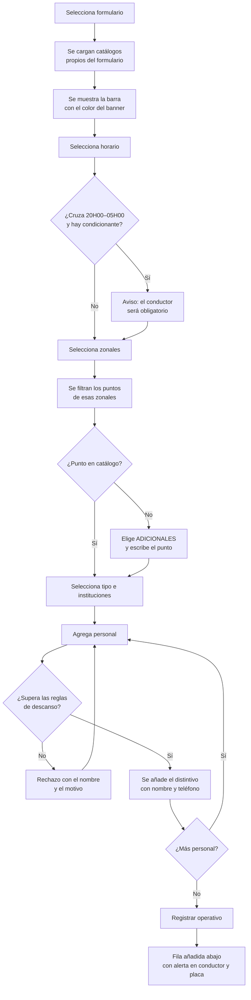
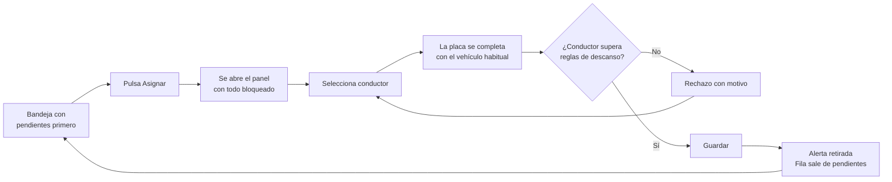

# DISEÑO DE INTERFAZ
## Módulo Transportes / Cuadro de Colores Operativo — Agencia Metropolitana de Control

| | |
|---|---|
| **Fase** | 5 — Diseño de experiencia e interfaz |
| **Base visual** | Proyecto `transporte-frontend`, sin estilos nuevos |
| **Stack** | React 19 · Tailwind CSS 4 · daisyUI 5 |
| **Entrada** | Documentación funcional (Fase 2) y arquitectura técnica (Fase 4) |

---

## 1. PRINCIPIO RECTOR

Este diseño **no introduce ni una sola clase nueva**. Cada pantalla se compone exclusivamente con los componentes, clases utilitarias y variables de tema ya presentes en `transporte-frontend`. Antes de diseñar se inventarió el sistema visual real del proyecto —tokens, tema de daisyUI, hojas de estilo propias y patrones de composición de las páginas existentes— y todo lo que sigue se construye sobre ese inventario.

La única excepción son los **nueve colores de banner del cuadro de colores**, que no son decisiones de diseño sino datos institucionales: provienen del libro Excel aprobado por la Dirección, los entrega el backend en la respuesta y se aplican como color en línea sobre la fila de banner. El frontend no los define ni los interpreta.

---

## 2. SISTEMA VISUAL HEREDADO

### 2.1 Tema de daisyUI

Verificado en `src/index.css`. Estos son los únicos colores semánticos disponibles.

| Token | Claro | Oscuro | Uso en este módulo |
|---|---|---|---|
| `primary` | `#1b77bb` | `#1b77bb` | Acción principal, encabezados de sección |
| `secondary` | `#20347d` | `#20347d` | Títulos de página, barra lateral |
| `accent` | `#3744d0` | `#3744d0` | Acción destacada, énfasis |
| `neutral` | `#72b9e7` | `#72b9e7` | Elementos neutros |
| `success` | `#6ed0bd` | `#6ed0bd` | Confirmaciones |
| `info` | `#8fa1ff` | `#8fa1ff` | Avisos informativos, realce de fila |
| `warning` | `#f48a42` | `#f48a42` | Alerta logística pendiente |
| `error` | `#cb1f03` | `#ea3446` | Errores y reglas incumplidas |
| `base-100` | `#ffffff` | `#0d1630` | Superficie de panel |
| `base-200` | `#f1f3f6` | `#121f40` | Fondo de aplicación |
| `base-300` | `#d6deef` | `#233766` | Bordes y separadores |
| `base-content` | `#26365f` | `#edf4ff` | Texto |

> **Observación para la Dirección.** El manual de marca Nueva Imagen 2025, presente en el propio repositorio, señala `#3744d0` como color primario de acción. El tema del proyecto lo tiene asignado a `accent` y usa `#1b77bb` como `primary`. Dado que la instrucción es respetar el diseño existente y no inventar estilos, este diseño **usa el tema tal como está**. Si la DNP desea alinear ambos, la modificación es una línea del tema y afecta a todo el sistema por igual. `PENDIENTE DE VALIDACIÓN CON EL USUARIO`.

### 2.2 Clases de composición verificadas

Extraídas de las páginas existentes del proyecto. Son las que se reutilizan tal cual.

> **Revisado contra el código el 2026-08-21.** Tres filas se habían quedado atrás y decían lo
> contrario de lo que hace el proyecto: el panel bajó de `rounded-3xl` a `rounded-md` el 20-AGO
> —regla de marca de cajas rectas—, y el gris de Tailwind salió de la interfaz el 21-AGO en favor
> del token del tema, que sí cumple contraste en tema oscuro. El estado vacío nunca fue cursivo.
>
> **Actualizado el 2026-09-14 para heredar el diseño de `instruccion-frontend`:** paneles y
> sidebar vuelven a `rounded-3xl` (esquinas redondeadas). El contenedor de página (`.app-page-shell`)
> pasa a **ancho completo** (`max-width: none`): las pantallas aprovechan todo el espacio disponible
> del área de contenido, sin margen lateral muerto en pantallas anchas. Las tablas suman
> **`table-zebra`** (filas alternas) y el paso del cursor pasa de
> `hover:bg-info/10` a **`hover:bg-primary/5`**. Y los botones de color quedan **planos** —sin la
> sombra propia que añadía `refinamiento.css`—, como los de instruccion; se conserva el contorno
> del secundario y el realce del ghost para no perder contraste. Todo del mismo sistema AMC.
>
> **Esta tabla es la fuente de verdad de la regla 1 de `CLAUDE.md`** —«no se introducen clases
> nuevas»—, así que mantenerla al día no es cortesía: si miente, la regla no se puede cumplir.
>
> **TIPOGRAFÍA CENTRALIZADA EN TOKENS (2026-09-15).** El peso, el interlineado y la interletra
> de toda la jerarquía —títulos, antetítulos, encabezados de sección, cabeceras de tabla,
> etiquetas, botones y distintivos— salen de un solo bloque de variables en `refinamiento.css`
> (`--app-peso-*`, `--app-interlineado-*`, `--app-tracking-*`, `--app-titulo-pagina`), no de
> literales repetidos ni de utilidades por componente. Por eso las clases de antetítulo y título
> de sección de arriba **ya no llevan `tracking-[0.18em]`**: la interletra la pone el token. La
> familia (Montserrat) y los tamaños de la maqueta densa no se tocan; el tope de peso sigue en 600.

| Elemento | Clases exactas del proyecto |
|---|---|
| Contenedor de página | `app-page-shell` — rejilla, ancho completo hasta **80rem** y centrada (heredado de instruccion, 2026-09-14) |
| Antetítulo | `page-heading-kicker font-semibold uppercase` — el tamaño (11px, eyebrow) lo fija el token `--app-antetitulo` en `refinamiento.css`, no una utilidad en línea |
| Título de página | `page-heading-title` |
| Subtítulo | `page-heading-subtitle` |
| Panel de datos | `app-modules-panel app-data-panel app-shell-surface overflow-visible rounded-3xl border border-base-300 bg-base-100 shadow-[0_12px_32px_rgba(15,23,42,0.12)] backdrop-blur-[2px]` |
| Cabecera de sección | `app-section-header flex flex-col gap-3 border-b border-base-300 px-6 py-4 sm:flex-row sm:items-center sm:justify-between` |
| Título de sección | `app-section-heading text-sm font-semibold uppercase text-primary/95` |
| Cuerpo del panel | `app-data-panel-body px-2 pb-4 pt-2 md:px-4` |
| Rejilla de tarjetas | `grid grid-cols-1 gap-3 md:grid-cols-2 xl:grid-cols-3` — órdenes en P-06, zonales en P-08 |
| Tarjeta | `rounded-md border border-base-300 bg-base-100 p-4` — `p-3` cuando va **dentro** de un panel |
| Tabla | `table table-sm table-zebra w-full text-sm` |
| Tabla de operativos (matriz P-04, jornada P-13, registro P-01, mis operativos P-02) | `table table-sm` **sin `table-zebra`** — la banda se pinta POR OPERATIVO (o por GRUPO del 8), no por `<tr>` (2026-09-14). Un operativo ocupa varios renglones (uno por persona, o las copias agrupadas del 8); `table-zebra` los rayaba a ellos y el bloque salía a dos tonos. Se alterna `bg-base-200` (impares en blanco, sin clase) según el índice del operativo/grupo. En la matriz y la jornada, además, `border-t border-base-300` en la primera fila hace de separador |
| Encabezado de tabla | `text-xs uppercase tracking-wider` — el color (pleno, peso 600) lo fija la corrección única de `ui/tipografia.plugin.js` (2026-10-08). ~~`text-base-content/70`~~ retirada |
| Fila de filtros | `input input-bordered input-xs w-full font-normal normal-case` |
| Fila con paso del cursor | `hover:bg-primary/5` |
| Fila seleccionada | `bg-primary/5` |
| Buscador | `input input-bordered input-sm w-full sm:max-w-md` |
| **Botón (estándar único, 2026-10-15)** | **Solo por `<Boton>`** (`components/common/Boton.tsx`, regla 17 del CLAUDE.md). Variantes: `primario` = `btn btn-primary`; `secundario` = `btn app-accion-secundaria`; `acento` = `btn btn-outline btn-primary`; `peligro` = `btn btn-outline btn-error text-[var(--app-text-peligro)] hover:text-error-content`; `exito` = `btn btn-outline btn-success text-[var(--app-text-exito)] hover:text-success-content`; `peligroTexto` = `btn btn-ghost text-[var(--app-text-peligro)]`; `enlace` = `btn btn-link`; `peligroRelleno` = `btn btn-error` (solo la confirmación de lo irreversible, excepción D1). Tamaños: `sm` = `btn-sm [--fontsize:0.8125rem]` (32 px, 13 px); `md` = `[--size:2.25rem] [--fontsize:0.875rem]` (36 px, 14 px); `lg` = `[--fontsize:0.875rem]` (40 px). Siempre `whitespace-nowrap`; sin texto, `btn-square`; en cabecera azul el primario suma `border-base-100`. Apagado con `aria-disabled` + `title` (no `disabled`): `ui/tipografia.plugin.js` lo deja en su variante al 50 % con `cursor: not-allowed`. Las variables arbitrarias `[--size:…]`/`[--fontsize:…]` se añaden al inventario por pedido expreso del usuario. Se retiraron `app-accion-fila`, `app-accion-adicional` y `app-accion-icono` |
| **Enlace con aspecto de botón (`BotonEnlace`)** | `components/common/BotonEnlace.tsx` — **añadido el 2026-10-15** (bloque 4 del estándar de botones): un `<Link>` de react-router con las clases de `CLASES_VARIANTE`/`CLASES_TAMANO` de `Boton` (ninguna propia). Para lo que NAVEGA: «Ver la Jornada del Día» (cabecera azul, `secundario md`), «Ir a Mis operativos» y «Asignar transporte» (`enlace sm`) |
| **`clasesBoton` y la regla del lint (D6)** | **Añadido el 2026-10-15 (bloque 6 del estándar de botones).** `clasesBoton(variante, tamano, enBarraOscura)` de `Boton.tsx` da las mismas clases para lo que no puede ser `<button>`: el `<summary>` «Opciones» de Planificar el día y los `<a href>` al portal (Login, AuthCallback). `eslint.config.js` (`no-restricted-syntax`) rechaza la clase `btn` entera en un `className` fuera de `components/common/`, y `common/estandarBotones.spec.ts` recorre `src/**/*.tsx` por si el lint no corrió. **Excepciones marcadas** con `// eslint-disable-next-line no-restricted-syntax -- control de selección, no acción` (25): `SelectorSegmentado` (1), `SelectorPersonal` (7: contador «[−] n [+]» y filtros de área), `SelectorTokens` (2: «×» dentro de la ficha azul), `SelectorFormulario` (1), `SelectorFormularioCabecera` (1), `AcordeonZonales` (1: abrir/cerrar la zonal), `PanelAreasFormulario` (1: fichas de área), `PasoBuscarPersona` (1: filtros), `MisOperativosPage` (1: atajos de fecha), `EditorPlantillaOrden` (1: fichas de campo), `ConstructorPatron` (1: letras de turno), `MatrizCobertura` (2: «Rotar turno / Seleccionar rango»), `ModalAplicarPatron` (1: patrones rápidos), `PasoAsignar` (2: «Línea de tiempo / Tabla»), `DrawerOperacionVehiculo` (1: monto del vale) y `MenuDropdown` (1: botón del armazón). El «Alertas» de la barra superior (`estilos` de `SubMenuDropdown`) lleva el marcador «excepción D6:» |
| Botón principal (histórico) | ~~`btn btn-primary btn-sm`~~ → `<Boton variante="primario">` |
| Botón secundario (histórico) | ~~`btn btn-ghost btn-sm`~~ → `<Boton variante="secundario">` |
| Botón de paginación (histórico) | ~~`btn btn-ghost btn-xs`~~ → `Paginacion` (`<Boton tamano="sm">`) |
| Distintivo | `badge badge-primary badge-sm whitespace-nowrap` |
| Estado vacío | `py-6 text-center text-sm text-app-muted`, con el `px-` de las celdas de esa tabla (antes `text-base-content/70`, retirada el 2026-10-08) |
| **Texto fuerte** | `text-app-strong` — títulos, valores, encabezados (2026-10-08, pedido expreso) |
| **Etiqueta** | `text-app-label` — color pleno y peso 600; la llevan ya `.label`, `.label-text` y `.fieldset-legend` (2026-10-08) |
| **Texto secundario** | `text-app-muted` — ayudas, pistas, metadatos, estados vacíos, filas inactivas; ≥ 5,6:1 (2026-10-08) |
| **Deshabilitado** | `text-app-disabled` — SOLO controles deshabilitados; único caso bajo 4,5:1 (2026-10-08) |
| ~~Grises sueltos~~ | ~~`text-base-content/40·60·70·80`, `opacity-40·55·60` sobre texto, `text-gray-*`, `text-slate-*`~~ **retiradas el 2026-10-08**: el lint las marca como error. Ver `docs/estilos.md` |
| Código generado por el sistema | `font-mono text-xs font-semibold` — identificador de operativo, código de orden |
| Rótulo sobre el banner del formulario | `badge badge-sm` con `backgroundColor` del servidor y `color` de `colorDeTextoSobre()`. **Nunca `text-white` fijo** |

> **El cambio de tema no se anima, desde el 26-AGO.** `<html data-cambiando-tema>` durante
> un fotograma, con `transition: none` bajo ese atributo. No es una clase del inventario:
> es un atributo de datos, y la regla 1 de `CLAUDE.md` no lo alcanza.
>
> Sin él, los fondos saltaban de golpe mientras dieciocho selectores animaban `color`
> durante 180 ms, y en ese lapso el texto quedaba a **1,60:1**. Ver `.interface-design/system.md`.
| Dato de identidad | `font-mono text-xs` — cédula, placa, usuario |
| Cargando | `loading loading-spinner loading-lg text-primary` |
| Aviso | **`AvisoEnLinea` desde el 2026-10-16** (mensajes estándar, bloque 5): las 98 `alert alert-*` de páginas, formularios y cajones —y `AvisoVentana` / `AvisoVentanaCerrada`— pasaron a `common/AvisoEnLinea.tsx` (variantes advertencia, error, éxito, info; ver «Mensajes estándar»). `common/mensajesEstandar.spec.ts` falla si vuelve una clase `alert-error|warning|info|success` fuera de `components/common/`. Histórico: `alert alert-info` · `alert-warning` · `alert-error` · `alert-success` — relleno tenue, borde del color y texto legible desde el 24-AGO (el manual prohíbe el rojo y los complementarios como fondos completos, y `alert-warning` a sangre daba 2.45:1), vestidas en `styles/ui/avisos-y-distintivos.css` |
| Distintivo de estado | `badge badge-info` · `badge-warning` · `badge-error` · `badge-success` — mismo tratamiento y mismo motivo |
| Envoltorio de tabla | `overflow-x-auto` |
| Recorte de texto en una línea | `truncate` — puntos suspensivos cuando el texto excede su caja; exige un ancho definido en el contenedor. **Documentada el 2026-09-07**: ya se usaba y faltaba aquí. En uso en `AlertList`, `PanelPuntosEncuentro`, `SelectorPersonal` y la barra de perfil |
| Encoger un hijo flex | `min-w-0` — un elemento flex no baja de su contenido salvo con esto; es lo que hace funcionar a `truncate` dentro de una fila o un distintivo. **Documentada el 2026-09-07**. En uso en `AvisoEnLinea`, `SelectorPersonal` y los cajones (`MarcoModal`, `PanelPuntosEncuentro` y `ModalDirectorioAuth` ya no existen) |
| Recorte de contenido de una caja | `overflow-hidden` — contiene lo que desborda un contenedor de tamaño fijo. **Documentada el 2026-09-07**. En uso en `MainLayout`, `Navbar`, `Sidebar`, `PanelPuntosEncuentro` |
| Forzar que un rótulo envuelva | `whitespace-normal` — **Añadida el 2026-09-07.** `.label` de daisyUI es `white-space: nowrap`; un rótulo largo de checkbox o un texto de ayuda envuelto en `.label` se salía de la ventana. `whitespace-normal` (con `min-w-0` en el hijo) devuelve el envolvido. En uso en las casillas de rol de `ModalUsuario` |
| Control con dato de longitud libre que no desborda | **Añadidas el 2026-09-07.** `.btn` y `.badge` de daisyUI son `flex-shrink:0` y de alto/altura fija, así que un dato largo en su rótulo (nombre, correo, placa, institución, nombre de formulario o de zonal) crece a lo ancho y desborda su caja. Dos remedios según el control: **botón** → `h-auto max-w-full` (crece hacia abajo y el rótulo se parte en varias líneas; la fila debe ir `w-full`), en `PanelPuntosEncuentro` y `SelectorFormulario`; **distintivo** → `min-w-0 max-w-full` en el `badge` y `min-w-0 truncate` en el dato (se recorta con puntos suspensivos y el valor íntegro va al `title`, porque el distintivo es de altura fija), en `SelectorPersonal`, `SelectorTokens`, `ModalUsuario`, `ModalDirectorioAuth`, `PanelEdicionOperativo` y `PanelAdicionalOperativo` |
| Celda que abarca varios renglónes | `rowSpan` en el `<td>`. **No es una clase**, así que la regla 1 no la alcanza; se anota aquí porque es técnica nueva en el proyecto desde el 2026-08-27 |
| **Barra de progreso** | `progress progress-primary w-full` (`progress-success` al 100 %) — **añadida el 2026-10-08**, por decisión del usuario, para «X de N operativos cubiertos» del paso 2 de «Planificar el día». Va siempre con su número en texto y `aria-label` (regla 6): la barra acompaña, no informa sola. Sin otros usos |
| **Menú desplegable** | `dropdown dropdown-end` sobre `<details>`/`<summary className="btn …">` y `dropdown-content` — **registrada el 2026-10-08**, por decisión del usuario: ya se usaba sin anotar en `components/tabla/Table.tsx`; ahora también en «Opciones (n)» de «Planificar el día». `<details>` da el teclado y el cierre sin código propio |
| **Indicador de paso** | `inline-flex h-8 w-8 shrink-0 items-center justify-center rounded-full` + `bg-primary text-primary-content ring-4 ring-primary/20` (actual) · `bg-success text-success-content` (completado, con ✓) · `border border-base-300 bg-base-200 text-app-muted` (pendiente) — **añadido el 2026-10-08**, a pedido del usuario: círculos de 32 px en `common/Stepper.tsx`, en lugar del `badge` rectangular. El estado va también en texto (✓ + «completado» para lectores de pantalla, regla 6) |
| ~~**Cajón lateral amplio**~~ | **Retirado el 2026-10-15 (cajón estándar, bloque 4)**: `DrawerOperativo` es `lg` del cajón estándar y `md:max-w-[min(60rem,92vw)]` y `md:rounded-l-3xl` ya no se usan. Lo que sigue es su descripción histórica. `DrawerLateral` con `ancho="amplio"`: `w-full md:max-w-[min(60rem,92vw)] md:rounded-l-3xl` + el enganche `app-cajon-amplio` (sombra marcada y entrada corta desde la derecha, sin movimiento con `prefers-reduced-motion`; en `ui/componentes-propios.css`) — **añadido el 2026-10-08**, por decisión del usuario, para el **operativo adicional**, y el mismo día para la **edición**: `DrawerOperativo` (modos «adicional», «editar» y «personal»; Órdenes de servicio, Mis operativos y Registro de operativo). Bajo `md` ocupa el 100 % del ancho. Sin otros usos |
| **Cajón estándar (`DrawerLateral` lg/md, 2026-10-15)** | **Añadido el 2026-10-15** por pedido expreso del usuario (plan «drawer-estandar», bloque 1). Panel: `w-full` + `app-cajon-amplio` (entrada subida a **220 ms**) + `md:rounded-l-2xl` y `md:max-w-[clamp(45rem,50vw,53.75rem)]` (**lg**, 720–860 px, D1) o `md:max-w-[37.5rem]` (**md**, 600 px); velo `bg-slate-950/45`. Cabecera `px-6 py-5`: título `text-xl font-semibold text-app-strong`, subtítulo `text-[0.8125rem] text-app-muted`, aspa `<Boton secundario md>`; sin versalita. Ayuda `px-6 pt-3 text-xs text-app-muted`. Cuerpo `gap-4`. Pie `bg-base-200 border-t px-6 py-3.5` con `role="status"`: `text-app-muted` (sin cambios / pendiente), `text-error` + icono `alerta` (falta), `font-semibold text-[var(--app-text-exito)]` + `check` (listo), `loading loading-spinner loading-sm` + «Guardando…». **`SeccionDrawer`**: `rounded-xl border border-base-300 p-4`, título `h3 text-sm font-semibold text-app-strong`, rejilla `grid grid-cols-1 gap-4 md:grid-cols-2`. **`CampoDrawer`**: etiqueta `text-sm font-semibold text-app-label`, `*` `text-error`, ayuda `text-xs text-app-muted`, error `text-xs text-error`, ancha `md:col-span-2`. **Desde el bloque 4 son los DOS únicos anchos**: `xl`, `formulario`, `2xl` (`max-w-2xl` + `shadow-[0_20px_45px_rgba(15,23,42,0.20)]`), `3xl` y `amplio` se retiraron con `antetitulo`, `marca` y `pie`; `cajonEstandar.spec.ts` lo vigila. Abrir un segundo cajón sobre otro avisa en desarrollo (D7). **Revisión 2 (2026-10-15, cabecera y pie azules):** el panel pasa a `h-full overflow-hidden rounded-l-2xl` sin `border-l` (la curva recorta cabecera, cuerpo y pie; el cuerpo `flex-1 min-h-0 overflow-y-auto px-6 pt-3.5 pb-5` es el único scroll y abre con la `ayuda` `text-xs text-app-muted`); cabecera `app-cajon-barra px-6 pt-5 pb-4` y pie `app-cajon-barra px-6 py-3.5`, ya sin `border-b`/`border-t`/`bg-base-200`. Clases nuevas en `ui/componentes-propios.css`: **`app-cajon-barra`** (fondo `--app-cajon-barra`, texto blanco y, dentro, `--app-text-strong`/`--app-text-label` blancos y `--app-text-muted` #c9d2ec; casilla blanca con check azul), **`app-boton-barra-primario`** (borde blanco; apagado con `--app-cajon-deshabilitado-*`, sin opacidad), **`app-boton-barra-secundario`** (blanco con texto azul), **`app-boton-barra-enlace`** y **`app-boton-barra-fantasma`** (blancos; el fantasma, al pasar, blanco al 14 %) e **`app-insignia-barra`** (fondo blanco 14 %, borde blanco 35 %, texto blanco). Las pone `Boton`/`Insignia` por `BarraOscuraContexto` (`common/barraOscura.ts`); `enBarraOscura` del primario deja `border-base-100` por `app-boton-barra-primario`. Nueva variante de `Boton` **`fantasma`** (`btn-ghost`, el aspa). Tonos del estado: `text-app-muted` (sin cambios, pendiente), `text-[var(--app-cajon-estado-cambios)]` (nuevo tono `cambios`, «Cambios sin guardar»), `text-[var(--app-cajon-estado-error)]` + `alerta`, `font-semibold text-[var(--app-cajon-estado-listo)]` + `check`. Tokens `--app-cajon-*` en `foundation/design-tokens.css`, iguales en claro y oscuro (E4), con su contraste sobre #20347d. **Bloque 2 de la revisión 2:** regla sin clase nueva `.app-cajon-amplio :is(.input, .select, .textarea)[aria-invalid="true"]` → borde `var(--color-error)` (el campo inválido tras intentar se marca en rojo, no solo con el texto); los estados del pie salen de `utils/estadoPieDrawer.util.ts` (`estadoPieDrawer`, `motivoSinCambios`) en todos los cajones de formulario |
| **Mensajes estándar (`MensajeModal`, avisos breves, `AvisoEnLinea`, 2026-10-16)** | **Añadidos el 2026-10-16** por pedido expreso del usuario (plan «mensajes-estandar», bloque 1). **Modal**: capa `fixed inset-0 z-[10003] flex items-center justify-center p-4` (por encima del cajón `z-40` y de los avisos breves), velo `app-mensaje-fondo absolute inset-0 bg-slate-950/45`, tarjeta `app-mensaje-caja w-[420px] max-w-[90vw] max-h-full overflow-y-auto rounded-2xl bg-base-100 p-6 flex flex-col items-center gap-2.5 text-center`; círculo `size-14 rounded-full` + fondo y color de la familia; título `text-lg font-semibold text-app-strong`; texto `text-sm leading-normal text-app-muted`; detalle `<pre>` `rounded-lg bg-base-200 p-3 font-mono text-xs text-app-label whitespace-pre-wrap break-words`; botones `<Boton lg className="flex-1">`. **Aviso breve**: región `pointer-events-none fixed bottom-4 right-4 z-[10001] w-[360px] max-w-[calc(100vw-2rem)] flex flex-col gap-2`, tarjeta `app-toast pointer-events-auto rounded-xl border border-l-4 border-base-300 bg-base-100 p-3` + borde izquierdo de la familia, icono `size-7 rounded-full`, título `text-sm font-semibold text-app-strong`, texto `text-[0.8125rem] text-app-muted`. **Aviso en línea**: `flex items-start gap-3 rounded-lg border p-3 text-sm text-app-strong` + fondo y borde de la familia. **Familias** (`common/familiasMensaje.ts`): `bg-[var(--app-msg-*-bg)]`, `text-[var(--app-msg-*-fg)]`, `border-l-[color:var(--app-msg-*-fg)]`, `border-[color:color-mix(in_srgb,var(--app-msg-*-fg)_35%,transparent)]` con `*` = advertencia, error, exito, info. Clases nuevas en `ui/componentes-propios.css`: **`app-mensaje-fondo`** (aparece en 150 ms), **`app-mensaje-caja`** (sombra; crece de 0,96 a 1 en 150 ms), **`app-toast`** (sombra; entra desde la derecha) y **`app-boton-peligro-relleno`** (el `peligroRelleno` de `Boton`: `--app-peligro-relleno` #c2200f, al pasar `--app-peligro-relleno-hover` #9b1a0c; M2). Tokens `--app-msg-*` y `--app-peligro-relleno*` en `foundation/design-tokens.css`, con su contraste. Iconos de línea propios (`common/IconoMensaje.tsx`, SVG con trazo de 2 px, M3) |
| **Formulario de operativo único (`FormOperativo`, 2026-10-16)** | **Añadido el 2026-10-16** por pedido expreso del usuario (plan «registro-operativo-rediseno», bloque 2). El alta de P-01 y el cajón de edición/adicional pintan las mismas cuatro tarjetas `SeccionDrawer`: «Personal y horario», «Lugar», «Control», «Transporte y observaciones». En el alta, dos columnas desde `lg` con **`lg:grid-cols-[11fr_9fr]`** (~55 % / ~45 %) y **`lg:items-start`**; en el cajón, apiladas. **`SeccionDrawer`** suma `obligatoria` (`*` `ml-1 text-error`, `aria-hidden`) y `conFalta` (borde **`border-error`** en vez de `border-base-300`, tras intentar registrar). **`BarraPie`** (`common/BarraPie.tsx`) es la barra azul del pie que comparten el cajón y el alta (`app-cajon-barra`, mismos tonos del estado): en el alta va al final del bloque con `rounded-xl px-6 py-3.5` y [Limpiar] secundario lg + [Registrar operativo] primario lg. El `<form>` del alta lleva **`app-form-operativo`**, que solo amplía la regla del campo inválido del cajón (`:is(.input, .select, .textarea)[aria-invalid="true"]` → borde `var(--color-error)`, en `ui/componentes-propios.css`). Observación del alta: `textarea textarea-bordered w-full` (retirada el mismo día: ver «Observaciones del operativo»). «(sugerido)» del transporte: `ml-1 text-xs text-app-muted`. Se retiró `CampoOtroTipo` (el «otro tipo» va en el combobox como ficha `badge-warning badge-outline` «OTRO ·»). **Bloque 3 (2026-10-16), tarjeta «Personal y horario»**, sin clases nuevas: la franja de seleccionados es `rounded-box border border-dashed border-base-300 bg-base-200 p-3` (la misma composición de la vista previa de `ModalVentana`); disponibles y no disponibles en `grid grid-cols-1 gap-2 md:grid-cols-2`, la tarjeta del no disponible con `bg-base-200`; el nombre con `truncate`; el contador con `text-warning` / `text-success` / `text-error` + icono. **Ajustes visuales (2026-10-16, pedido expreso del usuario): `variante="pagina" | "drawer"`** (por omisión, «pagina» en el alta). En la PÁGINA, la columna derecha va **sin tarjetas ni títulos**: `SeccionDrawer abierta` pinta un `div` `role="group"` con `aria-label` (el título), `flex flex-col gap-3` y su rejilla de siempre; del segundo grupo en adelante **`border-t border-base-200 pt-3.5`** (`separada`); la columna con **`gap-3.5`**; cuatro grupos: Lugar · Control · Transporte · Observaciones. Lo que falta tras intentar lo dice el CAMPO (`aria-invalid` → `app-form-operativo`) y el grupo lleva `data-con-falta`. Y el pie de la página es **`BarraPie tono="claro"`**: `border-t border-base-200 bg-base-100` con **`px-[18px] py-3`**, sin `BarraOscuraContexto` (botones normales, sin borde blanco), estados en `text-app-muted` / **`text-[var(--app-msg-error-fg)]`** / **`font-semibold text-[var(--app-msg-exito-fg)]`** (y `text-[var(--app-msg-advertencia-fg)]` para «cambios»), con `data-tono`. El cajón conserva tarjetas, títulos y su pie azul |
| **Acciones con icono, tooltip y notas del operativo (2026-10-19)** | **Añadido el 2026-10-19** por pedido expreso del usuario (plan «acciones-icono-notas»). **`Tooltip`** (`common/Tooltip.tsx`, el único): portal con **`app-tooltip`** (`position: fixed`, `z-index: 10004`, `max-width: 16rem`, `padding 0.25rem 0.5rem`, radio 6 px, fondo `--app-tooltip-bg` #15204a, texto `--app-tooltip-fg` blanco, 12 px seminegrita) y su flecha (`::after`, `data-lado="arriba" | "abajo"`, posición `--app-tooltip-flecha`); el ancla es un `span.inline-flex` y el texto vive en un `span.sr-only` enlazado por `aria-describedby`. **Acciones con icono** (`AccionesFila modo="icono"`, `BotonIcono`): `<Boton tamano="sm">` sin texto (→ `btn-square`, 32 px) con **`[--fontsize:1rem]`** (icono de 16 px); grupo **`app-acciones-icono`** (`inline-flex`, `justify-content: flex-end`, `gap: 4px`, `white-space: nowrap`); en `AccionesOperativo`, cuatro casilleros `inline-flex w-8 shrink-0 justify-center`; columna `w-[9.5rem] text-right` y celda `text-right whitespace-nowrap`. `app-acciones-operativo` y `app-acciones-casillero` quedan sin uso. **Notas** (`common/NotasObservacion.tsx` desde el 2026-10-19, la misma pieza en Registro, Mis operativos, Jornada y Matriz; antes `cuadro/NotasOperativo.tsx`): **`app-nota`** (bloque, `max-width: 210px`, `padding: 5px 8px`, borde 1 px `--app-nota-borde`, filete izquierdo 3 px `--app-nota-filete`, radio 6 px, fondo `--app-nota-bg`, 12 px), **`app-nota-compartida`** (borde, filete y fondo `--app-nota-compartida-*`; como `button`, `cursor: pointer`, ancho completo y foco con `outline` primario) y **`app-nota-pie`** (10 px, con `text-app-muted`); lista `flex w-full flex-col gap-1`; «+ N notas más» / «Ver menos» es `<Boton variante="enlace" tamano="sm">`. Tokens nuevos en `foundation/design-tokens.css`: `--app-tooltip-*` (iguales en los dos temas) y `--app-nota-*` (ámbar #fffbea / #f3e3a3 / #e5b93a y azul #eef3ff / #c7d6fb / #2458d6; en oscuro, mezclados con la base). **Navegación de la nota compartida (2026-10-19, plan «notas-jornada-matriz»)**: **`app-fila-destello`** en el `<tr>` (sus `td` animan `app-fila-destello` 1500 ms de `--app-fila-destello` —ámbar #fde68a; en oscuro, mezclado con la base— a transparente; con `prefers-reduced-motion`, fijo hasta que se retira la clase) y ancla `data-operativo-id`; **`app-columna-notas`** (`width/min-width: 220px`) en la cabecera Observaciones de las cuatro tablas. **Columna Formulario compacta** (P-02): punto `inline-block h-2.5 w-2.5 shrink-0 rounded-full` con el `colorFondo` que entrega el servidor (regla 3) y «N · CÓDIGO» `inline-flex items-center gap-1.5 whitespace-nowrap`, enfocable (`tabIndex=0`) para leer el tooltip |
| **Fila recién registrada** | `bg-primary/10 transition-colors` durante 3 s (`MS_RESALTADO`) — **añadida el 2026-10-08**, por decisión del usuario: marca en la tabla el adicional que se acaba de crear desde el cajón. Lleva `data-resaltado`; el texto de la fila no cambia, el resaltado solo ayuda a encontrarla |
| ~~**Aviso suave**~~ | ~~`alert alert-info alert-soft`~~ — **Retirado el 2026-10-16** (mensajes estándar, bloque 5): es un `AvisoEnLinea` info. Histórico: añadido el 2026-10-08 para el aviso «ya tiene conductor y placa asignados por la DAF» del adicional |
| **Aviso en línea con rol propio (`AvisoEnLinea rol`)** | **Añadido el 2026-10-16** (bloque 5): `rol="alert"` en una advertencia que debe interrumpir («queda constancia en la auditoría», «no se pudo heredar», «celdas fuera de rango», «sin ningún rol de Transporte»). Por omisión, `alert` para el error y `status` para el resto. Sin clases nuevas |
| ~~`app-confirm-dialog*` · `app-modules-modal-backdrop`~~ | **Retiradas el 2026-10-16** (mensajes estándar, bloque 5): `styles/ui/confirm-dialog.css` entero y la regla del velo de `administration-modal-shared.css`, sin consumidores. Con ellas salieron `ModalProvider`, `ModalContext`, `useModal`, `interfaces/Modal.ts` (registro vacío) y `common/Alert.tsx` (sin importar) |
| **Enlace de texto** | `link link-primary` — **añadido el 2026-10-08**: el «¿Cómo funciona?» (`<summary>`) que despliega el detalle del adicional |
| **Botón que se ve apagado pero se pulsa** | `aria-disabled="true"` sobre `btn` — **añadido el 2026-10-08**, por decisión del usuario: «Registrar adicional» mientras falta algo. Recibe el clic, valida y lleva el foco al primer error. No es una clase: es un atributo. También «Registrar ausencia» de P-07. **Desde el 2026-10-15** es el apagado de TODO `<Boton>` (en su variante al 50 %); el «se ve apagado pero se pulsa» es `onClickApagado` / `DrawerLateral guardarPendiente` |
| **Tabla con cabecera fija** | Caja `max-h-[70vh] overflow-auto rounded-md border border-base-300` + `thead` con `sticky top-0 z-10 bg-base-100` — **añadida el 2026-10-08** para el maestro de P-07 (rediseño aprobado por el usuario). Mismo patrón y mismo tope que ya usaba la matriz de cobertura |
| **Confirmar una acción de peligro / de reingreso** | `btn btn-outline btn-error btn-sm` (dar de baja) · `btn btn-outline btn-success btn-sm` (reactivar) — **añadidos el 2026-10-08** para los modales «¿Dar de baja a…?» y «¿Reactivar a…?» de P-07. Con contorno y no sólidos: el manual prohíbe el rojo como fondo completo (regla 16 de `CLAUDE.md`) |
| **Chips de filtro** | `btn btn-xs rounded-full` + `btn-primary` (activo) / `btn-outline` (resto), con `aria-pressed` — **añadidos el 2026-10-08**: dependencias de Auth en el paso 1 del alta de P-07 |
| **Casilla** | `checkbox checkbox-sm` — **registrada el 2026-10-08**: «Mostrar quienes ya tienen ficha» en el paso 1 del alta |
| **Interruptor** | `toggle toggle-sm` en un `<input type="checkbox">` dentro de su `<label>` con el texto — **registrado el 2026-10-13**, por decisión del usuario: «Solo zonales con puntos en este formulario» en P-08 (encendido por omisión). Ya lo usaban sin anotar las opciones de «Planificar el día» (`PasoAsignar`) |
| **Avatar de iniciales** | `flex h-10 w-10 items-center justify-center rounded-full bg-primary text-primary-content` — **añadido el 2026-10-08**: tarjeta de la persona de Auth en la ficha de P-07. Decorativo (`aria-hidden`); el nombre va al lado |
| **Fila recién guardada (P-07)** | `bg-success/10 transition-colors` durante `MS_RESALTADO` con `data-resaltado` — el verde lo pidió el rediseño del maestro (2026-10-08); en las tablas de operativos sigue el azul `bg-primary/10` |
| **Solo para lectores de pantalla** | `sr-only` — **registrada el 2026-10-08**: ya se usaba (`BotonRepartoCarga`, `Stepper`); ahora también el rótulo del filtro segmentado de estado de P-07 |
| **Pestañas** | `tabs tabs-border` en el contenedor (`role="tablist"`) y `tab` / `tab-active` en cada `<button role="tab">`, con un `badge badge-sm` del número (`badge-primary` en la elegida, `badge-ghost` en el resto) — **registradas el 2026-10-12**, por decisión del usuario: las tres pestañas de «Catálogos del cuadro» (P-08). Flechas ←/→, Inicio y Fin; el panel es `role="tabpanel"`. **Desde el 2026-10-15 es un solo componente, `common/Pestanas.tsx`** (Catálogos y Flota): la elegida lleva `bg-primary/10 font-bold rounded-t-lg rounded-b-none` sobre la línea de 3 px de `tabs-border`; las demás `bg-transparent font-semibold hover:bg-base-200 cursor-pointer`; `transition-colors duration-150` |
| **Grupo de botones unidos** | `join` / `join-item` — **registrada el 2026-10-12**: ya la usaban sin anotar `SelectorSegmentado`, `Table`, `MatrizCobertura` y «Planificar el día». Ahora también el filtro Todos · Activos · Inactivos de P-08. **El 2026-10-15** `SelectorSegmentado` pasa a grupo con borde: contenedor `join w-fit rounded-field border border-base-300 bg-base-100`, opciones `join-item btn btn-sm border-0 shadow-none` (activa `btn-primary`, las demás `btn-ghost hover:bg-base-200`); lo usan Flota, Formularios y Personal |
| ~~**Cajón lateral mediano**~~ | **Retirado el 2026-10-15 (cajón estándar, bloque 4)**: `DrawerValorCatalogo` es `md` y `md:max-w-xl` ya no se usa en cajones. Histórico: `DrawerLateral` con `ancho="xl"`: `app-cajon-amplio md:max-w-xl md:rounded-l-3xl` (~576 px; 100 % bajo `md`) — **añadido el 2026-10-12**: alta y edición de zonal, punto, tipo de control e institución en P-08 (`DrawerValorCatalogo`) |
| **Acordeón** | Botón `btn btn-ghost btn-sm` con `aria-expanded` + `aria-controls` que gobierna una región, y el icono `desplegar` girando con `inline-flex transition-transform` / `rotate-180` — **añadido el 2026-10-12**: zonales de P-08 y la barra plegable de áreas. **Desde el 2026-10-13 las zonales usan el icono `acordeon` (▸) girando `rotate-90` (▾ abierta) con `motion-safe:transition-transform`**; la barra de áreas y el selector de cabecera siguen con `desplegar`. No es `<details>`: la cabecera lleva acciones, y un botón dentro de `<summary>` también abre y cierra |
| **Acciones de fila de catálogo** | `btn btn-outline btn-xs` (Editar) · `btn btn-outline btn-warning btn-xs` (Desactivar) · `btn btn-outline btn-success btn-xs` (Activar) · `btn btn-outline btn-error btn-xs` (Eliminar, con `aria-disabled` y el motivo en `title` cuando no procede) · `btn btn-outline btn-primary btn-xs` («+ Punto») — **añadidas el 2026-10-12** para P-08. Todas con rótulo (regla 6) |
| **Selector de formulario de P-01 (`SelectorFormulario`, 2026-10-16)** | **Añadido el 2026-10-16** (plan «registro-operativo-rediseno», bloque 4). En la barra azul «FORMULARIO»: la caja es `btn h-10 min-h-10 w-full md:w-[29.5rem] justify-between border border-base-300 bg-base-100 normal-case text-app-strong` (~470 × 40 px; control de selección, con su `eslint-disable`), con el punto del `colorFondo` (`h-3 w-3 rounded-full border border-base-300`, color por `style`, regla 3) y «N hoy» en `Insignia neutro`. El desplegable reutiliza la superficie del selector de cabecera (`app-shell-surface absolute top-full z-30 mt-1 rounded-md border bg-base-100 p-2` + su sombra) con un `input input-bordered input-sm` de búsqueda y la lista en `max-h-80 overflow-y-auto`; el rótulo de cada grupo `text-xs font-semibold uppercase tracking-[0.08em] text-app-muted`, la opción activa `bg-primary/10`. Los recientes son `<Boton tamano="sm" enBarraOscura>` con el punto y «N · CÓDIGO». La línea de ayuda, `text-xs text-app-muted` |
| **Observaciones del operativo (`ObservacionesOperativo`, 2026-10-16)** | **Añadido el 2026-10-16** por pedido expreso del usuario: una sola pieza en el alta y en el cajón, que sustituye a `CapturadorNotas` y al `textarea` del alta. Campo `input input-bordered w-full min-w-0` + «Agregar» `<Boton secundario sm>`; cada nota de la sesión en `flex items-start gap-2 rounded-md border border-base-300 px-3 py-1` con su texto en **`whitespace-pre-line text-sm`** (una corrección puede llevar saltos de línea) y «Autor · dd/mm/aaaa HHhMM» `text-xs text-app-muted`, y las acciones «Editar» `<Boton secundario sm>` y ✕ `<Boton peligro sm>`; en corrección, `textarea textarea-bordered w-full border-primary` con «Cancelar» y «Guardar» `sm`. Las ya guardadas siguen en `bg-base-200/40` y sin acciones; «nueva, sin guardar» `badge badge-warning badge-sm` solo en el cajón |
| **Selector de formulario de cabecera** | `btn h-12 w-full border-2 border-primary bg-base-100` + lista `role="listbox"` con la barrita del `colorFondo` (`h-5 w-1.5 rounded-full`, color del servidor por `style`, regla 3) y ✓ en el elegido — **añadido el 2026-10-12**: `SelectorFormularioCabecera` de P-08. Número y nombre siempre escritos (regla 6) |
| **Chips de selección (áreas)** | `btn btn-sm rounded-full` + `btn-outline btn-primary` (marcada, con ✓) / `btn-ghost border-dashed border-base-300` (sin marcar, con +), con `aria-pressed` — **añadidos el 2026-10-12**: áreas de personal admitidas en P-08 |
| **Fila o zonal recién guardada (P-08)** | `bg-success/10 transition-colors` con `data-resaltado` durante `MS_RESALTADO` — el mismo verde de P-07 (2026-10-12) |
| **Distintivo único (`Insignia`)** | `components/common/Insignia.tsx`: `badge badge-sm` + la variante — `badge-success badge-outline` (éxito), `badge-ghost` (neutro), `badge-warning` (aviso), `badge-soft badge-warning border-warning/40` (avisoSuave: un dato que falta —«Sin fechas», «Falta SOAT», «Falta matrícula»—, **2026-10-15**; el texto lo pone `--badge-fg` desde `tipografia.plugin.js`, que ahora también cubre `badge-soft`: 5,92:1 en claro y 10,56:1 en oscuro, frente a 2,29:1 del ámbar puro), `badge-error` (error, 2026-10-14), `app-insignia-suave` (suave: azul claro, texto azul oscuro, 11 px, tokens `--app-insignia-suave-bg/fg` en los dos temas; sustituyó a `badge-info`, que salía azul sólido) — **añadido el 2026-10-13**, por decisión del usuario («componente único de badge»): Vigente / Inactivo, las etiquetas de comportamiento y «⚠ Sin áreas» de «Formularios del cuadro». El texto es la señal; `title` opcional amplía |
| ~~**Cajón lateral de formulario**~~ | **Retirado el 2026-10-15 (cajón estándar, bloque 4)**: `DrawerFormulario` es `lg`, sin `marca` (el cuadro de color va en el subtítulo) y `md:max-w-[42.5rem]` ya no se usa. Histórico: `DrawerLateral` con `ancho="formulario"`: `app-cajon-amplio md:max-w-[42.5rem] md:rounded-l-3xl` (~680 px; 100 % bajo `md`) — **añadido el 2026-10-13**: alta y edición de «Formularios del cuadro» (`DrawerFormulario`), cinco secciones con filas de tres campos. Admite `marca`: el cuadro con color y número a la izquierda del título |
| **Cuadro del formulario** | `inline-flex h-9 w-9 shrink-0 items-center justify-center rounded-md text-sm font-semibold` con `backgroundColor` del servidor y `color` de `colorDeTextoSobre()`; sin color, `border-2 border-dashed border-base-300` — **añadido el 2026-10-13** (`CuadroFormulario`): tabla y cabecera del cajón de «Formularios del cuadro» |
| **Muestras de color** | Rejilla `grid grid-cols-6 gap-2 sm:grid-cols-8` (24 colores de la paleta: 3 filas de 8; 4 de 6 en móvil) de botones `h-9 w-full rounded-md border` con el color por `style`, `aria-pressed`, ✓ en la elegida (`border-primary ring-2 ring-primary`) y • en las que ya usa otro formulario vigente — **añadidas el 2026-10-13**: sustituyen a los botones con texto del color; el nombre va en `title` y `aria-label` |
| **Filtro de rango de fechas** | Dos `input input-bordered input-sm` de tipo `date` (Desde → Hasta, flecha `aria-hidden`), con `input-error` + `aria-invalid` en el campo que falla y el aviso en `text-sm text-error` `role="alert"`; atajos `btn btn-sm rounded-full` + `btn-primary` (activo) / `btn-outline` (resto) con `aria-pressed` — **añadido el 2026-10-13**: «Mis operativos» (P-02). El resumen de varios días va en `Insignia variante="suave"` |
| **Anchos de la tabla de operativos** | `min-w-[170px]` (Identificador, código en una línea con `whitespace-nowrap`), `min-w-[130px]` (Conductor, para que «Sin conductor» —`h-auto whitespace-nowrap px-2 py-0.5`, sin icono— no se parta), `w-24` (Teléfono, Estado), `w-[13.75rem]` (Acciones), `w-28 min-w-24` (Formulario, que se parte en líneas) y `min-w-28` / `min-w-32` (Tipo de control, Personal) en el `<th>`. El **Horario va en dos líneas** («08H00 A» / «15H00», cada una `block whitespace-nowrap`, envoltorio `data-horario` con el texto completo); varios horarios unidos por coma se pintan tal cual y el filtro sigue usando el texto de una línea. «+N» de tipos de control: `badge badge-ghost badge-xs text-app-strong` con la lista completa en `title`. **Columna Teléfono** (restituida el 2026-10-13: debajo del nombre no se distinguía): `text-xs whitespace-nowrap`, número en monoespaciado y «Sin teléfono» en `text-app-muted`. **Sin columna Fecha desde el 2026-10-13**: con varios días, una fila de cabecera por día (ver «Cabecera de día»). **Medido** (Chrome sin interfaz contra `localhost:5180`, 2026-10-13, tras la tabla única): **P-02** cabe sin desplazarse a 1440 px (panel 1327, barra plegada) y a 1700 (panel 1325, barra fija), **con un día y con varios días**; **P-01** (columnas de sesión con Observaciones, barra siempre fija; remedido el 2026-10-13 tras restituir Observaciones, `min-w-40` = 160 px) mide 1433 px: se desplaza dentro de su panel a 1440 (panel 1065) y a 1700 (panel 1325); por cálculo cabe desde unos 1810 px. La página nunca se desplaza. Formulario no baja de 128 px por su palabra más larga («limpiaparabrisas») |
| **Barra lateral plegada** | Hook `useBarraPlegada(ruta)` (`useSyncExternalStore` sobre `matchMedia("(max-width: <umbral − 0.02>px)")`) con la tabla `UMBRALES_PLEGADO` (ruta → px): **Mis operativos bajo 1700 px** (opción B) y **Registro de operativo bajo 1840 px** (opción A, 2026-10-13). Plegada, la barra deja de ocupar columna (la celda de la rejilla queda a `0rem` y vacía) y se abre como el **menú flotante del móvil** desde el botón de la barra superior, que muestra «Menú» (`btn gap-2 rounded-full px-3` + `aria-expanded` + `aria-controls="menu-lateral-flotante"`). Al abrir, el foco entra en el primer enlace; **Esc** o clic en el fondo cierran y el foco vuelve al botón. En las demás rutas y por encima de cada umbral, sin cambios. Umbral = ancho mínimo de la tabla + 375 px (barra 262 + márgenes 64 + panel ~49), con margen: P-02 ~1310 → 1700 (con 1500 volvía a desplazarse entre 1500 y 1700); P-01 1433 con Observaciones → cabe con barra fija desde ~1808 → 1840. Plegada, el panel mide `ancho − 113`: P-01 cabe desde ~1550; a 1440 su tabla se desplaza dentro del panel (aceptado) |
| **Interruptor con descripción** | Fila `<label class="app-interruptor-fila flex items-start justify-between gap-4 rounded-lg border border-base-300 px-3 py-2">` que envuelve el nombre (`text-sm font-semibold text-app-strong`), la descripción (`text-xs text-app-muted`) y el control `<input type="checkbox" role="switch" class="app-interruptor">`: **toda la fila alterna** y el foco visible rodea la fila. `app-interruptor` (plugin `ui/tipografia.plugin.js`) mide 36×20: apagado relleno `--app-interruptor-apagado` (#C9D0DE claro, #4A5778 oscuro) con perilla blanca, encendido `--color-primary` — **añadido el 2026-10-13; rehecho el mismo día** (ajustes finales): las nueve banderas de comportamiento de «Formularios del cuadro», que antes eran casillas cuyo rótulo se cortaba, y el `toggle` apagado de daisyUI apenas se veía |
| **Tarjeta de indicador clicable (`TarjetaIndicador`)** | `components/common/TarjetaIndicador.tsx` — **añadida el 2026-10-14** («Flota y garajes»): `<button aria-pressed>` con `flex flex-col gap-1 rounded-md border p-3 text-left hover:bg-primary/5`, título `text-sm text-app-label`, valor `text-2xl font-semibold text-app-strong` (`—` sin dato) y detalle `text-xs text-app-muted`, la misma composición de los indicadores del paso 4 de Planificar. Con atención, `border-warning bg-warning/10` y «Requiere atención» en el nombre accesible (regla 6); con su filtro puesto, `ring-2 ring-primary`. **El 2026-10-15** suma `atencion="suave"` (`border-warning/50 bg-base-100`, «Requiere revisión») para un dato que falta, y `nota`, una segunda línea `text-xs text-app-muted` |
| **Estado del pie de los cajones de la flota** | `components/flota/PiezasCajonFlota.tsx`: `text-sm` + `text-app-muted` (N campos obligatorios, antes de intentar guardar), `text-error` («Falta: …», después), `text-warning` («Por revisar: …») y `font-semibold text-[var(--app-text-exito)]` («Listo para guardar»): el token de éxito ya existente, porque `text-success` da 1,84:1 en claro — **añadido el 2026-10-15**. El texto es la señal |
| **Acciones de fila de maestro (`AccionesFila`)** | **Desde el 2026-10-15 (estándar de botones)**: slots `editar` → `propia` → `estado` (`desactivar`/`activar`/`baja`/`reactivar`/`retirar`) → `menu` (`MenuFila`, el «⋮» de `SubMenuDropdown` con `disparador`), todos `<Boton tamano="sm">` en `flex justify-end gap-1.5`; como mucho tres visibles; el borrado del menú en `text-error` con la papelera, apagado con `aria-disabled` + `title`. Se retiró el modo «menu». Historia: `components/common/AccionesFila.tsx` — **añadido el 2026-10-14**: «Editar» (`btn btn-outline btn-xs` con icono `editar`) y `SubMenuDropdown` ⋮ con UNA opción, «Dar de baja» (`text-error`) o «Reactivar». Nombre accesible con el registro: «Editar PBA-1235», «Más acciones de PBA-1235». **Modo `botones` (2026-10-15, «Flota y garajes»)**: sin ⋮, «Editar» (`btn-outline`), «Dar de baja» (`btn-outline btn-error`, icono `desactivar`, solo si está activo) o «Reactivar» (`btn-outline btn-success` con `text-[var(--app-text-exito)] hover:text-success-content`, icono `activar`, solo si está de baja), todos `btn-sm` (32 px) `text-[0.8125rem]` (13 px) `whitespace-nowrap`, separados `gap-1.5`; la columna lleva el encabezado «Acciones» `text-right w-[230px]`. `text-[0.8125rem]` y `w-[230px]` son valores arbitrarios **pedidos explícitamente** por el usuario |
| **Fichas del patrón de rotación** | `components/flota/FichasPatron.tsx` — **añadidas el 2026-10-14**: `flex h-5 w-5 items-center justify-center rounded font-mono text-xs font-semibold` con la clase del turno de `utils/paletaTurnos.util.ts` (la paleta de «Turnos del mes»); el grupo es `role="img"` con la secuencia en palabras («Patrón: Noche → Noche → Libre»). El constructor (`ConstructorPatron`) son `btn btn-sm` con esa misma clase, letra y nombre del turno, ⌫ y «Limpiar» |
| **Grupo de acciones de fila (`AccionesOperativo`)** | **Desde el 2026-10-15**: casilleros con `<Boton tamano="sm">` (principal `secundario`, «+ Adicional» `acento`) y el «⋮» es `MenuFila` de `AccionesFila`; `app-accion-fila`/`app-accion-adicional`/`app-accion-icono` retiradas. Historia: `components/cuadro/AccionesOperativo.tsx`: `<div class="app-acciones-operativo">` de ancho fijo (13,25 rem), alineado a la derecha, con dos casilleros fijos `app-acciones-casillero` (principal `w-[4.75rem]`, «+ Adicional» `w-[6.25rem]`) y el «⋮» (`SubMenuDropdown`, `aria-label` «Más acciones», con teclado: flechas, Inicio/Fin, Escape y Tab, foco de vuelta al disparador). Botones `btn app-accion-fila` (32 px, 13 px, seminegrita) en dos variantes: `app-accion-secundaria` (fondo base, borde gris, texto `--app-text-strong`) y `app-accion-adicional` (tokens `--app-insignia-suave-bg/fg`); el «⋮» suma `app-accion-icono` (32×32). Por `--btn-color`, así el hover de daisyUI sigue oscureciendo. Lo que no aplica se ve APAGADO con `aria-disabled` y su motivo en `title`, para que la columna no cambie de ancho. «Eliminar» vive solo en el menú, en rojo, y se confirma con `ModalConfirmacion` `peligro` (botón `btn-error`) — **añadido el 2026-10-13** («Mis operativos · rediseño de la columna Acciones») |
| **Celda «Conductor» compacta** | `TablaOperativos` → `CeldaConductor`: «Sin conductor» (sin icono desde el 2026-10-13) con `Insignia` aviso y `title` «La DAF todavía no ha asignado conductor a este operativo.»; con conductor, nombre (`text-app-strong`) y placa (`font-mono text-xs text-app-muted`) en dos líneas, «+N» si hay otros por tramos. «Propios medios» en gris corriente, sin fondo, **salvo que la tabla tenga la columna Transporte** (P-01): ahí dice «—», porque Transporte ya lo dice. La columna «Vehículo · No se activa» se retiró el 2026-10-13. La celda no lleva el fondo de `CeldaAlerta` — **añadido el 2026-10-13** |
| **Tabla única de operativos (`PanelOperativos`)** | `components/cuadro/PanelOperativos.tsx` + `hooks/useTablaOperativos.ts`: el panel (`app-modules-panel app-data-panel …`, cabecera `app-section-header`), `TablaOperativos` con su fila de filtros, `Paginacion` (10/25/50, «Mostrando 1–N de N operativos») y la confirmación «¿Eliminar <ID>?» (`ModalConfirmacion peligro`). Lo montan **P-01** («Operativos de este formulario», columnas de sesión, con Transporte) y **P-02** («Operativos registrados», con Formulario). Al registrar o guardar, la fila se resalta (`MS_RESALTADO`) y la tabla va a su página; los filtros no se borran — **añadida el 2026-10-13** |
| **Etiqueta de transporte** | `badge badge-sm whitespace-nowrap` + `app-etiqueta-transporte` (Completo, Solo dejar, Solo retirar, Dejar y retirar: fondo y texto de la insignia suave, borde primario al 40 %) o `app-etiqueta-transporte-neutra` (Propios medios: sin relleno, `--app-text-muted`, borde gris). Sustituye a `badge-primary` / `badge-info` / `badge-accent` / `badge-primary badge-outline` / `badge-ghost`. En los formularios sin vehículo (RN-41/42) el `title` dice «Este formulario no pide vehículo a la DAF.» — **añadida el 2026-10-13** |
| **Cabecera de día (P-02 con varios días)** | `<tr data-cabecera-fecha>` con `<th scope="colgroup" colSpan>` y `bg-base-300/60 px-2 py-1.5 text-left text-xs font-semibold text-app-strong`: «Martes 14/10/2026 · 3 operativos» (el total del día en todo lo filtrado, aunque la paginación lo parta). Sustituye a la columna Fecha — **añadida el 2026-10-13** |
| **Columna Observaciones (P-01)** | Última columna de datos de «Operativos de este formulario», después de Estado: las notas unidas por « · » en `CeldaAlerta` (campo `observaciones`), `min-w-40` en el `<th>`, con salto de línea, y filtro propio. P-02 no la lleva. El icono de notas junto al identificador se probó el 2026-10-13 y **se retiró el mismo día**: no se leía — **restituida el 2026-10-13** |
| **Celdas con fondo de alerta en la tabla de operativos** | Desde la tabla única (2026-10-13), solo **Personal**, **Punto** y **Observaciones** (P-01) pintan el fondo de alerta de `CeldaAlerta` (`bg-warning/25 font-semibold`). El tipo de control va sin fondo ni negrita, con el libre en `text-xs text-app-muted` y «(libre)» en cursiva |
| **Campo fijo (solo lectura)** | `input input-bordered` con `readOnly` + `aria-readonly` y `bg-base-200 text-app-strong cursor-default`, con 🔒 junto a la etiqueta — **añadido el 2026-10-13** (ajustes finales de «Formularios del cuadro»): número y código al editar, y el prefijo de un formulario que numera por área. No `disabled`: dejaba el valor pálido y fuera del orden de tabulación |
| ~~**Aviso breve con acción**~~ | ~~`AvisoEfimero` con `accion`~~ — **Retirado el 2026-10-16 (mensajes estándar, bloque 4)**: la acción va en `toast.exito(titulo, { accion })` de `utils/mensaje.ts` (enlace dentro de `.app-toast`, pausa con ratón o foco). Con `AvisoEfimero` salieron `.app-modules-feedback-region`, `.app-modules-page-feedback` (y `.is-leaving`, `::before`), sus `@keyframes app-modules-feedback-*` y los hexadecimales a mano `#2fb39b`, `#eaf8f4`, `#b9e7dc`, `#143a34`, `#255a51`, `#173c36`, `#dcfff7` |

> **El botón de baja lleva icono y rótulo, desde el 2026-08-27.** `btn btn-ghost btn-xs
> text-error` con `<Iconos nombre="eliminar" />` —un tacho de basura— delante de la
> palabra **Eliminar**. Está en P-02 y en las ausencias de P-07.
>
> **El rótulo no se quita.** Regla 13 de `CLAUDE.md`: el icono acompaña, nunca sustituye;
> y en la misma fila «Editar» y «Adicional» son palabras, de modo que un botón que solo
> fuera un dibujo obligaría a adivinar cuál es. El icono no lleva `aria-label` —FontAwesome
> ya pone `aria-hidden`— ni color ni tamaño propios: hereda el rojo de `text-error`.
>
> **Y dejó de decir «Retirar» porque «Retirar» no era exacto.** La baja de un operativo
> **borra la fila** cuando todavía no hay una orden emitida (PV-10), y la de una ausencia
> la borra siempre. El texto de confirmación ya lo decía —«Se borra de la base y no se
> puede deshacer»—; era el rótulo el que desentonaba.
>
> **En P-11 el botón sigue diciendo «Retirar», y sin icono.** Ahí la baja es lógica: la
> correspondencia de rol se conserva porque explica los operativos que ya existen, y la
> propia pantalla lo escribe encima de la tabla. Un tacho de basura prometería algo que
> no ocurre.

#### Topes de tamaño

Van aparte porque **no describen un elemento, sino cuánto se le deja crecer**, y porque cada
uno se autorizó por su caso. La regla 1 obliga a consultar antes de escribir un valor que no
esté aquí: son los únicos admitidos.

| Tope | Dónde y por qué |
|---|---|
| ~~`max-w-sm` · `max-w-lg` · `max-w-2xl` (anchos de `MarcoModal`)~~ | **Retirados el 2026-10-16 con `MarcoModal`** (mensajes estándar, bloque 3): las confirmaciones son `MensajeModal` (`w-[420px] max-w-[90vw]`), el diálogo de candidatos de «Planificar el día» es el cajón `DrawerCandidatos` (`lg`) y la tarea de taller el cajón `DrawerTareaTaller` (`md`). Histórico: los tres anchos de `MarcoModal` desde el 2026-10-15 (D2) |
| ~~`app-modal-fondo` · `app-modal-caja`~~ | **Retiradas el 2026-10-16 con `MarcoModal`** de `ui/componentes-propios.css`. Se conserva el `@keyframes app-modal-entrar-fondo`, que usa `app-mensaje-fondo` |
| ~~`max-w-4xl`~~ | **Retirado el 2026-10-15 (cajón estándar, bloque 4)**: el personal de P-13 pasó al cajón `lg`; con él salieron `max-w-6xl`, `max-w-7xl` y `max-w-full` de `MarcoModal` (visor de PDF, hoy cajón `lg`). Histórico: **Añadido el 2026-08-27.** Cuarto ancho de `MarcoModal`, y **solo para ventanas que contienen una lista, no un formulario**. Lo trajo el personal de P-13: en 672 px las dos columnas de candidatos dejaban celdas de 328 px y el motivo del servidor se partía en tres renglones; con 896 px la celda sube a 440 px y cabe en dos, igual que en P-01. **No se use para capturar**: un formulario a 896 px devuelve las líneas largas que el reparto de P-01 existe para evitar |
| `max-w-md` · `max-w-xs` | Buscadores, como `sm:max-w-md` y `sm:max-w-xs`. El segundo, en las tres pantallas de administración |
| `max-h-full` | Tarjeta de `MensajeModal` (antes de `MarcoModal`, retirado el 2026-10-16), con `overflow-y-auto`: la ventana nunca sobrepasa el alto de la pantalla |
| `max-h-32` | Bandeja de elementos ya elegidos —distintivos— en `SelectorTokens` y `SelectorPersonal`. Un distintivo mide 24 px y con `gap-2` la fila ocupa 32: deja ver dos filas |
| `max-h-48` | Listas cortas de selección |
| `max-h-80` | **Añadido el 2026-08-26**, y anotado aquí el 27. Lista de candidatos de `SelectorPersonal`: con `max-h-48` cabían tres personas y asignar treinta obligaba a desplazar decenas de veces. Los valores que había antes eran 32, 48 y `full` |
| ~~`max-w-[560px]`~~ | **Retirado el 2026-10-15 (cajón estándar, bloque 4)** con la limpieza de `MarcoModal`. Histórico: **Añadido el 2026-10-07, a pedido expreso del usuario.** Ancho `ventana` de `MarcoModal`, solo para «Editar ventana de carga»: con `max-w-lg` (512 px) el subtítulo «<Rol> · Hora local America/Guayaquil» se partía en dos líneas. **Sin uso desde el 2026-10-15**: «Editar ventana de carga» pasó al cajón estándar `md`; se retira con la limpieza de `MarcoModal` |
| ~~`max-h-[80vh]`~~ | **Retirado el 2026-10-15 (cajón estándar, bloque 4)**: `cuerpoAcotado` salió de `MarcoModal` sin usos. Histórico: **Añadido el 2026-10-07, a pedido expreso del usuario.** Cuerpo de `MarcoModal` con `cuerpoAcotado` (hoy solo «Editar ventana de carga»): se desplaza por su cuenta hasta el 80 % del alto y, con espacio, no recorta nada |

**Composición del aviso de ventana cerrada (2026-10-07, a pedido expreso del usuario).**
`AvisoVentanaCerrada` —el aviso real de P-01/P-02 y su vista previa en «Editar ventana de carga»—
usa `border-l-4 border-l-primary` (borde izquierdo azul de 4 px); la vista previa lo enmarca con
`border-dashed bg-base-200`, y las ayudas del modal llevan `leading-normal`. No se usan fuera de
esas piezas.

> **Un tope de tamaño se decide midiendo, no eligiendo.** Las tres filas con fecha de arriba
> nacieron de una medición sobre la hoja compilada, no de una preferencia; quien quiera
> cambiarlas debería repetir la medición antes, porque lo que hay detrás de cada número es
> el ancho de una celda y el número de renglones que ocupa un texto que redacta el servidor.

### 2.3 Componentes reutilizados

| Componente | Ruta en el proyecto | Uso en este módulo |
|---|---|---|
| `Table` | `components/tabla/Table.tsx` | Listados con TanStack Table |
| `FilterByColumn` | `components/tabla/FilterByColumn.tsx` | Filtros por columna |
| `RowActions` | `components/tabla/RowActions.tsx` | Acciones por fila |
| `TextInput`, `SelectInput`, `TextAreaInput` | `components/forms/FormikField.tsx` | Todos los campos del formulario |
| `Boton` | `components/common/Boton.tsx` | Botones con icono y contador |
| `Alert` | `components/common/Alert.tsx` | Avisos de resultado |
| `Loading` | `components/common/Loading.tsx` | Estado de carga |
| `ModalConfirmacion` | `components/common/ModalConfirmacion.tsx` | Confirmación de eliminación |
| ~~`ModalExito`~~ | — | **Retirado el 2026-10-15 (cajón estándar, D3)**: el éxito es un aviso breve (`toast.exito`, desde el 2026-10-16; antes `AvisoEfimero`) y, si hay fila, la fila resaltada |
| ~~`ModalContainer`~~ | — | **Retirado el 2026-10-15**: con el registro de `interfaces/Modal.ts` vacío nunca pintó nada |
| `Paginacion` | `components/common/Paginacion.tsx` | Paginación de listados. **Desde el 2026-10-15 (estándar de botones) hay UN SOLO modo**, el numerado, en todas las tablas: botones `<Boton tamano="sm">` (`min-w-8` los números, `primario` la actual), una página → solo el texto, vacío → nada; se retiraron el modo viejo («« ‹ Pág. › »», «10 / pág.») y las props `numerada`/`ocultarSiUnaPagina`. Historia: **desde el 2026-10-15**, con `numerada` («Filas por página», «‹ Anterior», páginas con elipsis de `rangoPaginas`, «Siguiente ›»; la actual `btn-primary` con `aria-current`) y `ocultarSiUnaPagina` (una página: solo el texto; vacío: nada). Apagadas por omisión: Personal, Registro y Mis operativos no cambian. La usa «Flota y garajes». **Tamaño del modo numerado (2026-10-15)**: `btn btn-sm min-w-8 text-[0.8125rem] disabled:text-app-disabled` en `flex gap-1` (ya no `join`), `select-sm` y el texto «Mostrando…» a 13 px |
| ~~`PieDrawer`~~ | — | **Retirado el 2026-10-15 (cajón estándar, bloque 2)**: su pie lo arma ahora `DrawerLateral` (`estadoPie`, `guardarPendiente`, `motivoGuardar`, `extraPie`, `accionesPie`). Lo que sigue es su descripción histórica. pie común de cajones y modales de captura. `[izquierda] estado · Cancelar (secundario lg) · acción (primario lg)`; estado en `role="status"`: `text-app-muted` (pendiente), `text-error` (tras intentar), `text-warning` (aviso), `font-semibold text-[var(--app-text-exito)]` (listo). `pendiente` = se ve apagada pero llama a la acción (muestra qué falta); `motivoDeshabilitado` = apagada de verdad («Sin cambios»). Error del servidor encima, tal cual. Lo usan los cajones de la flota (reemplaza a `PieCajon`) |
| `usePaginaLocal` | `hooks/usePaginaLocal.ts` | **Añadido el 2026-10-15**: la página visible de una tabla paginada en el navegador (10 por página con `Paginacion`): vuelve a la primera si cambia el número de filas, salta a la de la fila resaltada. Lo usan Catálogos (tipos, instituciones), Formularios, Roles de Auth y Cuentas |
| Fila con cambios sin guardar (Parámetros) | `components/administracion/TablaParametros.tsx` | **Añadido el 2026-10-15**: `bg-warning/10` en la fila + el texto «Cambios sin guardar» (regla 6); «Guardar» `<Boton sm>` secundario apagado «Sin cambios» → primario con cambios; «Descartar» `enlace` solo con cambios. `useAvisoAlSalir` avisa antes de salir |
| `ModalConfirmacion` (pie) | `components/common/ModalConfirmacion.tsx` | **Desde el 2026-10-15**: `<Boton tamano="lg">` «No/Cancelar» `secundario` + acción `primario`; con `peligro`, `peligro` (borde rojo, reversible); con `peligro irreversible`, `peligroRelleno` (excepción D1). |
| `Collapse` | `components/common/Collapse.tsx` | Secciones plegables |
| `Iconos` | `components/common/Iconos.tsx` | Catálogo de iconos FontAwesome |
| `RutaProtegida` | `components/common/RutaProtegida.tsx` | Protección de rutas por rol |
| `SelectorRolPruebas` | `components/navbar/SelectorRolPruebas.tsx` | Cambio de perfil provisional |

### 2.4 Puntos de corte

Los verificados en las hojas de estilo del proyecto: `767px` como límite de móvil y `768px` como inicio de escritorio en `page-header.css`, más los puntos estándar de Tailwind `sm` 640, `md` 768, `lg` 1024, `xl` 1280.

---

## 3. MAPA DE PANTALLAS

### 3.1 Inventario

| ID | Pantalla | Ruta | Perfiles |
|---|---|---|---|
| **P-01** | Registro de operativo | `/cuadro/registro` | DMIP Operativos, DMIP Inspecciones, DMIT |
| **P-02** | Mis operativos | `/cuadro/mis-operativos` | DMIP Operativos, DMIP Inspecciones, DMIT |
| **P-03** | Asignación de transporte | `/cuadro/transporte` | DAF |
| **P-04** | Matriz Consolidada del Día | `/cuadro/matriz` | Director |
| **P-13** | Jornada del Día | `/cuadro/jornada` | DMIT Instrucción. Desde el 2026-08-27 avisa de qué personal le toca poner (ALV-08): recuento en `alert alert-warning` con `role="status"` en la cabecera, y línea `text-xs text-base-content/70` bajo el botón de cada fila. **El color va arriba y las palabras abajo**: un distintivo de color por fila, en una tabla de doce columnas, deja de señalar nada |

> **ALV-08 se pinta en el marco, no en cada página.** `AvisoPersonalPendiente` se monta
> en `MainLayout`, dentro de `<main>` y encima del `<Outlet>`, con
> `alert alert-warning mb-4` y `role="status"`; el enlace de salida usa
> `btn btn-ghost btn-xs`. Todas son clases del inventario de §2.2. **En P-13 no se
> pinta**: esa pantalla lleva el suyo, que sigue a la fecha del selector en lugar de
> hablar siempre de la jornada que se está armando.
| **P-05** | Órdenes de servicio | `/cuadro/ordenes` | Director |
| **P-06** | Mis órdenes | `/mis-ordenes` | Funcionario |
| **P-07** | Administración de personal | `/administracion/personal` | Administrador, y los tres departamentales en consulta (PER-09) |
| **P-08** | Administración de catálogos | `/administracion/catalogos-cuadro` | Administrador |
| **P-09** | Administración de ventanas | `/administracion/ventanas` | Administrador |
| **M-01** | Modal de confirmación de retiro | — | Departamentales |
| **M-02** | Modal de detalle de operativo | — | Director, DAF |
| **M-03** | Modal de éxito | — | Todos |

### 3.2 Navegación lateral

Se agrega al `navigation.ts` existente empleando el campo `allowedRoles` ya previsto. Los ítems no autorizados se muestran atenuados, no ocultos, conforme a PER-07.

```
CUADRO DE COLORES
├── Registro de operativo      → DMIP_OPERATIVOS, DMIP_INSPECCIONES, DMIT
├── Mis operativos             → DMIP_OPERATIVOS, DMIP_INSPECCIONES, DMIT
├── Asignación de transporte   → DAF
├── Jornada del Día            → DMIT_INSTRUCTOR
├── Matriz Consolidada         → DIRECTOR
└── Órdenes de servicio        → DIRECTOR

ADMINISTRACIÓN
├── Personal y disponibilidad  → ADMINISTRADOR_DMIP
├── Catálogos del cuadro       → ADMINISTRADOR_DMIP
└── Ventanas de carga          → ADMINISTRADOR_DMIP
```

---

## 4. WIREFRAMES

### 4.1 P-01 · Registro de operativo

Disposición horizontal a ancho completo, con la matriz de resultado debajo. Responde a la instrucción del Product Owner de que el formulario se vea corto.

```
┌──────────────────────────────────────────────────────────────────────────────┐
│ [☰]                        S I G O C                    [Perfil ▾] [🔔] [☀] │  ← Navbar heredado
├────────────┬─────────────────────────────────────────────────────────────────┤
│            │                                                                 │
│  SIGOC     │  PLANIFICACIÓN OPERATIVA · DMIP OPERATIVOS      ← kicker        │
│  Sistema   │  Registro de operativo                          ← título        │
│  de        │  Cuadro del viernes 31 de julio de 2026 · Semana 31             │
│  Gestión   │                                                                 │
│            │  ┌───────────────────────────────────────────────────────────┐  │
│ ▸ Cuadro   │  │ ⓘ Ventana de carga abierta hasta las 15H00.               │  │  ← alert alert-info
│   • Regis…│  └───────────────────────────────────────────────────────────┘  │
│   • Mis op│                                                                 │
│   • Asign…│  ┌───────────────────────────────────────────────────────────┐  │
│   • Matriz│  │ REGISTRAR OPERATIVO          Semana 31 │ OCF-004 │ 31-JUL │  │  ← section-header
│   • Órden…│  ├───────────────────────────────────────────────────────────┤  │     + badges de solo lectura
│            │  │                                                           │  │
│ ▸ Adminis… │  │ Formulario*        Hora inicio*   Hora fin*   Zonal*      │  │
│            │  │ [1. Fijos    ▾]    [08:00 ▾]      [16:30 ▾]   [☑ Espejo ]│  │  ← rejilla 1→2→3→4 col
│            │  │ ▬▬▬▬ Verde azulado                            [☐ Delicia]│  │
│            │  │                                                           │  │
│            │  │ Punto de encuentro*  Tipo de control*  Instituciones*     │  │
│            │  │ [El Tejar      ▾]    [Control esp… ▾]  [☑ AMC  ☐ CACMQ ] │  │
│            │  │                                                           │  │
│            │  │ Personal asignado*                                        │  │
│            │  │ [Buscar funcionario…        ▾] [+ Agregar]                │  │
│            │  │ (SEGOVIA EDISON · 98 514 4231 ✕)                          │  │  ← badge badge-primary
│            │  │                                                           │  │
│            │  │ Observaciones                                             │  │
│            │  │ [                                                       ] │  │
│            │  │                                                           │  │
│            │  │ ⚠ Conductor y placa los asigna Transportes. Quedarán en   │  │  ← alert alert-warning
│            │  │   Amarillo de Alerta hasta que la DAF los complete.       │  │
│            │  │                                                           │  │
│            │  │ [Registrar Operativo]  [Limpiar]                          │  │
│            │  └───────────────────────────────────────────────────────────┘  │
│            │                                                                 │
│            │  ┌───────────────────────────────────────────────────────────┐  │
│            │  │ MIS OPERATIVOS DEL DÍA                        4 registros │  │
│            │  ├───────────────────────────────────────────────────────────┤  │
│            │  │ ID │ FORM │ HORARIO │ PERSONAL │ PUNTO │ COND │ ACCIONES  │  │
│            │  │ ───┼──────┼─────────┼──────────┼───────┼──────┼────────── │  │
│            │  │ OCF│ 1    │ 08H00…  │ SEGOVIA  │ Tejar │ ⚠Pend│ [✎] [🗑]  │  │
│            │  └───────────────────────────────────────────────────────────┘  │
└────────────┴─────────────────────────────────────────────────────────────────┘
```

### 4.2 P-03 · Asignación de transporte

```
┌──────────────────────────────────────────────────────────────────────────────┐
│  DIRECCIÓN ADMINISTRATIVA FINANCIERA                                         │
│  Asignación de transporte                                                    │
│  Cuadro del 31 de julio de 2026 · Ventana de 15H00 a 16H30                   │
│                                                                              │
│  ┌────────────────────────────────────────────────────────────────────────┐  │
│  │ ⓘ Edición restringida. Solo puede completar conductor y placa.         │  │  ← alert alert-info
│  └────────────────────────────────────────────────────────────────────────┘  │
│                                                                              │
│  ┌────────────────────────────────────────────────────────────────────────┐  │
│  │ ASIGNAR TRANSPORTE A  ICNECU-001-31-JUL-2026            [Cancelar]     │  │  ← panel de edición
│  ├────────────────────────────────────────────────────────────────────────┤  │     (oculto hasta seleccionar)
│  │ Formulario         Horario          Zonal           Punto              │  │
│  │ [6. Reacc. Noct ]  [18H00 A 23H30]  [DMQ        ]   [AMC Matriz     ]  │  │  ← disabled
│  │ ▒▒▒▒▒▒▒▒▒▒▒▒▒▒▒▒  ▒▒▒▒▒▒▒▒▒▒▒▒▒▒▒  ▒▒▒▒▒▒▒▒▒▒▒▒▒   ▒▒▒▒▒▒▒▒▒▒▒▒▒▒▒▒▒  │  │
│  │                                                                        │  │
│  │ Personal asignado                                Tipo de control       │  │
│  │ [YUNDA JESSICA · CAMPAÑA JUAN · NARVAEZ IVAN ]   [Alertas ECU 911  ]  │  │  ← disabled
│  │                                                                        │  │
│  │ Conductor / Teléfono  [Editable]     Placa del vehículo  [Editable]    │  │
│  │ ┃[Seleccione conductor…        ▾]    ┃[PMA7892                     ]   │  │  ← focus:input-primary
│  │                                                                        │  │
│  │ [Guardar asignación]  [Marcar propios medios]                          │  │
│  └────────────────────────────────────────────────────────────────────────┘  │
│                                                                              │
│  ┌────────────────────────────────────────────────────────────────────────┐  │
│  │ PLANIFICACIONES RECIBIDAS      Flota 12/15 · 4 pendientes              │  │
│  ├────────────────────────────────────────────────────────────────────────┤  │
│  │ [Buscar…                    ]                       [Limpiar filtros]  │  │
│  │ ID │ FORMULARIO │ HORARIO │ PERSONAL │ PUNTO │ COND │ PLACA │ ACCIÓN   │  │
│  │ ───┼────────────┼─────────┼──────────┼───────┼──────┼───────┼───────── │  │
│  │ ICN│ 6. Reacc…  │ 18H00…  │ 3 pers.  │ Matriz│ ⚠Pend│ ⚠Pend │[Asignar] │  │
│  │ IG-│ 8. Inspec… │ 09H00…  │ 1 pers.  │ AMC   │ ⚠Pend│ ⚠Pend │[Asignar] │  │
│  │ OCF│ 1. Fijos   │ 08H00…  │ 1 pers.  │ Tejar │ Prop.│ N/A   │[Revisar] │  │
│  │                                            « ‹  Página 1 de 3  › »     │  │
│  └────────────────────────────────────────────────────────────────────────┘  │
└──────────────────────────────────────────────────────────────────────────────┘
```

### 4.3 P-04 · Matriz Consolidada del Día

```
┌──────────────────────────────────────────────────────────────────────────────┐
│  DIRECCIÓN NACIONAL DE PLANIFICACIÓN                                         │
│  Matriz Consolidada del Día                                                  │
│  AMC-2026-JUL-31 · viernes 31 de julio de 2026 · Semana 31                   │
│                                                                              │
│  [En transporte]  [24 operativos]  [7 alertas]  [Flota 18/15 ⚠]              │  ← badges
│                                                                              │
│  ┌────────────────────────────────────────────────────────────────────────┐  │
│  │ MATRIZ CONSOLIDADA        [Todos los formularios ▾]  [Exportar PDF]    │  │
│  ├────────────────────────────────────────────────────────────────────────┤  │
│  │ ████ 1. OPERATIVOS DE CONTROL FIJOS   DMIP Operativos · 3 operativos   │  │  ← banner con color
│  │ ID      │HORARIO│PERSONAL │ZONAL│PUNTO │TIPO│INST│COND│PLACA│OBS│ACC   │  │     del backend
│  │ ────────┼───────┼─────────┼─────┼──────┼────┼────┼────┼─────┼───┼───── │  │
│  │ OCF-001 │07H00… │SEGOVIA  │M.Sáe│Tejar │Esp.│AMC │Prop│ N/A │…  │[📄]  │  │
│  │                                                                        │  │
│  │ ████ 2. CONTROL DE PUNTO DE MANDO OPERATIVO (PMO)  · 5 operativos      │  │
│  │ OCPMO-1 │18H00… │TACO R.  │M.Sáe│Basíli│Esp.│AMC │VIVA│PMA…│…  │[📄]  │  │
│  │                                                                        │  │
│  │ ████ 6. PATRULLA REACCIÓN NOCTURNA   DMIP Insp. + DMIT · 1 operativo   │  │
│  │ ICNECU-1│18H00… │3 person.│DMQ  │Matriz│ECU │AMC │▓▓▓▓│▓▓▓▓│…  │[📄]  │  │  ← celdas en amarillo
│  │                                                                        │  │
│  │ ████ 7. OPERATIVO DMIT                            DMIT · 0 operativos  │  │
│  │ │ La información de este formulario no fue ingresada.                │ │  │  ← fila de evidencia
│  │ │ Responsable: DMIT Instrucción · cierre 15H00                       │ │  │
│  └────────────────────────────────────────────────────────────────────────┘  │
│                                                                              │
│  Leyenda  ▓ Asignación logística pendiente   ▓ Vehículo obligatorio sin cond.│
└──────────────────────────────────────────────────────────────────────────────┘
```

### 4.4 P-02 · Mis operativos

```
┌──────────────────────────────────────────────────────────────────────────────┐
│  DMIP · INSPECCIONES TÉCNICAS Y GENERALES                                    │
│  Mis operativos                                                              │
│  Formularios 5, 6 y 8 · Cuadro del 31 de julio de 2026                       │
│                                                                              │
│  ┌────────────────────────────────────────────────────────────────────────┐  │
│  │ OPERATIVOS REGISTRADOS      6 registros    [+ Nuevo operativo]         │  │
│  ├────────────────────────────────────────────────────────────────────────┤  │
│  │ [Buscar…                          ]              [Limpiar filtros]     │  │
│  │ ID │FORMULARIO│HORARIO│PERSONAL│PUNTO│COND│ESTADO   │ACCIONES          │  │
│  │ [f]│[filtrar ]│[filtr]│[filtra]│[fil]│    │[filtrar]│                  │  │  ← fila de filtros
│  │ ───┼──────────┼───────┼────────┼─────┼────┼─────────┼───────────────── │  │
│  │ IG-│8. Inspec.│09H00… │REDROVAN│AMC  │⚠   │Pendiente│[✎ Editar][🗑]    │  │
│  │ ICN│6. Reacc. │18H00… │3 pers. │Matr.│⚠   │Pendiente│[✎ Editar][🗑]    │  │
│  │                                            « ‹  Página 1 de 1  › »     │  │
│  └────────────────────────────────────────────────────────────────────────┘  │
│  La Matriz Consolidada del Día es exclusiva de la Dirección.                 │
└──────────────────────────────────────────────────────────────────────────────┘
```

> **Ese pie sigue siendo cierto, y desde el 2026-08-26 conviene precisarlo.** La Matriz
> Consolidada —P-04, con su exportación y su cierre— sigue siendo solo de la Dirección. Lo
> que cambió es que **DMIT Instrucción tiene una pantalla propia**, P-13 · «Jornada del
> Día», donde ve los nueve formularios y asigna personal en los suyos. Para ese perfil el
> pie de P-02 se queda corto; para los otros dos departamentales, no.

### 4.5 P-07 · Administración de personal

```
┌──────────────────────────────────────────────────────────────────────────────┐
│  ADMINISTRACIÓN                                                              │
│  Personal y disponibilidad                                                   │
│                                                                              │
│  ┌────────────────────────────────────────────────────────────────────────┐  │
│  │ MAESTRO DE PERSONAL      52 registros    [+ Nuevo funcionario]         │  │
│  ├────────────────────────────────────────────────────────────────────────┤  │
│  │ [Buscar…              ]  [Área ▾] [Contrato ▾] [Estado ▾] [Limpiar]    │  │
│  │ CÉDULA│APELLIDOS Y NOMBRES│ÁREA│CONTRATO│TELÉFONO│ESTADO│ACCIONES      │  │
│  │ ──────┼───────────────────┼────┼────────┼────────┼──────┼───────────── │  │
│  │ 17…   │YUNDA JESSICA      │Gral│Ocasion.│98 715… │Activo│[✎][📅][🗑]   │  │
│  │ 17…   │ORTEGA PAOLA       │Gral│Ocasion.│99 251… │Vacac.│[✎][📅][🗑]   │  │
│  └────────────────────────────────────────────────────────────────────────┘  │
│                                                                              │
│  ┌────────────────────────────────────────────────────────────────────────┐  │
│  │ AUSENCIAS REGISTRADAS                                                  │  │
│  │ FUNCIONARIO │ MOTIVO      │ DESDE      │ HASTA      │ ACCIONES         │  │
│  │ ORTEGA PAOLA│ Vacaciones  │ 28-JUL-26  │ 08-AGO-26  │ [✎] [🗑]         │  │
│  └────────────────────────────────────────────────────────────────────────┘  │
└──────────────────────────────────────────────────────────────────────────────┘
```

### 4.6 M-01 · Modal de confirmación

Se emplea `ModalConfirmacion` tal como existe, sin modificaciones.

```
                ┌─────────────────────────────────────┐
                │              ⚠                      │  ← bg-warning/15, text-warning
                │                                     │
                │      ¿Retirar este operativo?       │  ← text-lg font-bold
                │                                     │
                │  Se quitará IG-002-31-JUL-2026,     │  ← text-sm text-gray-600
                │  AMC Matriz, 09H00 A 18H00, del     │
                │  formulario 8. Inspecciones         │
                │  Técnicas y Generales.              │
                │                                     │
                │  [  Cancelar  ]  [   Confirmar   ]  │  ← btn-outline / btn-primary
                └─────────────────────────────────────┘
```

---

## 5. MOCKUPS · ESPECIFICACIÓN DE COMPOSICIÓN

Cada mockup indica las clases exactas del proyecto que se emplean. No hay ninguna clase inventada.

### 5.1 P-01 · Registro de operativo

**Contenedor y encabezado**

| Zona | Composición |
|---|---|
| Contenedor | `app-page-shell` |
| Antetítulo | `<p class="page-heading-kicker font-semibold uppercase">` con la dirección y rama del usuario |
| Título | `<h1 class="page-heading-title text-2xl font-bold">Registro de operativo</h1>` |
| Subtítulo | `<p class="page-heading-subtitle text-sm">` con la fecha del cuadro y el número de semana |
| Aviso de ventana | `alert alert-info` cuando está abierta, `alert alert-error` cuando está cerrada |

**Panel del formulario**

| Zona | Composición |
|---|---|
| Panel | `app-modules-panel app-data-panel app-shell-surface overflow-visible rounded-3xl border border-base-300 bg-base-100 shadow-[0_12px_32px_rgba(15,23,42,0.12)] backdrop-blur-[2px]` |
| Cabecera | `app-section-header flex flex-col gap-3 border-b border-base-300 px-6 py-4 sm:flex-row sm:items-center sm:justify-between` |
| Título de sección | `app-section-heading text-sm font-semibold uppercase text-primary/95` |
| Datos calculados | Tres `badge badge-ghost badge-sm` con semana, identificador y fecha. **No son campos**: son información de solo lectura, conforme a RN-06 y RN-09 |
| Cuerpo | `px-6 py-5` con rejilla `grid grid-cols-1 gap-4 sm:grid-cols-2 lg:grid-cols-3 xl:grid-cols-4` |

**Campos**

Todos con los componentes de `FormikField.tsx`, que ya aportan etiqueta, marca de obligatorio y mensaje de error.

| Campo | Componente | Notas de composición |
|---|---|---|
| Formulario | `SelectInput` | Debajo, una barra `h-1.5 w-full rounded-full` con el color del banner en línea desde la respuesta |
| Hora inicio y fin | `SelectInput` en `grid grid-cols-2 gap-2` | 48 opciones en intervalos de treinta minutos |
| Zonal | Lista de casillas en `max-h-32 overflow-y-auto rounded-lg border border-base-300 p-2` con `checkbox checkbox-sm` | Selección múltiple, RN-19 |
| Punto de encuentro | `SelectInput` | Al elegir `ADICIONALES` aparece un `TextInput` debajo |
| Tipo de control | `SelectInput` | Mismo comportamiento con `ADICIONALES` |
| Instituciones | Lista de casillas, igual que zonal | Selección múltiple |
| Personal | `SelectInput` más `btn btn-ghost btn-sm` de agregar. Los seleccionados como `badge badge-primary badge-sm` con botón de retiro | El teléfono se muestra en el distintivo, no se digita |
| Observaciones | `TextAreaInput` | Ocupa `col-span-full` |
| Aviso de transporte | `alert alert-warning` fijo al pie del formulario | Explica que conductor y placa los asigna la DAF |
| Acciones | `btn btn-primary btn-sm` y `btn btn-ghost btn-sm` | |

### 5.2 P-03 · Panel de asignación de transporte

Es la pantalla donde el diseño expresa visualmente una regla de negocio. El contraste entre campos bloqueados y editables debe ser inequívoco.

| Zona | Composición |
|---|---|
| Campos bloqueados | `input input-bordered w-full` con `disabled`. daisyUI ya aplica el aspecto atenuado |
| Etiqueta de editable | `badge badge-accent badge-xs` con el texto *Editable*, junto a la etiqueta del campo |
| Campos editables | `select input-bordered w-full focus:input-primary` — el mismo tratamiento de foco que usa `FormikField` |
| Acción principal | `btn btn-primary btn-sm` |
| Acción alternativa | `btn btn-ghost btn-sm` para propios medios |
| Indicador de flota | `badge badge-ghost badge-sm` en estado normal, `badge badge-error badge-sm` al superarse la capacidad |

### 5.3 P-04 · Matriz Consolidada

| Zona | Composición |
|---|---|
| Fila de banner | `<tr>` con `<td colSpan>` y `style` con el color de fondo recibido del backend. Texto `text-xs font-bold uppercase tracking-[0.1em]` |
| Cabecera de columnas | `text-xs uppercase tracking-wider text-gray-500` |
| Fila de datos | `hover:bg-primary/5` |
| Celda con alerta | `bg-warning/25 font-semibold` más `title` con el motivo |
| Celda con alerta crítica | `bg-warning/25 font-semibold ring-1 ring-error ring-inset` |
| Fila de evidencia | `<tr>` con `bg-error/10 text-sm italic` y el mensaje de formulario no ingresado |
| Acción por fila | `btn btn-ghost btn-xs` con icono de documento |
| Exportación | `btn btn-primary btn-sm` |

> El uso de `bg-warning/25` para el Amarillo de Alerta merece explicación. El color institucional de alerta declarado en el Excel es el amarillo puro. El tema del proyecto define `warning` como `#f48a42`, un naranja. Aplicar el amarillo puro sería introducir un color fuera del tema. Se emplea por tanto la opacidad del `warning` del tema, que preserva la semántica de advertencia sin salirse del sistema visual. `PENDIENTE DE VALIDACIÓN CON EL USUARIO` sobre si la Dirección exige el amarillo exacto del Excel.

### 5.4 Distintivos de estado

Reutilizando el patrón `estadoBadgeMap` que ya existe en `config/env.ts`, se agregan las claves de este módulo con los distintivos del tema.

| Estado | Distintivo |
|---|---|
| Borrador | `badge-neutral` |
| En transporte | `badge-warning` |
| Aprobado | `badge-info` |
| Cerrado | `badge-success` |
| Transporte pendiente | `badge-warning` |
| Transporte asignado | `badge-success` |
| Propios medios | `badge-ghost` |
| Ventana abierta | `badge-success` |
| Ventana cerrada | `badge-error` |

---

## 6. FLUJOS DE INTERFAZ

### 6.1 Flujo maestro por perfil



### 6.2 Flujo de captura del formulario



### 6.3 Flujo de asignación de transporte



---

## 7. VALIDACIONES EN LA INTERFAZ

### 7.1 Principio

Las validaciones del navegador existen para dar respuesta inmediata, **no como control efectivo**. Toda regla se verifica también en el servidor. Los esquemas de Yup se ubican en `config/validationSchemas.ts`, junto a los ya existentes.

### 7.2 Validaciones de formulario

| Campo | Validación en el cliente | Momento | Presentación del error |
|---|---|---|---|
| Formulario | Requerido. Debe pertenecer a los del rol | Al enviar | `input-error` más mensaje bajo el campo |
| Hora inicio | Requerido | Al perder el foco | `input-error` |
| Hora fin | Requerido y posterior al inicio, contemplando cruce de medianoche | Al perder el foco | `input-error` |
| Zonal | Al menos una selección | Al enviar | Borde `border-error` en la lista |
| Punto de encuentro | Requerido | Al enviar | `input-error` |
| Punto adicional | Requerido si se eligió `ADICIONALES` | Al enviar | `input-error` |
| Tipo de control | Requerido | Al enviar | `input-error` |
| Tipo adicional | Requerido si se eligió `ADICIONALES` | Al enviar | `input-error` |
| Instituciones | Al menos una selección | Al enviar | Borde `border-error` |
| Personal | Al menos una persona | Al enviar | `alert alert-error` sobre el bloque |
| Observaciones | Sin validación. Su ausencia genera alerta amarilla, no error | — | — |

### 7.3 Validaciones que solo resuelve el servidor

Estas no se replican en el navegador porque dependen de datos que el cliente no posee. Se presentan al recibir la respuesta.

| Validación | Código de respuesta | Presentación |
|---|---|---|
| Persona con patrulla el día anterior | 409 | `alert alert-error` con el nombre y el motivo, sin perder lo capturado |
| Personal de nombramiento en turno no admitido | 409 | Igual |
| Tope de salidas pesadas alcanzado | 409 | Igual |
| Persona no disponible | 409 | Igual, indicando el motivo y la fecha de retorno |
| Solapamiento horario | 409 | Igual, indicando el operativo en conflicto |
| Jornada máxima superada | 409 | Igual |
| Ventana de carga cerrada | 423 | Formulario deshabilitado y `alert alert-error` con la hora de reapertura |
| Formulario no autorizado | 403 | `alert alert-error` |
| Campos no permitidos para la DAF | 400 | `alert alert-error` |

### 7.4 Redacción de mensajes

El campo `mensaje` de la respuesta se muestra tal cual. Está redactado en el servidor conforme al criterio de la Fase 2: nombra a la persona implicada y explica el motivo en términos operativos.

| Redacción inadecuada | Redacción conforme |
|---|---|
| Error de validación | La persona indicada salió en patrulla ayer. No puede tener patrulla dos días seguidos |
| Conflicto de horario | YUNDA JESSICA ya está asignada al operativo IG-002 de 09H00 a 18H00 en AMC Matriz |
| Recurso no disponible | El conductor RUIZ ESTEBAN se encuentra de vacaciones hasta el 8 de agosto |

---

## 8. ESTADOS DE PANTALLA

### 8.1 Estados transversales

Todos con los componentes existentes del proyecto.

| Estado | Composición | Cuándo |
|---|---|---|
| **Cargando inicial** | `Loading` con `loading loading-spinner loading-lg text-primary` | Primera carga de la pantalla |
| **Recarga silenciosa** | Sin indicador. Se conserva el contenido previo | Al revalidar datos ya mostrados, siguiendo el patrón de caché de las páginas existentes |
| **Vacío** | `p-4 text-center text-sm italic text-gray-500` | Sin resultados |
| **Vacío por filtro** | Mismo estilo, con texto que sugiere limpiar el filtro | Filtros activos sin coincidencias |
| **Error de carga** | `alert alert-error` con botón de reintento | Fallo de red o del servidor |
| **Guardando** | Botón con `loading loading-spinner loading-xs` y `disabled` | Durante el envío |
| **Éxito** | Aviso breve `toast.exito` (`MensajeHost`, abajo a la derecha; título corto + texto) y la fila resaltada `bg-success/10`. **Hitos** (cerrar cuadro, emitir órdenes, publicar mes, guardar permisos, carga inicial): `mensaje.exito`, modal de éxito | Tras completar la operación. `ModalExito` se retiró el 2026-10-15 y `AvisoEfimero` el 2026-10-16 |
| **Solo lectura** | Campos con `disabled` | Ventana cerrada o perfil sin permiso |

### 8.2 Estados por pantalla

**P-01 · Registro de operativo**

| Estado | Comportamiento |
|---|---|
| Ventana abierta | Formulario habilitado. `alert alert-info` con la hora de cierre |
| Ventana cerrada | Todos los campos `disabled`, botón deshabilitado, `alert alert-error` con la hora de reapertura |
| Sin formularios asignados | Panel oculto. Mensaje explicando que el perfil no administra formularios de carga |
| Cargando catálogos | Los desplegables dependientes deshabilitados con texto de carga |
| Sin zonal seleccionada | El desplegable de punto muestra la opción de elegir primero una zonal |
| Personal rechazado | `alert alert-error` sobre el bloque de personal. Lo capturado se conserva |
| Registro exitoso | Aviso breve (`toast.exito`), formulario limpio salvo el formulario seleccionado, fila nueva resaltada |

**P-03 · Asignación de transporte**

| Estado | Comportamiento |
|---|---|
| Antes de las 15H00 | Bandeja visible en solo lectura. `alert alert-info` indicando que aún no es su turno |
| Ventana abierta | Bandeja y panel operativos |
| Después de las 16H30 | Todo en solo lectura. `alert alert-error` |
| Sin pendientes | Estado vacío con mensaje de que no hay asignaciones por realizar |
| Panel cerrado | Solo la bandeja visible |
| Panel abierto | Panel sobre la bandeja, con la fila seleccionada marcada con `bg-primary/5` |
| Flota excedida | `badge badge-error badge-sm` y `alert alert-warning` sobre la bandeja |

**P-04 · Matriz Consolidada**

| Estado | Comportamiento |
|---|---|
| Cuadro en borrador | Se muestra con `badge badge-neutral`. Exportación habilitada con advertencia de que hay carga pendiente |
| Cuadro en transporte | `badge badge-warning`. Se destacan los pendientes |
| Cuadro cerrado | `badge badge-success`. Emisión de órdenes habilitada |
| Formulario sin carga | Fila de evidencia dentro del banner |
| Sin operativos en todo el cuadro | Estado vacío. Exportación deshabilitada |
| Exportando | Botón con indicador de carga y `disabled` |
| Operativo sin personal | El botón de emitir orden queda deshabilitado con explicación en el `title` |

**P-07 · Administración de personal**

| Estado | Comportamiento |
|---|---|
| Listado vacío | Estado vacío con invitación a registrar el primer funcionario |
| Funcionario con ausencia vigente | `badge badge-warning` con el motivo en la columna de estado |
| Funcionario inactivo | Fila con `text-app-muted` y `badge badge-ghost` (la opacidad se retiró el 2026-10-08) |
| Intento de baja con historial | `ModalConfirmacion` advirtiendo que se realizará baja lógica |

---

## 9. DISEÑO RESPONSIVO

### 9.1 Puntos de corte

Los del proyecto, sin agregar ninguno.

| Punto | Ancho | Origen |
|---|---|---|
| Móvil | hasta 767 px | `page-header.css` del proyecto |
| `sm` | desde 640 px | Tailwind |
| `md` | desde 768 px | Tailwind y `page-header.css` |
| `lg` | desde 1024 px | Tailwind |
| `xl` | desde 1280 px | Tailwind |

> **El contenedor de página tiene su propio umbral, y no es un punto de ruptura.**
> `app-page-shell` deja de crecer cuando el espacio disponible supera su tope, y ese
> espacio es la ventana **menos** la barra lateral (`16.375rem`) y el relleno del `<main>`
> (`lg:px-8`). Con el tope en **110rem** eso ocurre por encima de **1824 px de ventana**;
> con el de 80rem que rigió hasta el 2026-08-26, por encima de **1606 px**.
>
> **Es la razón de que el recorte no se detectara durante meses.** La disposición se
> verificó a 1440 px, donde el disponible es 1114 px y el tope no llegaba a actuar. En un
> monitor de 1920 sí: sobraban 157 px a cada lado, y con la barra lateral plegada, 288.

### 9.2 Comportamiento del armazón

Heredado sin modificación de `MainLayout` y `app-shell-layout.css`: la barra lateral pasa a cajón deslizante por debajo de `lg`, la barra superior permanece fija y el contenedor `app-page-shell` reduce su separación y elimina la altura mínima en móvil.

### 9.3 Rejilla del formulario de registro

| Anchura | Columnas | Resultado |
|---|---|---|
| Móvil | 1 | Campos apilados. El formulario requiere desplazamiento vertical |
| `sm` desde 640 px | 2 | Se reduce a la mitad la altura |
| `lg` desde 1024 px | 3 | Formulario en tres filas |
| `xl` desde 1280 px | 4 | **Disposición objetivo.** Formulario completo sin desplazamiento |

La configuración de cuatro columnas en pantalla ancha es la que responde a la instrucción del Product Owner sobre que el formulario se perciba corto. En el escritorio de oficina, que es donde se opera, el formulario entra completo.

> **Cuatro es el tope, y lo seguirá siendo.** Ninguna rejilla del proyecto declara `2xl:`,
> así que ensanchar el contenedor **no añade columnas**: los puntos de ruptura de Tailwind
> miden la ventana, no el contenedor, y a 1920 px ya rige `xl`.
>
> Lo que cambió el **2026-08-26** al subir el tope de `app-page-shell` de 80rem a 110rem es
> **el ancho de esas cuatro columnas**, que pasan de unos 296 px a unos 377 px. Los campos
> dejan de apretarse y las etiquetas largas dejan de partirse en dos líneas, que es lo que
> alargaba el formulario. Va en la misma dirección que la instrucción del Product Owner.
>
> Pasar a cinco columnas sería otra decisión, y cambiaría la disposición que esta sección
> llama **objetivo**. No se hizo.

### 9.4 Tablas

Las tablas del cuadro tienen entre ocho y once columnas, lo que excede cualquier pantalla estrecha.

| Anchura | Tratamiento |
|---|---|
| Escritorio | Tabla completa dentro de `overflow-x-auto` |
| Tableta | Igual, con desplazamiento horizontal |
| Móvil | Desplazamiento horizontal con la primera columna del identificador visible. Se conserva la tabla en lugar de convertirla en tarjetas, para no introducir un patrón que el proyecto no usa |

> **Nota de alcance.** La Matriz Consolidada está pensada para revisión en escritorio. El Product Owner describió su uso por parte de la Dirección en oficina. La consulta en movilidad relevante es la de la orden de servicio individual, que sí se diseña para móvil.

### 9.5 Adaptación por pantalla

| Pantalla | Móvil | Tableta | Escritorio |
|---|---|---|---|
| P-01 Registro | Campos apilados, matriz con desplazamiento | Dos columnas | Cuatro columnas, sin desplazamiento |
| P-02 Mis operativos | Tabla con desplazamiento, filtros apilados | Tabla con desplazamiento | Tabla completa |
| P-03 Transporte | Panel apilado, bandeja con desplazamiento | Dos columnas en el panel | Panel en cuatro columnas |
| P-04 Matriz | Desplazamiento horizontal | Desplazamiento horizontal | Tabla completa |
| P-06 Mis órdenes | **Optimizada para móvil.** Tarjetas apiladas | Tarjetas en dos columnas | Tarjetas en tres columnas |
| P-07 a P-09 Administración | Tabla con desplazamiento | Tabla con desplazamiento | Tabla completa |

### 9.6 P-06 · Mis órdenes en móvil

Es la única pantalla concebida principalmente para el teléfono, porque su destinatario es el funcionario en territorio.

```
┌───────────────────────────┐
│  MI ORDEN DE SERVICIO     │
│  31 de julio de 2026      │
│                           │
│ ┌───────────────────────┐ │  ← card bg-base-100 border
│ │ ICNECU-001-31-JUL-26  │ │     border-base-300 rounded-2xl
│ │                       │ │
│ │ HORARIO               │ │
│ │ 18H00 A 23H30         │ │
│ │                       │ │
│ │ CONDUCTOR             │ │
│ │ VIVANCO JORGE         │ │
│ │ 97 863 1797           │ │
│ │                       │ │
│ │ PLACA                 │ │
│ │ PMA7892               │ │
│ │                       │ │
│ │ [Descargar PDF]       │ │
│ └───────────────────────┘ │
│                           │
│ Este documento contiene   │
│ únicamente su asignación. │
└───────────────────────────┘
```

---

## 10. ACCESIBILIDAD

### 10.1 Criterio

Se toma como referencia el nivel AA de las pautas de accesibilidad para contenido web. Todo lo que sigue se resuelve con los componentes existentes; ninguna medida exige estilos nuevos.

### 10.2 Contraste

| Combinación | Relación aproximada | Cumple AA |
|---|---|---|
| `base-content` `#26365f` sobre `base-100` `#ffffff` | 11,4 : 1 | Sí |
| `primary` `#1b77bb` sobre blanco | 4,6 : 1 | Sí, texto normal |
| `secondary` `#20347d` sobre blanco | 10,9 : 1 | Sí |
| Blanco sobre `primary` `#1b77bb` | 4,6 : 1 | Sí |
| Blanco sobre `error` `#cb1f03` | 5,9 : 1 | Sí |
| `text-app-muted` (78 %) sobre `base-100` / `base-200` | 6,05 / 5,66 : 1 claro · 10,11 / 9,35 : 1 oscuro | Sí (2026-10-08) |
| `text-app-disabled` (50 %) sobre `base-100` | 2,80 : 1 claro · 4,83 : 1 oscuro | No: solo controles deshabilitados, que WCAG exime |
| Etiquetas y encabezados de daisyUI (60 %), **antes** de la corrección | 3,6 : 1 claro | **No** — corregido el 2026-10-08 |
| `primary` sobre la fila rayada `base-200`, claro / oscuro | 4,29 / 3,40 : 1 | **No** — las acciones de fila usan `--app-text-accion` (6,08 / 6,73), 2026-10-08 |
| `error` sobre la fila rayada en oscuro | 3,92 : 1 | **No** — las acciones de fila usan `--app-text-peligro` (5,69), 2026-10-08 |
| Blanco sobre `warning` (`badge-warning`) | 2,45 : 1 | **No** — relleno tenue con texto mezclado: 5,42 claro · 8,87 oscuro (2026-10-08) |
| Blanco sobre `error` en oscuro (`badge-error`) | 4,14 : 1 | **No** — 7,93 con relleno tenue (2026-10-08). Detalle en `docs/estilos.md` |
| Texto sobre celda con `bg-warning/25` | Por verificar | `PENDIENTE DE VERIFICACIÓN` |
| Texto sobre banners de color del cuadro | Por verificar | `PENDIENTE DE VERIFICACIÓN` |

> **Punto de atención.** Los nueve colores de banner provienen del Excel institucional y no se eligieron con criterio de contraste. Son tonos pastel claros —verde azulado, naranja claro, rosado, gris— sobre los que el texto oscuro del tema debería leerse bien, pero conviene medirlo con la herramienta correspondiente antes de la puesta en marcha. Si alguno no alcanza el umbral, la solución que no altera el dato institucional es oscurecer el texto del banner, no cambiar el color de fondo.

### 10.3 Navegación por teclado

| Requisito | Implementación |
|---|---|
| Orden de tabulación lógico | El orden del documento coincide con el orden visual de la rejilla |
| Campos calculados fuera del recorrido | Semana, identificador y fecha son distintivos, no campos, por lo que no reciben foco |
| Foco visible | daisyUI aporta el anillo de foco. No se anula en ninguna parte |
| Escape cierra modales | `usePanelAccesible`, común a `MensajeModal` y `DrawerLateral` (`MarcoModal` se retiró el 2026-10-16): con varias capas abiertas solo responde la de arriba (pila de capas, 2026-10-15) |
| Enter envía el formulario | Comportamiento nativo del elemento de formulario |
| Foco al abrir modal | `ModalConfirmacion` ya aplica `autoFocus` al botón de confirmar |
| Retorno del foco al cerrar | Vuelve al elemento que abrió el modal |

### 10.4 Semántica y lectores de pantalla

| Elemento | Tratamiento |
|---|---|
| Encabezados | Jerarquía correcta: uno por página, secciones en segundo nivel |
| Tablas | `<th>` con `scope`. La fila de banner se marca con `<th colspan>` para que se anuncie como encabezado de grupo |
| Formularios | Etiqueta asociada a cada campo. `FormikField` ya lo resuelve |
| Campos obligatorios | Marca visual con asterisco más `aria-required` |
| Errores | `aria-invalid` en el campo y mensaje asociado con `aria-describedby` |
| Avisos | `role="alert"` en los mensajes de error, `role="status"` en los informativos |
| Modales | `role="dialog"` y `aria-modal`, ya presentes en `ModalConfirmacion` |
| Botones de icono | `aria-label` descriptivo. `Boton` ya acepta la propiedad de etiqueta |
| Estado de carga | `aria-busy` en la región que se actualiza |

### 10.5 La información no depende solo del color

Es el punto de accesibilidad más relevante de este módulo, porque el sistema completo se llama *cuadro de colores*.

| Información | Señal de color | Señal alternativa |
|---|---|---|
| Formulario al que pertenece la fila | Color del banner | Número y nombre del formulario en el texto del banner |
| Alerta logística pendiente | Fondo amarillo | Texto *Pendiente* en la celda más `title` con el motivo |
| Alerta crítica | Borde rojo | Texto del motivo en el `title`, distinguible del informativo |
| Formulario sin carga | Fondo rojo claro | Frase explícita de información no ingresada |
| Estado del cuadro | Color del distintivo | Texto del estado dentro del distintivo |
| Campo editable de la DAF | Borde y foco distintos | Distintivo con el texto *Editable* junto a la etiqueta |
| Ventana abierta o cerrada | Color del aviso | Texto con la hora de cierre o reapertura |

### 10.6 Otras consideraciones

| Aspecto | Tratamiento |
|---|---|
| Tamaño mínimo de área táctil | Los botones `btn-sm` de daisyUI alcanzan el mínimo recomendado. Se evita `btn-xs` en móvil |
| Movimiento reducido | El proyecto no emplea animaciones intensas. Las transiciones existentes son de duración breve |
| Escalado de texto | La composición usa unidades relativas, por lo que tolera el aumento del tamaño de fuente del navegador |
| Idioma | El documento se declara en español, coherente con el contenido |
| Tema oscuro | Disponible mediante el conmutador heredado. Todas las combinaciones de color se verifican en ambos temas |

---

## 11. PENDIENTES DE DISEÑO

| # | Pendiente | Impacto |
|---|---|---|
| 1 | Color primario de acción: el manual señala `#3744d0`, el tema usa `#1b77bb` | Medio. Afecta a todo el sistema, no solo a este módulo |
| 2 | Tono exacto del Amarillo de Alerta: el Excel indica amarillo puro, el tema define `warning` como naranja | Medio |
| 3 | Verificación de contraste sobre los nueve banners de color | Medio |
| 4 | Formato definitivo de la orden de servicio impresa | Alto |
| 5 | Canal de entrega de la orden al funcionario, que determina si P-06 es necesaria | Alto |
| 6 | Indicadores del panel de estadísticas por unidad | Bajo |
| 7 | Comportamiento de la matriz en móvil si la Dirección requiere consultarla desde el teléfono | Bajo |

---

## 12. SÍNTESIS

Se diseñaron **nueve pantallas y tres modales**, compuestos íntegramente con el sistema visual existente de `transporte-frontend`: su tema de daisyUI, sus clases de composición verificadas en las páginas actuales y sus quince componentes reutilizables. No se introduce ninguna clase, color ni patrón nuevo.

La única excepción documentada son los nueve colores de banner del cuadro, que son datos institucionales entregados por el backend y no decisiones de diseño.

Tres decisiones de composición responden directamente a instrucciones del negocio. La primera es la rejilla de cuatro columnas del formulario de registro, que traduce la petición del Product Owner de que la captura se perciba corta. La segunda es el contraste inequívoco entre campos bloqueados y editables en la pantalla de la DAF, que hace visible una regla de autorización. La tercera es que **ninguna información depende exclusivamente del color**, lo que en un sistema llamado *cuadro de colores* exigía atención deliberada.

Quedan **siete pendientes de diseño**, dos de los cuales —el color primario de acción y el tono del amarillo de alerta— revelan tensiones entre el manual de marca institucional y el tema efectivamente implementado en el proyecto. Ambas se documentan sin resolverlas, porque hacerlo excedería la instrucción de respetar el diseño existente.

---

*Fin del diseño de interfaz. A la espera de revisión para iniciar la implementación.*
