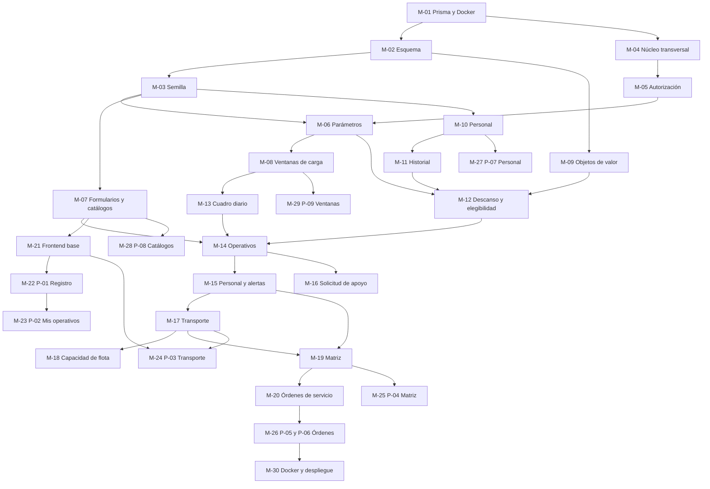

# PLAN DE IMPLEMENTACIÓN
## Módulo Transportes / Cuadro de Colores Operativo — Agencia Metropolitana de Control

| | |
|---|---|
| **Fecha** | 2026-08-04 |
| **Entradas** | `IMPLEMENTATION_GUIDE.md` · `ANALYSIS_REPORT.md` |
| **Naturaleza** | Plan de trabajo. **No contiene código** |
| **Estado de partida** | E0.a, E0.b y E0.c ejecutadas: repositorios en línea base, `build` y `lint` en cero, documentación instalada |
| **Unidad de trabajo** | 30 módulos pequeños, cada uno con entrega verificable |

---

## 0. CÓMO USAR ESTE PLAN

### 0.1 Estructura de cada módulo

Cada módulo declara: **prioridad**, **dependencias**, **frontend**, **backend**, **base de datos**,
**componentes React**, **endpoints**, **DTO**, **servicios**, **repositorios**, **validaciones**,
**permisos** y **casos de prueba**. Un campo con `—` significa que ese módulo no entrega nada en
esa dimensión.

### 0.2 Escala de prioridad

| Prioridad | Significado |
|---|---|
| **P0 · Crítica** | Bloquea todo lo demás, o protege a personas. No se negocia el orden |
| **P1 · Alta** | Camino principal del negocio. Sin esto no hay producto |
| **P2 · Media** | Completa el producto, pero admite entrega posterior |
| **P3 · Baja** | Mejora o cierre. Puede diferirse sin afectar la operación |

### 0.3 Definición de terminado, común a todos los módulos

Un módulo no se declara terminado sin **las nueve condiciones**:

1. `npm run build` con código de salida 0.
2. `npm run lint` con código de salida 0.
3. Sin `any`, sin `console.log`, sin código muerto ni variables sin usar.
4. Cabecera de comentario en todo archivo nuevo, con desarrollador real y fecha.
5. Toda validación, guarda o política **cita su identificador** `RN-xx`, `VAL-xx`, `PER-xx` o
   `INV-xx` y su fuente documental.
6. Sus casos de prueba pasan.
7. El agente auditor correspondiente (`auditor-rbac` o `auditor-ui`) no reporta hallazgos críticos.
8. Ningún punto de `IMPLEMENTATION_GUIDE.md` §0.1 se completó por inferencia.
9. Confirmación del responsable funcional cuando el módulo toca reglas de negocio.

### 0.4 Regla que atraviesa el plan entero

**Doce puntos no están definidos por el negocio.** Si un módulo los necesita, **se detiene y se
pregunta**. Cada módulo declara abajo cuáles le afectan. Completarlos con un valor razonable
destruye el trabajo de cinco fases de análisis, cuyo valor está en distinguir lo acordado de lo
supuesto.

### 0.5 Mapa de dependencias



### 0.6 Bloques y su orden

| Bloque | Módulos | Entrega |
|---|---|---|
| **A · Cimientos** | M-01 a M-05 | Base de datos, esquema, datos iniciales, transversales y autorización |
| **B · Configuración** | M-06 a M-08 | Parámetros, formularios, catálogos y ventanas |
| **C · Talento y dominio** | M-09 a M-12 | Objetos de valor y **las reglas que protegen a personas** |
| **D · Planificación** | M-13 a M-16 | Cuadro diario, operativos, personal asignado y apoyo |
| **E · Logística** | M-17 a M-18 | Conductor, vehículo y capacidad de flota |
| **F · Entregables** | M-19 a M-20 | Matriz consolidada y órdenes de servicio |
| **G · Interfaz** | M-21 a M-29 | Base del frontend y las nueve pantallas |
| **H · Cierre** | M-30 | Contenedores, despliegue e identidad real |

---

# BLOQUE A · CIMIENTOS

---

## M-01 · Preparación, Prisma y contenedor de base de datos ✅ **COMPLETADO · 2026-08-04**

| | |
|---|---|
| **Prioridad** | **P0 · Crítica** |
| **Etapa de la guía** | E0.d |
| **Dependencias** | Ninguna. E0.a, E0.b y E0.c ya están hechas |
| **Bloquea** | Todo |
| **Estado** | **Terminado.** Los seis casos de prueba pasan. Ver §M-01.1 al final del módulo |

**Backend.** Instalar `prisma` (desarrollo) y `@prisma/client` (producción). Inicializar
`prisma/` con proveedor `postgresql`. Crear `src/prisma/prisma.module.ts` marcado con `@Global()`
y `src/prisma/prisma.service.ts`, que extiende `PrismaClient` e implementa `OnModuleInit` y
`OnModuleDestroy`: conecta al iniciar y desconecta de forma ordenada. Importar `PrismaModule` en
`app.module.ts`. Reescribir `docker-compose.yml` con los tres servicios del módulo y el
`Dockerfile` con `npx prisma generate` **dentro de la etapa de construcción** y sin LibreOffice.

**Base de datos.** Ninguna tabla todavía. Se levanta el contenedor `transportedb` (PostgreSQL 18,
puerto externo **5434**, interno 5432, volumen `transporte_pgdata`) y se comprueba con
`pg_isready`. Codificación `UTF8`, ordenamiento español, zona horaria `America/Guayaquil`.

**Frontend · Componentes React.** —

**Endpoints.** Ninguno nuevo. Queda operativo `GET /api/v1/estado`.

**DTO.** —

**Servicios.** `PrismaService`.

**Repositorios.** —

**Validaciones.** Verificación de arranque: si `MODO_IDENTIDAD_PROVISIONAL` está activo, el
servicio advierte en consola (ya implementado en la línea base).

**Permisos.** —

**Casos de prueba.**

| # | Caso | Resultado esperado |
|---|---|---|
| 1 | `docker compose up -d transportedb` | El contenedor responde a `pg_isready` |
| 2 | Arranque del backend | Conecta a la base sin error; el log indica puerto 3003, prefijo `api/v1` y zona horaria |
| 3 | Apagado ordenado del backend | `PrismaService` desconecta sin dejar conexiones colgadas |
| 4 | `GET /api/v1/estado` | `200` con `{ servicio, estado }` |
| 5 | Construcción de la imagen del backend | El cliente Prisma se genera **dentro** de la imagen, no se copia |
| 6 | Puertos | 5434, 3003 y 5176 sin colisión con Instrucción (5433, 3002, 5175) |

### M-01.1 · Resultado de la ejecución · 2026-08-04

**Entregado.** Los seis casos de prueba pasan. Backend: `build`, `lint:check` y `test` en cero.
Frontend: **cero archivos modificados**, `build` y `lint` en cero.

**Archivos creados:** `prisma/schema.prisma`, `prisma/README.md`, `src/prisma/prisma.service.ts`,
`src/prisma/prisma.module.ts`.
**Modificados:** `src/app.module.ts`, `src/main.ts`, `src/config/app.config.ts`, `Dockerfile`,
`package.json`.

**Dos desviaciones, ambas documentadas y verificadas:**

| # | Desviación | Motivo |
|---|---|---|
| 1 | **Prisma fijado en 6.19.3**, no en la última | Prisma 7 eliminó `url = env("DATABASE_URL")` del `datasource` y exige adaptadores de driver, lo que obliga a instalar `@prisma/adapter-pg`. El esquema aprobado de FASE4-base-datos §10 **no valida con la 7**. Requiere decisión explícita, no un efecto colateral |
| 2 | **`openssl` añadido a la imagen de ejecución** | `node:20-slim` no lo incluye. Sin él, Prisma detecta `debian-openssl-1.1.x` en ejecución mientras la construcción generó el motor para `3.0.x`, y el contenedor entra en bucle de reinicio. **Es la variante más común de RT-04, y se materializó durante este módulo** |

**Dos correcciones no previstas en el plan:**

- `app.enableShutdownHooks()` en `main.ts`. Sin él, `OnModuleDestroy` **nunca se ejecuta** ante
  `SIGTERM` y la conexión de Prisma queda abierta al detener el contenedor. La guía exige
  «desconecta de forma ordenada», pero eso no ocurre solo por implementar la interfaz.
- Copia de `node_modules/@prisma/client` además de `.prisma` en el `Dockerfile`. `npm ci --omit=dev`
  reinstala el paquete sin generar, y sin esa copia el cliente queda vacío.

---

## M-02 · Esquema de base de datos y migraciones ✅ **COMPLETADO · 2026-08-05**

| | |
|---|---|
| **Prioridad** | **P0 · Crítica** |
| **Etapa** | E1 |
| **Dependencias** | M-01 |
| **Bloquea** | Todos los módulos de negocio |
| **Estado** | **Terminado.** 27 tablas, 11 enumerados, 24 restricciones `CHECK` y 7 índices parciales. Documentación en `M02_ESQUEMA_BASE_DATOS.md` |

**Backend.** `prisma/schema.prisma` completo. Tres migraciones: la generada por Prisma y **dos
manuales complementarias**, porque Prisma no expresa restricciones `CHECK` ni índices parciales.

**Base de datos.** **27 tablas y 11 enumerados.**

| Grupo | Tablas |
|---|---|
| Configuración (12) | `t_formulario`, `t_formulario_prefijo`, `t_formulario_area`, `t_formulario_punto`, `t_formulario_tipo_control`, `t_formulario_institucion`, `t_zonal`, `t_punto_encuentro`, `t_tipo_control`, `t_institucion`, `t_ventana_carga`, `t_parametro_politica` |
| Talento (5) | `t_funcionario`, `t_conductor`, `t_vehiculo`, `t_disponibilidad`, `t_historial_jornada` |
| Planificación (6) | `t_cuadro_diario`, `t_operativo`, `t_asignacion_personal`, `t_operativo_zonal`, `t_operativo_institucion`, `t_solicitud_apoyo` |
| Logística (1) | `t_capacidad_flota` |
| Entregables (1) | `t_orden_servicio` |
| Transversal (2) | `t_auditoria`, `t_usuario` |

Enumerados: `RolDepartamental`, `EstadoCuadro`, `EstadoTransporte`, `PoliticaVehiculo`,
`AreaPersonal`, `TipoContrato`, `EstadoDisponibilidad`, `TipoVentana`, `AccionAuditoria`,
`EstadoSolicitud`, `TipoParametro`.

Migraciones:

| Nombre | Contenido |
|---|---|
| `esquema_inicial` | Las 27 tablas, los 11 enumerados y las 20 restricciones de unicidad |
| `agrega_restricciones_verificacion` | Las 22 restricciones `CHECK` de FASE4-base-datos §7.1 |
| `agrega_indices_parciales` | Los 6 índices parciales y el único parcial `uq_orden_vigente` |

> **Discrepancia resuelta (D-03 del informe).** `FASE4-diseno-base-datos.md` documenta 26 tablas y
> 10 enumerados; la guía manda 27 y 11. La diferencia es `t_parametro_politica` y `TipoParametro`.
> **Además esa tabla no tiene ninguna de las 22 restricciones documentadas**: hay que añadirle la
> verificación de rango (`para_valor` dentro de `para_minimo` y `para_maximo` según `para_tipo`).

**Frontend · Componentes React.** —

**Endpoints · DTO · Servicios · Repositorios.** —

**Validaciones.** Las 22 restricciones `CHECK`. La más valiosa es `ck_operativo_transporte`:
`ASIGNADO` exige conductor y vehículo informados; `PENDIENTE` y `PROPIOS_MEDIOS` exigen ambos
nulos. Traduce a garantía del motor el hallazgo HAL-01. **Nunca se elimina para simplificar una
migración.**

**Permisos.** —

**Casos de prueba.**

| # | Caso | Resultado esperado |
|---|---|---|
| 1 | `npx prisma migrate status` | Sin migraciones pendientes |
| 2 | `npx prisma migrate diff` esquema contra base | Sin divergencias |
| 3 | `\d+ t_operativo` en psql | Las 8 restricciones de la tabla presentes |
| 4 | Insertar operativo `ASIGNADO` sin conductor | **Rechazado por la base** (`ck_operativo_transporte`) |
| 5 | Insertar dos cuadros con la misma fecha | Rechazado (`uq_cuadro_fecha`, RN-05) |
| 6 | Insertar dos operativos con igual cuadro, formulario y secuencial | Rechazado (`uq_operativo_cuad_form_sec`, RN-12) |
| 7 | Insertar disponibilidad con funcionario y conductor a la vez | Rechazado (`ck_disponibilidad_sujeto`) |
| 8 | Dos órdenes vigentes para el mismo operativo y funcionario | Rechazado (`uq_orden_vigente`, INV-23) |
| 9 | Tras una migración estructural | Las `CHECK` y los índices parciales **siguen presentes** |

---

## M-03 · Semilla de catálogos ⚠️ **ENTREGADO PARCIALMENTE · 2026-08-05**

| | |
|---|---|
| **Prioridad** | **P0 · Crítica** |
| **Etapa** | E1 |
| **Dependencias** | M-02 |
| **Bloquea** | M-06 ✅ y M-08 ✅ **desbloqueados** · M-07, M-10 y M-14 siguen bloqueados |
| **Estado** | **5 de 12 catálogos cargados.** Los 7 restantes esperan PV-01, PV-02, PV-03, PV-25, PV-26 y PV-27. Documentación en `M03_SEMILLA_CATALOGOS.md` |

**Backend.** `prisma/seed.ts` **idempotente**: se ejecuta varias veces sin duplicar, usando
`upsert` con la clave natural. Consume `insumos/catalogos-hoja2.json`.

**Base de datos.** Carga inicial:

| Catálogo | Volumen | Estado |
|---|---|---|
| 9 formularios con colores y políticas | 9 | **Bloqueado**: faltan `form_color_acento` y `form_es_patrulla`, columnas obligatorias creadas en M-02 cuyos valores el insumo no trae. Ver PV-25 y PV-26 |
| Prefijos por formulario | 18 | Completo, **sin criterio de área** |
| Zonales más el ámbito DMQ | 11 | Completo |
| Puntos de encuentro | ~70 | Completo, **sin vincular a zonal** |
| Tipos de control | ~60 | Completo |
| Instituciones | 16 | Completo |
| Ventanas de carga | 6 | Parcial |
| Parámetros de política | 8 | Completo |
| Relación zonal ↔ punto por formulario | — | **PENDIENTE PV-01. Dejar `TODO`** |
| Personal | — | **PENDIENTE PV-02. Solo ejemplos marcados** |
| Conductores y vehículos | — | **PENDIENTE PV-03. Solo ejemplos marcados** |

Los ocho parámetros iniciales:

| Clave | Valor | Tipo | Rango | Regla |
|---|---|---|---|---|
| `JORNADA_MAXIMA_HORAS` | `12` | Decimal | 8 a 16 | RN-36 |
| `TOPE_SALIDAS_PESADAS` | `3` | Entero | 1 a 6 | RN-25 |
| `PERIODO_COMPUTO_SALIDAS` | `MENSUAL` | Texto | Semanal · Quincenal · Mensual | RN-37 |
| `HORA_CIERRE_DEPARTAMENTAL` | `15:00` | Texto | — | RN-59 |
| `HORA_LIMITE_CUADRO` | `16:30` | Texto | — | RN-57 |
| `FRANJA_NOCTURNA_INICIO` | `20:00` | Texto | — | RN-43 |
| `FRANJA_NOCTURNA_FIN` | `05:00` | Texto | — | RN-43 |
| `DIAS_DESCANSO_PATRULLA` | `1` | Entero | 1 a 3 | RN-24 |

> **Cuatro trampas del insumo, detectadas en el análisis. No consumir el JSON a ciegas:**
>
> | # | Trampa | Qué hacer |
> |---|---|---|
> | D-05 | El JSON trae `condicionanteNocturno: true` en el formulario 9, y la guía §0.1 punto 4 exige `false` | **Sobrescribir a `false`** con comentario citando la contradicción |
> | D-06 | El JSON dice `OBLIGATORIO` en el formulario 8; FASE2 §16.2 dice `Requerido` | **Detenerse y preguntar** qué separa los dos valores del enumerado |
> | D-07 | `form_color_acento` es obligatorio y **no está en el insumo** | **PV-25.** `TODO` explícito hasta que la DNP lo entregue |
> | D-07 | `form_es_patrulla` **no está**, y de él depende RN-24 | **PV-26.** Deducirlo del nombre es exactamente la inferencia que el proyecto prohíbe |
>
> Falta además el criterio de selección de prefijo por área (**PV-27**): el formulario 8 tiene
> cuatro prefijos y dos áreas.

**Frontend · Componentes React · Endpoints · DTO.** —

**Servicios.** —

**Repositorios.** —

**Validaciones.** Idempotencia. Los parámetros se validan contra su rango admisible.

**Permisos.** —

**Casos de prueba.**

| # | Caso | Resultado esperado |
|---|---|---|
| 1 | `npx prisma db seed` dos veces seguidas | Sin error y **sin duplicados** |
| 2 | `SELECT count(*) FROM t_formulario` | `9` |
| 3 | `SELECT count(*) FROM t_parametro_politica` | `8` |
| 4 | `SELECT count(*) FROM t_zonal` | `11`, uno con `zona_es_dmq = true` |
| 5 | `SELECT count(*) FROM t_institucion` | `16` |
| 6 | Colores de los nueve formularios | Coinciden exactamente con los del Excel aprobado |
| 7 | Formulario 9 | `condicionanteNoct = false` con comentario de la contradicción |
| 8 | Pendientes | `t_formulario_punto` vacía con `TODO`; personal y conductores solo con ejemplos marcados |

---

## M-04 · Núcleo transversal: errores, filtro, correlación, registro y auditoría ✅ **COMPLETADO · 2026-08-05**

| | |
|---|---|
| **Prioridad** | **P0 · Crítica** |
| **Etapa** | E2 |
| **Dependencias** | M-01 |
| **Bloquea** | M-05 y todos los módulos de negocio |
| **Estado** | **Terminado.** 23 pruebas unitarias y los 7 casos del plan pasan. La auditoría se entrega como servicio transaccional, no como interceptor: ver `M04_NUCLEO_TRANSVERSAL.md` §3 |

**Backend.** Jerarquía de errores sobre la `ApplicationError` existente; extensión del
`AllExceptionsFilter`; tres interceptores; logger estructurado; DTO de paginación.

| Elemento | Detalle |
|---|---|
| `ReglaNegocioError` | 409. Regla de descanso, duplicidad o condicionante |
| `VentanaCerradaError` | 423. Escritura fuera de la ventana del rol |
| `AutorizacionError` | 403. Rol sin permiso sobre el recurso |
| `ConflictoConcurrenciaError` | 409. Versión desactualizada |
| `correlacion.interceptor` | Propaga `x-correlation-id` de extremo a extremo |
| `logging.interceptor` | Traza de petición con duración |
| `auditoria.interceptor` | Registra escrituras **dentro de la misma transacción** |
| `logger.service` | Registro estructurado, **nunca con datos personales** |

**Base de datos.** Escrituras sobre `t_auditoria`: entidad, identificador, acción, campo, valor
anterior, valor nuevo, usuario, rol, correlación y momento.

**Frontend · Componentes React.** —

**Endpoints.** Ninguno propio. El filtro y los interceptores aplican a todos.

**DTO.** `PaginacionDto` (`pagina`, `tamanio`), `RespuestaDto` con metadatos.

**Servicios.** `LoggerService`, `AuditoriaService`.

**Repositorios.** `AuditoriaRepository`.

**Validaciones.** Formato uniforme de error, obligatorio en toda respuesta de fallo:

```
statusCode · codigo · mensaje · detalles · correlacionId · timestamp · ruta
```

**El campo `mensaje` se muestra tal cual al funcionario.** Debe nombrar a la persona o recurso
implicado y explicar el motivo en términos operativos. Prohibido «error de validación» o «dato
inválido». Los quince códigos:

`VENTANA_CARGA_CERRADA` · `FORMULARIO_NO_AUTORIZADO` · `ROL_NO_AUTORIZADO` ·
`CAMPOS_NO_PERMITIDOS` · `PERSONA_NO_DISPONIBLE` · `CONTRATO_NO_ADMITE_TURNO` ·
`PATRULLA_CONSECUTIVA` · `TOPE_SALIDAS_PESADAS` · `SOLAPAMIENTO_HORARIO` ·
`JORNADA_MAXIMA_SUPERADA` · `CUPO_COMPARTIDO_SUPERADO` · `CONDUCTOR_PATRULLA_CONSECUTIVA` ·
`CONDICIONANTE_NOCTURNO` · `CUADRO_CERRADO` · `CONFLICTO_CONCURRENCIA`

**Permisos.** —

**Casos de prueba.**

| # | Caso | Resultado esperado |
|---|---|---|
| 1 | Petición con `x-correlation-id` | El mismo identificador vuelve en la respuesta y aparece en todos los registros |
| 2 | Petición sin la cabecera | El servidor genera uno y lo propaga |
| 3 | Error de regla de negocio | Respuesta con los siete campos del formato, `mensaje` en lenguaje operativo |
| 4 | Fallo a mitad de una escritura | **La auditoría tampoco se escribe**: misma transacción |
| 5 | `grep -E "[0-9]{9,10}" logs/` | Sin teléfonos ni cédulas |
| 6 | Registro de una orden de servicio | El log **no** contiene su contenido |
| 7 | Arranque con `MODO_IDENTIDAD_PROVISIONAL=true` | Advertencia visible en consola |

---

## M-05 · Cadena de autorización ✅ **COMPLETADO · 2026-08-05**

| | |
|---|---|
| **Prioridad** | **P0 · Crítica** |
| **Etapa** | E2 |
| **Dependencias** | M-03, M-04 |
| **Bloquea** | Todo endpoint de escritura |
| **Estado** | **Terminado.** Las cuatro guardas, 55 pruebas. Documentación en `M05_CADENA_AUTORIZACION.md` |

**Backend.** Las cuatro guardas, en orden, más decoradores.

```
IdentidadGuard → RolesGuard → FormularioRolGuard → VentanaCargaGuard → ValidationPipe → Servicio
     401             403             403                423                400            409
```

| Guarda | Pregunta | Fuente de verdad |
|---|---|---|
| `IdentidadGuard` | ¿Quién realiza la petición? | Token, o cabecera provisional **solo si `MODO_IDENTIDAD_PROVISIONAL=true`**. **Único punto provisional del sistema** |
| `RolesGuard` | ¿El rol figura entre los autorizados? | Decorador `@Roles()`. **Ya existe, se reutiliza** |
| `FormularioRolGuard` | ¿El formulario pertenece a este rol? | **Tabla `t_formulario`**, nunca el cuerpo de la petición |
| `VentanaCargaGuard` | ¿Puede escribir ahora? | `t_ventana_carga`, evaluada en `America/Guayaquil` |

Decoradores: `@Roles()` (existe), `@UsuarioActual()`, `@FormularioDesde()`.

**Base de datos.** Lectura de `t_formulario` y `t_ventana_carga`. Ninguna escritura.

**Frontend · Componentes React · Endpoints · DTO.** —

**Servicios.** `IdentidadService` en modo provisional.

**Repositorios.** Consulta a `t_formulario` para la guarda de formulario.

**Validaciones.** VAL-26 ventana de carga · VAL-28 autorización de escritura · VAL-29 autorización
de emisión.

**Permisos.** Los seis roles y su alcance:

| Rol | Escritura |
|---|---|
| `DMIP_OPERATIVOS` | Formularios 1, 2, 3, 4 |
| `DMIP_INSPECCIONES` | Formularios 5, 6, 8 |
| `DMIT_INSTRUCTOR` | Formularios 7, 9 y cupo en el 6 |
| `DAF` | **Solo `conductorId` y `vehiculoId`** en los nueve |
| `DIRECTOR` | Ninguna sobre la planificación |
| `ADMINISTRADOR_DMIP` | Catálogos, personal, ventanas y parámetros |

**Casos de prueba.**

| # | Caso | Resultado esperado |
|---|---|---|
| 1 | Petición sin identidad | `401` |
| 2 | Rol no listado en `@Roles()` | `403 ROL_NO_AUTORIZADO` |
| 3 | `DMIP_OPERATIVOS` escribiendo en el formulario 7 | `403 FORMULARIO_NO_AUTORIZADO` |
| 4 | Petición manipulada con otro formulario en el cuerpo | `403`. La guarda consulta la tabla, no el cuerpo |
| 5 | Escritura fuera de la ventana | `423 VENTANA_CARGA_CERRADA` con la hora de reapertura |
| 6 | Cabecera provisional con `MODO_IDENTIDAD_PROVISIONAL=false` | `401`. La cabecera se ignora |
| 7 | Orden de evaluación | Con rol ajeno **y** ventana cerrada, gana el `403`: la cadena corta en la primera que falla |

---

# BLOQUE B · CONFIGURACIÓN

---

## M-06 · Parámetros de política ✅ **COMPLETADO · 2026-08-05**

| | |
|---|---|
| **Prioridad** | **P0 · Crítica** |
| **Etapa** | E3 |
| **Dependencias** | M-03, M-05 |
| **Bloquea** | M-08 ✅ y M-12 ✅ **desbloqueados** |
| **Estado** | **Terminado.** Siete archivos, 88 pruebas en total. Documentación en `M06_PARAMETROS_POLITICA.md` |

**Backend.** Submódulo `configuracion`. `ParametroPoliticaService` **cachea en memoria** e
**invalida al modificarse**. Toda modificación queda en auditoría.

**Base de datos.** `t_parametro_politica`.

**Frontend.** Consumo en M-29 (pantalla P-09).

**Componentes React.** —

**Endpoints.**

| Método | Ruta | Roles |
|---|---|---|
| `GET` | `/parametros` | `ADMINISTRADOR_DMIP` |
| `GET` | `/parametros/:clave` | `ADMINISTRADOR_DMIP` |
| `PUT` | `/parametros/:clave` | `ADMINISTRADOR_DMIP` |

**DTO.** `ActualizarParametroDto` (`valor`), `ParametroResponseDto` (clave, valor, tipo, unidad,
descripción, mínimo, máximo, modificado por, modificado en).

**Servicios.** `ParametroPoliticaService` con `obtenerEntero()`, `obtenerDecimal()`,
`obtenerTexto()`, `actualizar()`, `invalidarCache()`.

**Repositorios.** `ParametroPoliticaRepository`.

**Validaciones.** El valor se valida **contra su rango admisible** al guardar: una jornada de 30
horas se rechaza. El tipo declarado debe corresponder con el valor.

**Permisos.** Lectura y escritura exclusivas de `ADMINISTRADOR_DMIP`.

**Casos de prueba.**

| # | Caso | Resultado esperado | Verificado |
|---|---|---|---|
| 1 | `GET /parametros` con rol `ADMINISTRADOR_DMIP` | Los ocho parámetros con su rango | ✅ |
| 2 | `GET /parametros` con rol `DIRECTOR` | `403` | ✅ `403 ROL_NO_AUTORIZADO` |
| 3 | `PUT` con `JORNADA_MAXIMA_HORAS = 30` | `400`, fuera del rango 8 a 16 | ✅ |
| 4 | `PUT` con `JORNADA_MAXIMA_HORAS = 8` | `200`; la caché se invalida | ✅ |
| 5 | Lectura tras la modificación | Devuelve `8` sin reiniciar el servicio | ✅ |
| 6 | Auditoría | Registra clave, valor anterior, valor nuevo, usuario y momento | ✅ más rol y correlación |

**Nota de contrato.** Una clave inexistente devuelve **`404 RECURSO_NO_ENCONTRADO`**, no `400`: la
clave viaja en la ruta e identifica al recurso. La modificación es idempotente —reenviar el valor
vigente devuelve `200` sin escribir ni auditar—, y los endpoints **no llevan `VentanaCargaGuard`**
a propósito. Ver `M06_PARAMETROS_POLITICA.md` §5.

---

## M-07 · Formularios y catálogos ✅ **COMPLETADO · 2026-08-05** (backend)

| | |
|---|---|
| **Prioridad** | **P1 · Alta** |
| **Etapa** | E3 |
| **Dependencias** | M-03, M-05 |
| **Bloquea** | M-14 ✅, M-21 ✅ y M-28 ✅ **desbloqueados** |
| **Estado** | **Backend terminado.** 13 endpoints, 48 pruebas unitarias nuevas y 21 de integración. Documentación en `M07_FORMULARIOS_CATALOGOS.md` |
| **Frontend** | **No corresponde a este módulo:** los hooks son M-21 y la pantalla P-08 es M-28, tal como declara la ficha |

**Backend.** `FormulariosService` y `CatalogosService` dentro de `configuracion`.

**Base de datos.** `t_formulario`, `t_formulario_prefijo`, `t_formulario_area`,
`t_formulario_punto`, `t_formulario_tipo_control`, `t_formulario_institucion`, `t_zonal`,
`t_punto_encuentro`, `t_tipo_control`, `t_institucion`.

**Frontend.** Consumido por M-21 (hooks y servicios) y M-28 (pantalla P-08).

**Componentes React.** —

**Endpoints.**

| Método | Ruta | Roles |
|---|---|---|
| `GET` | `/formularios/permitidos` | Todos |
| `GET` | `/formularios/:codigo/catalogos` | Todos |
| `GET` | `/zonales` | Todos |
| `GET` | `/formularios/:codigo/zonales/:zonalId/puntos` | Todos |
| `CRUD` | `/administracion/catalogos` | `ADMINISTRADOR_DMIP` |

**DTO.** `FormularioResponseDto` (número, código, nombre, **colores**, rol dueño, rol compartido y
cupo, política de vehículo, condicionante nocturno, es patrulla, áreas admitidas),
`CatalogosFormularioResponseDto`, `CrearPuntoDto`, `CrearTipoControlDto`, `CrearInstitucionDto`.

**Servicios.** `FormulariosService.obtenerDefinicion(codigo)`, `obtenerPermitidos(rol)`;
`CatalogosService.obtenerCatalogos(formularioId)`, `obtenerPuntos(formularioId, zonalId)`.

**Repositorios.** `FormulariosRepository`, `CatalogosRepository`.

**Validaciones.** RN-16 cada formulario despliega sus propios catálogos · RN-17 el punto depende
de la zonal · RN-18 las diez zonales aparecen siempre, aunque no tengan puntos mapeados · RN-20
opción `ADICIONALES` con captura libre · RF-058 un valor usado en cuadros históricos **no se
elimina, solo se desactiva**.

**Permisos.** Lectura para todos los roles autenticados. `GET /formularios/permitidos` devuelve
**solo los del rol que consulta**. Administración exclusiva de `ADMINISTRADOR_DMIP`.

> **Bloqueado parcialmente por PV-01.** El filtrado en cascada no devolverá puntos hasta que
> llegue la matriz zonal ↔ punto. La estructura se construye y se prueba con datos de ejemplo.

**Casos de prueba.**

| # | Caso | Resultado esperado | Verificado |
|---|---|---|---|
| 1 | `/formularios/permitidos` con `DMIP_OPERATIVOS` | Formularios 1, 2, 3 y 4. Ningún otro | ✅ |
| 2 | Ídem con `DMIT_INSTRUCTOR` | Formularios 7 y 9, más el 6 marcado como compartido | ✅ |
| 3 | Ídem con `DAF` | Los nueve, en modo lectura | ✅ |
| 4 | `/formularios/INSP/catalogos` | Sus 10 puntos, 24 tipos y 5 instituciones. Nada de otro formulario | ✅ con datos de prueba: PV-01 impide los reales |
| 5 | `GET /zonales` | Las 10 más DMQ, siempre completas | ✅ |
| 6 | Puntos de una zonal sin mapeo | Lista vacía, **pero la zonal aparece** | ✅ |
| 7 | Eliminar un tipo de control usado en un cuadro histórico | Se desactiva, no se borra | ✅ la baja es lógica **siempre** |
| 8 | Respuesta de formulario | Incluye `colorFondo` y `colorAcento`: **el frontend no los define** | ✅ |

**Notas de implementación.** Se agregó `form_permite_captura_libre` a `t_formulario`: RN-20 no era
representable en el modelo aprobado, y el valor sale del insumo (formularios 2 y 8), no de una
inferencia. La ruta de puntos lleva el código del formulario —`/formularios/:codigo/zonales/:zonalId/puntos`—
y no la forma de `FASE4` §8.2, porque RN-16 y RN-17 actúan juntas. Ver
`M07_FORMULARIOS_CATALOGOS.md` §2 y §3.3.

---

## M-08 · Ventanas de carga ✅ **COMPLETADO · 2026-08-05**

| | |
|---|---|
| **Prioridad** | **P1 · Alta** |
| **Etapa** | E3 |
| **Dependencias** | M-05, M-06 |
| **Bloquea** | M-13 ✅ y M-29 ✅ **desbloqueados** |
| **Estado** | **Terminado.** 4 endpoints, 34 pruebas unitarias nuevas y 13 de integración. Documentación en `M08_VENTANAS_CARGA.md` |

**Backend.** `VentanaCargaService` y la política `EvaluadorVentanaCarga` (POL-05). Evalúa
**siempre en `America/Guayaquil`**, con independencia de la zona del servidor.

**Base de datos.** `t_ventana_carga`, una fila por rol.

**Frontend.** Hook `useVentanaCarga` en M-21; pantalla P-09 en M-29.

**Componentes React.** —

**Endpoints.**

| Método | Ruta | Roles |
|---|---|---|
| `GET` | `/ventanas/estado` | Todos |
| `CRUD` | `/administracion/ventanas` | `ADMINISTRADOR_DMIP` |

**DTO.** `VentanaEstadoResponseDto` (abierta, hora de cierre, hora de reapertura, mensaje),
`ActualizarVentanaDto` (tipo, día y hora de apertura, día y hora de cierre, mensaje, activo).

**Servicios.** `VentanaCargaService.puedeEscribir(rol, momento)`, `obtenerEstado(rol)`.

**Repositorios.** `VentanaCargaRepository`.

**Validaciones.** RN-56 la carga departamental cierra y a continuación se abre la de la DAF ·
RN-57 el cuadro debe estar listo a las 16H30 · VAL-26. Formato `HH:MM` y días ISO de 1 a 7.

**Permisos.** Consulta del propio estado para todos. Administración solo `ADMINISTRADOR_DMIP`.

> **Pendiente PV-06 y D-08.** Las fuentes solo definen la ventana departamental (14H00 frente a
> 15H00, contradicción documentada) y la de la DAF (15H00–16H30). Para `DIRECTOR` y
> `ADMINISTRADOR_DMIP` **no hay valores**: sembrarlas con `vcar_activo = false` y documentarlo.

**Casos de prueba.**

| # | Caso | Resultado esperado | Verificado |
|---|---|---|---|
| 1 | `GET /ventanas/estado` a las 14H00 con rol departamental | Abierta, con la hora de cierre | ✅ |
| 2 | Ídem a las 15H30 | Cerrada, con la hora de reapertura | ✅ |
| 3 | Ídem a las 15H30 con rol `DAF` | Abierta | ✅ |
| 4 | Servidor en otra zona horaria | El resultado **no cambia**: se evalúa en `America/Guayaquil` | ✅ |
| 5 | Cambiar la hora de cierre a 14H00 | El comportamiento cambia sin desplegar código | ✅ |
| 6 | Rol con ventana `activo = false` | Sin restricción horaria | ✅ |

**Notas de implementación.** No hay `POST` ni `DELETE`: hay una ventana por rol y los roles son seis
fijos; un `DELETE` **abriría** la carga las veinticuatro horas, porque el evaluador trata la ausencia
de ventana como «sin restricción». `activo: false` hace lo mismo diciéndolo. RN-56 y RN-57 se
implementan como **advertencias que no bloquean**, porque PV-06 sigue abierto. La guarda de M-05 no
usa la caché de este servicio, a propósito. Ver `M08_VENTANAS_CARGA.md` §3 y §5.2.

---

# BLOQUE C · TALENTO Y DOMINIO

---

## M-09 · Objetos de valor del dominio ✅ **COMPLETADO · 2026-08-05**

| | |
|---|---|
| **Prioridad** | **P0 · Crítica** |
| **Etapa** | E4 |
| **Dependencias** | M-02 |
| **Bloquea** | M-12 ✅ y M-14 ✅ **desbloqueados** |
| **Estado** | **Terminado.** Cuatro objetos de valor, 71 pruebas nuevas. Los ocho casos obligatorios de `RangoHorario` pasan. Documentación en `M09_OBJETOS_VALOR_DOMINIO.md` |

> **Este es el módulo de mayor riesgo del sistema.** `RangoHorario` se implementa **antes** que
> cualquier política que lo use, y **no se da por terminado sin que sus ocho pruebas pasen**. Un
> defecto aquí no produce un error de sistema: produce un funcionario asignado a dieciséis horas.

**Backend.** Carpeta `domain/` de `operativos`. **Los objetos de valor no dependen de nada
externo**: ni de Prisma, ni de NestJS, ni de configuración. Reciben lo que necesitan.

| Objeto | Responsabilidad | Reglas que absorbe |
|---|---|---|
| `RangoHorario` | Validez, granularidad de 30 minutos, condición nocturna, duración con cruce de medianoche, **solapamiento** | RN-07, RN-28, RN-43 |
| `IdentificadorOperativo` | Composición prefijo + secuencial + fecha | RN-09 a RN-12 |
| `EstadoTransporte` | Tres estados excluyentes y transiciones válidas | RN-40 a RN-42, RN-55 |
| `UbicacionOperativa` | Zonales y punto, catalogado o libre | RN-17 a RN-20 |

**Base de datos · Frontend · Componentes React · Endpoints · DTO · Repositorios.** —

**Servicios.** Ninguno. Son objetos de valor puros.

**Validaciones.** La hora de fin es posterior a la de inicio **admitiendo cruce de medianoche**;
solo intervalos de treinta minutos; intersección con la franja nocturna leída de parámetros.

**Permisos.** —

**Casos de prueba.** Los ocho obligatorios de `RangoHorario`, más los de los otros tres objetos:

| # | Caso | Resultado esperado | Verificado |
|---|---|---|---|
| 1 | Rango normal `08:00–16:30` | Válido, 8,5 horas, no nocturno | ✅ |
| 2 | Cruce de medianoche `22:00–02:00` | Válido, 4 horas, nocturno | ✅ |
| 3 | Solapamiento parcial `08:00–12:00` con `11:00–15:00` | Detectado | ✅ |
| 4 | Solapamiento con cruce `22:00–02:00` con `01:00–05:00` | **Detectado** | ✅ |
| 5 | Contención `08:00–18:00` con `10:00–12:00` | Detectado | ✅ |
| 6 | Adyacencia `08:00–12:00` con `12:00–16:00` | **No se solapan** | ✅ |
| 7 | Franja nocturna tocada parcialmente `19:00–21:00` | Es nocturno | ✅ |
| 8 | Franja nocturna contenida `21:00–23:00` | Es nocturno | ✅ |
| 9 | Hora `08:15` | Rechazada: granularidad de 30 minutos | ✅ |
| 10 | Identificador en dos fechas distintas | Ambas empiezan en `001` | ✅ |
| 11 | `EstadoTransporte` de `ASIGNADO` a `PENDIENTE` | Transición rechazada | ✅ |
| 12 | `UbicacionOperativa` con punto de catálogo y punto libre a la vez | Rechazada | ✅ |
| 13 | `UbicacionOperativa` sin ninguna zonal | Rechazada | ✅ |

**Notas de implementación.** El solapamiento y la condición nocturna se resuelven con **la misma
aritmética**: el rango se descompone una vez en intervalos semiabiertos de un día ordinario. Los
intervalos semiabiertos son lo que hace que el caso 6 no se solape. El formato del identificador
—`ICNECU-001-31-JUL-2026`— sale de los mockups de FASE5, no de una suposición. Ver
`M09_OBJETOS_VALOR_DOMINIO.md` §3 y §4.

---

## M-10 · Maestro de personal y disponibilidad ✅ **COMPLETADO · 2026-08-05**

| | |
|---|---|
| **Prioridad** | **P1 · Alta** |
| **Etapa** | E4 |
| **Dependencias** | M-03, M-05 |
| **Bloquea** | M-11 ✅, M-12 ✅ y M-27 ✅ **desbloqueados** |
| **Estado** | **Terminado.** 9 endpoints, 57 pruebas unitarias nuevas y 19 de integración. Sin migraciones: los índices parciales de M-02 ya cubrían las consultas. Documentación en `M10_PERSONAL_DISPONIBILIDAD.md` |

**Backend.** Submódulo `talento-operativo`: `FuncionariosService` y `DisponibilidadService`.

**Base de datos.** `t_funcionario`, `t_disponibilidad`.

**Frontend.** Pantalla P-07 en M-27.

**Componentes React.** —

**Endpoints.**

| Método | Ruta | Roles |
|---|---|---|
| `CRUD` | `/administracion/personal` | `ADMINISTRADOR_DMIP` |
| `CRUD` | `/administracion/personal/:id/disponibilidad` | `ADMINISTRADOR_DMIP` |
| `GET` | `/personal/elegible?formulario=&inicio=&fin=` | Departamentales |

**DTO.** `CrearFuncionarioDto` (cédula, apellidos, nombres, teléfono, cargo, área, tipo de
contrato, dirección), `ActualizarFuncionarioDto`, `CrearDisponibilidadDto` (estado, desde, hasta,
motivo), `FuncionarioResponseDto`.

**Servicios.** `FuncionariosService`, `DisponibilidadService`.

**Repositorios.** `FuncionariosRepository`, `DisponibilidadRepository`.

**Validaciones.** RN-30 vacaciones, permiso, calamidad y reposo médico excluyen a la persona ·
RN-34 **el teléfono vive solo aquí y no se digita en el operativo** · RF-055 ausencias con rango y
motivo · INV-14 los períodos de indisponibilidad de una persona **no se solapan** · baja lógica,
nunca física, por la rotación mensual.

**Permisos.** Alta, baja y modificación exclusivas de `ADMINISTRADOR_DMIP`. Los departamentales solo
consultan personal elegible.

> **Bloqueado por PV-02.** Sin la base certificada con **tipo de contrato**, la regla RN-26 no se
> puede evaluar con datos reales. Se construye y se prueba con ejemplos marcados como tales.

**Casos de prueba.**

| # | Caso | Resultado esperado | Verificado |
|---|---|---|---|
| 1 | Alta con cédula repetida | Rechazada | ✅ el mensaje dice a nombre de quién está |
| 2 | Dos ausencias solapadas para la misma persona | Rechazada (INV-14) | ✅ nombra el período que choca |
| 3 | Baja de funcionario con historial | Baja **lógica**; el histórico se conserva | ✅ |
| 4 | `/personal/elegible` con persona de vacaciones | **No aparece en la lista** | ✅ |
| 5 | Modificar teléfono desde el operativo | Imposible: el campo no existe en su DTO | ✅ la respuesta no contiene `telefono` ni `cedula` |
| 6 | Ausencia con fecha de fin anterior al inicio | Rechazada (`ck_disponibilidad_rango`) | ✅ antes de llegar a la base |

**Notas de implementación.** Se añadió un tercer servicio, `PersonalElegibleService`: la consulta
cruza configuración, maestro y disponibilidad, y ponerla en `FuncionariosService` habría creado una
dependencia circular con `DisponibilidadService`. **La traza de auditoría no guarda el valor del
teléfono ni de la cédula**, solo que cambiaron; el motivo de una ausencia tampoco sale del
submódulo. Los extremos de un período son **inclusivos**, al revés que en `RangoHorario`. Ver
`M10_PERSONAL_DISPONIBILIDAD.md` §3 y §5.1.

---

## M-11 · Historial de jornada ✅ **COMPLETADO · 2026-08-06**

| | |
|---|---|
| **Prioridad** | **P1 · Alta** |
| **Etapa** | E4 |
| **Dependencias** | M-10 |
| **Bloquea** | M-12 ✅ **desbloqueado** |
| **Estado** | **Terminado.** Proyección persistida sin endpoints (RN-35). 26 pruebas unitarias nuevas y 16 de integración. Sin migraciones. Documentación en `M11_HISTORIAL_JORNADA.md` |

**Backend.** `HistorialJornadaService`. Es una **proyección persistida**, no una entidad
independiente: se actualiza al consumir el evento `CuadroCerrado`.

**Base de datos.** `t_historial_jornada`, una fila por funcionario y fecha, con `upsert`.

**Frontend · Componentes React · Endpoints · DTO.** — Consumo interno.

**Servicios.** `HistorialJornadaService.consolidarJornada(fecha)`, `obtenerUltimaPatrulla(func)`,
`contarSalidasPesadas(func, periodo)`, `obtenerHorasDelDia(func, fecha)`.

**Repositorios.** `HistorialJornadaRepository`.

**Validaciones.** Horas de jornada entre 0 y 24 (`ck_historial_horas`). Una fila por persona y día
(`uq_historial_func_fecha`).

**Permisos.** Sin acceso externo. **El acumulado de salidas no se muestra nunca en la interfaz**:
alimenta la validación, no la vista (RN-35, decisión expresa del Product Owner).

**Casos de prueba.**

| # | Caso | Resultado esperado | Verificado |
|---|---|---|---|
| 1 | Cerrar un cuadro con tres operativos de una persona | Una sola fila de historial con las horas sumadas | ✅ |
| 2 | Persona en patrulla nocturna | `fue_patrulla` y `fue_nocturna` en verdadero | ✅ |
| 3 | Operativo en sábado | `fue_fin_semana` en verdadero | ✅ |
| 4 | Reabrir y volver a cerrar el mismo cuadro | Sin duplicar: `upsert` por persona y fecha | ✅ |
| 5 | Operativo que cruza medianoche | Las horas se imputan al **día de inicio** | ✅ |
| 6 | Ningún endpoint expone el acumulado | Confirmado por revisión de rutas | ✅ en tres niveles |

**Notas de implementación.** La proyección **se recalcula entera**, incluido el borrado de quien
deja de figurar en el cuadro: sin ese paso, reabrir y eliminar un operativo dejaba a esa persona con
horas que ya no hizo. El fin de semana se calcula **en UTC y no en `America/Guayaquil`**, porque
`@db.Date` es una fecha de calendario y no un instante; preguntarle su día en Guayaquil la
retrasaría al viernes. **No se audita** —es un cálculo derivado, y lo auditado es el cierre que lo
dispara— y **no hay bus de eventos**: M-13 invocará `consolidarJornada(fecha)` tras confirmar la
transacción del cierre. Ver `M11_HISTORIAL_JORNADA.md` §2, §3 y §7.

---

## M-12 · Políticas de descanso y elegibilidad ✅ **COMPLETADO · 2026-08-06**

| | |
|---|---|
| **Prioridad** | **P0 · Crítica** |
| **Etapa** | E4 |
| **Dependencias** | M-06, M-09, M-11 |
| **Bloquea** | M-14 ✅, M-15 ✅ y M-17 ✅ **desbloqueados** |
| **Estado** | **Terminado.** Las seis reglas como función pura, 55 pruebas unitarias nuevas y 19 de integración. Sin migraciones. Documentación en `M12_POLITICAS_DESCANSO.md` |

> **Es la razón por la que existe el proyecto.** Las transcripciones describen funcionarios de
> dieciséis horas, patrullas en días consecutivos y accidentes por jornadas encadenadas.
> **Las reglas viven aquí y solo aquí.** Si aparece lógica de descanso en `operativos` o en
> `transporte`, es un defecto que debe reportarse.

**Backend.** `DescansoPersonalPolicy` (POL-01), `ElegibilidadService`, y la base de
`DescansoConductorPolicy` (POL-02), que M-17 aplica al conductor.

**Base de datos.** Lectura de `t_funcionario`, `t_disponibilidad`, `t_historial_jornada`,
`t_asignacion_personal`, `t_parametro_politica`.

**Frontend.** El navegador **no replica** estas reglas: dependen de datos que el cliente no posee.
Se presentan al recibir el `409`.

**Componentes React.** —

**Endpoints.** `GET /personal/elegible` (compartido con M-10). El resto es consumo interno.

**DTO.** `VeredictoElegibilidadDto`: `{ elegible: boolean, codigo?: string, motivo?: string }`.
**Nunca devuelve datos del funcionario.**

**Servicios.** `ElegibilidadService.verificar(funcionarioId, contexto)` y
`verificarConductor(conductorId, contexto)`.

**Repositorios.** Reutiliza los de M-10 y M-11. **No expone repositorios a otros submódulos.**

**Validaciones.** Las seis reglas, **en este orden**, devolviendo el **primer** motivo encontrado:

| # | Regla | Código | Origen | Parámetro |
|---|---|---|---|---|
| 1 | Disponibilidad | `PERSONA_NO_DISPONIBLE` | RN-30, VAL-12 | — |
| 2 | Tipo de contrato | `CONTRATO_NO_ADMITE_TURNO` | RN-26, RN-33, VAL-13 | — |
| 3 | Patrulla consecutiva | `PATRULLA_CONSECUTIVA` | RN-24, VAL-14 | `DIAS_DESCANSO_PATRULLA` |
| 4 | Tope de salidas pesadas | `TOPE_SALIDAS_PESADAS` | RN-25, VAL-15 | `TOPE_SALIDAS_PESADAS`, `PERIODO_COMPUTO_SALIDAS` |
| 5 | Solapamiento horario | `SOLAPAMIENTO_HORARIO` | RN-28, VAL-16 | — |
| 6 | Jornada máxima diaria | `JORNADA_MAXIMA_SUPERADA` | RN-36, VAL-17 | `JORNADA_MAXIMA_HORAS` |

**Los umbrales se leen de parámetros, nunca de constantes literales.**

**Permisos.** Servicio publicado. Ningún submódulo accede a los datos de origen.

**Casos de prueba.**

| # | Caso | Resultado esperado | Verificado |
|---|---|---|---|
| 1 | Persona de vacaciones | `409 PERSONA_NO_DISPONIBLE` con motivo y **fecha de retorno** | ✅ sin el texto libre del motivo |
| 2 | Nombramiento en turno nocturno | `409 CONTRATO_NO_ADMITE_TURNO` | ✅ |
| 3 | Nombramiento en sábado | `409 CONTRATO_NO_ADMITE_TURNO` | ✅ |
| 4 | Ocasional en turno nocturno | Elegible | ✅ |
| 5 | Quien salió en patrulla ayer, a patrulla diurna | `409 PATRULLA_CONSECUTIVA` **con el nombre** | ✅ |
| 6 | Ídem a patrulla nocturna | `409`. La regla no distingue diurna de nocturna | ✅ |
| 7 | Quien alcanzó el tope, a turno nocturno | `409 TOPE_SALIDAS_PESADAS` | ✅ |
| 8 | Solapamiento `22:00–02:00` contra `01:00–05:00` | `409 SOLAPAMIENTO_HORARIO` con el operativo en conflicto | ✅ |
| 9 | Suma que supera la jornada | `409 JORNADA_MAXIMA_SUPERADA` | ✅ |
| 10 | Cambiar `JORNADA_MAXIMA_HORAS` de 12 a 8 y repetir | **El comportamiento cambia sin recompilar** | ✅ verificado por la API |
| 11 | Persona con dos motivos | Devuelve **solo el primero** en el orden establecido | ✅ |
| 12 | Contenido del veredicto | Solo `elegible`, `codigo` y `motivo`. **Ningún dato del funcionario** | ✅ |
| 13 | `grep` de lógica de descanso fuera del submódulo | Sin coincidencias | ✅ en tres niveles |

**Notas de implementación.** La política es una **función pura**: recibe antecedentes, contexto y
umbrales, y decide sin tocar base, parámetros ni NestJS. `ElegibilidadService` consulta y traduce.
El historial alimenta las reglas del **pasado** —patrulla consecutiva y tope— y las asignaciones
vivas las del **día en construcción** —solapamiento y jornada—, porque el cuadro abierto todavía no
está consolidado. `esNocturno` se deriva aquí de la franja configurada y no lo aporta quien
pregunta. `GET /personal/elegible` admite `horaInicio` y `horaFin` opcionales: sin ellos no se
pueden aplicar cuatro de las seis reglas. Ver `M12_POLITICAS_DESCANSO.md` §2, §4 y §7.

---

# BLOQUE D · PLANIFICACIÓN

---

## M-13 · Cuadro diario ✅ **COMPLETADO · 2026-08-06**

| | |
|---|---|
| **Prioridad** | **P1 · Alta** |
| **Etapa** | E5 |
| **Dependencias** | M-08 |
| **Bloquea** | M-14 ✅ **desbloqueado** |
| **Estado** | **Terminado.** Siete archivos nuevos, 46 pruebas unitarias y 21 de integración. Sin migraciones. Documentación en `M13_CUADRO_DIARIO.md` |

**Backend.** Submódulo `cuadro-diario`. Gobierna el ciclo de vida de la jornada. **No contiene a
los operativos** (hallazgo HAL-02): si los contuviera, cada registro competiría con los otros dos
departamentos que escriben en paralelo.

**Base de datos.** `t_cuadro_diario`.

**Frontend.** Hook `useCuadroDiario` en M-21; cabecera de todas las pantallas.

**Componentes React.** —

**Endpoints.**

| Método | Ruta | Roles |
|---|---|---|
| `POST` | `/cuadros` | `ADMINISTRADOR_DMIP` |
| `GET` | `/cuadros/:fecha` | Todos |
| `POST` | `/cuadros/:fecha/cerrar` | `DIRECTOR` |
| `POST` | `/cuadros/:fecha/reabrir` | `DIRECTOR` |

**DTO.** `CrearCuadroDto` (fecha **y orden de trabajo**), `CuadroResponseDto` (fecha, orden de
trabajo, número y año de semana, estado, `admiteEscritura`, cerrado por, cerrado en, reaperturas).

**Servicios.** `CuadroDiarioService.obtenerPorFecha()`, `puedeEscribir()`, `exigirEscritura()`,
`sincronizarConVentanas()`, `avanzar()`, `cerrar()`, `reabrir()`. Emite `CuadroDiarioAbierto`,
`CuadroCerrado`, `CuadroReabierto`, **siempre después de confirmar la transacción**.

**Repositorios.** `CuadroDiarioRepository`.

**Validaciones.** RN-05 un solo cuadro por fecha (VAL-31) · RN-06 número de semana **ISO 8601**,
derivado y de solo lectura · RN-58 un cuadro cerrado no admite modificaciones (VAL-27) · INV-03
transiciones `Borrador → En transporte → Aprobado → Cerrado` · INV-11 al cerrar, ningún operativo
con condicionante nocturno puede seguir con transporte pendiente.

**Permisos.** Apertura: `ADMINISTRADOR_DMIP`. Cierre y reapertura: **solo `DIRECTOR`**. Consulta: todos.

> **Pendientes.** PV-05: la verificación del condicionante nocturno se ejecuta **al cerrar**, no al
> registrar, porque el conductor lo asigna la DAF después. PV-11: la reapertura se implementa como
> endpoint con verificación de rol, **sin flujo de autorización adicional**, con el contador como
> evidencia. **PV-28, nuevo:** ninguna fuente define el formato de `cuad_orden_trabajo`, así que se
> toma como dato de entrada obligatorio y **no se genera**.

**Casos de prueba.**

| # | Caso | Resultado esperado | Verificado |
|---|---|---|---|
| 1 | Crear dos cuadros para la misma fecha | Rechazado, ya existe | ✅ `400 VALIDACION`, con la orden de trabajo del existente |
| 2 | Cuadro del 31-DIC-2026 | Número de semana ISO correcto en el cambio de año | ✅ semana 53 de 2026 |
| 3 | Enviar el número de semana desde el cliente | **Se descarta**: es derivado | ✅ `400 CAMPOS_NO_PERMITIDOS` |
| 4 | Transición `Borrador → Cerrado` directa | Rechazada | ✅ |
| 5 | Escribir en un cuadro cerrado | `409 CUADRO_CERRADO` | ✅ |
| 6 | Cerrar con un operativo nocturno sin conductor | `409 CONDICIONANTE_NOCTURNO` | ✅ con la lista de operativos |
| 7 | Cierre correcto | Emite `CuadroCerrado`; el historial se consolida | ✅ |
| 8 | Cerrar con rol `DMIP_OPERATIVOS` | `403` | ✅ el `ADMINISTRADOR_DMIP` tampoco puede |
| 9 | Reabrir | Estado vuelve a `Aprobado`; el contador de reaperturas sube | ✅ |

> **Decisión de diseño.** El estado intermedio **lo mueve el reloj, no una persona**. INV-03 exige
> los cuatro estados en orden y CU-10 cierra «cuando las ventanas han vencido»: eso describe un
> avance automático. `sincronizarConVentanas()` lleva el estado guardado hasta donde dicen las
> ventanas de M-08, un escalón a la vez, sin planificador y sin endpoint de «avanzar». Se corrigió
> además que una ventana **desactivada** —que en M-08 significa «sin restricción horaria»— no
> retenga la jornada: si lo hiciera, desactivar la ventana de la DAF impediría cerrar el cuadro
> para siempre. Ver `M13_CUADRO_DIARIO.md` §2.

---

## M-14 · Operativos: registro, edición y baja ✅ **COMPLETADO · 2026-08-06**

| | |
|---|---|
| **Prioridad** | **P1 · Alta** |
| **Etapa** | E6 |
| **Dependencias** | M-07, M-09, M-12, M-13 |
| **Bloquea** | M-15 ✅, M-17 ✅, M-19 ✅ y M-22 ✅ **desbloqueados** |
| **Estado** | **Terminado.** Seis archivos nuevos, 61 pruebas unitarias y 36 de integración, **migración #6** para la baja lógica. Documentación en `M14_OPERATIVOS.md` |

**Backend.** Submódulo `operativos`. `OperativosService`, `GeneradorIdentificadorService`
(POL-04). Es el **núcleo del sistema**.

**Base de datos.** `t_operativo`, `t_operativo_zonal`, `t_operativo_institucion`. Escritura
multitabla **en una sola transacción**, con la auditoría dentro.

**Frontend.** Pantalla P-01 en M-22.

**Componentes React.** —

**Endpoints.**

| Método | Ruta | Roles | Guardas |
|---|---|---|---|
| `GET` | `/operativos?fecha=&formulario=` | Departamentales, `DIRECTOR` | Identidad, Roles |
| `GET` | `/operativos/:id` | Según propiedad | Identidad, FormularioRol |
| `POST` | `/operativos` | Departamentales | Las cuatro |
| `PATCH` | `/operativos/:id` | Rol dueño | Las cuatro |
| `DELETE` | `/operativos/:id` | Rol dueño | Las cuatro |

**DTO.** `CrearOperativoDto`: `cuadroFecha`, `formularioCodigo`, `horaInicio`, `horaFin`,
`zonalesIds[]`, `puntoEncuentroId?`, `puntoLibre?`, `tipoControlId?`, `tipoLibre?`,
`institucionesIds[]`, `personal[]`, `observaciones?`.

> **No incluye `conductorId` ni `vehiculoId`.** RN-40: nacen nulos y **solo la DAF los completa**.
> Tampoco incluye campos calculados: identificador, secuencial, número de semana, duración ni
> alertas.

`ActualizarOperativoDto` (mismos campos, todos opcionales, más `version` para bloqueo optimista),
`FiltroOperativosDto`, `OperativoResponseDto` (con **colores del formulario**, estado de
transporte, alertas calculadas y traza de autoría).

> **`personal[]` se implementa en M-15, no aquí.** Asignar personal exige el veredicto de
> elegibilidad, el cupo compartido del formulario 6 y el cálculo de alertas, que son el contenido
> de ese módulo: adelantarlo sería implementarlo dentro de este. El operativo se registra sin
> personal y se completa por `POST /operativos/:id/personal`.
>
> **`cuadroFecha` y `formularioCodigo` no se pueden editar.** Los dos componen el identificador ya
> emitido; cambiarlos dejaría un código impreso en la matriz que ya no corresponde a lo que nombra.

**Servicios.** `OperativosService.registrar()`, `editar()`, `retirar()`, `consultar()`;
`GeneradorIdentificadorService.generar()`. Emite `OperativoRegistrado`, `OperativoReprogramado`,
`OperativoRetirado`.

**Repositorios.** `OperativosRepository`. **Único punto que toca `PrismaService`** en este módulo.

**Validaciones.** VAL-01 a VAL-11 en el DTO · VAL-30 a VAL-32 en el servicio. Generación del
secuencial: contar dentro de la transacción, insertar con `conteo + 1`, y **reintentar hasta tres
veces** si la restricción única falla. INV-06 a INV-13.

**Permisos.** PER-01 un departamento no escribe en formularios ajenos **ni manipulando la
petición** · PER-02 cada perfil ve solo sus propias filas; **el filtrado ocurre en la consulta, no
en el cliente** · PER-03 la DAF no crea ni elimina operativos.

> **PV-10 resuelto en la implementación.** La baja es **lógica**, con la columna `oper_activo` que
> agrega la **migración #6**: el esquema aprobado no la traía. Borrar dejaría un hueco permanente en
> la numeración del día —`uq_operativo_cuad_form_sec` impide reutilizar el secuencial— y una
> auditoría sin el registro que explica.
>
> **PV-27, sin resolver.** El generador elige el prefijo predeterminado; si el formulario tiene
> varios y ninguno lo es, **se detiene nombrando el formulario** en vez de elegir por orden
> alfabético. Ver `M14_OPERATIVOS.md` §4.

**Casos de prueba.**

| # | Caso | Resultado esperado | Verificado |
|---|---|---|---|
| 1 | Registrar en formulario propio | `201` con identificador generado | ✅ `INSP-001-15-SEP-2026` |
| 2 | Registrar en formulario ajeno | `403 FORMULARIO_NO_AUTORIZADO` | ✅ |
| 3 | Enviar `conductorId` en el cuerpo | `400 CAMPOS_NO_PERMITIDOS` | ✅ también `identificador` y `secuencial` |
| 4 | Registrar en dos fechas distintas | **Ambas empiezan en `001`** | ✅ |
| 5 | Dos registros concurrentes en el mismo formulario | Secuenciales distintos; sin error visible | ✅ dos `POST` en paralelo |
| 6 | Estado inicial | `PENDIENTE`, conductor y vehículo nulos, alerta activa | ✅ comprobado en la base |
| 7 | Hora `08:15` | `400`, granularidad de 30 minutos | ✅ |
| 8 | Sin ninguna zonal | `400`, elija al menos una zonal | ✅ |
| 9 | Punto de catálogo y punto libre a la vez | `400` | ✅ |
| 10 | Editar con `version` desactualizada | `409 CONFLICTO_CONCURRENCIA` | ✅ |
| 11 | `DIRECTOR` registrando | `403` | ✅ la DAF tampoco |
| 12 | Consulta con rol departamental | **Solo sus filas**, verificado en la respuesta | ✅ |
| 13 | Fallo a mitad del registro | Nada persiste: ni operativo, ni zonales, ni auditoría | ✅ transacción real contra PostgreSQL |

> **Tres hallazgos de la implementación**, documentados en `M14_OPERATIVOS.md` §4.1 y §6:
>
> 1. `IdentificadorOperativo` lee la fecha con captadores **locales** y `cuad_fecha` es UTC: en
>    Quito el código habría impreso **el día anterior**. La conversión se hace en el generador, sin
>    tocar el objeto de valor de M-09.
> 2. `FormularioRolGuard` solo puede actuar en el registro —en `PATCH` y `DELETE` la ruta lleva el
>    identificador del operativo, no el código del formulario—, así que la propiedad la comprueba
>    el servicio con el **mismo 403**.
> 3. **Compartir no es ser dueño** (PER-06): la guarda deja pasar al rol compartido, pero el DMIT
>    tiene cupo de una persona en el formulario 6, no la potestad de crear operativos en él. Sí ve
>    esos operativos en el listado, porque en M-15 tiene que encontrarlos.
>
> `AuthModule` tuvo que **exportar los dos repositorios de las guardas**: `@UseGuards(Clase)` las
> construye en el inyector del módulo que declara el controlador, y M-14 es el primero que declara
> la cadena completa.

---

## M-15 · Asignación de personal y cálculo de alertas ✅ **COMPLETADO · 2026-08-06**

| | |
|---|---|
| **Prioridad** | **P1 · Alta** |
| **Etapa** | E6 |
| **Dependencias** | M-14 |
| **Bloquea** | M-17 ✅, M-19 ✅ y M-20 ✅ **desbloqueados** |
| **Estado** | **Terminado.** Cuatro archivos nuevos, 45 pruebas unitarias nuevas y 21 de integración. Sin migraciones. Documentación en `M15_ASIGNACION_PERSONAL.md` |

**Backend.** `CalculadorAlertasService` (POL-06) y `ExclusividadHorariaPolicy` (POL-03) dentro de
`operativos`. La asignación de personal **consulta a `talento-operativo`** y recibe un veredicto.

**Base de datos.** `t_asignacion_personal`. Campos derivados de `t_operativo`: `oper_alerta_activa`
y `oper_alertas` en JSONB.

**Frontend.** Selector de personal en P-01 (M-22); celdas con alerta en P-02 y P-04.

**Componentes React.** —

**Endpoints.**

| Método | Ruta | Roles |
|---|---|---|
| `POST` | `/operativos/:id/personal` | Rol dueño **o compartido dentro de su cupo** |
| `DELETE` | `/operativos/:id/personal/:funcionarioId` | Rol dueño |

**DTO.** `AsignacionPersonalDto` (`funcionarioId`, `esResponsable?`). El teléfono **no viaja en la
petición**: se resuelve desde el maestro (RN-34).

**Servicios.** `OperativosService.asignarPersonal()`, `retirarPersonal()`;
`CalculadorAlertasService.recalcular()`. Emite `PersonalAsignado`, `PersonalRetirado`.

**Repositorios.** `AsignacionPersonalRepository`.

**Validaciones.** VAL-10 el área debe estar admitida por el formulario · VAL-12 a VAL-17 delegadas
a `ElegibilidadService` · VAL-18 cupo del rol compartido · INV-10 nadie figura dos veces en el
mismo operativo · RN-31 patrulla diurna y nocturna con un inspector general y uno técnico · RN-32
la nocturna suma **una** persona de Instrucción.

**Las alertas se recalculan completas ante cualquier cambio, nunca de forma incremental**: mantener
alertas incrementalmente produce estados residuales, que es justamente el defecto que hoy tiene el
cuadro en Excel.

Alertas: ALV-01 personal sin asignar · ALV-02 conductor pendiente · ALV-03 placa pendiente ·
ALV-04 conductor obligatorio no asignado (crítica) · ALV-05 observaciones vacías · ALV-06 valor
capturado como adicional.

**Permisos.** PER-06 en el formulario 6, `DMIT_INSTRUCTOR` solo asigna personal del área de
Instrucción y **dentro de su cupo**. La verificación **no puede ir en una guarda**: depende del
área de la persona y de cuántas lleva el rol. Va en la capa de aplicación.

> **Pendiente PV-09.** El cupo exacto del rol DMIT en el formulario 6 no está declarado como
> número formal. Provisional: una persona.

**Casos de prueba.**

| # | Caso | Resultado esperado | Verificado |
|---|---|---|---|
| 1 | Asignar persona elegible | `201`; la alerta de personal se retira | ✅ ALV-01 desaparece |
| 2 | Asignar la misma persona dos veces | `409` (INV-10) | ✅ antes de preguntar el descanso |
| 3 | Asignar persona de área no admitida | `409` con las áreas que sí admite | ✅ `AREA_NO_ADMITIDA` |
| 4 | `DMIT_INSTRUCTOR` asignando en el formulario 6 dentro del cupo | Permitido | ✅ |
| 5 | Ídem excediendo el cupo | `409 CUPO_COMPARTIDO_SUPERADO` | ✅ «1 de 1» |
| 6 | Ídem con personal que no es de Instrucción | `409` | ✅ con un área que el formulario **sí** admite |
| 7 | Retirar al último funcionario | La alerta de personal **vuelve a activarse** | ✅ sin código que la reactive |
| 8 | Asignar transporte y luego cambiar el horario | Las alertas se recalculan **por completo** | ✅ aparece ALV-04, desaparece ALV-05 |
| 9 | Teléfono en la respuesta | Viene del maestro, no de la petición | ✅ y enviarlo produce `400` |

> **Cuatro decisiones de la implementación**, documentadas en `M15_ASIGNACION_PERSONAL.md`:
>
> 1. **POL-03 no se creó.** M-12 ya implementó RN-28 como la quinta regla de descanso y llega en el
>    mismo veredicto; escribirla otra vez en `operativos` sería la duplicación que prohíbe la regla
>    1 de CLAUDE.md, y sobre la aritmética que FASE3 §OV-02 señala como la más delicada del sistema.
> 2. **Decimosexto código de error, `AREA_NO_ADMITIDA`.** El plan exige `409` con las áreas
>    admitidas y ninguno de los quince lo describe; reutilizar `CUPO_COMPARTIDO_SUPERADO` obligaría
>    al frontend a distinguir dos situaciones por el texto.
> 3. **RN-31 y RN-32 se informan, no bloquean.** Aplicarlas al asignar rechazaría siempre a la
>    primera persona. Ninguna fuente define cuándo se verifican: **PV-29**, nuevo.
> 4. **Desviación señalada:** el rol compartido puede retirar **lo que él mismo asignó**. El plan
>    reserva el retiro al rol dueño; al pie de la letra, el DMIT ocuparía su único cupo por error y
>    necesitaría que otro departamento se lo liberase.

---

## M-16 · Solicitud de apoyo interdirección ✅ **COMPLETADO · 2026-08-06**

| | |
|---|---|
| **Prioridad** | **P2 · Media** |
| **Etapa** | E6 |
| **Dependencias** | M-14 |
| **Bloquea** | — |
| **Estado** | **Terminado.** Cuatro archivos nuevos, 17 pruebas unitarias y 22 de integración. Sin migraciones. Documentación en `M16_SOLICITUD_APOYO.md` |

**Backend.** Servicio dentro de `operativos`. Emite `ApoyoInterdireccionSolicitado`.

**Base de datos.** `t_solicitud_apoyo`.

**Frontend.** Control en P-01 (M-22).

**Componentes React.** —

**Endpoints.** `POST /operativos/:id/apoyo` — departamentales, con guardas Identidad, Roles y
Ventana.

> **Dos endpoints de consulta, que el plan no enumeraba y su caso 4 exige.** `GET
> /operativos/:id/apoyo` para la pantalla de registro, y **`GET /solicitudes-apoyo`** —la bandeja
> del rol—, porque la dirección requerida **no puede abrir el operativo ajeno**: es de otro
> formulario y PER-02 le responde `403`. Sin bandeja no se enteraría nunca de que le pidieron
> personal, y el módulo cumpliría la mitad de su propósito.

**DTO.** `SolicitarApoyoDto` (`rolRequerido`, `areaRequerida?`, `cantidad`, `observacion?`).

**Servicios.** `SolicitudApoyoService`.

**Repositorios.** `SolicitudApoyoRepository`.

**Validaciones.** Cantidad mayor que cero (`ck_solicitud_cantidad`). El rol requerido debe ser
distinto del solicitante.

**Permisos.** Los tres roles departamentales. `DIRECTOR` y `ADMINISTRADOR_DMIP` consultan.

> **Pendiente PV-12.** El flujo completo de aceptación o rechazo **no está definido**. Se
> implementa el registro y la notificación; **sin aceptación ni rechazo**. Tampoco se implementa
> el bloque adicional en la matriz que se mencionó en la primera reunión.

**Casos de prueba.**

| # | Caso | Resultado esperado | Verificado |
|---|---|---|---|
| 1 | Solicitar apoyo a otra dirección | `201`, estado `SOLICITADA` | ✅ con el contexto del operativo |
| 2 | Cantidad cero | `400` | ✅ también negativa y no entera |
| 3 | Solicitar apoyo a la propia dirección | `400` | ✅ |
| 4 | La dirección requerida consulta | Ve la solicitud | ✅ **y el operativo le sigue vedado** |
| 5 | Rol no departamental solicitando | `403` | ✅ `DIRECTOR` y `DAF` |

> **Dos decisiones de la implementación**, en `M16_SOLICITUD_APOYO.md`:
>
> 1. **El rol requerido debe ser una de las tres direcciones de carga.** Las otras tres no tienen
>    personal operativo que prestar —la DAF asigna transporte, la Dirección supervisa, la
>    administración configura—, así que una solicitud dirigida a ellas no tendría destinatario capaz
>    de atenderla. Es lectura de la matriz de FASE2 §14.
> 2. **No hay endpoint de actualización ni de anulación.** La matriz concede `U` a los tres roles
>    departamentales, pero toda actualización con sentido operativo —atender, rechazar, vencer— es
>    una transición de estado, que es justamente lo que PV-12 deja sin definir. Hoy **no se puede
>    corregir una solicitud equivocada**, y queda señalado como parte de ese pendiente.

---

# BLOQUE E · LOGÍSTICA

---

## M-17 · Asignación de transporte ✅ **COMPLETADO · 2026-08-06**

| | |
|---|---|
| **Prioridad** | **P1 · Alta** |
| **Etapa** | E7 |
| **Dependencias** | M-12, M-15 |
| **Bloquea** | M-19 ✅ y M-24 ✅ **desbloqueados** |
| **Estado** | **Terminado.** Submódulo `transporte` completo: seis archivos nuevos, 22 pruebas unitarias y 31 de integración. Sin migraciones. Documentación en `M17_ASIGNACION_TRANSPORTE.md` |

> **Es el endpoint donde la autorización se materializa en el contrato.** La restricción de la DAF
> se aplica en **cuatro niveles independientes**, para que ninguno sea el único punto de defensa.

**Backend.** Submódulo `transporte`. `TransporteService` y `DescansoConductorPolicy` (POL-02).

**Base de datos.** Escritura acotada a `t_operativo`: `cond_id`, `vehi_id`,
`oper_estado_transporte`, `oper_asignado_en`. **Ninguna otra columna.** Lectura de `t_conductor`,
`t_vehiculo` y `t_disponibilidad`.

**Frontend.** Pantalla P-03 en M-24.

**Componentes React.** —

**Endpoints.**

| Método | Ruta | Roles |
|---|---|---|
| `GET` | `/transporte/pendientes/:fecha` | `DAF`, `DIRECTOR` |
| `PATCH` | `/transporte/operativos/:id` | **`DAF`** |
| `PATCH` | `/transporte/operativos/:id/propios-medios` | **`DAF`** |
| `CRUD` | `/administracion/conductores` · `/administracion/vehiculos` | `ADMINISTRADOR_DMIP` |

**DTO.** `ActualizarTransporteDto` con **exactamente dos propiedades**: `conductorId` y
`vehiculoId`. Con `forbidNonWhitelisted`, cualquier campo adicional produce `400` con la lista de
rechazados. **No se le agrega ninguna propiedad bajo ninguna circunstancia.**

También: `CrearConductorDto`, `CrearVehiculoDto`, `PendientesResponseDto`.

**Servicios.** `TransporteService.asignar()`, `declararPropiosMedios()`. Emite
`TransporteAsignado`, `OperativoDeclaradoPropiosMedios`.

**Repositorios.** `ConductoresRepository`, `VehiculosRepository`.

**Validaciones.** VAL-19 disponibilidad del conductor · VAL-20 patrulla consecutiva del conductor ·
VAL-21 solapamiento del conductor · VAL-22 jornada del conductor · VAL-25 campos no autorizados.
Las **mismas seis reglas** de M-12 aplican al conductor: los accidentes vinieron de jornadas
encadenadas. RN-45 el desplegable excluye a conductores en vacaciones o compensación. Al asignar,
la placa se propone desde el vehículo habitual.

**Permisos.** La restricción de la DAF, en cuatro niveles:

| Nivel | Mecanismo |
|---|---|
| Ruta | Endpoint separado bajo `/transporte` con `@Roles(DAF)` |
| Contrato | DTO con exactamente dos propiedades |
| Validación | `forbidNonWhitelisted` rechaza campos adicionales |
| Servicio | El método escribe solo esas dos columnas y el estado |

**Casos de prueba.**

| # | Caso | Resultado esperado | Verificado |
|---|---|---|---|
| 1 | Asignar conductor y vehículo | `200`; estado `ASIGNADO`; alertas de transporte retiradas | ✅ ALV-02 desaparece de la base |
| 2 | Enviar `horaInicio` además de los dos campos | `400 CAMPOS_NO_PERMITIDOS` con la lista | ✅ también `observaciones`, `version`, `estadoTransporte` |
| 3 | Rol `DMIP_OPERATIVOS` en este endpoint | `403` | ✅ |
| 4 | La DAF intentando crear un operativo | `403 ROL_NO_AUTORIZADO` | ✅ tampoco edita ni retira |
| 5 | Conductor de vacaciones | `409` con el motivo y la fecha de retorno | ✅ |
| 6 | Conductor que condujo patrulla ayer | `409 CONDUCTOR_PATRULLA_CONSECUTIVA` | ✅ unitaria de POL-02 |
| 7 | Conductor ya comprometido en horario cruzado | `409` con el operativo en conflicto | ✅ nombra el identificador |
| 8 | Propios medios | Estado `PROPIOS_MEDIOS`, **sin conductor ni vehículo**, alerta retirada | ✅ comprobado en la base |
| 9 | Seleccionar conductor | La placa se propone desde su vehículo habitual | ✅ |
| 10 | Asignación fuera de la ventana de la DAF | `423` | ✅ y la consulta **no** se restringe |
| 11 | Revisión del servicio | Solo escribe conductor, vehículo y estado | ✅ **comparando la fila completa antes y después** |

> **Cuatro decisiones de la implementación**, en `M17_ASIGNACION_TRANSPORTE.md`:
>
> 1. **POL-02 no se creó en `transporte`.** Vive en `talento-operativo` desde M-12 y aquí se
>    pregunta: escribirla otra vez daría dos versiones de la aritmética de solapamiento, que FASE3
>    §OV-02 señala como el punto de error más probable del sistema.
> 2. **VAL-21 y VAL-22 sí eran calculables.** M-12 las dio por imposibles; salen de
>    `t_operativo.cond_id` con sus horas, igual que en el personal. Se incorporaron a POL-02. Siguen
>    sin poder aplicarse el tipo de contrato y el tope de salidas del conductor.
> 3. **`transporte` no escribe `t_operativo`.** La escritura pasa por
>    `OperativosService.asignarTransporte()` —contrato de CLAUDE.md §4—, cuya firma no puede
>    expresar otra columna. Es lo que hace real el cuarto nivel de la restricción.
> 4. **`GET /transporte/conductores`, que el plan no enumeraba.** RN-45 exige que el desplegable
>    excluya a los ausentes; si la lista llegara completa al navegador, bastaría con no filtrarla.

---

## M-18 · Capacidad de flota ✅ **COMPLETADO · 2026-08-06**

| | |
|---|---|
| **Prioridad** | **P2 · Media** |
| **Etapa** | E7 |
| **Dependencias** | M-17 |
| **Bloquea** | — |
| **Estado** | **Terminado.** Cuatro archivos nuevos, 26 pruebas unitarias y 19 de integración. Sin migraciones. Documentación en `M18_CAPACIDAD_FLOTA.md` |

**Backend.** `CapacidadFlotaService` y `VerificadorCapacidadFlota` (POL-07). Emite
`CapacidadFlotaExcedida`.

**Base de datos.** `t_capacidad_flota`, una fila por fecha.

**Frontend.** Indicador en P-03 (M-24) y en la cabecera de P-04 (M-25).

**Componentes React.** —

**Endpoints.**

| Método | Ruta | Roles |
|---|---|---|
| `GET` | `/transporte/capacidad/:fecha` | `DAF`, `DIRECTOR` |
| `PUT` | `/transporte/capacidad/:fecha` | `DAF`, `ADMINISTRADOR_DMIP` |

**DTO.** `DeclararCapacidadDto` (`vehiculosHabiles`, `conductoresHabiles`, `observacion?`),
`CapacidadResponseDto` (declarada, demandada, excedente).

**Servicios.** `CapacidadFlotaService.declarar()`, `verificarDemanda(fecha)`.

**Repositorios.** `CapacidadFlotaRepository`.

**Validaciones.** VAL-24 y RN-46: cuando la demanda supera la capacidad declarada, el sistema
**advierte sin bloquear**. Cantidades mayores o iguales a cero (`ck_capacidad_positiva`).

**Permisos.** Declaración: `DAF` y `ADMINISTRADOR_DMIP`. Consulta: `DAF` y `DIRECTOR`.

> **Bloqueado por PV-03.** Nadie en las reuniones supo cuántos conductores hábiles existen. El
> control **avisa pero no bloquea** hasta que la DAF entregue el catálogo.

**Casos de prueba.**

| # | Caso | Resultado esperado | Verificado |
|---|---|---|---|
| 1 | Declarar 15 vehículos y demandar 18 | Advertencia; **la asignación sigue permitida** | ✅ **las dos mitades**, con una asignación real posterior |
| 2 | Ídem con 12 | Sin advertencia | ✅ |
| 3 | Declarar cantidad negativa | `400` | ✅ también la no entera |
| 4 | Dos declaraciones para la misma fecha | La segunda actualiza, no duplica | ✅ una sola fila en la base |
| 5 | Rol departamental consultando | `403` | ✅ tampoco declara |

> **Tres decisiones de la implementación**, en `M18_CAPACIDAD_FLOTA.md`:
>
> 1. **«Advierte sin bloquear» es una propiedad del código, no una intención.** La política es una
>    función pura que **no puede lanzar**, y hay una prueba que lo afirma. Mientras no pueda
>    interrumpir a quien la llama, ningún descuido convertirá el aviso en un bloqueo.
> 2. **M-17 no se tocó.** Añadir la advertencia a la respuesta de la asignación habría modificado el
>    contrato de un módulo ya entregado para un aviso que la pantalla ya recibe por su endpoint.
> 3. **La demanda no baja al asignar**, porque es la del día; sí baja al declarar propios medios. Un
>    vehículo reutilizado en dos turnos cuenta dos veces: es el lado conservador de un aviso, y
>    separarlos exigiría una regla de reutilización que nadie ha definido.

---

# BLOQUE F · ENTREGABLES

---

## M-19 · Matriz consolidada y exportación ✅ **COMPLETADO · 2026-08-06**

| | |
|---|---|
| **Prioridad** | **P1 · Alta** |
| **Etapa** | E8 |
| **Dependencias** | M-15, M-17 |
| **Bloquea** | M-20 ✅ y M-25 ✅ **desbloqueados** |
| **Estado** | **Terminado.** Submódulo `documentos` iniciado: seis archivos nuevos, 28 pruebas unitarias y 21 de integración. Sin migraciones. Documentación en `M19_MATRIZ_CONSOLIDADA.md` |

**Backend.** Submódulo `documentos`. `MatrizConsolidadaService`.

**Base de datos.** Lectura con **carga anticipada mediante `include`**: nueve formularios con hasta
cincuenta operativos, cada uno con personal, zonales e instituciones. Sin `include`, la pantalla
produce cientos de consultas.

**Frontend.** Pantalla P-04 en M-25.

**Componentes React.** —

**Endpoints.**

| Método | Ruta | Roles |
|---|---|---|
| `GET` | `/matriz/:fecha` | **`DIRECTOR`** |
| `GET` | `/matriz/:fecha/exportar` | **`DIRECTOR`** |

**DTO.** `MatrizResponseDto`: cabecera (orden de trabajo, fecha en lenguaje natural, semana,
estado), nueve secciones con **su color de banner**, filas con las nueve columnas más
observaciones, alertas por celda, y **fila de evidencia** en los formularios sin carga.

**Servicios.** `MatrizConsolidadaService.componer(fecha)`, `exportar(fecha)`.

**Repositorios.** `MatrizRepository`, de solo lectura.

**Validaciones.** RN-53 y RN-54: si un formulario no tiene operativos **y su ventana venció**, la
matriz muestra la leyenda de información no ingresada, **con el departamento responsable y la hora
de cierre**. El documento exportado es horizontal, con logotipo institucional, y **sin ningún
control de interfaz**.

**Permisos.** PER-02: **la matriz no se sirve a perfiles departamentales**. Es el requisito que
originó el encargo: el cuadro circulaba por WhatsApp y los intervenidos se anticipaban.

**Casos de prueba.**

| # | Caso | Resultado esperado | Verificado |
|---|---|---|---|
| 1 | `GET /matriz/:fecha` con `DIRECTOR` | Los formularios agrupados, con sus colores | ✅ |
| 2 | Ídem con `DMIP_OPERATIVOS` | `403` | ✅ también con `DMIP_INSPECCIONES` |
| 3 | Ídem con `DAF` | `403` | ✅ y el `ADMINISTRADOR_DMIP` |
| 4 | Formulario sin carga y ventana vencida | Fila de evidencia con departamento y hora | ✅ |
| 5 | Formulario sin carga y ventana **abierta** | **Sin** fila de evidencia todavía | ✅ y tampoco con la ventana desactivada |
| 6 | Colores | Vienen en el JSON, **no del código del frontend** | ✅ |
| 7 | Número de consultas al componer | Acotado; sin consulta por fila | ✅ **unitaria**, más evidencia indirecta en integración |
| 8 | Documento exportado | Horizontal, con banners y firmas, sin botones | ✅ PDF real, con `Content-Disposition` |
| 9 | Matriz de un día completo | Menos de tres segundos | ✅ con **treinta operativos** |

> **Tres decisiones de la implementación**, en `M19_MATRIZ_CONSOLIDADA.md`:
>
> 1. **El PDF se compone con `pdfkit`, que ya estaba instalado** (guía §4.1, junto con `pdf-lib` y
>    `pdfmake`): **no se agregó ninguna dependencia**. Se eligió por traer sus propias fuentes;
>    `pdfmake` exigiría empaquetar archivos `.ttf` en la imagen del contenedor.
> 2. **El caso 7 se afirma en la prueba unitaria.** La versión de integración intentaba contar
>    consultas con `prisma.$on('query')` y registraba cero —el cliente no emite ese evento salvo que
>    se construya con `log: ['query']`, y `PrismaService` es de M-01—. Se sustituyó por treinta
>    operativos compuestos en menos de tres segundos, que es evidencia indirecta y se declara como
>    tal.
> 3. **Sin logotipo en el documento.** El archivo existe en `transporte-frontend/src/assets`, no en
>    este repositorio; copiarlo duplicaría un activo de marca sin aprobación. Se imprime la
>    identificación en texto y **se pide el logotipo a la DNP**.

---

## M-20 · Órdenes de servicio ✅ **COMPLETADO · 2026-08-06**

| | |
|---|---|
| **Prioridad** | **P1 · Alta** |
| **Etapa** | E8 |
| **Dependencias** | M-19 |
| **Bloquea** | M-26 ✅ **desbloqueado** |
| **Estado** | **Terminado.** Seis archivos nuevos, 32 pruebas unitarias y 19 de integración, **migración #7** para el enlace usuario–funcionario. Documentación en `M20_ORDENES_SERVICIO.md` |

> **`DatoAisladoBuilder` es la razón de ser de este módulo.** Construye un objeto **cerrado** de
> cuatro campos y **no recibe el operativo completo ni lo referencia**. Así la fuga de información
> es estructuralmente imposible, en lugar de depender de recordar qué campos omitir.

**Backend.** `OrdenServicioService` y `DatoAisladoBuilder` (POL-09), en `documentos`.

**Base de datos.** `t_orden_servicio`, con `oser_dato_aislado` en JSONB **congelado en el momento
de la emisión**. Si la DAF cambia el conductor después, la orden entregada sigue diciendo lo que
decía cuando se imprimió: es evidencia de lo comunicado, no una vista en vivo.

**Frontend.** Pantallas P-05 y P-06 en M-26.

**Componentes React.** —

**Endpoints.**

| Método | Ruta | Roles |
|---|---|---|
| `POST` | `/operativos/:id/ordenes-servicio` | **`DIRECTOR`** |
| `GET` | `/ordenes-servicio/mias` | Funcionario autenticado |

**DTO.** `OrdenServicioResponseDto` (código, fecha de emisión, y el dato aislado con **exactamente**
horario, funcionario, conductor y placa).

**Servicios.** `OrdenServicioService.emitir()`, `consultarPropias()`. Emite `OrdenServicioEmitida`.

**Repositorios.** `OrdenServicioRepository`.

**Validaciones.** VAL-30 emisión sin destinatario · INV-23 una sola orden vigente por operativo y
funcionario, garantizada por índice único parcial · INV-24 la orden expone **solo los cuatro
datos** · INV-25 una orden emitida es **inmutable**; la corrección genera una reemisión.

**Permisos.** Emisión exclusiva de `DIRECTOR` (PER-05). **`/ordenes-servicio/mias` filtra por la
identidad del servidor, nunca por un parámetro de la petición.**

> **Pendientes.** PV-07: se implementa la emisión y la consulta propia; **no** se implementa envío
> por correo. PV-08: se usa el diseño del prototipo, marcado como provisional, hasta que la DNP
> emita el formato institucional único.

**Casos de prueba.**

| # | Caso | Resultado esperado | Verificado |
|---|---|---|---|
| 1 | Emitir sobre operativo con tres funcionarios | **Tres órdenes; ninguna menciona a las otras dos** | ✅ |
| 2 | Contenido de `oser_dato_aislado` | Solo horario, funcionario, conductor y placa | ✅ leído de la base |
| 3 | Emitir sobre operativo sin personal | `409`, sin destinatario | ✅ |
| 4 | Emitir con rol distinto de `DIRECTOR` | `403` | ✅ departamental y DAF |
| 5 | Dos usuarios en `/ordenes-servicio/mias` | Cada uno ve **solo las suyas** | ✅ |
| 6 | Manipular la petición con otro `userId` | Se ignora: filtra por la identidad del servidor | ✅ con `funcionarioId` y `usuarioId` ajenos |
| 7 | Emitir dos veces sobre el mismo operativo y persona | La primera se marca no vigente; la nueva es la vigente | ✅ y la anulada **no se borra** |
| 8 | Cambiar el conductor tras emitir | La orden ya emitida **no cambia** | ✅ cambiando el conductor por HTTP |
| 9 | Documento generado | Vertical, una hoja por persona, con el aviso de aislamiento | ✅ PDF real |

> **Dos decisiones de la implementación**, en `M20_ORDENES_SERVICIO.md`:
>
> 1. **Migración #7 · `t_usuario.func_id`.** `/ordenes-servicio/mias` filtra por la identidad del
>    servidor, y en el modelo aprobado **nada relaciona un usuario con su ficha de personal**.
>    Cruzar la cédula contra `usua_identificador_ad` habría sido suponer que ese identificador es la
>    cédula, y un cruce equivocado entrega a una persona la orden de otra. La columna es nula por
>    defecto; **falta decidir quién la puebla**.
> 2. **El código de la emisión se genera**, a diferencia de PV-28: FASE2 §CU-09 dice que el sistema
>    registra la emisión con código único. Su forma —`OS-<identificador>-<funcionario>-<emisión>`—
>    se eligió por trazable, no por bonita.

---

# BLOQUE G · INTERFAZ

---

## M-21 · Base del frontend

| | |
|---|---|
| **Prioridad** | **P1 · Alta** |
| **Etapa** | E9 |
| **Dependencias** | M-07 |
| **Bloquea** | M-22 a M-29 ✅ **desbloqueados** |
| **Estado** | ✅ **COMPLETADO · 2026-08-06.** Diecisiete archivos nuevos: interfaces, seis servicios, cuatro hooks, rutas con carga diferida y navegación por rol. **Resueltos I-01 y P-01.** Documentación en `M21_BASE_FRONTEND.md` |

> **Requisito previo (P-01 de `MODULE_REVIEW.md`).** Al declarar las rutas hay que **restaurar la
> carga diferida** con `lazy` y `Suspense`, que se perdió al retirar el legado. El paquete ya pesa
> 334 kB sin ninguna pantalla, y `react-pdf` es pesado. Corregirlo después de acumular las nueve
> cuesta mucho más.

**Backend.** —

**Base de datos.** —

**Frontend.** Interfaces del dominio, servicios sobre `httpClient`, hooks de consulta, rutas,
navegación y perfiles de prueba. Instalar `react-pdf@10.4.1`.

| Carpeta | Contenido |
|---|---|
| `interfaces/` | `Operativo`, `Formulario`, `CuadroDiario`, `Personal`, `Transporte`, `Alerta` |
| `services/` | `CuadroDiarioService`, `OperativoService`, `TransporteService`, `CatalogoCuadroService`, `PersonalService`, `DocumentoService` |
| `hooks/` | `useCuadroDiario`, `useFormulariosPermitidos`, `useCatalogosFormulario`, `useVentanaCarga` |
| `utils/` | `horario.util.ts`, **espejo de `RangoHorario` solo para experiencia de usuario** |
| `config/` | Rutas de las nueve pantallas y navegación por rol |

**Componentes React.** Ninguno de pantalla todavía. Se verifica que los quince componentes
heredados se reutilizan sin modificar.

**Endpoints.** Consume los de M-07, M-08 y M-13.

**DTO.** —

**Servicios.** Los seis del cuadro anterior. **Todos sobre `httpClient`**, que ya resuelve
correlación y normalización de errores: no se duplica esa lógica.

**Repositorios.** —

**Validaciones.** Manejo diferenciado por código de respuesta:

| Código | Comportamiento |
|---|---|
| 400 | Marca el campo implicado y muestra el mensaje junto a él |
| 403 | Aviso de que el perfil no tiene permiso |
| 409 | Aviso destacado, **sin perder lo capturado** |
| 423 | Bloquea el formulario y muestra la hora de reapertura |
| 500 | Mensaje genérico más el identificador de correlación |

**El `mensaje` del servidor se muestra tal cual**: está redactado para el funcionario.

**Permisos.** Rutas con `RutaProtegida`; navegación con `allowedRoles`; **ítems ajenos atenuados,
no ocultos** (PER-07). Siete perfiles en `usuariosPrueba.ts`, ya creados en la línea base.

**Casos de prueba.**

| # | Caso | Resultado esperado | Verificado |
|---|---|---|---|
| 1 | Cambiar de perfil | La navegación cambia; se aterriza en la primera vista permitida | ⏳ **pendiente en el navegador** |
| 2 | Entrar por URL a una ruta no autorizada | Redirige | ⏳ implementado; **pendiente en el navegador** |
| 3 | Ítems no autorizados | Visibles pero atenuados y bloqueados | ⏳ implementado; **pendiente en el navegador** |
| 4 | Petición desde cualquier servicio | Lleva `x-correlation-id` | ✅ contra el backend: se envía y vuelve el mismo valor |
| 5 | `grep` de `axios` fuera de `httpClient` | Sin coincidencias | ✅ |
| 6 | `npm run lint` y `npm run build` | Código de salida 0 | ✅ los dos |

> **Tres decisiones y un hallazgo**, en `M21_BASE_FRONTEND.md`:
>
> 1. **I-01 resuelto.** `httpClient` envía `x-usuario-prueba`, tomada de `localStorage` —no del
>    contexto: es un módulo, no un componente—, en el mismo punto donde entrará el token real.
> 2. **Hallazgo: el contenedor respondía `401` a TODO.** `docker-compose.yml` forzaba
>    `MODO_IDENTIDAD_PROVISIONAL: "false"`, y con el modo desactivado la cabecera se ignora. Las 278
>    pruebas de integración no podían detectarlo: corren contra la base local, donde `.env` la deja
>    en `true`. Se quitó la línea para que la decisión vuelva a `.env`.
> 3. **Las nueve rutas existen desde hoy**, con un marcador temporal. Sin rutas declaradas, el caso 2
>    no se puede verificar; cada módulo de M-22 a M-29 sustituye una referencia.
> 4. **Las rutas de los servicios se escribieron contra los controladores reales**, no contra el
>    plan: `/formularios/permitidos`, `/ventanas/estado`, `/formularios/:codigo/zonales/:id/puntos`.
>
> **Sin ejecutor de pruebas en el frontend.** Los casos 1 a 3 quedan pendientes de comprobación
> manual. Incorporar uno es una dependencia nueva y **merece decidirse antes de M-22**.

---

## M-22 · Pantalla P-01 · Registro de operativo

| | |
|---|---|
| **Prioridad** | **P1 · Alta** |
| **Etapa** | E10 |
| **Dependencias** | M-14, M-15, M-21 · **más D-01 de `MODULE_REVIEW.md`** |
| **Bloquea** | M-23 ✅ **desbloqueado** |
| **Estado** | ✅ **COMPLETADO · 2026-08-06.** Diez archivos nuevos, tres de prueba y dos modificados. **D-01 resuelto** con 19 pruebas. **El frontend ya tiene ejecutor de pruebas** (Vitest + Testing Library): 47 pruebas en total. Documentación en `M22_PANTALLA_REGISTRO.md` |

> **Requisito previo (D-01).** Antes de construir esta pantalla conviene refactorizar
> `FormikField.tsx`, que hoy repite seis componentes casi idénticos, **acompañado de pruebas
> unitarias**. Es el momento más barato: todavía no tiene consumidores. Después lo heredarán los
> campos de las nueve pantallas. Ver `MODULE_REVIEW.md` §3.
>
> Al usar `Table`, **memoizar `findRecordsFn` con `useCallback`**: sin memoizar, incluirla en las
> dependencias del efecto provocaría un bucle de peticiones.

**Backend · Base de datos.** — Consume M-14 y M-15.

**Frontend.** Ruta `/home/cuadro/registro`. Formulario **en disposición horizontal**, con la matriz
de resultado debajo. La meta declarada por el Product Owner es **registrar un operativo en dos o
tres minutos**.

**Componentes React.**

| Componente | Responsabilidad |
|---|---|
| `CuadroRegistroPage` | Página, composición y estados |
| `SelectorFormulario` | Solo los formularios del rol, con barra del color del banner |
| `CamposCalculados` | Semana, identificador y fecha como `badge badge-ghost badge-sm`. **No son campos** |
| `FormularioOperativo` | Rejilla `grid-cols-1 sm:grid-cols-2 lg:grid-cols-3 xl:grid-cols-4` |
| `SelectorZonalPunto` | Filtrado en cascada formulario → zonal → punto, con `ADICIONALES` |
| `SelectorPersonal` | Búsqueda, alta por distintivo con nombre y teléfono, retiro |
| `TablaOperativos` | Resultado inmediato debajo del formulario |
| `CeldaAlerta` | Celda amarilla **con texto y `title`** |

**Endpoints.** `GET /formularios/permitidos`, `/formularios/:codigo/catalogos`, `/zonales`,
`/formularios/:codigo/zonales/:zonalId/puntos`, `/ventanas/estado`, `/personal/elegible`,
`POST /operativos`, `POST /operativos/:id/personal`.

**DTO.** Consume `CrearOperativoDto` y `OperativoResponseDto`.

**Servicios.** `OperativoService`, `CatalogoCuadroService`, `PersonalService`.

**Repositorios.** —

**Validaciones.** Con Formik y Yup en `config/validationSchemas.ts`: VAL-01 a VAL-11. Las de
descanso **no se replican**: dependen de datos que el cliente no posee; se muestran al recibir el
`409` **sin perder lo capturado**.

**Permisos.** DMIP Operativos, DMIP Inspecciones, DMIT. El selector ofrece **solo** los formularios
del rol.

**Casos de prueba.**

| # | Caso | Resultado esperado | Verificado |
|---|---|---|---|
| 1 | Perfil DMIP Operativos | El selector ofrece 4 formularios; los otros 5 no son seleccionables | ✅ prueba: propios habilitados, compartidos deshabilitados con motivo |
| 2 | Elegir formulario | Se cargan sus catálogos y aparece la barra con su color | ⏳ implementado; **exige backend con catálogos** |
| 3 | Elegir zonal | El desplegable de puntos se filtra | ✅ prueba: se piden al servidor (RN-17) |
| 4 | Sin zonal elegida | El desplegable de punto invita a elegir zonal primero | ✅ prueba |
| 5 | Elegir `ADICIONALES` | Aparece el campo de texto libre | ✅ prueba, y solo donde `permiteCapturaLibre` |
| 6 | Horario que toca la franja nocturna con condicionante | Aviso de que el conductor será obligatorio | ⏳ implementado; **pendiente en el navegador** |
| 7 | Agregar persona no elegible | `alert alert-error` con nombre y motivo; **lo capturado se conserva** | ✅ prueba |
| 8 | Registro correcto | `ModalExito`, formulario limpio salvo el formulario, fila añadida abajo | ⏳ implementado; **exige backend** |
| 9 | Ventana cerrada | Campos deshabilitados y aviso con la hora de reapertura | ⏳ implementado; **exige backend** |
| 10 | Anchura 1440 px | Formulario en cuatro columnas, **sin desplazamiento** | ⏳ `xl:grid-cols-4`; **comprobación visual** |
| 11 | Anchura 375 px | Campos apilados, sin desbordamiento horizontal | ⏳ `grid-cols-1`; **comprobación visual** |
| 12 | Campos calculados | Distintivos, **fuera del recorrido del tabulador** | ✅ prueba: sin `input`, `select` ni `tabindex` |

> **Cuatro decisiones**, en `M22_PANTALLA_REGISTRO.md`:
>
> 1. **D-01 resuelto, y con red.** `FormikField` pasa de seis componentes casi idénticos a una
>    envoltura más un campo parametrizado por su `type`. `DateInput` **no** se unificó porque
>    convierte `Date`↔texto, ni las casillas porque llevan la etiqueta a la derecha. Los seis
>    nombres exportados se conservan: son el contrato de las nueve pantallas.
> 2. **El frontend ya tiene ejecutor de pruebas.** Vitest + Testing Library, autorizados por el
>    Product Owner. Queda resuelta la carencia declarada al cerrar M-21.
> 3. **La advertencia de `useCallback` no aplica todavía: `TablaOperativos` no usa `Table`.** Aquí
>    muestra las filas registradas en esta sesión —en memoria, pocas, sin paginar—. `Table` **sí** es
>    lo correcto para P-02 (M-23), que consulta y pagina; **ahí habrá que memoizar**.
> 4. **Nada se descubre al guardar.** Los tres bloqueos —sin jornada, ventana vencida (RN-56), cuadro
>    cerrado (RN-58)— se avisan antes de capturar, y `useVentanaCarga` se reevalúa cada minuto.
>
> **La interfaz ofrece una sola zonal por operativo**, aunque RN-19 admita varias y el servicio las
> envíe como arreglo. Conviene confirmar con el Product Owner si la jornada repartida entre zonales
> es frecuente antes de ampliarlo.

---

## M-23 · Pantalla P-02 · Mis operativos

| | |
|---|---|
| **Prioridad** | **P1 · Alta** |
| **Etapa** | E10 |
| **Dependencias** | M-22 |
| **Bloquea** | — |
| **Estado** | ✅ **COMPLETADO · 2026-08-06.** Cuatro archivos nuevos, dos de prueba y cinco modificados. `TablaOperativos` pasa a servir a P-01 y P-02 con propiedades opcionales. **26 pruebas nuevas · 73 en total.** Documentación en `M23_PANTALLA_MIS_OPERATIVOS.md` |

**Backend · Base de datos.** — Consume M-14.

**Frontend.** Ruta `/home/cuadro/mis-operativos`. Listado con filtros por columna y paginación.

**Componentes React.** `MisOperativosPage`, `TablaOperativos` (reutilizado), `CeldaAlerta`,
`ModalConfirmacion` (M-01 del diseño).

**Endpoints.** `GET /operativos?fecha=&formulario=`, `PATCH /operativos/:id`,
`DELETE /operativos/:id`.

**DTO.** Consume `OperativoResponseDto` y `ActualizarOperativoDto`.

**Servicios.** `OperativoService`.

**Repositorios.** —

**Validaciones.** Las mismas de P-01 al editar. La edición y el retiro solo mientras la ventana
siga abierta y el cuadro no esté cerrado.

**Permisos.** Los tres roles departamentales, **cada uno con sus propias filas**. Se muestra
explícitamente que la Matriz Consolidada es exclusiva de la Dirección.

**Casos de prueba.**

| # | Caso | Resultado esperado | Verificado |
|---|---|---|---|
| 1 | Listado con perfil DMIP Inspecciones | Solo operativos de los formularios 5, 6 y 8 | ⏳ el recorte es del servidor (PER-02); **exige backend** |
| 2 | Retirar un operativo | `ModalConfirmacion` con identificador, punto, horario y formulario | ✅ prueba: el texto, carácter a carácter |
| 3 | Editar con la ventana cerrada | Controles deshabilitados | ✅ prueba: los dos botones, con el motivo en el `title` |
| 4 | Filtro sin coincidencias | Estado vacío que sugiere limpiar el filtro | ✅ prueba |
| 5 | Sin operativos | Estado vacío con invitación a registrar | ✅ prueba |
| 6 | Estado de transporte | Texto además del color | ✅ prueba: los tres estados |

> **Cuatro decisiones**, en `M23_PANTALLA_MIS_OPERATIVOS.md`:
>
> 1. **Corrijo lo que anticipé en M-22: esta pantalla NO usa `Table`.** Aquel filtra y pagina contra
>    el servidor, y `GET /operativos` solo admite `fecha` y `formulario`: los filtros de columna
>    viajarían y se ignorarían. Además sus acciones abren modales del registro `ModalType`, cuando
>    FASE5 §4.6 pide `ModalConfirmacion` directo, y trae dos botones de exportación a CSV y PDF que
>    no hacen nada. **La lista de componentes del propio plan ya decía `TablaOperativos`
>    (reutilizado)**. La advertencia de memoizar `findRecordsFn` se traslada a **M-27**, que sí lo
>    usará; y con ella, la corrección de la advertencia de lint de `FilterByColumn` (P-02 del
>    `MODULE_REVIEW`), que este módulo no monta.
> 2. **Una tabla para las dos pantallas.** Las diferencias son propiedades opcionales cuyo valor por
>    defecto es lo que P-01 ya hacía. Las columnas son datos: `COLUMNAS_SESION` y `COLUMNAS_LISTADO`.
> 3. **Se filtra exactamente lo que se ve.** `valorDeColumna` es la única fuente del texto de una
>    celda: la usa la tabla para pintar y el filtro para comparar. Se compara sin tildes, y por la
>    palabra —«asignado»—, no por el código del servidor.
> 4. **Se edita con el formulario de P-01**, que gana `valoresIniciales` sin cambiar su
>    comportamiento al registrar. El personal se guarda al instante porque entra y sale por otro
>    contrato, con su propio veredicto de descanso.
>
> **Se incluyó un selector de fecha** que el esquema no mostraba: sin él, el parámetro `fecha` del
> contrato quedaría muerto y la pantalla solo enseñaría hoy. Conviene confirmarlo con el Product
> Owner. **Si la jornada superara las 200 filas** —máximo de `PaginacionDto`— la pantalla lo avisa en
> lugar de mostrar un listado incompleto con aspecto de completo.

---

## M-24 · Pantalla P-03 · Asignación de transporte

| | |
|---|---|
| **Prioridad** | **P1 · Alta** |
| **Etapa** | E10 |
| **Dependencias** | M-17, M-18, M-21 |
| **Bloquea** | — |
| **Estado** | ✅ **COMPLETADO · 2026-08-06.** Seis archivos nuevos, dos de prueba y uno modificado. **29 pruebas nuevas · 102 en total.** Detectado **PV-33**: la DAF no tiene endpoint para listar la flota. Documentación en `M24_PANTALLA_TRANSPORTE.md` |

**Frontend.** Ruta `/home/cuadro/transporte`. **Es la pantalla donde el diseño expresa visualmente
una regla de negocio**: el contraste entre campos bloqueados y editables debe ser inequívoco.

**Componentes React.** `AsignacionTransportePage`, `PanelAsignacionTransporte` (**todo
deshabilitado salvo conductor y placa**, marcados con `badge badge-accent badge-xs` con el texto
*Editable*), `TablaOperativos` con los pendientes primero, indicador de flota.

**Endpoints.** `GET /transporte/pendientes/:fecha`, `PATCH /transporte/operativos/:id`,
`PATCH /transporte/operativos/:id/propios-medios`, `GET /transporte/capacidad/:fecha`.

**DTO.** Consume `ActualizarTransporteDto` — **el cliente envía exactamente dos campos**.

**Servicios.** `TransporteService`.

**Validaciones.** Conductor obligatorio al asignar. Las reglas de descanso del conductor se
presentan al recibir el `409`.

**Permisos.** **Solo `DAF`.** El panel no se monta para ningún otro perfil.

**Casos de prueba.**

| # | Caso | Resultado esperado | Verificado |
|---|---|---|---|
| 1 | Bandeja | Pendientes primero, con contador | ⏳ el orden lo garantiza el `orderBy` del repositorio; **exige backend** |
| 2 | Abrir el panel | Todos los campos deshabilitados salvo dos | ✅ prueba: se **cuentan** los habilitados, no se nombran |
| 3 | Elegir conductor | La placa se completa con su vehículo habitual | ✅ prueba, y sigue siendo cambiable |
| 4 | Conductor no elegible | Aviso con el motivo; la selección se conserva | ✅ prueba |
| 5 | Guardar | La fila **sale de pendientes** y pierde el amarillo | ⏳ consecuencia de que el endpoint solo devuelva pendientes; **exige backend** |
| 6 | Propios medios | Alerta retirada **sin asignar vehículo** | ✅ prueba: se pulsa sin conductor ni placa |
| 7 | Antes de las 15H00 | Bandeja en solo lectura, con aviso de que aún no es su turno | ✅ 12 pruebas sobre el momento de la ventana |
| 8 | Después de las 16H30 | Todo en solo lectura | ✅ ídem, con `alert-error` |
| 9 | Flota excedida | `badge badge-error` y aviso, **sin bloquear** | ✅ prueba |
| 10 | Sin pendientes | Estado vacío | ✅ prueba |

> **Cuatro decisiones y un hallazgo**, en `M24_PANTALLA_TRANSPORTE.md`:
>
> 1. **Hallazgo: la DAF no puede listar la flota (PV-33).** `ActualizarTransporteDto` exige
>    `vehiculoId`, pero `GET /administracion/vehiculos` es del `ADMINISTRADOR_DMIP`. Lo único que este
>    perfil conoce es el **vehículo habitual de cada conductor**, que llega en
>    `GET /transporte/conductores`; con eso se compone el desplegable de placas. **Un vehículo que no
>    sea habitual de nadie es inasignable desde aquí.** No se resolvió por cuenta propia porque las
>    tres salidas —abrir el endpoint a la DAF, crear uno nuevo, o aceptar la limitación— son
>    decisiones ajenas al alcance de un módulo de frontend.
> 2. **Los dos editables se verifican contando, no nombrando.** Nombrarlos habría dejado pasar la
>    regresión que importa: un tercer campo escribible añadido más adelante.
> 3. **«Todavía no» no es «ya no».** El servidor devuelve un solo `mensajeCierre`;
>    `momentoRespectoDeVentana` elige cuál de las dos frases lo acompaña, medido **en la zona de la
>    ventana**. No decide si se puede escribir: eso lo dice `abierta`.
> 4. **El orden de la bandeja no se toca.** Los nocturnos llegan primero porque son los que impiden
>    cerrar la jornada (INV-11); reordenar en el cliente enterraría el urgente.
>
> **La fila ya resuelta que dibuja FASE5 §4.2 no se muestra**: `GET /transporte/pendientes/:fecha`
> solo devuelve pendientes, y traerla exigiría una segunda fuente que este módulo no tiene asignada.

---

## M-25 · Pantalla P-04 · Matriz Consolidada del Día

| | |
|---|---|
| **Prioridad** | **P1 · Alta** |
| **Etapa** | E10 |
| **Dependencias** | M-19, M-21 |
| **Bloquea** | M-26 ✅ **desbloqueado** |
| **Estado** | ✅ **COMPLETADO · 2026-08-06.** Seis archivos nuevos, dos de prueba y dos modificados. **18 pruebas nuevas · 120 en total.** La celda crítica pasa de `border` a `ring`, como especifica FASE5 §5.3. Documentación en `M25_PANTALLA_MATRIZ.md` |

**Frontend.** Ruta `/home/cuadro/matriz`. Nueve secciones, cada una con su banner de color, más el
botón de exportación y el cierre del cuadro.

**Componentes React.** `MatrizConsolidadaPage`, `BannerFormulario` (**color recibido del backend,
aplicado con `style` en línea**), `FilaSinInformacion`, `CeldaAlerta`, filtro por formulario.

**Endpoints.** `GET /matriz/:fecha`, `GET /matriz/:fecha/exportar`, `POST /cuadros/:fecha/cerrar`.

**DTO.** Consume `MatrizResponseDto`.

**Servicios.** `DocumentoService`, `CuadroDiarioService`.

**Validaciones.** Ninguna de captura. Al cerrar, se presenta el `409` si algún operativo nocturno
sigue sin conductor.

**Permisos.** **Solo `DIRECTOR`.** Ningún otro perfil monta esta pantalla.

**Casos de prueba.**

| # | Caso | Resultado esperado | Verificado |
|---|---|---|---|
| 1 | Acceso con perfil departamental | Redirige; el componente no se monta | ⏳ `RutaProtegida` más `@Roles(DIRECTOR)`; **exige navegador y backend** |
| 2 | Los nueve banners | Con el color exacto del Excel, **más número y nombre en el texto** | ✅ prueba: color en línea, número, nombre, responsable y `colorNombre` |
| 3 | Formulario sin carga | Fila de evidencia con el departamento y la hora | ✅ prueba, y sin evidencia no se inventa ninguna |
| 4 | Celdas pendientes | `bg-warning/25` **más el texto «Pendiente» y `title` con el motivo** | ✅ prueba |
| 5 | Alerta crítica | Borde distintivo **más el motivo en el `title`** | ✅ prueba: usa `ring` y **no** `border` |
| 6 | Exportar | Documento horizontal, con banners y sin controles | ⏳ el PDF lo genera M-19; **exige backend** |
| 7 | Cerrar el cuadro | Estado a `Cerrado`; se habilita la emisión de órdenes | ⏳ confirmación que enumera lo firmado; **exige backend** |
| 8 | Anchura 375 px | Desplazamiento horizontal dentro del contenedor, sin desbordar la página | ✅ el envoltorio `overflow-x-auto`; el aspecto, **pendiente de mirar** |
| 9 | Tema oscuro | Todas las combinaciones legibles | ✅ **la elección** del texto por luminancia; que se vea bien, **pendiente** |

> **Cuatro decisiones**, en `M25_PANTALLA_MATRIZ.md`:
>
> 1. **Una sola tabla, con los banners como filas `<td colSpan={11}>`.** Nueve tablas parecen más
>    ordenadas y son peores: cada una calcularía sus anchos por su cuenta y las columnas quedarían
>    desalineadas entre secciones. La matriz es un documento y se lee en vertical.
> 2. **PV-25 tiene ahora una consecuencia visible.** El texto del banner necesita un color y
>    `colorAcento` —que sería el campo correcto— lleva relleno declarado como tal en M-07. Se elige
>    entre blanco y negro **por luminancia relativa WCAG**: el fondo sigue siendo del servidor, solo
>    el primer plano se decide, y se decide para que se lea. Cuando la DNP entregue los acentos,
>    conviene decidir si mandan sobre el cálculo.
> 3. **La celda crítica pasa de `border` a `ring`**, como especifica FASE5 §5.3. En una tabla la
>    diferencia no es estética: un borde ocupa espacio y desalinea la fila crítica respecto de las
>    demás. Afecta también a P-01 y P-02, y se hizo aquí porque el caso 5 de este módulo es
>    precisamente esa celda.
> 4. **No hay columna de acciones.** El esquema dibuja un botón de emitir orden por fila, pero
>    `POST /operativos/:id/ordenes-servicio` es contrato de **M-26** y el plan no lo lista aquí. Una
>    prueba afirma que la tabla no tiene ningún botón, para que agregarlo sea una decisión.
>
> **No se usó `react-pdf`**: el documento lo genera el servidor con PDFKit desde M-19 y aquí solo se
> descarga. Montar un visor sería rehacer el documento con otra librería y otro resultado.

---

## M-26 · Pantallas P-05 y P-06 · Órdenes de servicio

| | |
|---|---|
| **Prioridad** | **P1 · Alta** |
| **Etapa** | E10 |
| **Dependencias** | M-20, M-25 |
| **Bloquea** | M-30 ✅ **desbloqueado** |
| **Estado** | ✅ **COMPLETADO · 2026-08-06.** Seis archivos nuevos, uno de prueba y uno modificado. **14 pruebas nuevas · 134 en total.** Detectado **PV-34**: el caso 7 daba por confirmada en M-13 una regla que no lo está. Documentación en `M26_PANTALLAS_ORDENES.md` |

**Frontend.** Rutas `/home/cuadro/ordenes` (Director) y `/home/mis-ordenes` (funcionario).
**P-06 es la única pantalla concebida principalmente para el teléfono**, porque su destinatario es
el funcionario en territorio: tarjetas apiladas, no tabla.

**Componentes React.** `OrdenesServicioPage`, `MisOrdenesPage`, vista previa de la orden, tarjeta
de orden para móvil.

**Endpoints.** `POST /operativos/:id/ordenes-servicio`, `GET /ordenes-servicio/mias`.

**DTO.** Consume `OrdenServicioResponseDto`.

**Servicios.** `DocumentoService`.

**Validaciones.** El botón de emitir queda deshabilitado, **con la explicación en el `title`**,
cuando el operativo no tiene personal.

**Permisos.** Emisión: **solo `DIRECTOR`**. Consulta propia: el funcionario, filtrada **por la
identidad del servidor**.

**Casos de prueba.**

| # | Caso | Resultado esperado | Verificado |
|---|---|---|---|
| 1 | Emitir sobre operativo con tres personas | Documento de tres hojas, **una por persona** | ✅ prueba: tres artículos, uno por persona |
| 2 | Contenido de cada hoja | Horario, funcionario, conductor y placa. **Nada más** | ✅ prueba: se **cuentan** los rótulos, no se enumeran |
| 3 | Revisar una hoja | **No menciona a los otros dos funcionarios** | ✅ prueba: se afirma lo que **no** está, en las tres hojas |
| 4 | Operativo sin personal | Botón deshabilitado con explicación | ✅ prueba: el motivo **es** el valor que deshabilita |
| 5 | P-06 con dos funcionarios distintos | Cada uno ve solo lo suyo | ⏳ el filtro es la identidad del servidor; **exige backend con dos cuentas** |
| 6 | P-06 a 375 px | Tarjetas apiladas, legibles, con el aviso de aislamiento | ✅ la tarjeta y su descarga; la maquetación, **pendiente de mirar** |
| 7 | Emisión con cuadro no cerrado | Según la regla de negocio confirmada en M-13 | ✅ el bloqueo y su motivo · pero ver **PV-34** |

> **Tres decisiones y un hallazgo**, en `M26_PANTALLAS_ORDENES.md`:
>
> 1. **Hallazgo: el caso 7 daba por confirmada una regla que no lo está (PV-34).** FASE5 §6.1 y §7
>    dicen dos veces que la emisión sigue al cierre del cuadro; **`OrdenServicioService.emitir` no
>    mira el estado del cuadro**. Se implementó siguiendo el diseño —botón deshabilitado con el
>    motivo en el `title`—, pero **una regla que vive solo en la interfaz no es una regla**: si es
>    real le falta su comprobación en el servidor, y si no lo es sobra el bloqueo de la pantalla.
> 2. **Un solo componente pinta una orden.** `CamposDeLaOrden` lo usan P-05 y P-06: con dos copias,
>    agregar un quinto campo sería un cambio que nadie relacionaría con INV-24. La prueba **cuenta**
>    los rótulos.
> 3. **La prueba del caso 3 afirma lo que no está.** Se emiten tres órdenes y se comprueba que la
>    hoja de cada quien **no menciona a las otras dos**. Mirar solo que el nombre propio aparece
>    habría pasado igual con una hoja que los nombra a los tres.
> 4. **La lista de operativos sale de `GET /matriz/:fecha`**, que el plan no lista aquí pero ya se
>    consume en P-04: es del `DIRECTOR`, trae el personal —caso 4— y el estado del cuadro —caso 7—.
>    `GET /operativos` habría traído lo mismo con un contrato más y sin el estado.
>
> **P-06 pesa 2,69 kB**, el fragmento más liviano de las seis pantallas: quien la abre desde datos
> móviles no descarga nada más.

---

## M-27 · Pantalla P-07 · Personal y disponibilidad

| | |
|---|---|
| **Prioridad** | **P2 · Media** |
| **Etapa** | E10 |
| **Dependencias** | M-10, M-21 |
| **Bloquea** | — |
| **Estado** | ✅ **COMPLETADO · 2026-08-06.** Cinco archivos nuevos, uno de prueba y cuatro modificados. **22 pruebas nuevas · 156 en total.** Corregidos dos desajustes de contrato de M-21 y detectado **PV-35**. Documentación en `M27_PANTALLA_PERSONAL.md` |

**Frontend.** Ruta `/home/administracion/personal`. Maestro con filtros por área, contrato y
estado, más el listado de ausencias.

**Componentes React.** `AdminPersonalPage`, tabla de personal, tabla de ausencias, modales de alta
y de ausencia.

**Endpoints.** `CRUD /administracion/personal` y `/administracion/personal/:id/disponibilidad`.

**DTO.** `CrearFuncionarioDto`, `CrearDisponibilidadDto`.

**Servicios.** `PersonalService`.

**Validaciones.** Cédula, área, tipo de contrato y dirección obligatorios. Rango de fechas válido
en las ausencias.

**Permisos.** **Solo `ADMINISTRADOR_DMIP`.**

**Casos de prueba.**

| # | Caso | Resultado esperado | Verificado |
|---|---|---|---|
| 1 | Alta de funcionario | Aparece en el listado y en los desplegables de personal elegible | ⏳ el segundo efecto es del servidor; **exige backend** |
| 2 | Registrar vacaciones | La persona deja de ofrecerse en el rango | ⏳ lo decide `PersonalElegibleService`; **exige backend** |
| 3 | Funcionario con ausencia vigente | `badge badge-warning` **con el motivo en texto** | ✅ prueba: el distintivo, y que el motivo va en el `title` y **no** en la celda |
| 4 | Funcionario inactivo | Fila atenuada **y distintivo textual** | ✅ prueba: `opacity-60` **más** la palabra «Inactivo» |
| 5 | Baja con historial | Confirmación que advierte que será baja lógica | ⏳ el texto está; el conteo lo redacta el servidor |
| 6 | Acceso con otro perfil | Redirige | ⏳ `RutaProtegida` más `@Roles(ADMINISTRADOR_DMIP)`; **exige navegador** |

> **Tres decisiones y dos hallazgos**, en `M27_PANTALLA_PERSONAL.md`:
>
> 1. **Hallazgo: no hay forma de saber quién está ausente sin preguntar ficha por ficha (PV-35).**
>    `GET /administracion/personal/:id/disponibilidad` es por funcionario y la ficha no trae ningún
>    campo de situación. Se piden las ausencias **solo de las filas visibles**, en paralelo, y se
>    recuerdan; mientras no se sabe, la fila dice «Consultando…» en lugar de afirmar «Activo». La
>    solución limpia es de backend, sobre M-10.
> 2. **Hallazgo: dos desajustes de contrato de M-21**, invisibles hasta tener consumidor.
>    `Disponibilidad` declaraba un `funcionarioId` que el servidor no devuelve y le faltaba
>    `registradoPor`; y el servicio no tenía `actualizar`, aunque el plan pide CRUD y el controlador
>    expone `PUT /administracion/personal/:id`.
> 3. **La cédula se valida por su forma, no por su dígito verificador.** El módulo 10 es una regla y
>    ya vive en `verificarCedula`; replicarlo daría dos implementaciones que divergen. Al editar, la
>    cédula **no se toca**: es la identidad de la persona y el dato con el que se detecta un
>    reingreso.
> 4. **El tipo de contrato lleva su consecuencia escrita debajo** (RN-26). Elegirlo mal no produce un
>    error: produce a alguien convocado a un operativo nocturno que no le corresponde.
> 5. **Las fechas de ausencia viajan como texto y nunca se convierten a `Date`.** Son `@db.Date`, y
>    convertirlas en Quito —UTC−5— las desplazaría un día. Por eso `PanelAusencias` no usa el
>    `DateInput` de `FormikField`, que convierte.

---

## M-28 · Pantalla P-08 · Catálogos del cuadro

| | |
|---|---|
| **Prioridad** | **P2 · Media** |
| **Etapa** | E10 |
| **Dependencias** | M-07, M-21 |
| **Bloquea** | — |
| **Estado** | ✅ **COMPLETADO · 2026-08-06.** Cuatro archivos nuevos, uno de prueba y cuatro modificados. **15 pruebas nuevas · 171 en total.** Detectado **PV-36**: la administración de catálogos no tiene `GET` propio, y desactivar es irreversible desde la interfaz. Documentación en `M28_PANTALLA_CATALOGOS.md` |

**Frontend.** Ruta `/home/administracion/catalogos-cuadro`. Administración **por formulario** de
puntos de encuentro, tipos de control e instituciones.

**Componentes React.** `AdminCatalogosCuadroPage`, selector de formulario, tres tablas de catálogo,
modales de alta.

**Endpoints.** `CRUD /administracion/catalogos`.

**DTO.** `CrearPuntoDto`, `CrearTipoControlDto`, `CrearInstitucionDto`.

**Servicios.** `CatalogoCuadroService`.

**Validaciones.** RF-058: un valor usado en cuadros históricos **se desactiva, no se elimina**.
Nombre único dentro de su ámbito.

**Permisos.** **Solo `ADMINISTRADOR_DMIP`.**

> **Aquí se cargará la matriz zonal ↔ punto (PV-01) cuando el Product Owner la entregue.** Es la
> pantalla que desbloquea el filtrado en cascada.

**Casos de prueba.**

| # | Caso | Resultado esperado | Verificado |
|---|---|---|---|
| 1 | Alta de punto en una zonal y un formulario | Aparece en el filtrado en cascada de P-01 | ⏳ el alta envía zonal y formulario; **que aparezca en P-01 exige backend** |
| 2 | Eliminar un valor en uso | Se desactiva, con aviso | ✅ prueba: el botón dice «Desactivar» y **no** existe «Eliminar» |
| 3 | Nombre duplicado en la misma zonal | Rechazado | ✅ prueba: el rechazo se muestra sin perder lo escrito |
| 4 | Cambiar de formulario | Los tres catálogos se recargan | ✅ el selector ofrece los nueve; la recarga la hace `useCatalogosFormulario` |

> **Tres decisiones y un hallazgo**, en `M28_PANTALLA_CATALOGOS.md`:
>
> 1. **Hallazgo: la administración de catálogos no tiene `GET` propio (PV-36).** Se lee por
>    `GET /formularios/:codigo/catalogos`, que filtra `activo: true`. Consecuencia visible:
>    **un valor desactivado no se vuelve a listar y no se puede reactivar desde la interfaz**, aunque
>    el `PUT` acepte `activo: true`. La confirmación de baja lo advierte con esas palabras.
> 2. **Una tabla y un modal para los tres catálogos**, parametrizados por columnas y campos. Tres
>    copias casi idénticas son el hallazgo D-01 que costó una refactorización en M-22; aquí se evita
>    desde el principio.
> 3. **El selector no es `SelectorFormulario`.** Aquel deshabilita los formularios ajenos porque en
>    P-01 significan «no puede escribir»; aquí los nueve son administrables. El mismo control no
>    puede significar dos cosas distintas en dos pantallas.
> 4. **Al crear se envía siempre `formularioIds`.** Omitirlo no significa «todos»: el valor quedaría
>    sin vincular a ningún formulario y no aparecería en ninguna cascada.
>
> **El nombre único dentro de la zonal no se comprueba en el cliente**: `uq_punto_nombre_zonal` es
> compuesto y la pantalla solo recibe los puntos de un formulario. Llega como rechazo del servidor,
> con el nombre del punto que ya existe.

---

## M-29 · Pantalla P-09 · Ventanas y parámetros

| | |
|---|---|
| **Prioridad** | **P2 · Media** |
| **Etapa** | E10 |
| **Dependencias** | M-06, M-08, M-21 |
| **Bloquea** | — |
| **Estado** | ✅ **COMPLETADO · 2026-08-06.** Seis archivos nuevos, uno de prueba, uno modificado y **uno retirado**. **24 pruebas nuevas · 195 en total.** Con esta pantalla **se cierra el bloque G**: las nueve están construidas y se retiró el marcador `PantallaPendiente` de M-21. Documentación en `M29_PANTALLA_VENTANAS.md` |

**Frontend.** Ruta `/home/administracion/ventanas`. Dos paneles: ventanas de carga por rol y **los
ocho parámetros de política**, cada uno con su rango admisible visible.

**Componentes React.** `AdminVentanasPage`, tabla de ventanas, tabla de parámetros con edición en
línea.

**Endpoints.** `CRUD /administracion/ventanas`, `GET`/`PUT /parametros`.

**DTO.** `ActualizarVentanaDto`, `ActualizarParametroDto`.

**Servicios.** `CatalogoCuadroService` o un servicio propio de administración.

**Validaciones.** El valor se valida contra su rango **antes de enviarlo** y también en el
servidor. Formato `HH:MM` en las horas.

**Permisos.** **Solo `ADMINISTRADOR_DMIP`.**

**Casos de prueba.**

| # | Caso | Resultado esperado | Verificado |
|---|---|---|---|
| 1 | Cambiar `HORA_CIERRE_DEPARTAMENTAL` a 14H00 | La ventana cierra a las 14H00 **sin desplegar código** | ✅ el valor se admite y se envía; **el efecto es del servidor** |
| 2 | `JORNADA_MAXIMA_HORAS` a 30 | Rechazado, con el rango indicado | ✅ prueba: el rechazo nombra el máximo **y su unidad**, antes de enviar |
| 3 | `JORNADA_MAXIMA_HORAS` a 8 | Aceptado; la elegibilidad cambia de inmediato | ✅ y los dos extremos entran; el efecto lo decide `ElegibilidadService` |
| 4 | Visualización | Cada parámetro muestra unidad, mínimo, máximo y descripción | ✅ los cuatro, y el rango **visible desde el principio** |
| 5 | Auditoría | Toda modificación queda registrada con autor y momento | ✅ la última en la fila; **el historial completo no tiene pantalla** |

> **Cuatro decisiones**, en `M29_PANTALLA_VENTANAS.md`:
>
> 1. **La comprobación previa NO duplica una regla, y por eso aquí sí se hace.** En M-27 el dígito
>    verificador de la cédula se dejó al servidor para no tener dos implementaciones; aquí `minimo`,
>    `maximo` y `tipo` **viajan en la respuesta**, así que lo que se comprueba es el rango que el
>    servidor acaba de declarar. Si cambia en la base, cambia aquí sin tocar código.
> 2. **La tabla no conoce ningún parámetro en concreto.** Un noveno parámetro aparecería solo, con su
>    rango y su descripción. Es lo que hace de P-09 una pantalla de configuración y no ocho
>    formularios disfrazados de tabla.
> 3. **«Sin restricción» no es «sin datos».** Una hora nula o una ventana desactivada dicen que ese
>    rol no tiene esa restricción; escribir «—» las haría parecer datos por completar, y el siguiente
>    administrador cerraría una ventana que nadie pidió cerrar.
> 4. **Se retiró el marcador `PantallaPendiente` de M-21**, cuyo mecanismo estaba pensado para
>    terminar aquí. `CONSTRUIDAS` pasó a `Record<Ruta, ReactNode>` con `Ruta` derivada de la lista de
>    pantallas: **si faltara alguna de las nueve, TypeScript lo diría**.
>
> **Con este módulo se cierra el bloque G.** Las nueve pantallas funcionan y **ninguna se ha
> ejercitado contra datos reales**: los cinco bloqueantes siguen abiertos. Ya no falta software para
> empezar; falta el dato.

---

# BLOQUE H · CIERRE

---

## M-30 · Contenedores, despliegue e identidad real

| | |
|---|---|
| **Prioridad** | **P2 · Media** (identidad real: **P3**, depende de un tercero) |
| **Etapa** | E11 y E12 |
| **Dependencias** | M-26 |
| **Bloquea** | — |
| **Estado** | ✅ **E11 COMPLETADA · 2026-08-06.** Dos archivos nuevos, cuatro modificados y tres correcciones de documentación. **Los siete casos se ejercitaron contra los contenedores en marcha.** ⏳ **E12 no se implementa: el token de identidad no tiene contrato publicado** (P3, depende de un tercero). Documentación en `M30_CONTENEDORES.md` y procedimiento en `transporte-backend/DESPLIEGUE.md` |

**Backend.** Imagen multietapa con `npx prisma generate` en la etapa de construcción, usuario no
privilegiado y gestor de señales. **Sin LibreOffice.** Migraciones **fuera del arranque**:
`prisma migrate deploy` es un paso explícito del despliegue.

**Base de datos.** Volumen `transporte_pgdata`. `ANALYZE` tras poblar los catálogos.
`pg_stat_statements` habilitado en la puesta en marcha.

**Frontend.** Imagen servida por nginx en el puerto 5176.

**Componentes React.** Retirada de `SelectorRolPruebas` y `usuariosPrueba` en E12.

**Endpoints.** Sin cambios.

**DTO.** `UsuarioAutenticado`, mapeado desde las reclamaciones del token en E12.

**Servicios.** Modo JWT del `IdentidadGuard`: **un solo archivo cambia**.

**Repositorios.** —

**Validaciones.** `MODO_IDENTIDAD_PROVISIONAL` en falso en producción, con advertencia en el
arranque si está activo.

**Permisos.** La cadena de autorización **no cambia** al integrar la identidad real. Esa es la
medida del acierto del diseño.

**Casos de prueba.**

| # | Caso | Resultado esperado | Verificado |
|---|---|---|---|
| 1 | Construir la imagen del backend | El cliente Prisma se genera dentro | ✅ `.prisma/client` con `libquery_engine-debian-openssl-3.0.x` |
| 2 | Arrancar los tres contenedores | Sin colisión con Instrucción | ✅ 5434 · 3003 · 5176; los tres responden 200 |
| 3 | `TZ` en el contenedor | `America/Guayaquil` | ✅ en los **tres**; al frontend le faltaba y se agregó |
| 4 | Arranque | **No** aplica migraciones | ✅ `CMD node dist/main`; cero menciones en el registro |
| 5 | Usuario del contenedor | No privilegiado | ✅ backend `uid=1001`; frontend **corregido** de `uid=0` a `uid=101` |
| 6 | E12: modo JWT | Solo cambia `IdentidadGuard` | ⏳ **no se implementa: el token no tiene contrato**. La afirmación estructural sí se verificó |
| 7 | E12: cabecera provisional en producción | Ignorada | ✅ contenedor efímero con el modo apagado: `401` incluso con la cabecera |

> **Tres fallos corregidos y dos hallazgos**, en `M30_CONTENEDORES.md`:
>
> 1. **El frontend no se reconstruía.** `transporte-front` no declaraba `build:`, así que
>    `docker compose up --build` lo dejaba en la imagen anterior **sin avisar**. Es el mismo fallo
>    que ya se había corregido para `transporte-app`, en el mismo archivo.
> 2. **El nginx del frontend corría como root.** La imagen oficial baja los trabajadores a `nginx`
>    pero deja el **maestro** como root. Se cambió a `nginxinc/nginx-unprivileged`.
> 3. **La imagen copiaba cuatro fuentes que nadie lee**, bajo un comentario que hablaba de «motor
>    pdfmake» cuando M-19 eligió `pdfkit` **porque trae las suyas**.
> 4. **Faltaban `pg_stat_statements` y `ANALYZE`.** El primero necesita precarga en el `command:` y
>    la extensión en `init-db`; el segundo cierra ahora la semilla.
> 5. **Corrección que debo a M-19: el logotipo.** Escribí que el archivo «no existe en el backend».
>    Existe —`src/assets/LogoAmc.jpeg`, desde la línea base— pero **son 70 bytes: un PNG
>    transparente de 1×1 con extensión `.jpeg`**. Es peor que la ausencia: hay un archivo con el
>    nombre y la ruta correctos que no es lo que aparenta.
>
> **E12 no se inventó.** El token del microservicio de Active Directory no tiene contrato publicado;
> escribir un verificador con nombres de reclamación supuestos sería inventar exactamente lo que este
> proyecto se prohíbe. Lo que sí se verificó es la afirmación de diseño: **un solo archivo lee la
> cabecera, construye la identidad y la deja en la petición** —`identidad.guard.ts`—.

---

# ANEXOS

---

## A · Resumen por prioridad

| Prioridad | Módulos | Observación |
|---|---|---|
| **P0 · Crítica** | M-01, M-02, M-03, M-04, M-05, M-06, M-09, M-12 | Cimientos, o **protegen a personas** |
| **P1 · Alta** | M-07, M-08, M-10, M-11, M-13, M-14, M-15, M-17, M-19, M-20, M-21, M-22, M-23, M-24, M-25, M-26 | Camino principal del negocio |
| **P2 · Media** | M-16, M-18, M-27, M-28, M-29, M-30 | Completan el producto |
| **P3 · Baja** | E12 dentro de M-30 | Depende de un tercero |

## B · Pendientes del negocio y módulo que bloquean

| Pendiente | Responsable | Módulo afectado | Efecto |
|---|---|---|---|
| **PV-01** Matriz zonal ↔ punto | Product Owner | M-03, M-07, M-28 | El filtrado en cascada no devuelve puntos |
| **PV-02** Base de personal con tipo de contrato | Product Owner | M-03, M-10, M-12 | RN-26 no se evalúa con datos reales |
| **PV-03** Conductores y vehículos | **DAF** | M-03, M-17, M-18 | El control de flota avisa pero no bloquea |
| **PV-04** Contradicción del formulario 9 | DNP | M-03 | `seed` con `false` y comentario |
| **PV-05** Momento del condicionante nocturno | Product Owner | M-13 | Validación al cerrar, con `TODO` |
| **PV-06** Valores de los ocho parámetros | Dirección | M-03, M-08 | Provisionales, ajustables sin desplegar |
| **PV-07** Canal de entrega de la orden | Product Owner | M-20, M-26 | Sin envío por correo |
| **PV-08** Formato de la orden impresa | DNP | M-20, M-26 | Diseño del prototipo, provisional |
| **PV-09** Cupo DMIT en el formulario 6 | Product Owner | M-15 | Provisional: una persona |
| **PV-10** Baja física o lógica | Product Owner | M-14 | Lógica, con `TODO` |
| **PV-11** Reapertura del cuadro | Product Owner | M-13 | Endpoint con rol, sin flujo adicional |
| **PV-12** Flujo de la solicitud de apoyo | Product Owner | M-16 | Registro y notificación, sin aceptación |
| **PV-25** `form_color_acento` | DNP | M-03 | **Nuevo.** Columna obligatoria ausente del insumo |
| **PV-26** `form_es_patrulla` | Product Owner | M-03, M-12 | **Nuevo.** De él depende RN-24 |
| **PV-27** Prefijo por área | Product Owner | M-03, M-14 | **Nuevo.** Formularios 5, 6, 7 y 8 |
| **PV-28** Formato de `cuad_orden_trabajo` | Product Owner / Dirección | M-13, M-20 | **Nuevo.** Se toma como dato de entrada; no se genera |
| **PV-29** Momento de verificación de RN-31 y RN-32 | Product Owner | M-15, M-13 | **Nuevo.** La composición se informa, no bloquea |
| **PV-30** Logotipo institucional para el backend | DNP | M-19, M-20 | **Nuevo.** El PDF imprime la identificación en texto |

## C · Agentes recomendados por módulo

| Módulos | Construir con | Auditar con |
|---|---|---|
| M-02, M-03 | `prisma-transporte` | `revisor-amc` |
| M-09, M-12 | `dominio-reglas` | `revisor-amc` |
| M-04 a M-08, M-10, M-11, M-13 a M-20 | `nest-modulo` | `auditor-rbac` |
| M-21 a M-29 | `react-pantalla` | `auditor-ui` |
| Todos, antes de commitear | — | `revisor-amc` |
| Verificación end-to-end | `qa-transporte` | — |

## D · Criterios de aceptación transversales

Verificables por comando en cualquier momento del proyecto:

| Criterio | Comando | Esperado |
|---|---|---|
| Backend compila | `npm run build` | 0 |
| Backend sin errores de estilo | `npm run lint` | 0 |
| Frontend compila | `npm run build` | 0 |
| Frontend sin errores de estilo | `npm run lint` | 0 |
| Sin `any` | `grep -rn ": any" src/` | Sin coincidencias |
| Sin `console.log` | `grep -rn "console.log" src/` | Sin coincidencias |
| Sin TypeORM | `grep -rn "typeorm" src/` | Sin coincidencias |
| Sin `axios` directo | `grep -rn "from \"axios\"" src/` | Solo `httpClient.ts` |
| Esquema sincronizado | `npx prisma migrate status` | Sin pendientes |
| Semilla idempotente | `npx prisma db seed` dos veces | Sin duplicados |
| Sin datos personales en logs | `grep -E "[0-9]{9,10}" logs/` | Sin coincidencias |

---

## E · Advertencia final

Este plan permite implementar de forma **asistida, no desatendida**. Tres motivos, que no cambian
por estar el trabajo bien organizado:

**Faltan datos maestros.** La matriz zonal ↔ punto, la base de personal y el catálogo de
conductores siguen pendientes. El sistema se construye pero no se puede poblar por completo.

**Quince puntos siguen sin definición del negocio** —los doce de la guía más los tres que detectó
el análisis del insumo—. Están documentados como tales, no resueltos. Completarlos por inferencia
destruye el trabajo de cinco fases.

**Las reglas de descanso protegen a personas.** Un defecto en `RangoHorario` o en
`DescansoPersonalPolicy` no produce un error de sistema: produce un funcionario asignado a
dieciséis horas de jornada, o un conductor al volante tras dos días seguidos de patrulla. Esa es
la razón por la que existe el proyecto. Esas piezas —M-09 y M-12— **se implementan con pruebas
antes de usarse**, y se verifican con el Product Owner antes de ir a producción.

---

*Fin del plan de implementación. Ningún código fue escrito.*
